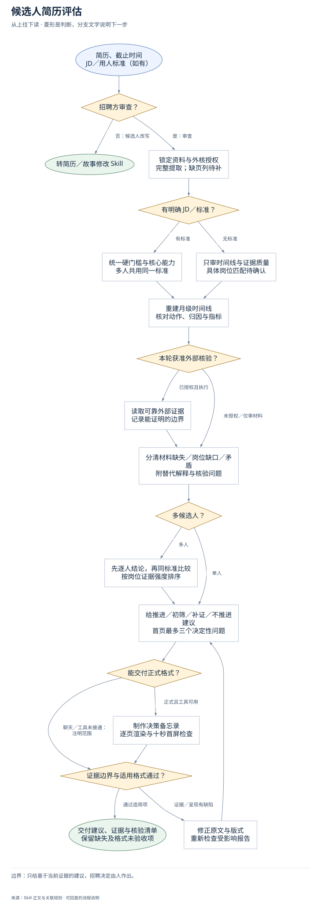
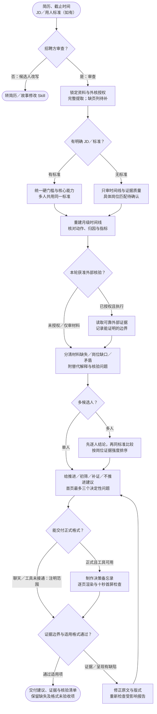

# 候选人简历评估：完整流程

输入：简历与版本；岗位 JD 或筛选标准；资料截止时间。

交付：决策与证据摘要；时间线与岗位匹配；面试核验问题。

[按原尺寸打开完整流程图](../assets/workflow.svg)

## 按什么顺序做

### 先分流并锁定口径

招聘方审查与候选人改写分流；无 JD 不猜岗位标准，多人保持同一标准。

### 完整读取并重建证据

记录缺页、日期精度、学历与经历，区分硬门槛未提及和明确不满足。

### 核对贡献、风险与建议

检查个人动作、指标、归因和矛盾，保留替代解释、核验问题与改变结论的新证据。

### 按格式验收后交付

先给招聘动作和最多三个决定性问题；正式报告逐页渲染，不可用格式如实保留未验收。

## 验收

- 判断连回简历原文
- 未提及不等于不具备
- 正式报告逐页渲染

只给基于当前证据的建议，招聘决定由人作出。

## 对应规则

- [SKILL.md](../SKILL.md)
- [references/audit-framework.md](audit-framework.md)
- [references/decision-first-report-design.md](decision-first-report-design.md)
- [references/output-contract.md](output-contract.md)

可编辑的流程源码

