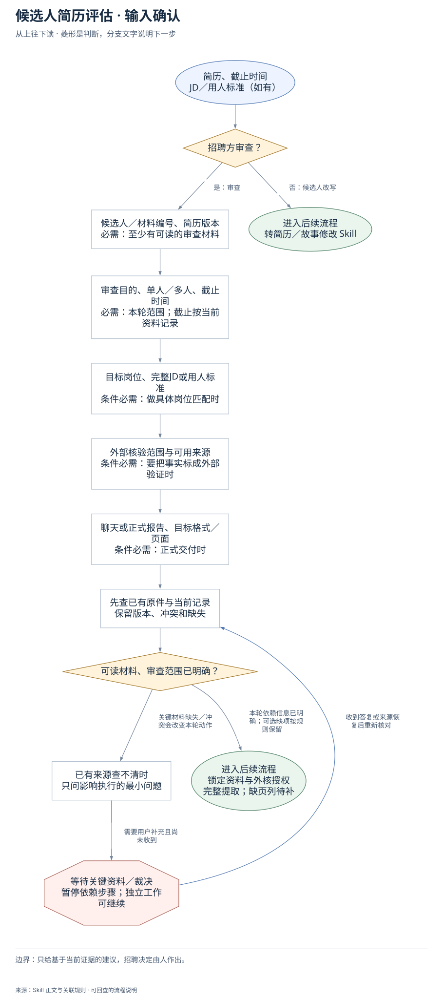

# 候选人简历评估：完整执行流程

先核对具体输入；已有材料能查明的直接读取，关键缺失或冲突才补充确认。沿完整图查看后续处理、失败去向与交付。

交付：决策与证据摘要；时间线与岗位匹配；面试核验问题。

## 执行前确认哪些信息

| 输入 | 何时需要 | 从哪里取得 | 缺失或冲突怎么处理 |
| --- | --- | --- | --- |
| 候选人／材料编号、简历版本 | 必需：至少有可读的审查材料 | 完整读原件、页数和正文身份；匿名材料用稳定编号，不擅自猜正式姓名 | 缺页标明覆盖；无可读内容仅列补件问题，不下候选人结论 |
| 审查目的、单人／多人、截止时间 | 必需：本轮范围；截止按当前资料记录 | 从当前请求确认是招聘审查还是候选人改写，登记计算截止月份 | 目的不清先问；不能因只有年份补精确日期或精确Gap |
| 目标岗位、完整JD或用人标准 | 条件必需：做具体岗位匹配时 | 读取用户提供JD，区分合法硬门槛、核心能力和加分项 | 无JD仍审完整性、时间线与证据；岗位匹配保持待确认 |
| 外部核验范围与可用来源 | 条件必需：要把事实标成外部验证时 | 复用当前授权和公开证据范围；没有授权只审所给材料 | 不外核不阻塞材料审查；不把简历自述标为已验真 |
| 聊天或正式报告、目标格式／页面 | 条件必需：正式交付时 | 明确Word/PDF/飞书等载体及当前创建、渲染和回读能力 | 正式能力缺失交付已完成的审查和明确格式缺口，不冒称正式报告验收 |

## 输入确认、补齐与返回

[按原尺寸查看输入确认图](../assets/input-confirmation.svg)

## 完整执行、判断与异常去向

[按原尺寸打开完整执行图](../assets/workflow.svg)

## 每一步具体怎么做

### 输入与范围

**1. 简历、截止时间；JD／用人标准（如有）**

接收本轮简历原件、可用JD/用人标准和资料截止时间；分别登记文件版本与读取覆盖，后续只评价这些材料能支持的结论。

下一步：招聘方审查？。

依据：[SKILL.md](../SKILL.md) 中的“Required Workflow”。

**2. 招聘方审查？**

先判断用户是替招聘方审查，还是替候选人改写。审查进入本流程；要改简历则连同原件、目标和范围转对应修改Skill。

下一步：“否：候选人改写” → 转简历／故事修改 Skill；“是：审查” → 候选人／材料编号、简历版本；必需：至少有可读的审查材料。

依据：[SKILL.md](../SKILL.md) 中的“Route the Request”。

**3. 候选人／材料编号、简历版本；必需：至少有可读的审查材料**

完整读原件、页数和正文身份；匿名材料用稳定编号，不擅自猜正式姓名；缺失处理：缺页标明覆盖；无可读内容仅列补件问题，不下候选人结论

下一步：审查目的、单人／多人、截止时间；必需：本轮范围；截止按当前资料记录。

依据：[SKILL.md](../SKILL.md) 中的“首次使用与交付能力”。

**4. 审查目的、单人／多人、截止时间；必需：本轮范围；截止按当前资料记录**

从当前请求确认是招聘审查还是候选人改写，登记计算截止月份；缺失处理：目的不清先问；不能因只有年份补精确日期或精确Gap

下一步：目标岗位、完整JD或用人标准；条件必需：做具体岗位匹配时。

依据：[SKILL.md](../SKILL.md) 中的“Required Workflow”。

**5. 目标岗位、完整JD或用人标准；条件必需：做具体岗位匹配时**

读取用户提供JD，区分合法硬门槛、核心能力和加分项；缺失处理：无JD仍审完整性、时间线与证据；岗位匹配保持待确认

下一步：外部核验范围与可用来源；条件必需：要把事实标成外部验证时。

依据：[SKILL.md](../SKILL.md) 中的“Route the Request”。

**6. 外部核验范围与可用来源；条件必需：要把事实标成外部验证时**

复用当前授权和公开证据范围；没有授权只审所给材料；缺失处理：不外核不阻塞材料审查；不把简历自述标为已验真

下一步：聊天或正式报告、目标格式／页面；条件必需：正式交付时。

依据：[SKILL.md](../SKILL.md) 中的“Non-Negotiable Boundaries”。

**7. 聊天或正式报告、目标格式／页面；条件必需：正式交付时**

明确Word/PDF/飞书等载体及当前创建、渲染和回读能力；缺失处理：正式能力缺失交付已完成的审查和明确格式缺口，不冒称正式报告验收

下一步：先查已有原件与当前记录；保留版本、冲突和缺失。

依据：[SKILL.md](../SKILL.md) 中的“首次使用与交付能力”。

**8. 先查已有原件与当前记录；保留版本、冲突和缺失**

对照原件、页码、版本与日期精度，保留不同说法；缺页不是不合格证据。

下一步：可读材料、审查范围已明确？。

依据：[SKILL.md](../SKILL.md) 中的“Required Workflow”。

**9. 可读材料、审查范围已明确？**

只对会影响本轮判断的必需材料设门。无JD、匿名姓名、未授权外核都各有合法只读分支。

下一步：“本轮依赖信息已明确；可选缺项按规则保留” → 锁定资料与外核授权；完整提取；缺页列待补；“关键材料缺失／冲突会改变本轮动作” → 已有来源查不清时；只问影响执行的最小问题。

依据：[SKILL.md](../SKILL.md) 中的“Required Workflow”。

**10. 已有来源查不清时；只问影响执行的最小问题**

只询问缺失原件、评估标准或影响判断的冲突；能审的时间线与证据继续。

下一步：“需要用户补充且尚未收到” → 等待关键资料／裁决；暂停依赖步骤；独立工作可继续。

依据：[SKILL.md](../SKILL.md) 中的“Required Workflow”。

**11. 等待关键资料／裁决；暂停依赖步骤；独立工作可继续**

没有收到补充前，不假定问题已解决；保留已确认材料和具体缺口。只询问缺失原件、评估标准或影响判断的冲突；能审的时间线与证据继续。

下一步：“收到答复或来源恢复后重新核对” → 先查已有原件与当前记录；保留版本、冲突和缺失。

依据：[SKILL.md](../SKILL.md) 中的“Required Workflow”。

### 执行与核验

**1. 锁定资料与外核授权；完整提取；缺页列待补**

完整提取正文和日期，列明已读页、缺页、JD是否存在和外部核验范围。缺页不支持淘汰；未获准外核仅审材料自述。

下一步：有明确 JD／标准？。

依据：[SKILL.md](../SKILL.md) 中的“首次使用与交付能力”。

**2. 有明确 JD／标准？**

核对是否有真实JD或明确用人标准。有则形成统一量尺；无则保留岗位匹配待确认，继续时间线和证据质量审查。

下一步：“有标准” → 统一硬门槛与核心能力；多人共用同一标准；“无标准” → 只审时间线与证据质量；具体岗位匹配待确认。

依据：[SKILL.md](../SKILL.md) 中的“Route the Request”。

**3. 统一硬门槛与核心能力；多人共用同一标准**

把JD拆成合法硬门槛、核心能力和加分项，每项记录简历证据或未提及。多人比较使用同一标准，加分项不能变隐性硬门槛。

下一步：重建月级时间线；核对动作、归因与指标。

依据：[references/audit-framework.md](audit-framework.md) 中的“6. 岗位匹配与建议”。

**4. 只审时间线与证据质量；具体岗位匹配待确认**

在没有JD时只审履历完整性、时间线、贡献和结果证据；报告具体岗位匹配未评估，不自行补一个理想候选人标准。

下一步：重建月级时间线；核对动作、归因与指标。

依据：[SKILL.md](../SKILL.md) 中的“Route the Request”。

**5. 重建月级时间线；核对动作、归因与指标**

按原文精度覆盖教育、全职、实习、项目、Gap和重叠；月级日期可计算约月数，仅年份不补月份，“至今”保留原文并声明截止月份。

下一步：分开学历／专业与能力；硬门槛三态；日期按原文精度。

依据：[SKILL.md](../SKILL.md) 中的“Required Workflow”。

**6. 本轮获准外部核验？**

只有本轮已有外核授权且读取了可靠外部证据才进入外核。未授权或工具不可用走材料审查，不把未知写成不可信。

下一步：“已授权且执行” → 读取可靠外部证据；记录能证明的边界；“未授权／仅审材料” → 分清材料缺失／岗位缺口／矛盾；附替代解释与核验问题。

依据：[SKILL.md](../SKILL.md) 中的“Non-Negotiable Boundaries”。

**7. 读取可靠外部证据；记录能证明的边界**

记录可靠外部来源、访问时间和它能证明的具体学历/公司/职位事实；来源只证明公开背景时，不扩大成个人贡献或业绩已验真。

下一步：分清材料缺失／岗位缺口／矛盾；附替代解释与核验问题。

依据：[references/audit-framework.md](audit-framework.md) 中的“1. 证据标签”。

**8. 分清材料缺失／岗位缺口／矛盾；附替代解释与核验问题**

分别登记材料缺失、岗位证据缺口与真实矛盾；风险条目保留原文、类型、影响、替代解释、核验问题和可接受证据。

下一步：选择推进／定向初筛／补材料；明确不推进门槛与新证据条件。

依据：[references/audit-framework.md](audit-framework.md) 中的“5. 水分风险”。

**9. 多候选人？**

单人直接形成建议；多人先各自完成单人结论，再沿同一岗位标准比较。候选人数不能成为降低单人证据门的理由。

下一步：“多人” → 先逐人结论，再同标准比较；按岗位证据强度排序；“单人” → 给推进／初筛／补证／不推进建议；首页最多三个决定性问题。

依据：[references/output-contract.md](output-contract.md) 中的“多候选人比较”。

**10. 先逐人结论，再同标准比较；按岗位证据强度排序**

逐人保留学历、时间线、JD证据和待核验项，再按岗位证据强弱比较。若证据无法区分，给出需要补的区分性证据，不强造排名。

下一步：给推进／初筛／补证／不推进建议；首页最多三个决定性问题。

依据：[references/output-contract.md](output-contract.md) 中的“多候选人比较”。

**11. 给推进／初筛／补证／不推进建议；首页最多三个决定性问题**

在首页给推进/定向初筛/补材料/不推进建议、下一动作及信心等级；最多三个决定性问题按影响排序，说明什么新证据会改变建议。

下一步：按决定影响排序核验问题；主问、追问、支持与削弱信号。

依据：[references/output-contract.md](output-contract.md) 中的“1. 十秒决策页”。

**12. 修正原文与版式；重新检查受影响报告**

根据具体错误修改证据论断或源文档排版；版面变动后重新渲染并检查受影响报告，不能只凭文件可打开结清缺陷。

下一步：给推进／初筛／补证／不推进建议；首页最多三个决定性问题。

依据：[references/decision-first-report-design.md](decision-first-report-design.md) 中的“8. 逐页验收”。

**13. 分开学历／专业与能力；硬门槛三态；日期按原文精度**

核教育层级、专业、证书和月级时间线；未提及标待确认，Gap不推断私生活或稳定性。

下一步：逐段核本人动作与职责；数字基线、周期、归因和复杂度。

依据：[references/audit-framework.md](audit-framework.md) 中的“2. 学历与专业”。

**14. 逐段核本人动作与职责；数字基线、周期、归因和复杂度**

为每段工作项目记录问题、角色、动作、边界、复杂度、结果及可验证产物；相关经验与独立承担时长分开。

下一步：本轮获准外部核验？。

依据：[references/audit-framework.md](audit-framework.md) 中的“4. 逐段经历与项目”。

**15. 选择推进／定向初筛／补材料；明确不推进门槛与新证据条件**

建议连回合法明确硬门槛或核心证据，不因学校、Gap、短任期自动淘汰；附高/中/低信心与可改变结论的证据。

下一步：多候选人？。

依据：[references/audit-framework.md](audit-framework.md) 中的“6. 岗位匹配与建议”。

**16. 按决定影响排序核验问题；主问、追问、支持与削弱信号**

每题指出要验证的简历声称、主问题、一层追问和可接受证据；首页只保留最多3个决定性问题。

下一步：能交付正式格式？。

依据：[references/output-contract.md](output-contract.md) 中的“9. 面试核验清单”。

### 交付与验收

**1. 转简历／故事修改 Skill**

把候选人原简历、明确JD、用户要求修改的要点交给简历/故事修改Skill；本次不以招聘审查结论代替改文。

这是本路径的交付或转交结果。

依据：[SKILL.md](../SKILL.md) 中的“Route the Request”。

**2. 能交付正式格式？**

区分聊天审查与正式报告。正式Word/PDF/飞书必须有相应制作和渲染能力；能力未接通则交已完成审查，并保留格式未验收项。

下一步：“正式且工具可用” → 制作决策备忘录；逐页渲染与十秒首屏检查；“聊天／工具未接通：注明范围” → 证据边界与适用格式通过？。

依据：[SKILL.md](../SKILL.md) 中的“首次使用与交付能力”。

**3. 制作决策备忘录；逐页渲染与十秒首屏检查**

把内容排成决策备忘录：首页十秒内能懂建议、原因和下一步，证据明细随后。逐页查看断表、孤行、密集表格、稀疏尾页和空白页。

下一步：证据边界与适用格式通过？。

依据：[references/decision-first-report-design.md](decision-first-report-design.md) 中的“8. 逐页验收”。

**4. 证据边界与适用格式通过？**

核完整时间线、每个风险的原文/替代解释/问题、未提及项状态和建议边界；正式格式另核首屏与全部渲染页，任一失败回原稿修正。

下一步：“通过适用项” → 交付建议、证据与核验清单；保留缺失及格式未验收项；“证据／呈现有缺陷” → 修正原文与版式；重新检查受影响报告。

依据：[SKILL.md](../SKILL.md) 中的“Completion Gate”。

**5. 交付建议、证据与核验清单；保留缺失及格式未验收项**

交付当前招聘建议、决定性证据、完整时间线与面试核验清单；同时说明材料截止、未核验事实及正式格式是否完成实际检查。

这是本路径的交付或转交结果。

依据：[SKILL.md](../SKILL.md) 中的“Completion Gate”。

## 验收

- 判断连回简历原文
- 未提及不等于不具备
- 正式报告逐页渲染

只给基于当前证据的建议，招聘决定由人作出。

## 对应规则

- [SKILL.md](../SKILL.md)
- [references/audit-framework.md](audit-framework.md)
- [references/decision-first-report-design.md](decision-first-report-design.md)
- [references/output-contract.md](output-contract.md)

```mermaid
flowchart TB
  in(["简历、截止时间<br/>JD／用人标准（如有）"])
  route{"招聘方审查？"}
  rewrite(["转简历／故事修改 Skill"])
  scope["锁定资料与外核授权<br/>完整提取；缺页列待补"]
  jd{"有明确 JD／标准？"}
  rubric["统一硬门槛与核心能力<br/>多人共用同一标准"]
  nojd["只审时间线与证据质量<br/>具体岗位匹配待确认"]
  timeline["重建月级时间线<br/>核对动作、归因与指标"]
  external{"本轮获准外部核验？"}
  verify["读取可靠外部证据<br/>记录能证明的边界"]
  risk["分清材料缺失／岗位缺口／矛盾<br/>附替代解释与核验问题"]
  multi{"多候选人？"}
  compare["先逐人结论，再同标准比较<br/>按岗位证据强度排序"]
  report["给推进／初筛／补证／不推进建议<br/>首页最多三个决定性问题"]
  format{"能交付正式格式？"}
  render["制作决策备忘录<br/>逐页渲染与十秒首屏检查"]
  gate{"证据边界与适用格式通过？"}
  revise["修正原文与版式<br/>重新检查受影响报告"]
  out(["交付建议、证据与核验清单<br/>保留缺失及格式未验收项"])
  i_material["候选人／材料编号、简历版本<br/>必需：至少有可读的审查材料"]
  i_purpose["审查目的、单人／多人、截止时间<br/>必需：本轮范围；截止按当前资料记录"]
  i_role["目标岗位、完整JD或用人标准<br/>条件必需：做具体岗位匹配时"]
  i_external["外部核验范围与可用来源<br/>条件必需：要把事实标成外部验证时"]
  i_format["聊天或正式报告、目标格式／页面<br/>条件必需：正式交付时"]
  i_existing["先查已有原件与当前记录<br/>保留版本、冲突和缺失"]
  i_ready{"可读材料、审查范围已明确？"}
  i_clarify["已有来源查不清时<br/>只问影响执行的最小问题"]
  i_wait(["等待关键资料／裁决<br/>暂停依赖步骤；独立工作可继续"])
  education["分开学历／专业与能力<br/>硬门槛三态；日期按原文精度"]
  claims["逐段核本人动作与职责<br/>数字基线、周期、归因和复杂度"]
  risk_action["选择推进／定向初筛／补材料<br/>明确不推进门槛与新证据条件"]
  interview_checks["按决定影响排序核验问题<br/>主问、追问、支持与削弱信号"]
  in --> route
  route -->|"否：候选人改写"| rewrite
  scope --> jd
  jd -->|"有标准"| rubric
  jd -->|"无标准"| nojd
  rubric --> timeline
  nojd --> timeline
  external -->|"已授权且执行"| verify
  external -->|"未授权／仅审材料"| risk
  verify --> risk
  multi -->|"多人"| compare
  multi -->|"单人"| report
  compare --> report
  format -->|"正式且工具可用"| render
  format -->|"聊天／工具未接通：注明范围"| gate
  render --> gate
  gate -->|"通过适用项"| out
  gate -->|"证据／呈现有缺陷"| revise
  revise --> report
  route -->|"是：审查"| i_material
  i_material --> i_purpose
  i_purpose --> i_role
  i_role --> i_external
  i_external --> i_format
  i_format --> i_existing
  i_existing --> i_ready
  i_ready -->|"本轮依赖信息已明确；可选缺项按规则保留"| scope
  i_ready -->|"关键材料缺失／冲突会改变本轮动作"| i_clarify
  i_clarify -->|"需要用户补充且尚未收到"| i_wait
  i_wait -->|"收到答复或来源恢复后重新核对"| i_existing
  timeline --> education
  education --> claims
  claims --> external
  risk --> risk_action
  risk_action --> multi
  report --> interview_checks
  interview_checks --> format
```

可编辑的完整流程源码

