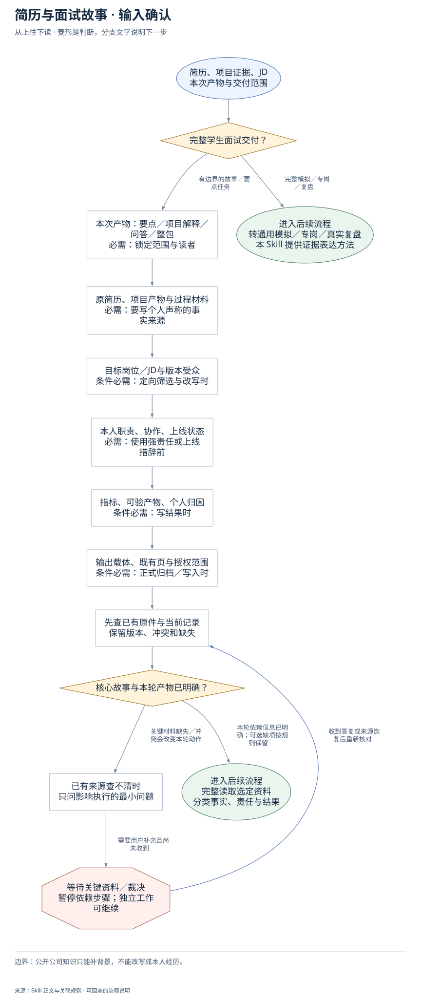
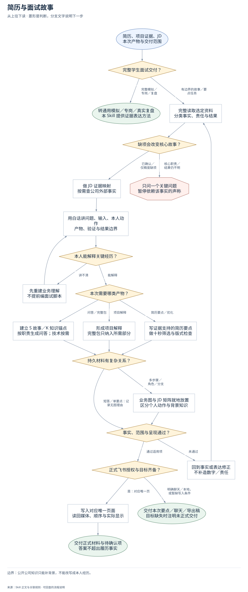
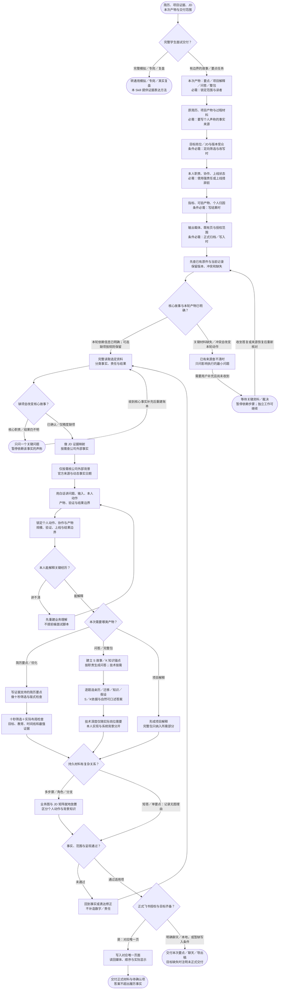

# 简历与面试故事：完整执行流程

先核对具体输入；已有材料能查明的直接读取，关键缺失或冲突才补充确认。沿完整图查看后续处理、失败去向与交付。

交付：证据与 JD 映射；简历要点或项目故事；面试问答与事实缺口。

## 执行前确认哪些信息

| 输入 | 何时需要 | 从哪里取得 | 缺失或冲突怎么处理 |
| --- | --- | --- | --- |
| 本次产物：要点／项目解释／问答／整包 | 必需：锁定范围与读者 | 从当前请求选主产物；完整模拟、专岗、真实复盘交给对应主Skill | 只问会导致产物不同的问题；不把要点改写扩大成整套问答 |
| 原简历、项目产物与过程材料 | 必需：要写个人声称的事实来源 | 完整读选定原件，拆公司岗位、时间、问题、输入、动作、流程、结果和工具 | 关键原件不可读时暂停依赖声称，已确认事实可先整理 |
| 目标岗位／JD与版本受众 | 条件必需：定向筛选与改写时 | 一版对应一个目标岗位；无JD先读已确认岗位族或声明筛选假设 | 岗位角度会改变核心故事时只问一个问题，不默认为通用技术受众 |
| 本人职责、协作、上线状态 | 必需：使用强责任或上线措辞前 | 核对是接需求、开发模块、测试还是主导；区分提案、原型、内部验证与生产 | 未确认保守写；核心责任不明先问，不把导师或团队结果认作个人 |
| 指标、可验产物、个人归因 | 条件必需：写结果时 | 有数字核基线、变化、单位、周期和本人贡献；无数字找真实产物/覆盖/流程变化 | 没有量化不编百分比；核心结果不明先问，非关键精度保守处理 |
| 输出载体、既有页与授权范围 | 条件必需：正式归档／写入时 | 先查当前学生对应唯一页与当前写入授权，记录保护内容 | 飞书目标缺失只暂停写入，继续授权内证据工作和可读稿 |

## 输入确认、补齐与返回

[按原尺寸查看输入确认图](../assets/input-confirmation.svg)

## 完整执行、判断与异常去向

[按原尺寸打开完整执行图](../assets/workflow.svg)

## 每一步具体怎么做

### 输入与范围

**1. 简历、项目证据、JD；本次产物与交付范围**

接收用户选定简历、项目过程证据和目标JD，先确认本次只要要点、白话解释、问答还是完整包，避免把短任务扩成整册。

下一步：完整学生面试交付？。

依据：[SKILL.md](../SKILL.md) 中的“1. Normalize the Input”。

**2. 完整学生面试交付？**

完整通用模拟、公司/JD专岗或真实面后复盘交给对应主Skill；仅有边界的简历要点、故事或项目解释由本流程继续。

下一步：“完整模拟／专岗／复盘” → 转通用模拟／专岗／真实复盘；本 Skill 提供证据表达方法；“有边界的故事／要点任务” → 本次产物：要点／项目解释／问答／整包；必需：锁定范围与读者。

依据：[SKILL.md](../SKILL.md) 中的“Route the Request”。

**3. 本次产物：要点／项目解释／问答／整包；必需：锁定范围与读者**

从当前请求选主产物；完整模拟、专岗、真实复盘交给对应主Skill；缺失处理：只问会导致产物不同的问题；不把要点改写扩大成整套问答

下一步：原简历、项目产物与过程材料；必需：要写个人声称的事实来源。

依据：[SKILL.md](../SKILL.md) 中的“Route the Request”。

**4. 原简历、项目产物与过程材料；必需：要写个人声称的事实来源**

完整读选定原件，拆公司岗位、时间、问题、输入、动作、流程、结果和工具；缺失处理：关键原件不可读时暂停依赖声称，已确认事实可先整理

下一步：目标岗位／JD与版本受众；条件必需：定向筛选与改写时。

依据：[references/intake-and-evidence.md](intake-and-evidence.md) 中的“1. Normalize the Material”。

**5. 目标岗位／JD与版本受众；条件必需：定向筛选与改写时**

一版对应一个目标岗位；无JD先读已确认岗位族或声明筛选假设；缺失处理：岗位角度会改变核心故事时只问一个问题，不默认为通用技术受众

下一步：本人职责、协作、上线状态；必需：使用强责任或上线措辞前。

依据：[SKILL.md](../SKILL.md) 中的“2. Turn the JD Into a Screening Rubric”。

**6. 本人职责、协作、上线状态；必需：使用强责任或上线措辞前**

核对是接需求、开发模块、测试还是主导；区分提案、原型、内部验证与生产；缺失处理：未确认保守写；核心责任不明先问，不把导师或团队结果认作个人

下一步：指标、可验产物、个人归因；条件必需：写结果时。

依据：[references/intake-and-evidence.md](intake-and-evidence.md) 中的“3. Calibrate Ownership”。

**7. 指标、可验产物、个人归因；条件必需：写结果时**

有数字核基线、变化、单位、周期和本人贡献；无数字找真实产物/覆盖/流程变化；缺失处理：没有量化不编百分比；核心结果不明先问，非关键精度保守处理

下一步：输出载体、既有页与授权范围；条件必需：正式归档／写入时。

依据：[references/resume-framework.md](resume-framework.md) 中的“9. State Results Without Fabricating Numbers”。

**8. 输出载体、既有页与授权范围；条件必需：正式归档／写入时**

先查当前学生对应唯一页与当前写入授权，记录保护内容；缺失处理：飞书目标缺失只暂停写入，继续授权内证据工作和可读稿

下一步：先查已有原件与当前记录；保留版本、冲突和缺失。

依据：[SKILL.md](../SKILL.md) 中的“Setup and dependencies”。

**9. 先查已有原件与当前记录；保留版本、冲突和缺失**

不同版本与导师示例分开登记，推断、知识补充、外部背景不能升级为本人事实。

下一步：核心故事与本轮产物已明确？。

依据：[SKILL.md](../SKILL.md) 中的“Mandatory Evidence Gate”。

**10. 核心故事与本轮产物已明确？**

确认所有个人动作和结果均有来源；只有改变职责、核心结果、功能存在、上线状态或目标角度的缺口才阻塞依赖成稿。

下一步：“本轮依赖信息已明确；可选缺项按规则保留” → 完整读取选定资料；分类事实、责任与结果；“关键材料缺失／冲突会改变本轮动作” → 已有来源查不清时；只问影响执行的最小问题。

依据：[SKILL.md](../SKILL.md) 中的“Mandatory Evidence Gate”。

**11. 已有来源查不清时；只问影响执行的最小问题**

优先查原件，仍缺核心事实只问一个聚焦问题；不因修辞细节暂停。

下一步：“需要用户补充且尚未收到” → 等待关键资料／裁决；暂停依赖步骤；独立工作可继续。

依据：[SKILL.md](../SKILL.md) 中的“Mandatory Evidence Gate”。

**12. 等待关键资料／裁决；暂停依赖步骤；独立工作可继续**

没有收到补充前，不假定问题已解决；保留已确认材料和具体缺口。优先查原件，仍缺核心事实只问一个聚焦问题；不因修辞细节暂停。

下一步：“收到答复或来源恢复后重新核对” → 先查已有原件与当前记录；保留版本、冲突和缺失。

依据：[SKILL.md](../SKILL.md) 中的“Mandatory Evidence Gate”。

### 执行与核验

**1. 完整读取选定资料；分类事实、责任与结果**

把公司/JD、背景、输入、个人动作、流程、产物、结果、工具与协作拆开；每个拟写声称关联原文，区分已确认、外核、推断、知识和待补。

下一步：缺项会改变核心故事？。

依据：[SKILL.md](../SKILL.md) 中的“Mandatory Evidence Gate”。

**2. 缺项会改变核心故事？**

判断缺项是否改变本人责任、核心结果、功能存在、上线状态或目标角度。影响核心故事则先补证；只影响精度可保守写并列待核。

下一步：“核心职责／结果仍不明” → 只问一个关键问题；暂停依赖该事实的声称；“已确认／仅精度缺项” → 做 JD 证据映射；按需查公司外部事实。

依据：[references/intake-and-evidence.md](intake-and-evidence.md) 中的“6. Decide Whether to Ask”。

**3. 做 JD 证据映射；按需查公司外部事实**

从JD提取职责、能力信号、业务情境和明确限制；每个高优先级要求找最强已确认经历，没有直接经验保留可迁移点或真实缺口。

下一步：仅按需核公司外部背景；官方来源与动态事实日期。

依据：[SKILL.md](../SKILL.md) 中的“2. Turn the JD Into a Screening Rubric”。

**4. 用白话讲问题、输入、本人动作；产物、验证与结果边界**

先用一句话及一个真实或明确教学案例讲谁遇到问题、什么输入、本人改什么、产出给谁、怎样控制质量和有什么结果，再解释术语。

下一步：锁定个人动作、协作与产物；规模、验证、上线与结果边界。

依据：[SKILL.md](../SKILL.md) 中的“4. Build the Business Model First”。

**5. 本人能解释关键经历？**

检查学生能否用白话解释核心经历、本人动作、实现深度和结果边界；不能解释则先讲清项目，不直接产出可背诵面试脚本。

下一步：“讲不清” → 先重建业务理解；不提前编面试脚本；“能解释” → 本次需要哪类产物？。

依据：[SKILL.md](../SKILL.md) 中的“5. Lock the Story”。

**6. 先重建业务理解；不提前编面试脚本**

按原材料重建项目的问题—输入—动作—产物—验证链，说明团队背景与本人负责部分；确认可理解后再回故事与问答。

下一步：用白话讲问题、输入、本人动作；产物、验证与结果边界。

依据：[SKILL.md](../SKILL.md) 中的“5. Lock the Story”。

**7. 本次需要哪类产物？**

依本次请求选择简历要点、项目解释或履历问答；完整包也只装入本次需要的内容，技术深度由岗位和已确认职责决定。

下一步：“简历要点／优化” → 写证据支持的简历要点；做十秒筛选与版式检查；“问答／完整包” → 建立 S 故事／K 知识锚点；按职责生成问答；技术按需；“项目解释” → 形成项目解释；完整包只纳入所需部分。

依据：[SKILL.md](../SKILL.md) 中的“Route the Request”。

**8. 写证据支持的简历要点；做十秒筛选与版式检查**

用隐含STAR写3–5条或实际所需更少要点，保留问题、个人动作、质量控制、协作与结果；工具只作执行证据，没有数字用真实产物结果。

下一步：十秒筛选＋实际布局检查；目标、教育、时间线和最强证据。

依据：[SKILL.md](../SKILL.md) 中的“6. Draft the Resume”。

**9. 形成项目解释；完整包只纳入所需部分**

把项目的业务定义、用户、输入输出、个人贡献、验证和结果边界组织成连贯解释；完整包按要求加入公司/JD/简历/技术/问答/待补事实。

下一步：持久材料有复杂关系？。

依据：[SKILL.md](../SKILL.md) 中的“10. Package the Output”。

**10. 业务图与 JD 矩阵就地放置；区分个人动作与背景知识**

项目证据流紧邻业务白话，JD矩阵紧邻筛选标准；个人动作仅用已确认事实，团队背景、外部资料、推断、知识与待补结果分清。

下一步：事实、范围与呈现通过？。

依据：[references/visual-story-contract.md](visual-story-contract.md) 中的“Placement and acceptance”。

**11. 仅按需核公司外部背景；官方来源与动态事实日期**

公司背景被要求时查主体、业务、行业与当前情境；不从公开资料补出内部团队或本人责任。

下一步：用白话讲问题、输入、本人动作；产物、验证与结果边界。

依据：[SKILL.md](../SKILL.md) 中的“3. Research Only What Is External”。

**12. 锁定个人动作、协作与产物；规模、验证、上线与结果边界**

以原始证据校准每个动词，确认学生能解释问题、输入、处理、输出、质量控制和下游价值，再进入脚本。

下一步：本人能解释关键经历？。

依据：[SKILL.md](../SKILL.md) 中的“5. Lock the Story”。

**13. 十秒筛选＋实际布局检查；目标、教育、时间线和最强证据**

检查JD高优先级证据、版面层级、密度、拼写与分页；早期简历可读前提下一页，不靠难读字号压页数。

下一步：持久材料有复杂关系？。

依据：[SKILL.md](../SKILL.md) 中的“7. Run the Screening and Layout Pass”。

**14. 逐题选亲历／迁移／知识／假设；S／K依据与自然可口述答案**

亲历引S、迁移引S+K、岗位知识引K、场景推演引K并说明假设；答案不增加比简历更强的责任。

下一步：技术深度仅随实际岗位需要；本人实现与系统背景分开。

依据：[references/interview-framework.md](interview-framework.md) 中的“4. Build Reusable Story and Knowledge Anchors”。

**15. 技术深度仅随实际岗位需要；本人实现与系统背景分开**

技术岗位或被明确要求时讲输入、转换、输出、控制、异常、验证与取舍；非技术故事不硬塞技术百科。

下一步：持久材料有复杂关系？。

依据：[SKILL.md](../SKILL.md) 中的“8. Add the Technical Model”。

### 交付与验收

**1. 转通用模拟／专岗／真实复盘；本 Skill 提供证据表达方法**

连同学生原件、已确认目标和本次交付范围转通用模拟/专岗/复盘Skill；本Skill仅提供证据和表达方法，不复制创建第二套页面。

这是本路径的交付或转交结果。

依据：[SKILL.md](../SKILL.md) 中的“Route the Request”。

**2. 只问一个关键问题；暂停依赖该事实的声称**

只问能决定核心声称的一项关键问题；等待时整理其他已确认事实，收到答复后重建账本，不用推断填入个人履历。

下一步：“收到核心事实补充后重建账本” → 完整读取选定资料；分类事实、责任与结果。

依据：[SKILL.md](../SKILL.md) 中的“Mandatory Evidence Gate”。

**3. 建立 S 故事／K 知识锚点；按职责生成问答；技术按需**

先建已确认S故事与K岗位知识，再从简历声称生成业务问题；每题有意图、表达类型、依据、答题框架、自然参考答案和待个性化边界。

下一步：逐题选亲历／迁移／知识／假设；S／K依据与自然可口述答案。

依据：[SKILL.md](../SKILL.md) 中的“9. Generate Interview Preparation”。

**4. 持久材料有复杂关系？**

完整持久材料存在依赖步骤、角色、组件、判断或验证路径时配关系图；仅单条要点或简单短答保持文字，并写具体无图理由。

下一步：“多步骤／角色／分支” → 业务图与 JD 矩阵就地放置；区分个人动作与背景知识；“短答／单要点：记录无图理由” → 事实、范围与呈现通过？。

依据：[SKILL.md](../SKILL.md) 中的“Route the Request”。

**5. 事实、范围与呈现通过？**

逐声称核来源、责任动词、JD覆盖、结果口径和问答一致性；检查业务可理解、十秒筛选和相应版面，复杂包还需媒体与逐页渲染。

下一步：“未通过” → 回到事实或表达修正；不补造数字／责任；“通过适用项” → 正式飞书授权与目标齐备？。

依据：[SKILL.md](../SKILL.md) 中的“Quality Gate”。

**6. 回到事实或表达修正；不补造数字／责任**

定位虚构数字、过强责任、讲不清业务或答案越界的具体句子，回原件和账本校准；先修证据或理解再改表达，不以润色掩盖缺口。

下一步：完整读取选定资料；分类事实、责任与结果。

依据：[references/intake-and-evidence.md](intake-and-evidence.md) 中的“7. RED Baseline Checks”。

**7. 正式飞书授权与目标齐备？**

正式归档沿用当前授权与对应唯一学生页；已有明确范围不重复询问。目标或访问能力不足只暂停该写入，保留已完成证据工作和正文。

下一步：“是：对应唯一页” → 写入对应唯一页面；读回媒体、顺序与实际显示；“明确聊天／本地，或暂缺写入条件” → 交付本次要点／聊天／导出稿；目标缺失时注明未正式交付。

依据：[SKILL.md](../SKILL.md) 中的“Setup and dependencies”。

**8. 写入对应唯一页面；读回媒体、顺序与实际显示**

写到该产物对应的唯一页，按章节局部更新并保护已有内容；复杂图正文就地显示，写后回读正文、媒体顺序与实际阅读效果。

下一步：交付正式材料与待确认项；答案不超出履历事实。

依据：[references/interview-framework.md](interview-framework.md) 中的“7. Full Package Routing”。

**9. 交付本次要点／聊天／导出稿；目标缺失时注明未正式交付**

按用户明确指定交付要点、聊天或导出稿；正式飞书目标缺失时可交可审阅内容，并明确这部分还没有完成正式页面交付。

这是本路径的交付或转交结果。

依据：[SKILL.md](../SKILL.md) 中的“Setup and dependencies”。

**10. 交付正式材料与待确认项；答案不超出履历事实**

交付本次正式材料和最少必要待确认项，给已验证页面/文件入口；个人动作、结果与答案均不能比原始证据或最终简历更强。

这是本路径的交付或转交结果。

依据：[SKILL.md](../SKILL.md) 中的“Quality Gate”。

## 验收

- 不编造个人贡献
- 业务解释可口述
- 交付只覆盖本次范围

公开公司知识只能补背景，不能改写成本人经历。

## 对应规则

- [SKILL.md](../SKILL.md)
- [references/intake-and-evidence.md](intake-and-evidence.md)
- [references/interview-framework.md](interview-framework.md)
- [references/resume-framework.md](resume-framework.md)
- [references/visual-story-contract.md](visual-story-contract.md)

可编辑的完整流程源码

