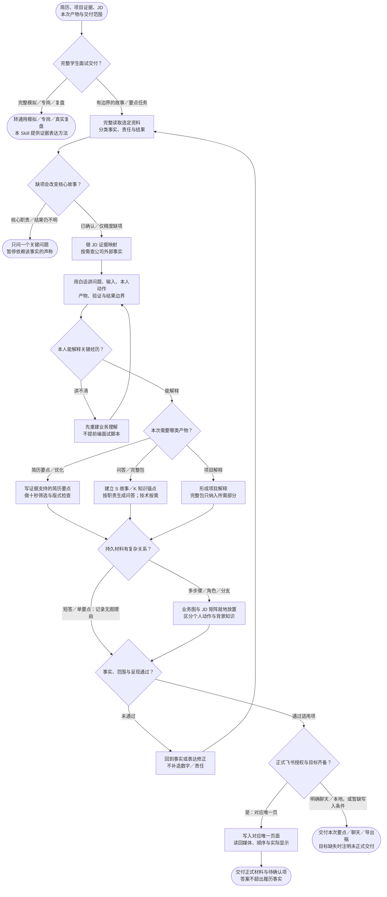

# 简历与面试故事：完整流程

输入：简历与项目证据；目标岗位或 JD；指定交付范围。

交付：证据与 JD 映射；简历要点或项目故事；面试问答与事实缺口。

[按原尺寸打开完整流程图](../assets/workflow.svg)

## 按什么顺序做

### 按交付范围分流

完整模拟、专岗和真实复盘由专用 Skill 主导，本入口处理有边界的故事与表达。

### 先证据与业务，再锁故事

建立事实账本与 JD 映射，关键缺项先追问；项目讲不清时先教学。

### 按请求生成表达

简历要点、项目解释、技术模型及面试问答只生成本次所需部分。

### 按复杂度及交付面验收

复杂持久材料就地配图；简短要点不强配图，正式材料按已授权目标写入并回读。

## 验收

- 不编造个人贡献
- 业务解释可口述
- 交付只覆盖本次范围

公开公司知识只能补背景，不能改写成本人经历。

## 对应规则

- [SKILL.md](../SKILL.md)
- [references/intake-and-evidence.md](intake-and-evidence.md)
- [references/interview-framework.md](interview-framework.md)
- [references/resume-framework.md](resume-framework.md)
- [references/visual-story-contract.md](visual-story-contract.md)

可编辑的流程源码

