# 选岗：先查共享库，原表追加，新岗回收：完整流程

输入：最新简历、求职模式、方向与城市；该生原投递表及全量个人历史；既有共享岗位库与本次数量目标。

交付：原投递表末尾的合格新增岗位；共享岗位库的去重新增／复用记录；四类质检结果、实际写入与回收缺口。

## 先看总览

学生原投递表保存个人筛选与进度，共享岗位库保存公共岗位事实。先查库，核验后计算缺口；补搜的新岗位再次核验，公共事实再回收到同一个库。

[按原尺寸查看总览](../assets/workflow-overview.svg)

## 完整分支与异常去向

[按原尺寸打开完整流程图](../assets/workflow.svg)

## 按什么顺序做

### 锁定原表和历史

定位唯一原投递表，完整读取历史与人工字段，沿用原默认视图。

### 先查共享岗位库

按当前画像检索共享库，池内每个岗位仍重新核验。

### 缺口才补搜

用真实合格数计算缺口；外搜新岗同样核验与终审。

### 原表只追加合格岗

统一去重、累计限额与证据检查，只向原表末尾写 ready。

### 新岗回收同一共享库

只回收去重后的公共事实，个人信息与投递状态不入库。

### 两端分别验收

分别核对个人表实写、共享库回收与剩余缺口，异常保留续接。

## 两个写入对象分别保留什么

| 对象 | 写入内容 | 保留与检查 |
| --- | --- | --- |
| 学生原投递表 | 本次 ready 合格岗位及个人匹配依据 | 末尾去重追加；原默认视图、人工审核、投递/面试状态、备注和权限保留；个人公司限额累计历史 |
| 同一个共享岗位库 | 公司、岗位、公共入口、JD、城市等通用事实 | 全库去重；新线索可待复核；不带学生姓名、简历、评价或投递状态；不套个人每公司限额 |

池内复用数、外搜数、个人表实写数、共享库新增/重复数和剩余缺口分别报告。池不可读不等于空池；回收失败不等于已完成；超时先读回实际结果再续接。

候选分为 ready（合格）、pending（待核验）、blocked（访问受阻）和 rejected（明确不符、重复或超个人限额等）。学生原表只接收 ready。共享库可保留标明待复核的公共线索；该生不适合某岗，不等于该岗对所有人都无效。已明确截止或下架的岗位不能因回收重新开放。

## 验收

- 先检索共享库，再按核验后的缺口外搜
- 池内线索按当前简历 × 完整 JD 重审
- 个人原表去重追加、默认视图及人工字段保留
- 个人公司限额包含历史；共享库不套该限额
- 公共事实回收与学生状态隔离，两端分别回读

学生表只收 ready；共享库可收待复核公共线索。选岗不等于投递，回收失败必须保留未完成项。

## 对应规则

- [SKILL.md](../SKILL.md)
- [references/feishu-delivery.md](feishu-delivery.md)
- [references/final-review.md](final-review.md)
- [references/shared-pool.md](shared-pool.md)

```mermaid
flowchart TB
  request(["本次简历、求职条件<br/>新增／累计目标"])
  original["定位该生原页面、原表<br/>核对本人身份与权限"]
  table_found{"已有唯一原表？"}
  may_create{"确无原表<br/>且已获创建授权？"}
  create["按原标准建空表<br/>挂回该生唯一目录"]
  target_blocked(["保留本地准备<br/>暂停目标不明的写入"])
  history["全量读个人历史、字段<br/>保留人工状态与默认视图"]
  pool_access{"共享岗位库<br/>配置、身份、读取正常？"}
  pool_gap{"明确记录未检索原因<br/>本轮允许先外搜？"}
  pool_hold(["先补齐共享库条件<br/>不冒称空池或另建替代池"])
  pool_search["先全量读取共享岗位库<br/>按当前模式、城市、方向筛选"]
  review["重新核验在招与入口<br/>当前简历 × 完整 JD 终审"]
  quality["四类分流＋全历史去重<br/>核公司累计限额与证据时效"]
  enough{"合格数量达标<br/>或可查来源已尽？"}
  external["只按剩余缺口补搜<br/>官网／招聘平台新岗位"]
  discoveries[("本轮外搜新发现<br/>保留公共来源与岗位身份")]
  ready{"有 ready 合格岗位？"}
  append_student["仅在原表末尾追加 ready<br/>沿用原默认视图，串行分批"]
  student_readback["全量回读：新增与历史<br/>人工字段、权限、链接、附件"]
  student_ok{"原表写入与阅读<br/>均已验收？"}
  student_issue["记录实际已写／未完成<br/>超时先回读，避免重复追加"]
  new_jobs{"有本轮外搜新岗位？"}
  pool_auth{"已有共享库维护授权<br/>且当前可访问？"}
  clean["只提取岗位公共事实<br/>清除个人参数、学生评价与状态"]
  pool_plan["与共享库全量去重<br/>重复关联原记录，新岗待复核"]
  append_pool["新岗追加至原共享岗位库<br/>不覆盖旧记录或套个人公司限额"]
  pool_ok{"回收逐字段读回<br/>一致且无重复？"}
  pool_issue["保留待回收／异常清单<br/>下次先重读去重再续接"]
  report["分别汇报：池内复用、外搜<br/>个人表实写、库回收与剩余缺口"]
  done(["原投递表新增结果<br/>共享库新增／复用结果＋未完成项"])
  request --> original
  original --> table_found
  table_found -->|"是"| history
  table_found -->|"否"| may_create
  may_create -->|"已确认不存在且允许"| create
  may_create -->|"条件不成立"| target_blocked
  create --> history
  history --> pool_access
  pool_access -->|"正常"| pool_search
  pool_access -->|"缺配置／受阻"| pool_gap
  pool_gap -->|"已明确允许"| external
  pool_gap -->|"未允许"| pool_hold
  pool_search --> review
  review --> quality
  quality --> enough
  enough -->|"达标／来源已尽"| ready
  enough -->|"仍有缺口与可查来源"| external
  external --> discoveries
  discoveries -->|"同样重新核验"| review
  ready -->|"有"| append_student
  ready -->|"没有：报告缺口"| new_jobs
  append_student --> student_readback
  student_readback --> student_ok
  student_ok -->|"通过"| new_jobs
  student_ok -->|"未通过／超时"| student_issue
  student_issue -->|"保留未完成状态"| new_jobs
  new_jobs -->|"没有"| report
  new_jobs -->|"有"| pool_auth
  pool_auth -->|"范围明确且可写"| clean
  pool_auth -->|"未授权／受阻"| pool_issue
  clean --> pool_plan
  pool_plan -->|"只追加去重后的新岗"| append_pool
  append_pool --> pool_ok
  pool_ok -->|"一致"| report
  pool_ok -->|"失败／部分成功"| pool_issue
  pool_issue -->|"回收仍未完成"| report
  report --> done
```

可编辑的流程源码

