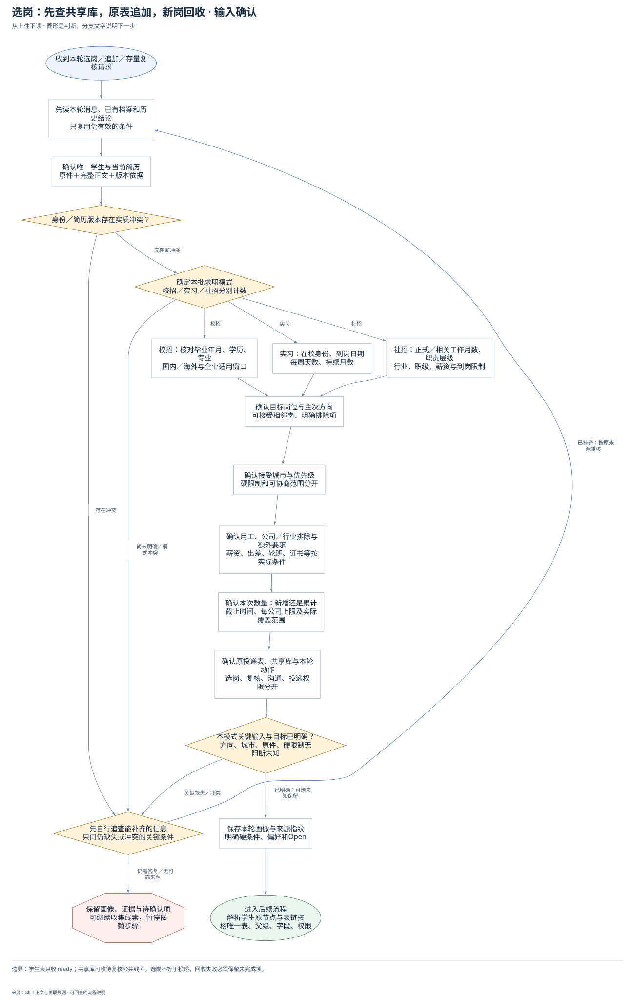
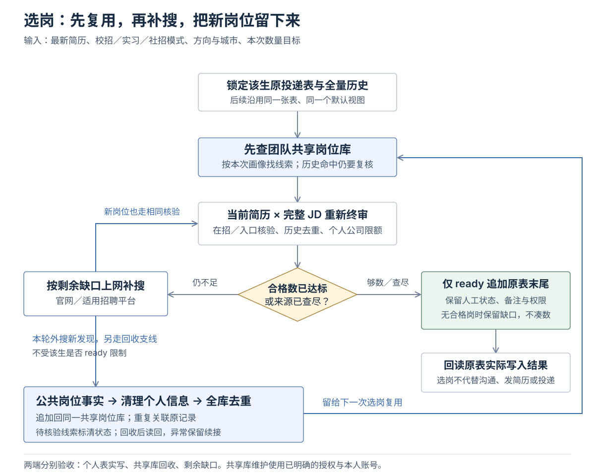
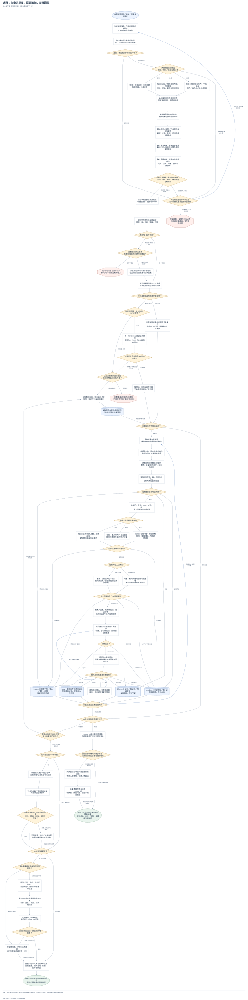

# 选岗：先查共享库，原表追加，新岗回收：完整执行流程

先核对具体输入；已有材料能查明的直接读取，关键缺失或冲突才补充确认。沿完整图查看后续处理、失败去向与交付。

交付：原投递表末尾的合格新增岗位；共享岗位库的去重新增／复用记录；四类质检结果、实际写入与回收缺口。

## 执行前确认哪些信息

| 输入 | 何时需要 | 从哪里取得 | 缺失或冲突怎么处理 |
| --- | --- | --- | --- |
| 唯一学生身份 | 必需 | 读取当前消息、学生档案和原表归属；核对正式姓名 | 身份不唯一时停止依赖该身份的写入并解决具体冲突 |
| 当前原简历与完整正文 | 形成ready必需 | 确认本次使用版本，完整读原件与正文，记录路径与SHA-256 | 缺原件、提取不完整或版本冲突时先补齐；可留线索但不终审通过 |
| 校招／实习／社招模式 | 每个新批次必需 | 依据本轮明确意图记录search_mode；多模式分批 | 不得隐式按校招或按毕业时间推断；先明确模式 |
| 目标岗位、方向及相邻岗范围 | 必需 | 读本轮意向与仍有效的职业规划，记录主次与可接受岗位 | 不能按其他学生模板选方向；仍不清楚时先问影响筛选的关键方向 |
| 接受城市与优先级 | 必需 | 读本轮要求与仍有效意向，记录城市清单、排序和可协商范围 | 不得默认全国或为凑数增加城市；不明范围先确认 |
| 用工类型 | 必需 | 区分全职与实习，记录employment_types并与模式一致 | 不能用实习补齐全职或把实习年限算正式工作 |
| 学历与专业 | 校招/实习必需；社招按JD要求核对 | 从当前原简历和证据读取，不从学校标签推断 | 未提不等于不限；影响门槛时待核验 |
| 毕业年月与国内/海外口径 | 校招必需；其他模式仅JD限制时 | 读真实毕业年月，保留日期精度和适用范围 | 不把届别标签当通用窗口，不猜具体日 |
| 在校/毕业状态 | 实习必需 | 原简历、当前学籍或用户事实；不从年龄推断 | 状态未知则无法通过实习在校门槛，保留待核验 |
| 到岗日、每周出勤与持续月数 | 实习必需 | 读取本轮可用时间，保留课程考试等真实限制 | 未知不填0，不把不满足排期的岗位算合格 |
| 已证实正式/相关工作月数与职责深度 | 社招必需 | 完整工作时间线去重计月，实习和项目单列 | 不把并行区间叠加或折算实习；证据不足保留待核验 |
| 行业、目标职级、到岗与其他限制 | 按本轮要求及JD条件 | 分别记录硬限制和偏好；职级看职责与决策范围 | 未指定不编造；岗位存在必备条件时逐项核对 |
| 薪资底线与比较口径 | 仅用户设定硬底线时阻断 | 保留币种、月/年、薪数及固定/浮动，不把奖金算保底 | 未设底线不猜；有硬底线而岗位薪资未知/口径不同则待核验 |
| 排除公司、行业及其他本人要求 | 有明确要求时必需遵守 | 读取本轮排除项和仍有效决定，不继承别人的规则 | 没有排除项不发明；与意向冲突时只问冲突点 |
| 新增/累计数量目标与交付时限 | 按当前请求明确口径 | 核对本次新增还是累计，人数/岗位数不混用；保留明确截止时间 | 未定具体数量先说明可核验范围，不以待核验/重复补数 |
| 个人每公司上限 | 默认3，累计历史；用户明确另定才改 | 读取全量个人历史；自定义时质检和预裁剪脚本使用同一个N | 旧超额保留不动，该公司停止继续新增；共享库不套个人限额 |
| 原投递表、默认视图与全量历史 | 追加必需；读取失败不等于不存在 | 查该生节点、正文/索引外链并解析唯一表和父链 | 歧义先解决；权限/分页失败不得新建替代；确无表且已有创建授权才创建 |
| 同一个共享岗位库入口与访问能力 | 默认先检索；例外需本轮明确允许 | 读成员私有配置，独立核对pool owner和本人访问 | 未配置/受阻报告尚未检索；补配置或已明确允许后外搜，不当空池 |
| 本轮动作范围与平台限制 | 必需；已有授权沿用 | 区分追加、存量只读复核、沟通、发简历和提交申请；核对本人CLI | 不把选岗扩展成沟通/代投；只读复核不修改业务表 |

## 输入确认、补齐与返回

[按原尺寸查看输入确认图](../assets/input-confirmation.svg)

## 选岗如何在个人表与共享库之间运行

先查共享库并重新核验，按剩余缺口补搜。合格岗位写入学生原表；新发现的公共事实单独去重回收同一共享库。两个写入对象分别验收。

## 完整执行、判断与异常去向

[按原尺寸打开完整执行图](../assets/workflow.svg)

## 每一步具体怎么做

### 输入与范围

**1. 收到本轮选岗／追加／存量复核请求**

收到本轮选岗／追加／存量复核请求

下一步：先读本轮消息、已有档案和历史结论；只复用仍有效的条件。

依据：[SKILL.md](../SKILL.md) 中的“执行流程”。

**2. 先读本轮消息、已有档案和历史结论；只复用仍有效的条件**

先检索已提供简历、学生已有入口与本轮限制；记录资料时间。历史结论只作线索，不让用户重新提供已可查明的信息。

下一步：确认唯一学生与当前简历；原件＋完整正文＋版本依据。

依据：[SKILL.md](../SKILL.md) 中的“先锁定输入与历史”。

**3. 确认唯一学生与当前简历；原件＋完整正文＋版本依据**

核对正式姓名、学生归属和当前确认原简历；完整提取后看原件排除丢页、漏表和混人，记录原件/正文路径与指纹；文件修改时间不能独自决定最新版。

下一步：身份／简历版本存在实质冲突？。

依据：[SKILL.md](../SKILL.md) 中的“先锁定输入与历史”。

**4. 身份／简历版本存在实质冲突？**

身份／简历版本存在实质冲突？

下一步：“存在冲突” → 先自行追查能补齐的信息；只问仍缺失或冲突的关键条件；“无阻断冲突” → 确定本批求职模式；校招／实习／社招分别计数。

依据：[SKILL.md](../SKILL.md) 中的“先锁定输入与历史”。

**5. 确定本批求职模式；校招／实习／社招分别计数**

依据本轮用户意图确定模式；多个模式分批记录画像、条件及合格数量，个人历史和公司限额共用。不能用毕业久、学历高等推断模式。

下一步：“校招” → 校招：核对毕业年月、学历、专业；国内／海外与企业适用窗口；“实习” → 实习：在校身份、到岗日期；每周天数、持续月数；“社招” → 社招：正式／相关工作月数、职责层级；行业、职级、薪资与到岗限制；“尚未明确／模式冲突” → 先自行追查能补齐的信息；只问仍缺失或冲突的关键条件。

依据：[references/search-modes.md](search-modes.md) 中的“一份主Skill，三种画像”。

**6. 校招：核对毕业年月、学历、专业；国内／海外与企业适用窗口**

记录本人真实毕业年月、学历专业与国内/海外身份；只按每个企业官方窗口判资格，不能只把“27届”作为所有公司的统一窗口。

下一步：确认目标岗位与主次方向；可接受相邻岗、明确排除项。

依据：[references/search-modes.md](search-modes.md) 中的“校招 campus”。

**7. 实习：在校身份、到岗日期；每周天数、持续月数**

记录 student_status 与 start_date/days_per_week/months；未知不填0。课程考试等已知限制同时保留；JD明确毕业窗口才比较毕业年月。

下一步：确认目标岗位与主次方向；可接受相邻岗、明确排除项。

依据：[references/search-modes.md](search-modes.md) 中的“实习 internship”。

**8. 社招：正式／相关工作月数、职责层级；行业、职级、薪资与到岗限制**

按实际时间线去重计正式/相关工作月数，实习与项目单列；区分职级、行业、薪资和到岗限制中哪些由本人设为硬条件。导师带教实践正常作为能力证据。

下一步：确认目标岗位与主次方向；可接受相邻岗、明确排除项。

依据：[references/search-modes.md](search-modes.md) 中的“社招 experienced”。

**9. 确认目标岗位与主次方向；可接受相邻岗、明确排除项**

把本轮想做的职能和岗位具体化为 target_roles、方向优先级与召回词；相邻岗仅在本轮允许范围内保留。不能继承别的学生方向或禁选名单；标题相似仍需读JD职责。

下一步：确认接受城市与优先级；硬限制和可协商范围分开。

依据：[references/campus-matching.md](campus-matching.md) 中的“资格与匹配分开”。

**10. 确认接受城市与优先级；硬限制和可协商范围分开**

记录 cities 接受城市数组，保留城市排序和明确的工作地点限制；不限城市必须有本轮依据，不能默认全国可投。不能因数量不足擅自加城市。

下一步：确认用工、公司／行业排除与额外要求；薪资、出差、轮班、证书等按实际条件。

依据：[SKILL.md](../SKILL.md) 中的“先锁定输入与历史”。

**11. 确认用工、公司／行业排除与额外要求；薪资、出差、轮班、证书等按实际条件**

保留本轮用工类型、排除公司/行业及已提出的其他条件，区分必需和偏好；薪资底线仅在用户设定时记录，保留币种、月/年及固定/浮动口径。未提出的偏好不编造。

下一步：确认本次数量：新增还是累计；截止时间、每公司上限及实际覆盖范围。

依据：[references/search-modes.md](search-modes.md) 中的“社招 experienced”。

**12. 确认本次数量：新增还是累计；截止时间、每公司上限及实际覆盖范围**

确认目标是本轮新增还是累计总数，以及明确的交付时限/平台范围；默认个人每公司最多3岗累计历史，只有用户明确改变时统一传相同参数。未给目标不擅自凑固定数量，先完成可核验范围并说明。

下一步：确认原投递表、共享库与本轮动作；选岗、复核、沟通、投递权限分开。

依据：[references/shared-pool.md](shared-pool.md) 中的“每次选岗”。

**13. 确认原投递表、共享库与本轮动作；选岗、复核、沟通、投递权限分开**

从已有学生入口定位原表和成员私有配置中的共享库；检查本轮是追加还是只读复核。账号归属、已知权限静默核对，既有授权不重问；选岗授权不等于发送消息/简历或提交申请。

下一步：本模式关键输入与目标已明确？；方向、城市、原件、硬限制无阻断未知。

依据：[SKILL.md](../SKILL.md) 中的“范围与本人身份”。

**14. 本模式关键输入与目标已明确？；方向、城市、原件、硬限制无阻断未知**

检查身份/当前原件、显式模式、target_roles、cities、employment_types及本模式必需字段是否可读且一致；可选项未提供不阻塞，关键缺失不得生成ready。

下一步：“关键缺失／冲突” → 先自行追查能补齐的信息；只问仍缺失或冲突的关键条件；“已明确；可选未知保留” → 保存本轮画像与来源指纹；明确硬条件、偏好和Open。

依据：[references/quality-contract.md](quality-contract.md) 中的“输入”。

**15. 先自行追查能补齐的信息；只问仍缺失或冲突的关键条件**

列明冲突原文和会影响的动作，集中提出必要问题。已查明且仍有效的条件不再问；有答复/可查证补齐后返回重新核对，未答只暂停依赖该条件的判断或写入。

下一步：“已补齐：按原来源重核” → 先读本轮消息、已有档案和历史结论；只复用仍有效的条件；“仍需答复／无可靠来源” → 保留画像、证据与待确认项；可继续收集线索，暂停依赖步骤。

依据：[SKILL.md](../SKILL.md) 中的“先锁定输入与历史”。

**16. 保留画像、证据与待确认项；可继续收集线索，暂停依赖步骤**

不以缺失信息推断条件已通过，不混入ready、不写不明目标；其他不依赖未知的信息读取与线索准备可继续。补齐后沿原入口续接，避免重建档案。

此处保留待办与证据，补齐后接续原任务。

依据：[references/quality-contract.md](quality-contract.md) 中的“输入”。

**17. 保存本轮画像与来源指纹；明确硬条件、偏好和Open**

形成 profile.json，保留已确认字段、实际来源和模式条件；原件与完整正文均非空可读。后续原件/意向/规则变化必须重审，不能只替换hash。

下一步：解析学生原节点与表链接；核唯一表、父级、字段、权限。

依据：[references/quality-contract.md](quality-contract.md) 中的“输入”。

### 执行与核验

**1. 解析学生原节点与表链接；核唯一表、父级、字段、权限**

读学生子节点及正文/索引外部Base；同一Base多链接只算一表。保存字段、视图、owner/creator、权限、修订号和全历史；不因列表无命中或403推断缺表。

下一步：原表唯一且可访问？。

依据：[references/feishu-delivery.md](feishu-delivery.md) 中的“对象、字段与保护基线”。

**2. 原表唯一且可访问？**

原表唯一且可访问？

下一步：“唯一可访问” → 分页读全量历史和人工字段；标准化岗位键与累计公司数；“未找到／受阻／歧义” → 完整确认确无原表；且本轮或既有创建授权覆盖？。

依据：[references/feishu-delivery.md](feishu-delivery.md) 中的“对象、字段与保护基线”。

**3. 完整确认确无原表；且本轮或既有创建授权覆盖？**

完整确认确无原表；且本轮或既有创建授权覆盖？

下一步：“已确认不存在且允许” → 只复制已核对的原标准结构；在正确学生目录建零记录空表；“条件不成立” → 保留本地准备与具体缺口；暂停目标不明或无权的写入。

依据：[references/feishu-delivery.md](feishu-delivery.md) 中的“学生没有投递表：原格式建到本人学生目录”。

**4. 只复制已核对的原标准结构；在正确学生目录建零记录空表**

优先指定/空白标准模板；异常历史模板只按字段白名单重建结构。不得复制其他学生内容、人员默认值、协作者或自动化；创建超时先查实际结果。验收唯一父链、本人owner、字段视图、零业务记录和原授权权限。

下一步：分页读全量历史和人工字段；标准化岗位键与累计公司数。

依据：[references/feishu-delivery.md](feishu-delivery.md) 中的“学生没有投递表：原格式建到本人学生目录”。

**5. 保留本地准备与具体缺口；暂停目标不明或无权的写入**

保留本地准备与具体缺口；暂停目标不明或无权的写入

此处保留待办与证据，补齐后接续原任务。

依据：[references/feishu-delivery.md](feishu-delivery.md) 中的“本人身份”。

**6. 分页读全量历史和人工字段；标准化岗位键与累计公司数**

不能只读默认视图可见记录；保留record_id、原字段、已审核/已投递/笔面试、附件与备注。历史重复/超额只报告，不删除；首次新表显式提供空历史。

下一步：本轮是新增选岗还是存量复核？。

依据：[SKILL.md](../SKILL.md) 中的“执行流程”。

**7. 共享库配置、本人访问、owner正常？**

共享库配置、本人访问、owner正常？

下一步：“正常” → 同一revision分页读全共享库；直到has_more=false再核revision；“未配置／异常” → 记录未检索的具体原因；本轮已明确允许先外搜？。

依据：[references/shared-pool.md](shared-pool.md) 中的“共享岗位池操作”。

**8. 记录未检索的具体原因；本轮已明确允许先外搜？**

记录未检索的具体原因；本轮已明确允许先外搜？

下一步：“已有明确例外” → 仅按剩余方向／城市缺口外搜；官网、指定平台及适用渠道；“先补条件” → 补配置或访问能力后续接；不得报告空库／新建替代库。

依据：[references/shared-pool.md](shared-pool.md) 中的“共享岗位池操作”。

**9. 补配置或访问能力后续接；不得报告空库／新建替代库**

补配置或访问能力后续接；不得报告空库／新建替代库

此处保留待办与证据，补齐后接续原任务。

依据：[references/shared-pool.md](shared-pool.md) 中的“共享岗位池操作”。

**10. 同一revision分页读全共享库；直到has_more=false再核revision**

保存完整快照与时间；半表/旧快照不称实时全量。revision变化或分页失败先补齐同版快照，不以部分数据计算空池。

下一步：共享库分页完整且revision一致？。

依据：[references/shared-pool.md](shared-pool.md) 中的“每次选岗”。

**11. 按模式、方向与城市召回；无命中再查别名／细分词**

可扩宽召回词但不改变个人门槛，所有命中均是待重验线索；不复用上一位学生的结论，不以库存总数当当前合格数。

下一步：本批实际有待核验候选？。

依据：[references/shared-pool.md](shared-pool.md) 中的“每次选岗”。

**12. 逐条处理本批候选；保留来自池内或外搜的标记**

批内逐条查证，记录候选、公共来源与实际访问时间；进入同一套资格、有效性、入口和独立终审。批处理完成再算当前真实合格数与缺口。

下一步：核招聘主体、租户与岗位身份；稳定ID/URL对全历史去重。

依据：[SKILL.md](../SKILL.md) 中的“执行流程”。

**13. 核招聘主体、租户与岗位身份；稳定ID/URL对全历史去重**

核官方托管/招聘者关系，保留租户和职位ID/SPA业务参数。公司别名必须有证据；多入口同岗合并，不能按不同链接凑数；不删个人历史。

下一步：读取该岗位完整主区域JD；职责、必备/优先条件、城市与用工。

依据：[references/campus-matching.md](campus-matching.md) 中的“招聘主体与唯一岗位”。

**14. 读取该岗位完整主区域JD；职责、必备/优先条件、城市与用工**

不使用搜索摘要、推荐区或通用页脚代替JD；把所有职责/要求纳入矩阵，不把“优先”改成“必须”，未提不自动等于不限。

下一步：实际核对在招、截止与岗位上下文；JS空壳转后台浏览器。

依据：[references/campus-matching.md](campus-matching.md) 中的“资格与匹配分开”。

**15. 实际核对在招、截止与岗位上下文；JS空壳转后台浏览器**

读取真实当前详情/列表条目；记录带时区checked_at、原始正文和截图。HTTP200/online不能独自证明在招，403/429/TLS/验证码不能判下架；中国截止默认上海时区。

下一步：当前岗位是否明确有效？。

依据：[references/campus-matching.md](campus-matching.md) 中的“当前有效性”。

**16. 当前岗位是否明确有效？**

当前岗位是否明确有效？

下一步：“有效” → 核学历、专业、方向、城市、用工；本人限制与JD逐项对照；“明确关闭／截止” → rejected：明确不符／截止／重复／超额；保留原因与证据；“受阻” → blocked：访问／验证码／网络受阻；保存原因，不当下架；“证据不足” → pending：关键未知／需补证；列明缺项，不计合格。

依据：[references/campus-matching.md](campus-matching.md) 中的“当前有效性”。

**17. 核学历、专业、方向、城市、用工；本人限制与JD逐项对照**

每项记录pass/fail/unknown、官方原句和来源；核心职责以学生真实实践为证据。未提专业不等于专业不限，不能用高匹配分抵消硬条件未知。

下一步：按本批模式核专属条件。

依据：[references/campus-matching.md](campus-matching.md) 中的“资格与匹配分开”。

**18. 按本批模式核专属条件**

按本批模式核专属条件

下一步：“校招” → 校招：本人年月 × 企业窗口；核项目适用与国内/海外口径；“实习” → 实习：在校门槛 × 实际排期；到岗、每周天数、月数逐项比较；“社招” → 社招：正式/相关月数、职责/职级；薪资同口径及行业要求。

依据：[references/search-modes.md](search-modes.md) 中的“检查键与终审”。

**19. 校招：本人年月 × 企业窗口；核项目适用与国内/海外口径**

校招：本人年月 × 企业窗口；核项目适用与国内/海外口径

下一步：全部适用硬条件通过？。

依据：[references/campus-matching.md](campus-matching.md) 中的“资格与匹配分开”。

**20. 实习：在校门槛 × 实际排期；到岗、每周天数、月数逐项比较**

实习：在校门槛 × 实际排期；到岗、每周天数、月数逐项比较

下一步：全部适用硬条件通过？。

依据：[references/search-modes.md](search-modes.md) 中的“实习 internship”。

**21. 社招：正式/相关月数、职责/职级；薪资同口径及行业要求**

JD明确允许实践替代时按原文核对；不能擅自加正式年限门槛或把实习折算。硬薪资底线未知或口径不同待核验，部分区间符合真实说明。

下一步：全部适用硬条件通过？。

依据：[references/search-modes.md](search-modes.md) 中的“社招 experienced”。

**22. 全部适用硬条件通过？**

全部适用硬条件通过？

下一步：“全部通过” → 当前岗位入口类型？；“明确不符” → rejected：明确不符／截止／重复／超额；保留原因与证据；“关键未知” → pending：关键未知／需补证；列明缺项，不计合格。

依据：[references/campus-matching.md](campus-matching.md) 中的“资格与匹配分开”。

**23. 当前岗位入口类型？**

当前岗位入口类型？

下一步：“官网／表单” → 表单：实际进入但不提交；核同岗表单／保留岗位的登录/授权页；“招聘者沟通” → 沟通：核同岗启用控件与招聘者；不为证明可用而点击发送。

依据：[references/search-modes.md](search-modes.md) 中的“BOSS与其他招聘平台”。

**24. 表单：实际进入但不提交；核同岗表单／保留岗位的登录/授权页**

记录按钮点击或有据直达、原/新标签页、最终URL、岗位上下文与证据。停在登录/验证码/协议/上传/提交之前；通用首页/登录页不算通过。

下一步：指定范围的入口与证据通过？。

依据：[references/campus-matching.md](campus-matching.md) 中的“表单申请路径”。

**25. 沟通：核同岗启用控件与招聘者；不为证明可用而点击发送**

记录当前招聘者、启用控件、岗位ID、实际文字/时间/截图；保留岗位上下文的登录入口仅证明待登录。未实际沟通/发送不填相应业务状态。

下一步：指定范围的入口与证据通过？。

依据：[references/search-modes.md](search-modes.md) 中的“BOSS与其他招聘平台”。

**26. 指定范围的入口与证据通过？**

指定范围的入口与证据通过？

下一步：“范围内通过” → 按本人匹配、城市优先级、截止排序；核历史去重与个人公司限额；“访问受阻” → blocked：访问／验证码／网络受阻；保存原因，不当下架；“上下文／入口未知” → pending：关键未知／需补证；列明缺项，不计合格；“明确关闭／错岗” → rejected：明确不符／截止／重复／超额；保留原因与证据。

依据：[references/quality-contract.md](quality-contract.md) 中的“观察结构”。

**27. 按本人匹配、城市优先级、截止排序；核历史去重与个人公司限额**

职责与本人实践证据优先，迁移证据注明差距；历史累计最多3岗或已确认N，不跨批重置。池内公共库存不套该限额。

下一步：独立重读本次原简历 × 完整JD；职责、必备/优先项、反对理由全覆盖。

依据：[SKILL.md](../SKILL.md) 中的“执行流程”。

**28. 独立重读本次原简历 × 完整JD；职责、必备/优先项、反对理由全覆盖**

不先看初筛分数/推荐文案；逐条配对原句，列direct/transferable/gap/unknown、阻断Open和来源指纹。必备失败reject，阻断未知conditional，证据充分才recommend；导师带教实践正常计能力。

下一步：终审结论？。

依据：[references/final-review.md](final-review.md) 中的“怎么复核”。

**29. 终审结论？**

终审结论？

下一步：“recommend” → 运行统一离线质检；画像＋标准候选＋全历史＋同一上限；“conditional” → pending：关键未知／需补证；列明缺项，不计合格；“reject” → rejected：明确不符／截止／重复／超额；保留原因与证据。

依据：[references/final-review.md](final-review.md) 中的“怎么复核”。

**30. 运行统一离线质检；画像＋标准候选＋全历史＋同一上限**

核引文/岗位键、原件/正文/JD/画像指纹、真实时间及24小时有效性、累计去重和公司数；脚本不访问网页/鉴定事实，不能手填虚假pass。退出2先修输入，退出1只用ready并报告其余。

下一步：输入契约及本条检查结果？。

依据：[references/quality-contract.md](quality-contract.md) 中的“输出与使用”。

**31. 输入契约及本条检查结果？**

输入契约及本条检查结果？

下一步：“输入错误” → 修标准化输入／补真实证据；原件、意向或JD变更则重审；“ready” → ready：本轮条件与终审通过；保存具体证据、差距和入口边界；“pending” → pending：关键未知／需补证；列明缺项，不计合格；“blocked” → blocked：访问／验证码／网络受阻；保存原因，不当下架；“rejected” → rejected：明确不符／截止／重复／超额；保留原因与证据。

依据：[references/quality-contract.md](quality-contract.md) 中的“输出与使用”。

**32. 修标准化输入／补真实证据；原件、意向或JD变更则重审**

修标准化输入／补真实证据；原件、意向或JD变更则重审

下一步：“修正或重审后重跑” → 独立重读本次原简历 × 完整JD；职责、必备/优先项、反对理由全覆盖。

依据：[references/quality-contract.md](quality-contract.md) 中的“输入”。

**33. ready：本轮条件与终审通过；保存具体证据、差距和入口边界**

ready：本轮条件与终审通过；保存具体证据、差距和入口边界

下一步：本批候选已逐条处理完？。

依据：[SKILL.md](../SKILL.md) 中的“四种结果”。

**34. pending：关键未知／需补证；列明缺项，不计合格**

pending：关键未知／需补证；列明缺项，不计合格

下一步：本批候选已逐条处理完？。

依据：[SKILL.md](../SKILL.md) 中的“四种结果”。

**35. blocked：访问／验证码／网络受阻；保存原因，不当下架**

blocked：访问／验证码／网络受阻；保存原因，不当下架

下一步：本批候选已逐条处理完？。

依据：[SKILL.md](../SKILL.md) 中的“四种结果”。

**36. rejected：明确不符／截止／重复／超额；保留原因与证据**

rejected：明确不符／截止／重复／超额；保留原因与证据

下一步：本批候选已逐条处理完？。

依据：[SKILL.md](../SKILL.md) 中的“四种结果”。

**37. 本批候选已逐条处理完？**

四类结果按岗位键记录，未读候选不算已处理；批内还有项则继续下一条，处理完才计算合格数，重复不重复计数。

下一步：“还有候选：处理下一条” → 逐条处理本批候选；保留来自池内或外搜的标记；“本批处理完” → 本轮处理的是存量复核？。

依据：[SKILL.md](../SKILL.md) 中的“执行流程”。

**38. 真实合格数达本轮口径；或允许来源已查尽？**

真实合格数达本轮口径；或允许来源已查尽？

下一步：“仍有缺口且有允许来源” → 仅按剩余方向／城市缺口外搜；官网、指定平台及适用渠道；“达标／允许来源已尽” → 有可追加的ready子集？。

依据：[references/shared-pool.md](shared-pool.md) 中的“每次选岗”。

**39. 仅按剩余方向／城市缺口外搜；官网、指定平台及适用渠道**

遵守本轮模式、方向、城市与排除限制；不为凑数放宽资格/混模式。保留每个新发现的公共来源，回到同一逐岗核验，而非直接计为合格。

下一步：单独保存本轮外搜新发现；公共岗位事实与来源键。

依据：[references/source-adapters.md](source-adapters.md) 中的“采集适配”。

**40. 单独保存本轮外搜新发现；公共岗位事实与来源键**

单独保存本轮外搜新发现；公共岗位事实与来源键

下一步：“保留真实新发现” → 本批实际有待核验候选？。

依据：[references/shared-pool.md](shared-pool.md) 中的“回收输入和边界”。

**41. 本轮是新增选岗还是存量复核？**

遵守本轮明确范围；存量复核先处理原表record_id集合，不先查池补搜，不因既有共享库维护授权执行本轮只读范围外写入。

下一步：“新增／追加” → 共享库配置、本人访问、owner正常？；“存量复核” → 加载本轮应复核的原表记录集合；保留record_id、原链接和人工字段。

依据：[SKILL.md](../SKILL.md) 中的“时效、证据与存量”。

**42. 加载本轮应复核的原表记录集合；保留record_id、原链接和人工字段**

完整读取获准复核的全量存量，audit模式不把存量当新增重复项；未覆盖记录单列，不能用抽样冒充全量。

下一步：本批实际有待核验候选？。

依据：[SKILL.md](../SKILL.md) 中的“时效、证据与存量”。

**43. 本批实际有待核验候选？**

池内召回、外搜新发现和存量集合都可能为空；空集直接进入数量/范围判断，不虚构一条JD或合格结果。

下一步：“有候选” → 逐条处理本批候选；保留来自池内或外搜的标记；“实际为空” → 本轮处理的是存量复核？。

依据：[SKILL.md](../SKILL.md) 中的“执行流程”。

**44. 本轮处理的是存量复核？**

批内逐条完成或实际空集后，存量路径直达record_id级报告；新增路径才计算缺口、补搜与新岗回收。

下一步：“存量” → record_id级全量问题清单；仅按另有修正授权处理原字段；“新增选岗” → 真实合格数达本轮口径；或允许来源已查尽？。

依据：[SKILL.md](../SKILL.md) 中的“时效、证据与存量”。

**45. 共享库分页完整且revision一致？**

核对同版分页直到has_more=false并再次读revision；不完整或期间变更先重读，无法完成保留访问/并发缺口，不把半表当完整空库。

下一步：“完整同版” → 按模式、方向与城市召回；无命中再查别名／细分词；“不完整／并发变化／受阻” → 记录未检索的具体原因；本轮已明确允许先外搜？。

依据：[references/shared-pool.md](shared-pool.md) 中的“每次选岗”。

### 交付与验收

**1. record_id级全量问题清单；仅按另有修正授权处理原字段**

存量用audit模式，不把存量当待重复新增；默认只报告，获准才局部修正，不删除历史；报告未覆盖/异常数量。

下一步：当前请求明确允许局部修正？；只读限制优先于既有维护授权。

依据：[SKILL.md](../SKILL.md) 中的“时效、证据与存量”。

**2. 有可追加的ready子集？**

有可追加的ready子集？

下一步：“有” → 映射原有真实字段白名单；再核画像/证据未变与未过期；“没有：保留缺口” → 本轮有外搜新发现？。

依据：[references/feishu-delivery.md](feishu-delivery.md) 中的“写入”。

**3. 映射原有真实字段白名单；再核画像/证据未变与未过期**

只从ready.json生成记录，备注/匹配列可读呈现证据与差距；不把说明放URL、不自动加字段或新视图，保留所有人工状态和权限。

下一步：15–25条串行追加原表末尾；每批读回后再继续。

依据：[references/feishu-delivery.md](feishu-delivery.md) 中的“写入”。

**4. 15–25条串行追加原表末尾；每批读回后再继续**

不覆盖整表或人工字段，不新建日期/批次入口。每批保存请求、响应与真实record_id，频控串行退避；超时先查实际写入而非重发。

下一步：全量回读新增、历史与实际阅读；字段、链接、附件、权限均正确？。

依据：[references/feishu-delivery.md](feishu-delivery.md) 中的“写入”。

**5. 全量回读新增、历史与实际阅读；字段、链接、附件、权限均正确？**

全量回读新增、历史与实际阅读；字段、链接、附件、权限均正确？

下一步：“通过” → 本轮有外搜新发现？；“失败／部分成功／未验” → 记录实写／缺口／并发变更；仅重试确认未完成的对象。

依据：[references/feishu-delivery.md](feishu-delivery.md) 中的“独立验收”。

**6. 记录实写／缺口／并发变更；仅重试确认未完成的对象**

业务质检与写入一致性分开；并发人工编辑不回滚。视觉受阻留未验收项，不能把修订号或CLI success当全部完成。

下一步：“保留原表未完成项” → 本轮有外搜新发现？。

依据：[references/feishu-delivery.md](feishu-delivery.md) 中的“独立验收”。

**7. 本轮有外搜新发现？**

本轮有外搜新发现？

下一步：“无新发现” → 分别交付个人表与共享库结果；四类数量、池内复用、外搜、实写与缺口；“有公共新线索” → 原共享库维护授权与写权限可用？。

依据：[references/shared-pool.md](shared-pool.md) 中的“回收输入和边界”。

**8. 原共享库维护授权与写权限可用？**

原共享库维护授权与写权限可用？

下一步：“已有授权且可写” → 仅提取公司、岗位、公共JD与入口；清理候选人/简历/会话/追踪信息；“未授权／受阻” → 保留待回收、冲突与已完成ID；超时先重读再续接同一计划。

依据：[references/shared-pool.md](shared-pool.md) 中的“写入与恢复”。

**9. 仅提取公司、岗位、公共JD与入口；清理候选人/简历/会话/追踪信息**

不回收学生姓名、简历、匹配理由、私评、投递/面试状态；保留岗位ID和租户。无法安全还原公共入口者列异常，不整段复制个人备注。

下一步：重读同一共享库全量存量再去重；新增、重复、冲突、缺字段分开。

依据：[references/shared-pool.md](shared-pool.md) 中的“回收输入和边界”。

**10. 重读同一共享库全量存量再去重；新增、重复、冲突、缺字段分开**

重复关联现有记录不覆盖旧人工字段；缺关键公司/岗位/公共入口或主体冲突先保留异常。共享库不套个人每公司上限，待核验公共线索也可回收但不称当前可投。

下一步：按授权执行原库追加；串行批次与journal记录。

依据：[references/shared-pool.md](shared-pool.md) 中的“写入与恢复”。

**11. 按授权执行原库追加；串行批次与journal记录**

只新增必要公司与岗位，默认dry-run审计划，已有维护授权覆盖后执行。每100条串行按ID逐字段读回，不改旧记录/字段/权限/视图；不刷新核验时间，历史已关闭不重开。

下一步：回收逐字段回读一致且无新增重复？。

依据：[references/shared-pool.md](shared-pool.md) 中的“写入与恢复”。

**12. 回收逐字段回读一致且无新增重复？**

回收逐字段回读一致且无新增重复？

下一步：“通过” → 分别交付个人表与共享库结果；四类数量、池内复用、外搜、实写与缺口；“失败／部分成功” → 保留待回收、冲突与已完成ID；超时先重读再续接同一计划。

依据：[references/shared-pool.md](shared-pool.md) 中的“写入与恢复”。

**13. 保留待回收、冲突与已完成ID；超时先重读再续接同一计划**

回收失败不影响已独立验收的个人表，但不能报告系统全部完成；保留同一journal和未完成键，下次先重读全库去重再续接。

下一步：“保留回收未完成项” → 分别交付个人表与共享库结果；四类数量、池内复用、外搜、实写与缺口。

依据：[references/shared-pool.md](shared-pool.md) 中的“写入与恢复”。

**14. 分别交付个人表与共享库结果；四类数量、池内复用、外搜、实写与缺口**

报告实际修改/只读对象、本地证据、未触碰对象与Open。学生表只收ready，入库不等于可投；已选岗/已沟通/已发简历/已回复/已提交按真实事件分开，不互推。

下一步：原表交付与共享库回收分别验收；留下仍需处理的具体事项。

依据：[SKILL.md](../SKILL.md) 中的“交付与完成口径”。

**15. 原表交付与共享库回收分别验收；留下仍需处理的具体事项**

原表交付与共享库回收分别验收；留下仍需处理的具体事项

这是本路径的交付或转交结果。

依据：[SKILL.md](../SKILL.md) 中的“交付与完成口径”。

**16. 当前请求明确允许局部修正？；只读限制优先于既有维护授权**

只对本轮/会话明确授权的原字段修正；当前要求只读时即使有旧维护授权也不写。删除需另有明确授权，不追加新岗或写共享库。

下一步：“只读／未授权修改” → 交付record_id级存量问题与覆盖结果；实际修改、未改、受阻、未覆盖分别说明；“已明确授权具体字段” → 列原值与拟改值并局部更新原记录；不改人工审核／投递／笔面试。

依据：[SKILL.md](../SKILL.md) 中的“时效、证据与存量”。

**17. 列原值与拟改值并局部更新原记录；不改人工审核／投递／笔面试**

按record_id生成获准字段差异，写前核对实际原值；并发人工修改保留，只处理已授权且无冲突的局部补丁，不删记录、不以主页替代坏链接。

下一步：全量读回修改与未改record_id；核数量、残留问题、历史字段及权限。

依据：[SKILL.md](../SKILL.md) 中的“时效、证据与存量”。

**18. 全量读回修改与未改record_id；核数量、残留问题、历史字段及权限**

逐条比对获准修改，保留未完成/受阻与原始报错；超时先读回实际结果再重试未完成对象，不能把部分通过报全量通过。

下一步：“保留实际结果与未完成项” → 交付record_id级存量问题与覆盖结果；实际修改、未改、受阻、未覆盖分别说明。

依据：[SKILL.md](../SKILL.md) 中的“时效、证据与存量”。

**19. 交付record_id级存量问题与覆盖结果；实际修改、未改、受阻、未覆盖分别说明**

只读复核交可定位问题清单与建议动作；获准修正后另报真实改动及回读证据。不进入新岗补搜、追加或共享库回收链。

这是本路径的交付或转交结果。

依据：[SKILL.md](../SKILL.md) 中的“时效、证据与存量”。

## 两个写入对象分别保留什么

| 对象 | 写入内容 | 保留与检查 |
| --- | --- | --- |
| 学生原投递表 | 本次 ready 合格岗位及个人匹配依据 | 原表末尾去重追加；原默认视图、人工审核、投递/面试状态、备注和权限保留；个人公司限额累计历史 |
| 同一个共享岗位库 | 公司、岗位、公共入口、JD、城市等通用事实 | 全库去重；新线索可待复核；不带学生姓名、简历、评价或投递状态；不套个人每公司限额 |

池内复用、外搜、个人表实写、共享库新增/重复/异常和剩余缺口分别报告。池不可读不等于空池；入池不等于当前可投；回收失败保留未完成项，超时先读回再续接。

## 验收

- 先检索共享库，再按核验后的缺口外搜
- 池内线索按当前简历 × 完整 JD 重审
- 个人原表去重追加、默认视图及人工字段保留
- 个人公司限额包含历史；共享库不套该限额
- 公共事实回收与学生状态隔离，两端分别回读

学生表只收 ready；共享库可收待复核公共线索。选岗不等于投递，回收失败必须保留未完成项。

## 对应规则

- [SKILL.md](../SKILL.md)
- [references/campus-matching.md](campus-matching.md)
- [references/feishu-delivery.md](feishu-delivery.md)
- [references/final-review.md](final-review.md)
- [references/quality-contract.md](quality-contract.md)
- [references/search-modes.md](search-modes.md)
- [references/shared-pool.md](shared-pool.md)
- [references/source-adapters.md](source-adapters.md)

```mermaid
flowchart TB
  request(["收到本轮选岗／追加／存量复核请求"])
  existing["先读本轮消息、已有档案和历史结论<br/>只复用仍有效的条件"]
  person["确认唯一学生与当前简历<br/>原件＋完整正文＋版本依据"]
  resume_conflict{"身份／简历版本存在实质冲突？"}
  mode{"确定本批求职模式<br/>校招／实习／社招分别计数"}
  campus["校招：核对毕业年月、学历、专业<br/>国内／海外与企业适用窗口"]
  internship["实习：在校身份、到岗日期<br/>每周天数、持续月数"]
  experienced["社招：正式／相关工作月数、职责层级<br/>行业、职级、薪资与到岗限制"]
  roles["确认目标岗位与主次方向<br/>可接受相邻岗、明确排除项"]
  cities["确认接受城市与优先级<br/>硬限制和可协商范围分开"]
  constraints["确认用工、公司／行业排除与额外要求<br/>薪资、出差、轮班、证书等按实际条件"]
  quantity["确认本次数量：新增还是累计<br/>截止时间、每公司上限及实际覆盖范围"]
  targets["确认原投递表、共享库与本轮动作<br/>选岗、复核、沟通、投递权限分开"]
  input_gate{"本模式关键输入与目标已明确？<br/>方向、城市、原件、硬限制无阻断未知"}
  clarify{"先自行追查能补齐的信息<br/>只问仍缺失或冲突的关键条件"}
  wait_input(["保留画像、证据与待确认项<br/>可继续收集线索，暂停依赖步骤"])
  freeze["保存本轮画像与来源指纹<br/>明确硬条件、偏好和Open"]
  original["解析学生原节点与表链接<br/>核唯一表、父级、字段、权限"]
  table_found{"原表唯一且可访问？"}
  may_create{"完整确认确无原表<br/>且本轮或既有创建授权覆盖？"}
  create["只复制已核对的原标准结构<br/>在正确学生目录建零记录空表"]
  target_blocked(["保留本地准备与具体缺口<br/>暂停目标不明或无权的写入"])
  history["分页读全量历史和人工字段<br/>标准化岗位键与累计公司数"]
  pool_access{"共享库配置、本人访问、owner正常？"}
  pool_gap{"记录未检索的具体原因<br/>本轮已明确允许先外搜？"}
  pool_hold(["补配置或访问能力后续接<br/>不得报告空库／新建替代库"])
  snapshot["同一revision分页读全共享库<br/>直到has_more=false再核revision"]
  pool_search["按模式、方向与城市召回<br/>无命中再查别名／细分词"]
  candidate_batch["逐条处理本批候选<br/>保留来自池内或外搜的标记"]
  job_key["核招聘主体、租户与岗位身份<br/>稳定ID/URL对全历史去重"]
  jd["读取该岗位完整主区域JD<br/>职责、必备/优先条件、城市与用工"]
  current["实际核对在招、截止与岗位上下文<br/>JS空壳转后台浏览器"]
  availability{"当前岗位是否明确有效？"}
  common["核学历、专业、方向、城市、用工<br/>本人限制与JD逐项对照"]
  mode_checks{"按本批模式核专属条件"}
  grad_check["校招：本人年月 × 企业窗口<br/>核项目适用与国内/海外口径"]
  schedule_check["实习：在校门槛 × 实际排期<br/>到岗、每周天数、月数逐项比较"]
  experience_check["社招：正式/相关月数、职责/职级<br/>薪资同口径及行业要求"]
  hard{"全部适用硬条件通过？"}
  entry_route{"当前岗位入口类型？"}
  form["表单：实际进入但不提交<br/>核同岗表单／保留岗位的登录/授权页"]
  chat["沟通：核同岗启用控件与招聘者<br/>不为证明可用而点击发送"]
  entry_ok{"指定范围的入口与证据通过？"}
  rank["按本人匹配、城市优先级、截止排序<br/>核历史去重与个人公司限额"]
  fresh_review["独立重读本次原简历 × 完整JD<br/>职责、必备/优先项、反对理由全覆盖"]
  review_verdict{"终审结论？"}
  offline["运行统一离线质检<br/>画像＋标准候选＋全历史＋同一上限"]
  offline_ok{"输入契约及本条检查结果？"}
  input_error["修标准化输入／补真实证据<br/>原件、意向或JD变更则重审"]
  ready_result[("ready：本轮条件与终审通过<br/>保存具体证据、差距和入口边界")]
  pending_result[("pending：关键未知／需补证<br/>列明缺项，不计合格")]
  blocked_result[("blocked：访问／验证码／网络受阻<br/>保存原因，不当下架")]
  rejected_result[("rejected：明确不符／截止／重复／超额<br/>保留原因与证据")]
  batch_done{"本批候选已逐条处理完？"}
  enough{"真实合格数达本轮口径<br/>或允许来源已查尽？"}
  external["仅按剩余方向／城市缺口外搜<br/>官网、指定平台及适用渠道"]
  discoveries[("单独保存本轮外搜新发现<br/>公共岗位事实与来源键")]
  audit["record_id级全量问题清单<br/>仅按另有修正授权处理原字段"]
  has_ready{"有可追加的ready子集？"}
  map["映射原有真实字段白名单<br/>再核画像/证据未变与未过期"]
  write["15–25条串行追加原表末尾<br/>每批读回后再继续"]
  student_ok{"全量回读新增、历史与实际阅读<br/>字段、链接、附件、权限均正确？"}
  student_issue["记录实写／缺口／并发变更<br/>仅重试确认未完成的对象"]
  new_jobs{"本轮有外搜新发现？"}
  pool_auth{"原共享库维护授权与写权限可用？"}
  clean["仅提取公司、岗位、公共JD与入口<br/>清理候选人/简历/会话/追踪信息"]
  pool_plan["重读同一共享库全量存量再去重<br/>新增、重复、冲突、缺字段分开"]
  pool_append["按授权执行原库追加<br/>串行批次与journal记录"]
  pool_ok{"回收逐字段回读一致且无新增重复？"}
  pool_issue["保留待回收、冲突与已完成ID<br/>超时先重读再续接同一计划"]
  report["分别交付个人表与共享库结果<br/>四类数量、池内复用、外搜、实写与缺口"]
  done(["原表交付与共享库回收分别验收<br/>留下仍需处理的具体事项"])
  work_action{"本轮是新增选岗还是存量复核？"}
  audit_records["加载本轮应复核的原表记录集合<br/>保留record_id、原链接和人工字段"]
  batch_available{"本批实际有待核验候选？"}
  batch_purpose{"本轮处理的是存量复核？"}
  snapshot_ok{"共享库分页完整且revision一致？"}
  audit_fix_allowed{"当前请求明确允许局部修正？<br/>只读限制优先于既有维护授权"}
  audit_patch["列原值与拟改值并局部更新原记录<br/>不改人工审核／投递／笔面试"]
  audit_readback["全量读回修改与未改record_id<br/>核数量、残留问题、历史字段及权限"]
  audit_report(["交付record_id级存量问题与覆盖结果<br/>实际修改、未改、受阻、未覆盖分别说明"])
  request --> existing
  existing --> person
  person --> resume_conflict
  resume_conflict -->|"存在冲突"| clarify
  resume_conflict -->|"无阻断冲突"| mode
  mode -->|"校招"| campus
  campus --> roles
  mode -->|"实习"| internship
  internship --> roles
  mode -->|"社招"| experienced
  experienced --> roles
  roles --> cities
  cities --> constraints
  constraints --> quantity
  quantity --> targets
  targets --> input_gate
  input_gate -->|"关键缺失／冲突"| clarify
  input_gate -->|"已明确；可选未知保留"| freeze
  clarify -->|"已补齐：按原来源重核"| existing
  clarify -->|"仍需答复／无可靠来源"| wait_input
  freeze --> original
  original --> table_found
  table_found -->|"唯一可访问"| history
  table_found -->|"未找到／受阻／歧义"| may_create
  may_create -->|"已确认不存在且允许"| create
  may_create -->|"条件不成立"| target_blocked
  create --> history
  pool_access -->|"正常"| snapshot
  pool_access -->|"未配置／异常"| pool_gap
  pool_gap -->|"已有明确例外"| external
  pool_gap -->|"先补条件"| pool_hold
  candidate_batch --> job_key
  job_key --> jd
  jd --> current
  current --> availability
  availability -->|"有效"| common
  availability -->|"明确关闭／截止"| rejected_result
  availability -->|"受阻"| blocked_result
  availability -->|"证据不足"| pending_result
  common --> mode_checks
  mode_checks -->|"校招"| grad_check
  grad_check --> hard
  mode_checks -->|"实习"| schedule_check
  schedule_check --> hard
  mode_checks -->|"社招"| experience_check
  experience_check --> hard
  hard -->|"全部通过"| entry_route
  hard -->|"明确不符"| rejected_result
  hard -->|"关键未知"| pending_result
  entry_route -->|"官网／表单"| form
  entry_route -->|"招聘者沟通"| chat
  form --> entry_ok
  chat --> entry_ok
  entry_ok -->|"范围内通过"| rank
  entry_ok -->|"访问受阻"| blocked_result
  entry_ok -->|"上下文／入口未知"| pending_result
  entry_ok -->|"明确关闭／错岗"| rejected_result
  rank --> fresh_review
  fresh_review --> review_verdict
  review_verdict -->|"recommend"| offline
  review_verdict -->|"conditional"| pending_result
  review_verdict -->|"reject"| rejected_result
  offline --> offline_ok
  offline_ok -->|"输入错误"| input_error
  input_error -->|"修正或重审后重跑"| fresh_review
  offline_ok -->|"ready"| ready_result
  offline_ok -->|"pending"| pending_result
  offline_ok -->|"blocked"| blocked_result
  offline_ok -->|"rejected"| rejected_result
  ready_result --> batch_done
  pending_result --> batch_done
  blocked_result --> batch_done
  rejected_result --> batch_done
  batch_done -->|"还有候选：处理下一条"| candidate_batch
  enough -->|"仍有缺口且有允许来源"| external
  external --> discoveries
  has_ready -->|"有"| map
  has_ready -->|"没有：保留缺口"| new_jobs
  map --> write
  write --> student_ok
  student_ok -->|"通过"| new_jobs
  student_ok -->|"失败／部分成功／未验"| student_issue
  student_issue -->|"保留原表未完成项"| new_jobs
  new_jobs -->|"无新发现"| report
  new_jobs -->|"有公共新线索"| pool_auth
  pool_auth -->|"已有授权且可写"| clean
  pool_auth -->|"未授权／受阻"| pool_issue
  clean --> pool_plan
  pool_plan --> pool_append
  pool_append --> pool_ok
  pool_ok -->|"通过"| report
  pool_ok -->|"失败／部分成功"| pool_issue
  pool_issue -->|"保留回收未完成项"| report
  report --> done
  mode -->|"尚未明确／模式冲突"| clarify
  history --> work_action
  work_action -->|"新增／追加"| pool_access
  work_action -->|"存量复核"| audit_records
  audit_records --> batch_available
  snapshot --> snapshot_ok
  snapshot_ok -->|"完整同版"| pool_search
  snapshot_ok -->|"不完整／并发变化／受阻"| pool_gap
  pool_search --> batch_available
  discoveries -->|"保留真实新发现"| batch_available
  batch_available -->|"有候选"| candidate_batch
  batch_available -->|"实际为空"| batch_purpose
  batch_done -->|"本批处理完"| batch_purpose
  batch_purpose -->|"存量"| audit
  batch_purpose -->|"新增选岗"| enough
  enough -->|"达标／允许来源已尽"| has_ready
  audit --> audit_fix_allowed
  audit_fix_allowed -->|"只读／未授权修改"| audit_report
  audit_fix_allowed -->|"已明确授权具体字段"| audit_patch
  audit_patch --> audit_readback
  audit_readback -->|"保留实际结果与未完成项"| audit_report
```

可编辑的完整流程源码

