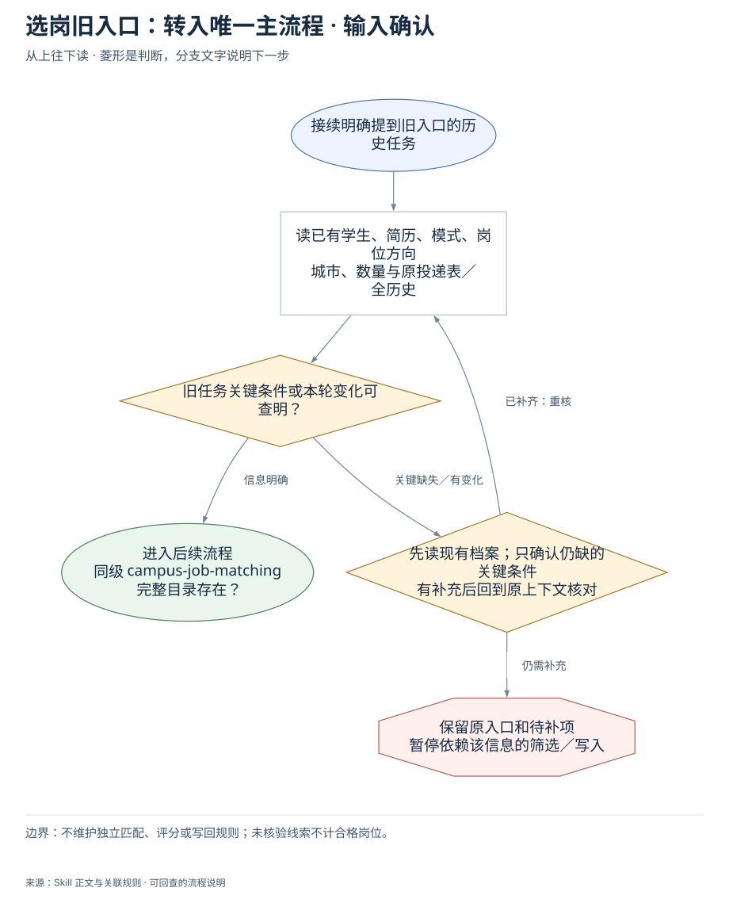
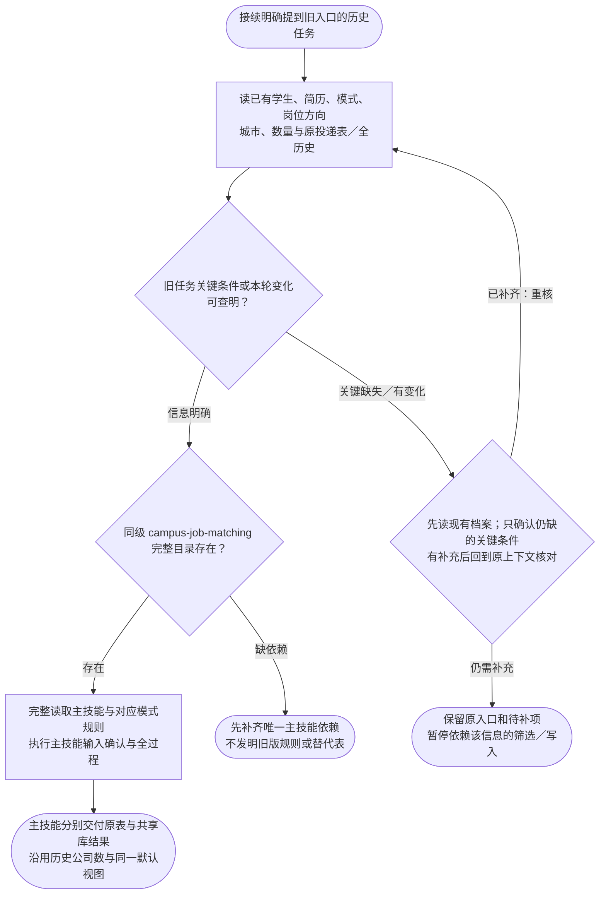

# 选岗旧入口：转入唯一主流程：完整执行流程

先核对具体输入；已有材料能查明的直接读取，关键缺失或冲突才补充确认。沿完整图查看后续处理、失败去向与交付。

交付：转入当前 campus-job-matching 主流程；保留原条件、投递表和历史记录。

## 执行前确认哪些信息

| 输入 | 何时需要 | 从哪里取得 | 缺失或冲突怎么处理 |
| --- | --- | --- | --- |
| 原学生、简历、模式及对应条件 | 接续必需 | 读旧任务与当前明确变更，沿用原身份 | 只确认当前缺失，不重建档案 |
| 岗位方向、城市与本轮数量口径 | 接续筛选必需 | 读取旧任务与本轮修正，不能照搬已过时条件 | 不自行扩大城市/方向，交主技能补齐关键项 |
| 原投递表、默认视图与历史岗位键 | 追加必需 | 沿用原入口与全历史累计公司数 | 缺入口先查，不创建批次替代表 |
| 本轮操作范围与本人私有配置 | 执行外部动作前必需 | 读取当前授权和成员配置，沿用已确认本人身份 | 不因旧入口自动获得新沟通/提交权限 |

## 输入确认、补齐与返回

[按原尺寸查看输入确认图](../assets/input-confirmation.svg)

## 完整执行、判断与异常去向

[按原尺寸打开完整执行图](../assets/workflow.svg)

## 每一步具体怎么做

### 输入与范围

**1. 接续明确提到旧入口的历史任务**

接续明确提到旧入口的历史任务

下一步：读已有学生、简历、模式、岗位方向；城市、数量与原投递表／全历史。

依据：[SKILL.md](../SKILL.md) 中的“旧入口兼容”。

**2. 读已有学生、简历、模式、岗位方向；城市、数量与原投递表／全历史**

读已有学生、简历、模式、岗位方向；城市、数量与原投递表／全历史

下一步：旧任务关键条件或本轮变化可查明？。

依据：[SKILL.md](../SKILL.md) 中的“沿用已有学生”。

**3. 旧任务关键条件或本轮变化可查明？**

旧任务关键条件或本轮变化可查明？

下一步：“信息明确” → 同级 campus-job-matching 完整目录存在？；“关键缺失／有变化” → 先读现有档案；只确认仍缺的关键条件；有补充后回到原上下文核对。

依据：[SKILL.md](../SKILL.md) 中的“沿用已有学生”。

**4. 先读现有档案；只确认仍缺的关键条件；有补充后回到原上下文核对**

先读现有档案；只确认仍缺的关键条件；有补充后回到原上下文核对

下一步：“已补齐：重核” → 读已有学生、简历、模式、岗位方向；城市、数量与原投递表／全历史；“仍需补充” → 保留原入口和待补项；暂停依赖该信息的筛选／写入。

依据：[SKILL.md](../SKILL.md) 中的“沿用已有学生”。

**5. 保留原入口和待补项；暂停依赖该信息的筛选／写入**

保留原入口和待补项；暂停依赖该信息的筛选／写入

此处保留待办与证据，补齐后接续原任务。

依据：[SKILL.md](../SKILL.md) 中的“沿用已有学生”。

### 执行与核验

**1. 同级 campus-job-matching 完整目录存在？**

同级 campus-job-matching 完整目录存在？

下一步：“存在” → 完整读取主技能与对应模式规则；执行主技能输入确认与全过程；“缺依赖” → 先补齐唯一主技能依赖；不发明旧版规则或替代表。

依据：[SKILL.md](../SKILL.md) 中的“本入口只是旧任务兼容别名”。

**2. 先补齐唯一主技能依赖；不发明旧版规则或替代表**

先补齐唯一主技能依赖；不发明旧版规则或替代表

此处保留待办与证据，补齐后接续原任务。

依据：[SKILL.md](../SKILL.md) 中的“本入口只是旧任务兼容别名”。

**3. 完整读取主技能与对应模式规则；执行主技能输入确认与全过程**

完整读取主技能与对应模式规则；执行主技能输入确认与全过程

下一步：主技能分别交付原表与共享库结果；沿用历史公司数与同一默认视图。

依据：[SKILL.md](../SKILL.md) 中的“沿用已有学生”。

### 交付与验收

**1. 主技能分别交付原表与共享库结果；沿用历史公司数与同一默认视图**

主技能分别交付原表与共享库结果；沿用历史公司数与同一默认视图

这是本路径的交付或转交结果。

依据：[SKILL.md](../SKILL.md) 中的“沿用已有学生”。

## 验收

- 只保留一个选岗主规则
- 模式与历史计数不丢失

不维护独立匹配、评分或写回规则；未核验线索不计合格岗位。

## 对应规则

- [SKILL.md](../SKILL.md)

可编辑的完整流程源码

