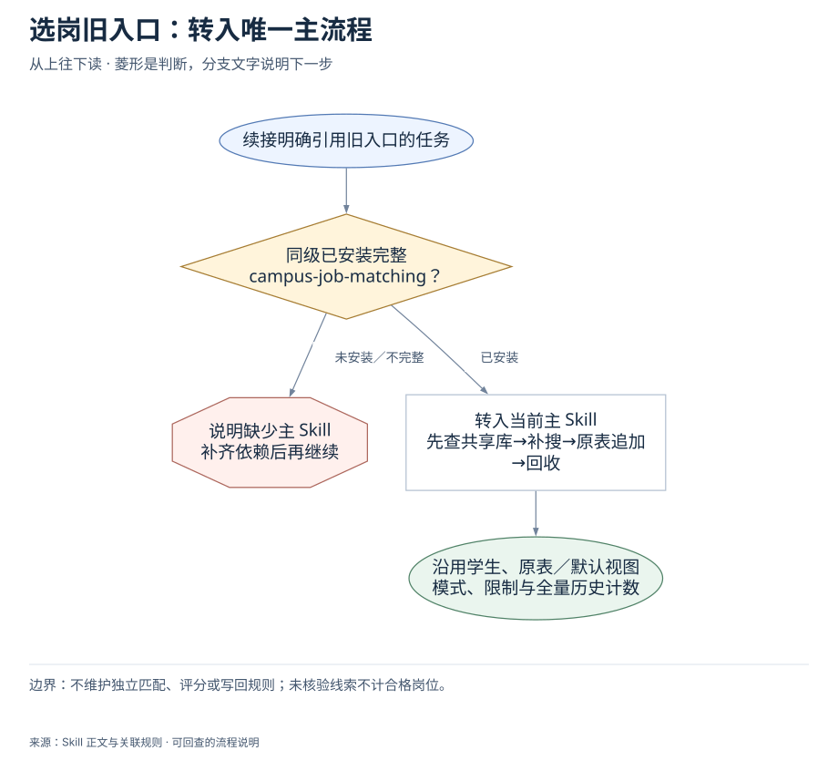
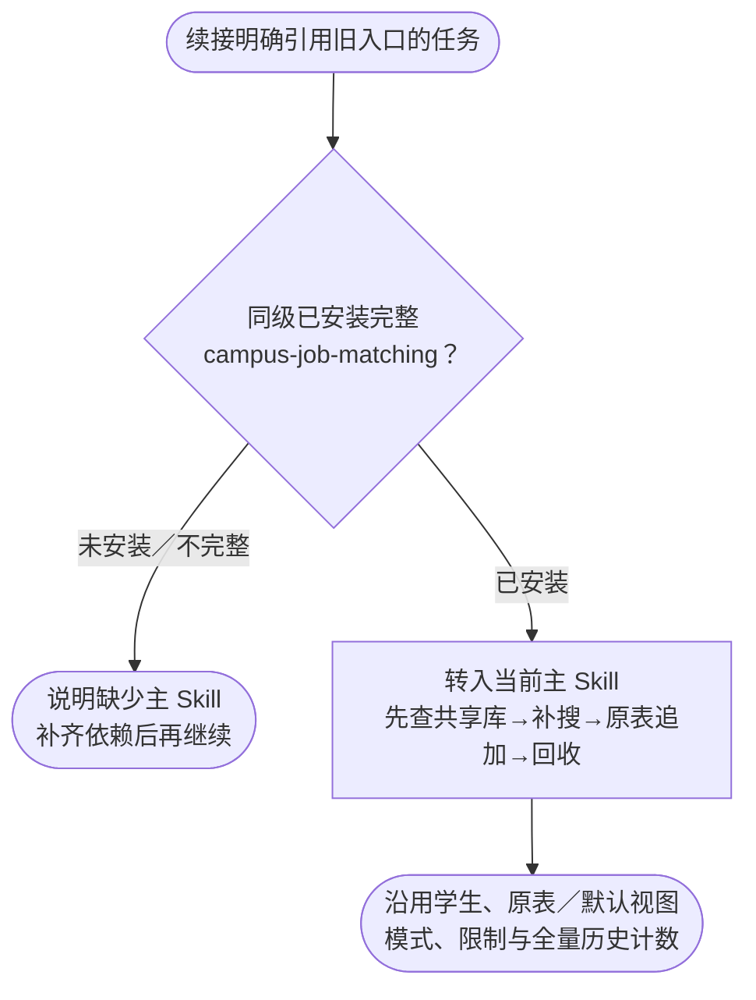

# 选岗旧入口：转入唯一主流程：完整流程

输入：历史任务与既定投递表；原有模式、条件与公司计数。

交付：转入当前 campus-job-matching 主流程；保留原条件、投递表和历史记录。

[按原尺寸打开完整流程图](../assets/workflow.svg)

## 按什么顺序做

### 检查主 Skill 依赖

兼容入口不能单独完成选岗。

### 转入当前主规则

只读唯一主 Skill，不重造旧选岗规则。

### 保留原任务条件

沿用原表、默认视图、个人历史与模式。

## 验收

- 只保留一个选岗主规则
- 模式与历史计数不丢失

不维护独立匹配、评分或写回规则；未核验线索不计合格岗位。

## 对应规则

- [SKILL.md](../SKILL.md)

可编辑的流程源码

