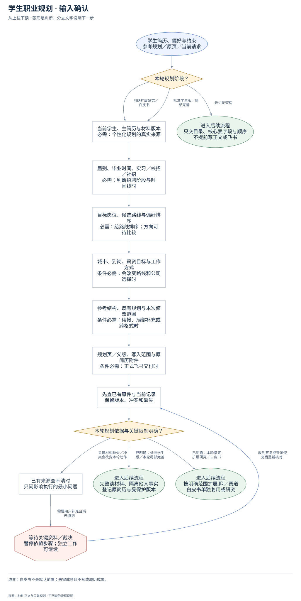

# 学生职业规划：完整执行流程

先核对具体输入；已有材料能查明的直接读取，关键缺失或冲突才补充确认。沿完整图查看后续处理、失败去向与交付。

交付：学生职业规划；方向与分层公司池；差距补强与行动时间线。

## 执行前确认哪些信息

| 输入 | 何时需要 | 从哪里取得 | 缺失或冲突怎么处理 |
| --- | --- | --- | --- |
| 当前学生、主简历与材料版本 | 必需：个性化规划的真实来源 | 完整读原简历、问卷、截图与点名参考，登记读取范围和原始附件指纹 | 身份/版本冲突先核对；模糊截图与未读页面不补猜事实 |
| 届别、毕业时间、实习／校招／社招 | 必需：判断招聘阶段与时间线时 | 从简历与当前确认记录读取教育、届别和经历，区分当前机会与未来岗位画像 | 未知阶段只给条件性方向建议，不把旧届次样本当当前可投 |
| 目标岗位、候选路线与偏好排序 | 必需：给路线排序；方向可待比较 | 整理学生能力证据、偏好和具体工作内容，比较合理路线后收敛1–3条 | 未选定时主动比较并给当前排序和切换条件，不只回问想做什么 |
| 城市、到岗、薪资目标与工作方式 | 条件必需：会改变路线和公司选择时 | 读取已确认城市优先级、成长/稳定诉求、到岗窗口、薪资目标和风险限制 | 会改变建议的未知点精确确认；期望薪资不当作市场证据 |
| 参考结构、既有规划与本次修改范围 | 条件必需：续接、局部补充或跨格式时 | 确认架构对焦/标准/扩展及受保护母版；参考只借结构，不借他人事实 | 版式/母版不明先查唯一版本，不用新摘要覆盖已确认完整版 |
| 规划页／父级、写入范围与原简历附件 | 条件必需：正式飞书交付时 | 查既有唯一规划页、父级和本人身份；从原件保留可校验二进制 | 目标不唯一只暂停外部写入；其他授权正文可继续，白皮书另按明确范围 |

## 输入确认、补齐与返回

[按原尺寸查看输入确认图](../assets/input-confirmation.svg)

## 完整执行、判断与异常去向

[按原尺寸打开完整执行图](../assets/workflow.svg)

## 每一步具体怎么做

### 输入与范围

**1. 学生简历、偏好与约束；参考规划／原页／当前请求**

接收当前学生简历、问卷/偏好、用户约束、既有规划和参考；先判当前要求是讨论结构、正式规划、扩展研究还是指定局部补充。

下一步：本轮规划阶段？。

依据：[SKILL.md](../SKILL.md) 中的“1. 先建立证据台账”。

**2. 本轮规划阶段？**

“先架构/大纲/不要写”只交结构；标准学生版走完整规划；大量JD/同赛道研究或独立白皮书只在明确要求时扩展，不默认加白皮书。

下一步：“先讨论架构” → 只交目录、核心表字段与顺序；不提前写正文或飞书；“明确扩展研究／白皮书” → 当前学生、主简历与材料版本；必需：个性化规划的真实来源；“标准学生版／局部完善” → 当前学生、主简历与材料版本；必需：个性化规划的真实来源。

依据：[SKILL.md](../SKILL.md) 中的“先判断当前阶段”。

**3. 当前学生、主简历与材料版本；必需：个性化规划的真实来源**

完整读原简历、问卷、截图与点名参考，登记读取范围和原始附件指纹；缺失处理：身份/版本冲突先核对；模糊截图与未读页面不补猜事实

下一步：届别、毕业时间、实习／校招／社招；必需：判断招聘阶段与时间线时。

依据：[SKILL.md](../SKILL.md) 中的“1. 先建立证据台账”。

**4. 届别、毕业时间、实习／校招／社招；必需：判断招聘阶段与时间线时**

从简历与当前确认记录读取教育、届别和经历，区分当前机会与未来岗位画像；缺失处理：未知阶段只给条件性方向建议，不把旧届次样本当当前可投

下一步：目标岗位、候选路线与偏好排序；必需：给路线排序；方向可待比较。

依据：[references/external-career-plan-standard.md](external-career-plan-standard.md) 中的“1. 学生现状与求职目标”。

**5. 目标岗位、候选路线与偏好排序；必需：给路线排序；方向可待比较**

整理学生能力证据、偏好和具体工作内容，比较合理路线后收敛1–3条；缺失处理：未选定时主动比较并给当前排序和切换条件，不只回问想做什么

下一步：城市、到岗、薪资目标与工作方式；条件必需：会改变路线和公司选择时。

依据：[SKILL.md](../SKILL.md) 中的“2. 先选可投方向，再选行业和公司”。

**6. 城市、到岗、薪资目标与工作方式；条件必需：会改变路线和公司选择时**

读取已确认城市优先级、成长/稳定诉求、到岗窗口、薪资目标和风险限制；缺失处理：会改变建议的未知点精确确认；期望薪资不当作市场证据

下一步：参考结构、既有规划与本次修改范围；条件必需：续接、局部补充或跨格式时。

依据：[references/evidence-and-input-contract.md](evidence-and-input-contract.md) 中的“五类事实”。

**7. 参考结构、既有规划与本次修改范围；条件必需：续接、局部补充或跨格式时**

确认架构对焦/标准/扩展及受保护母版；参考只借结构，不借他人事实；缺失处理：版式/母版不明先查唯一版本，不用新摘要覆盖已确认完整版

下一步：规划页／父级、写入范围与原简历附件；条件必需：正式飞书交付时。

依据：[SKILL.md](../SKILL.md) 中的“先判断当前阶段”。

**8. 规划页／父级、写入范围与原简历附件；条件必需：正式飞书交付时**

查既有唯一规划页、父级和本人身份；从原件保留可校验二进制；缺失处理：目标不唯一只暂停外部写入；其他授权正文可继续，白皮书另按明确范围

下一步：先查已有原件与当前记录；保留版本、冲突和缺失。

依据：[SKILL.md](../SKILL.md) 中的“写入与验收”。

**9. 先查已有原件与当前记录；保留版本、冲突和缺失**

保留资料截止、缺页、冲突和参考隔离；候选偏好与市场证据分开，既有完整母版保护。

下一步：本轮规划依据与关键限制明确？。

依据：[SKILL.md](../SKILL.md) 中的“1. 先建立证据台账”。

**10. 本轮规划依据与关键限制明确？**

未知偏好允许条件性判断；仅学生/版本冲突或缺失足以改变本次推荐、落点的信息需要聚焦补齐。

下一步：“已明确：标准学生版／本轮局部完善” → 完整读材料、隔离他人事实；登记原简历与受保护版本；“关键材料缺失／冲突会改变本轮动作” → 已有来源查不清时；只问影响执行的最小问题；“已明确：本轮指定扩展研究／白皮书” → 按明确范围扩展 JD／赛道；白皮书单独复用或研究。

依据：[SKILL.md](../SKILL.md) 中的“1. 先建立证据台账”。

**11. 已有来源查不清时；只问影响执行的最小问题**

从原件和问卷先查城市/到岗/意向，再仅询问决定排序的缺口；不把所有表项机械发给学生重填。

下一步：“需要用户补充且尚未收到” → 等待关键资料／裁决；暂停依赖步骤；独立工作可继续。

依据：[SKILL.md](../SKILL.md) 中的“1. 先建立证据台账”。

**12. 等待关键资料／裁决；暂停依赖步骤；独立工作可继续**

没有收到补充前，不假定问题已解决；保留已确认材料和具体缺口。从原件和问卷先查城市/到岗/意向，再仅询问决定排序的缺口；不把所有表项机械发给学生重填。

下一步：“收到答复或来源恢复后重新核对” → 先查已有原件与当前记录；保留版本、冲突和缺失。

依据：[SKILL.md](../SKILL.md) 中的“1. 先建立证据台账”。

### 执行与核验

**1. 按明确范围扩展 JD／赛道；白皮书单独复用或研究**

先查同赛道既有研究的范围和时效，可复用则增量核验；按明确研究问题检索一手来源。白皮书不带学生事实，也不成为每人规划默认前置。

下一步：完整读材料、隔离他人事实；登记原简历与受保护版本。

依据：[references/industry-research-contract.md](industry-research-contract.md) 中的“研究模式”。

**2. 完整读材料、隔离他人事实；登记原简历与受保护版本**

完整读当前学生与点名参考，登记资料类型、截止、覆盖和冲突；参考只借章节和讲解方式，原简历记录二进制文件名、大小和哈希。

下一步：提炼本人动作与可迁移能力；学历、兴趣与能力证据分开。

依据：[SKILL.md](../SKILL.md) 中的“1. 先建立证据台账”。

**3. 比较日常、门槛、偏好与证据；收敛 1—3 条可投路线**

把本人能力证据、城市/工作方式偏好与现实门槛并列比较，收敛1–3条有据可投路线；给当前优先级、取舍和改变排序的条件。

下一步：每路线讲日常、门槛与取舍；给推荐排序与切换条件。

依据：[SKILL.md](../SKILL.md) 中的“2. 先选可投方向，再选行业和公司”。

**4. 每路线查岗位—公司—城市／阶段；薪酬待遇、来源与分层公司池**

先构建优先级、方向/业务场景、有序岗位、本人适配、代表企业和薪酬口径同表关联的规划总览，再逐路线查具体公司岗位、待遇、资格与来源；报价清单不能替代总览。

下一步：公司池分重点／补充／冲刺；当前样本与长期研究池分开。

依据：[references/planning-and-project-contract.md](planning-and-project-contract.md) 中的“岗位—公司—薪资待遇对照（核心正文）”。

**5. 总览、薪酬梯度与样本；能支持本人选择？**

检查同路线业务/平台差异、真实报价、个人申请目标与升档条件，以及现金、培养、工作安排的取舍；同城同职业同阶段依据不足继续研究，不混入他人参考区间。

下一步：“有同口径依据” → 按岗位缺口选补强产物；社招优先深挖已有经历；“未披露／证据不足” → 继续找同职业可比样本；仍缺则标薪资研究未完成。

依据：[SKILL.md](../SKILL.md) 中的“核心交付：具体岗位、公司、薪资待遇”。

**6. 继续找同职业可比样本；仍缺则标薪资研究未完成**

优先岗位披露，再同公司同类岗位、同城同职业同阶段样本；仍查不到时标该路线薪资研究未完成，其他已核验部分可以继续。

下一步：按岗位缺口选补强产物；社招优先深挖已有经历。

依据：[references/planning-and-project-contract.md](planning-and-project-contract.md) 中的“岗位—公司—薪资待遇对照（核心正文）”。

**7. 按岗位缺口选补强产物；社招优先深挖已有经历**

先判断缺技术、产品决策、分析还是客户协作证据，再选能补该缺口的产物；应届常用1–2个且服从明确数量，社招优先深化真实已有经历。

下一步：岗位缺口反推项目与产物；明确计划状态与简历进入门槛。

依据：[SKILL.md](../SKILL.md) 中的“4. 项目补缺口，投递按现有证据准备度推进”。

**8. 核心申请证据准备度？**

逐目标岗判断现有经历能否证明核心能力。足够则简历和申请准备可先行；确实依赖新项目的声称要等项目达到可演示、可解释、可复盘状态。

下一步：“现有经历已支持” → 现有证据足够：规划可投版本；申请准备与补强并行；“需新增项目证据” → 依赖新项目：列任务与进入条件；达标后再写成果、投对应岗。

依据：[references/planning-and-project-contract.md](planning-and-project-contract.md) 中的“项目与执行顺序”。

**9. 现有证据足够：规划可投版本；申请准备与补强并行**

为已有成熟证据支持的岗位安排可用简历版本、公司研究与投递节奏，同时继续补明确短板；不因其他项目未完成暂停全部申请。

下一步：按八章写完整规划与时间线；图解紧邻对应解释。

依据：[references/external-career-plan-standard.md](external-career-plan-standard.md) 中的“6. 简历版本规划”。

**10. 依赖新项目：列任务与进入条件；达标后再写成果、投对应岗**

把新增项目列为计划，明确数据/权限、本人模块、交付物和进入简历的验收门槛；达标前不生成成果型要点或称已具备该能力。

下一步：按八章写完整规划与时间线；图解紧邻对应解释。

依据：[references/external-career-plan-standard.md](external-career-plan-standard.md) 中的“5. 补强项目与证据”。

**11. 按八章写完整规划与时间线；图解紧邻对应解释**

保留已认可八章和有效判断；原生画板交代方向与准备关系，规划总表关联岗位、适配、公司与薪酬，具体样本作为下钻；保留短案例和取舍解释。

下一步：各简历版本对应同一证据；倒排投递、补强和反馈时间线。

依据：[SKILL.md](../SKILL.md) 中的“目标”。

**12. 方向、市场与行动链讲清？**

沿具体岗位样本追到本人证据、差距、补强产物、简历版本和投递门槛；若只剩都可以、通用赞美或项目无法对应JD，回对应章节修内容。

下一步：“未讲清／链条不对应” → 只修本轮缺口；保留已确认结构与有效内容；“内容可用” → 飞书授权且唯一落点？。

依据：[references/external-career-plan-standard.md](external-career-plan-standard.md) 中的“内容审阅：在排版与写入前做”。

**13. 提炼本人动作与可迁移能力；学历、兴趣与能力证据分开**

建立真实经历、偏好、外部核验、推断和待确认账本；职责/时间/项目/数字冲突保留原版本。

下一步：比较日常、门槛、偏好与证据；收敛 1—3 条可投路线。

依据：[references/evidence-and-input-contract.md](evidence-and-input-contract.md) 中的“五类事实”。

**14. 每路线讲日常、门槛与取舍；给推荐排序与切换条件**

工作对象→输入→动作→交付→协作→验证，连接学生事实解释适配与差距；行业不当作职业方向。

下一步：每路线查岗位—公司—城市／阶段；薪酬待遇、来源与分层公司池。

依据：[references/external-career-plan-standard.md](external-career-plan-standard.md) 中的“3. 各方向分别做什么、为什么适合”。

**15. 公司池分重点／补充／冲刺；当前样本与长期研究池分开**

按岗位内容与学生证据给具体公司、城市、招聘阶段和核验日期；AI Agent适用时细分大厂应用/平台/评测与算法门槛。

下一步：固定薪资／浮动／补贴分列；同城同职业同阶段可比。

依据：[SKILL.md](../SKILL.md) 中的“3. 公司池必须具体且分层”。

**16. 固定薪资／浮动／补贴分列；同城同职业同阶段可比**

招聘披露、个人目标与综合判断分开；比较固定、浮动、培养、工作安排和后续责任；月薪乘未保证薪数只称展示年额，不能以数量或未披露填满表。

下一步：总览、薪酬梯度与样本；能支持本人选择？。

依据：[references/planning-and-project-contract.md](planning-and-project-contract.md) 中的“岗位—公司—薪资待遇对照（核心正文）”。

**17. 岗位缺口反推项目与产物；明确计划状态与简历进入门槛**

核项目是否真能回答具体JD核心要求，定义本人模块、数据权限、最低演示、最终验收和面试用途；不能通用加AI工具。

下一步：核心申请证据准备度？。

依据：[references/planning-and-project-contract.md](planning-and-project-contract.md) 中的“项目与执行顺序”。

**18. 各简历版本对应同一证据；倒排投递、补强和反馈时间线**

按当前日期、届别和到岗倒排，现有证据足够的先投，依赖新增证据的达标再投；给近期三项动作及改变排序的条件。

下一步：方向、市场与行动链讲清？。

依据：[references/external-career-plan-standard.md](external-career-plan-standard.md) 中的“8. 行动时间线与近期重点”。

### 交付与验收

**1. 只交目录、核心表字段与顺序；不提前写正文或飞书**

交付目录、关键表字段和岗位—项目—简历—投递顺序及图解位置；保持讨论只读，不提前写完整学生正文或飞书。

这是本路径的交付或转交结果。

依据：[SKILL.md](../SKILL.md) 中的“先判断当前阶段”。

**2. 只修本轮缺口；保留已确认结构与有效内容**

只修本轮点名缺口及必要关联，保留已确认章节、删减项和有效正文；有受保护完整母版时跨格式保持等价，不另写摘要替代。

下一步：比较日常、门槛、偏好与证据；收敛 1—3 条可投路线。

依据：[references/external-career-plan-standard.md](external-career-plan-standard.md) 中的“参考使用与模式变化”。

**3. 飞书授权且唯一落点？**

已有明确飞书交付约定且唯一父级可核实则直接写；讨论/只读/限定本地按当前范围交付。授权或落点真正不明才处理最小必要问题。

下一步：“未授权／限定本地／目标待确认” → 交付可审阅正文／指定本地形式；保留薪资及事实未完成项；“已授权且唯一” → 核对本人、父级与版本后局部写；保留母版等价、首屏原简历。

依据：[SKILL.md](../SKILL.md) 中的“写入与验收”。

**4. 交付可审阅正文／指定本地形式；保留薪资及事实未完成项**

交付已完成可审阅正文或用户指定本地形式，列明仍未解决的事实/薪资研究/显示缺口；不把本地稿当已写入飞书的完整终态。

这是本路径的交付或转交结果。

依据：[SKILL.md](../SKILL.md) 中的“写入与验收”。

**5. 核对本人、父级与版本后局部写；保留母版等价、首屏原简历**

核本人、父级、唯一性、当前修订和原正文后，用块级方式写指定章节；已有完整母版保留顺序、数字、公司、来源与必需图示，原简历置于首页。

下一步：原简历位于个人简历标题后；下载核大小／哈希并实际预览。

依据：[references/feishu-delivery.md](feishu-delivery.md) 中的“写入顺序”。

**6. 回读全文、公司薪资、媒体与附件；对照母版，逐页检查最终渲染**

从目标页重新导出完整正文，逐路线核岗位公司薪酬、项目到投递关系、来源、媒体及附件；对照母版并核下载哈希，最终渲染逐页检查。

下一步：本轮适用验收全部通过？。

依据：[references/feishu-delivery.md](feishu-delivery.md) 中的“写后读回”。

**7. 本轮适用验收全部通过？**

先人工核各路线判断、具体机会及同口径待遇，再运行交付/视觉门；附件、父级、唯一性、全文等价或显示任一必要项失败，保留未完成并修正。

下一步：“适用项均通过” → 交付规划页与行动顺序；列明未确认及未验证项；“缺项／不等价／显示失败” → 只修本轮缺口；保留已确认结构与有效内容；“研究／显示仍受阻：仅交付已完成部分” → 交付可审阅正文／指定本地形式；保留薪资及事实未完成项。

依据：[SKILL.md](../SKILL.md) 中的“标准交付最低门”。

**8. 交付规划页与行动顺序；列明未确认及未验证项**

给当前规划页、可执行的近期动作和调整条件，说明资料截止、真实回读/渲染范围及影响使用的待确认项；不得承诺未查明待遇或机会状态。

这是本路径的交付或转交结果。

依据：[SKILL.md](../SKILL.md) 中的“写入与验收”。

**9. 原简历位于个人简历标题后；下载核大小／哈希并实际预览**

原文件块在第一个编号章节前，图片或文件名不能代替附件；已有母版逐项核受保护标题、数字、公司、来源和图示媒体。

下一步：回读全文、公司薪资、媒体与附件；对照母版，逐页检查最终渲染。

依据：[references/feishu-delivery.md](feishu-delivery.md) 中的“写后读回”。

## 验收

- 方向有履历依据
- 岗位差距对应行动
- 交付正文与图表可读

白皮书不是默认前置；未完成项目不写成履历成果。

## 对应规则

- [SKILL.md](../SKILL.md)
- [references/evidence-and-input-contract.md](evidence-and-input-contract.md)
- [references/external-career-plan-standard.md](external-career-plan-standard.md)
- [references/feishu-delivery.md](feishu-delivery.md)
- [references/industry-research-contract.md](industry-research-contract.md)
- [references/planning-and-project-contract.md](planning-and-project-contract.md)

```mermaid
flowchart TB
  in(["学生简历、偏好与约束<br/>参考规划／原页／当前请求"])
  mode{"本轮规划阶段？"}
  outline(["只交目录、核心表字段与顺序<br/>不提前写正文或飞书"])
  research["按明确范围扩展 JD／赛道<br/>白皮书单独复用或研究"]
  evidence["完整读材料、隔离他人事实<br/>登记原简历与受保护版本"]
  roles["比较日常、门槛、偏好与证据<br/>收敛 1—3 条可投路线"]
  market["每路线查岗位—公司—城市／阶段<br/>薪酬待遇、来源与分层公司池"]
  salary{"总览、薪酬梯度与样本<br/>能支持本人选择？"}
  salarygap["继续找同职业可比样本<br/>仍缺则标薪资研究未完成"]
  projects["按岗位缺口选补强产物<br/>社招优先深挖已有经历"]
  ready{"核心申请证据准备度？"}
  now["现有证据足够：规划可投版本<br/>申请准备与补强并行"]
  later["依赖新项目：列任务与进入条件<br/>达标后再写成果、投对应岗"]
  body["按八章写完整规划与时间线<br/>图解紧邻对应解释"]
  content{"方向、市场与行动链讲清？"}
  repair["只修本轮缺口<br/>保留已确认结构与有效内容"]
  deliver{"飞书授权且唯一落点？"}
  draft(["交付可审阅正文／指定本地形式<br/>保留薪资及事实未完成项"])
  write["核对本人、父级与版本后局部写<br/>保留母版等价、首屏原简历"]
  readback["回读全文、公司薪资、媒体与附件<br/>对照母版，逐页检查最终渲染"]
  gate{"本轮适用验收全部通过？"}
  out(["交付规划页与行动顺序<br/>列明未确认及未验证项"])
  i_student["当前学生、主简历与材料版本<br/>必需：个性化规划的真实来源"]
  i_stage["届别、毕业时间、实习／校招／社招<br/>必需：判断招聘阶段与时间线时"]
  i_direction["目标岗位、候选路线与偏好排序<br/>必需：给路线排序；方向可待比较"]
  i_constraints["城市、到岗、薪资目标与工作方式<br/>条件必需：会改变路线和公司选择时"]
  i_protected["参考结构、既有规划与本次修改范围<br/>条件必需：续接、局部补充或跨格式时"]
  i_delivery["规划页／父级、写入范围与原简历附件<br/>条件必需：正式飞书交付时"]
  i_existing["先查已有原件与当前记录<br/>保留版本、冲突和缺失"]
  i_ready{"本轮规划依据与关键限制明确？"}
  i_clarify["已有来源查不清时<br/>只问影响执行的最小问题"]
  i_wait(["等待关键资料／裁决<br/>暂停依赖步骤；独立工作可继续"])
  capability_map["提炼本人动作与可迁移能力<br/>学历、兴趣与能力证据分开"]
  role_compare["每路线讲日常、门槛与取舍<br/>给推荐排序与切换条件"]
  company_layers["公司池分重点／补充／冲刺<br/>当前样本与长期研究池分开"]
  pay_components["固定薪资／浮动／补贴分列<br/>同城同职业同阶段可比"]
  project_mapping["岗位缺口反推项目与产物<br/>明确计划状态与简历进入门槛"]
  version_timeline["各简历版本对应同一证据<br/>倒排投递、补强和反馈时间线"]
  source_attachment["原简历位于个人简历标题后<br/>下载核大小／哈希并实际预览"]
  in --> mode
  mode -->|"先讨论架构"| outline
  mode -->|"明确扩展研究／白皮书"| i_student
  research --> evidence
  salary -->|"有同口径依据"| projects
  salary -->|"未披露／证据不足"| salarygap
  salarygap --> projects
  ready -->|"现有经历已支持"| now
  ready -->|"需新增项目证据"| later
  now --> body
  later --> body
  content -->|"未讲清／链条不对应"| repair
  repair --> roles
  content -->|"内容可用"| deliver
  deliver -->|"未授权／限定本地／目标待确认"| draft
  deliver -->|"已授权且唯一"| write
  readback --> gate
  gate -->|"适用项均通过"| out
  gate -->|"缺项／不等价／显示失败"| repair
  gate -->|"研究／显示仍受阻：仅交付已完成部分"| draft
  mode -->|"标准学生版／局部完善"| i_student
  i_student --> i_stage
  i_stage --> i_direction
  i_direction --> i_constraints
  i_constraints --> i_protected
  i_protected --> i_delivery
  i_delivery --> i_existing
  i_existing --> i_ready
  i_ready -->|"已明确：标准学生版／本轮局部完善"| evidence
  i_ready -->|"关键材料缺失／冲突会改变本轮动作"| i_clarify
  i_clarify -->|"需要用户补充且尚未收到"| i_wait
  i_wait -->|"收到答复或来源恢复后重新核对"| i_existing
  i_ready -->|"已明确：本轮指定扩展研究／白皮书"| research
  evidence --> capability_map
  capability_map --> roles
  roles --> role_compare
  role_compare --> market
  market --> company_layers
  company_layers --> pay_components
  pay_components --> salary
  projects --> project_mapping
  project_mapping --> ready
  body --> version_timeline
  version_timeline --> content
  write --> source_attachment
  source_attachment --> readback
```

可编辑的完整流程源码

