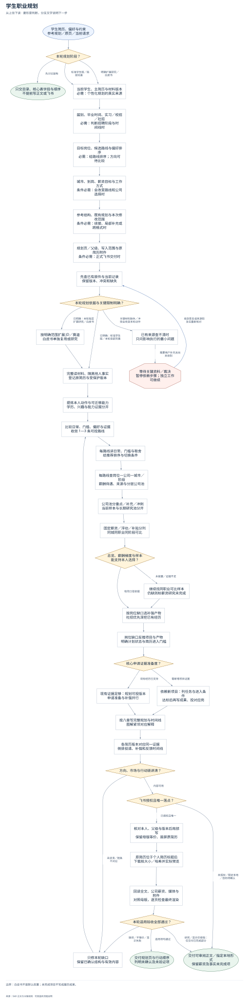
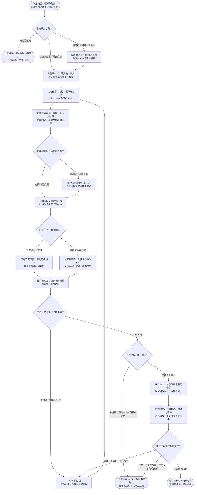

# 学生职业规划：完整流程

输入：学生简历与背景；目标城市与方向；问卷与已有规划（如有）。

交付：学生职业规划；方向与分层公司池；差距补强与行动时间线。

[按原尺寸打开完整流程图](../assets/workflow.svg)

## 按什么顺序做

### 先判断阶段与受保护母版

架构对焦只给结构；标准版完整展开；扩展研究和白皮书只按明确要求增加。

### 建立证据并排序方向

从学生经历、偏好和门槛收敛 1—3 个可投方向，说明取舍与切换条件。

### 研究具体岗位、公司与待遇

每路线关联真实岗位、城市阶段、薪酬待遇与分层公司池，缺薪酬继续查可比样本。

### 按证据准备度安排补强与投递

已有证据支持的岗位可先准备简历投递；依赖新项目的能力写明达标后进入条件。

### 完成正文与交付验收

先审内容，再写授权唯一页面；保护母版等价性，回读全文、附件、媒体并渲染。

## 验收

- 方向有履历依据
- 岗位差距对应行动
- 交付正文与图表可读

白皮书不是默认前置；未完成项目不写成履历成果。

## 对应规则

- [SKILL.md](../SKILL.md)
- [references/evidence-and-input-contract.md](evidence-and-input-contract.md)
- [references/external-career-plan-standard.md](external-career-plan-standard.md)
- [references/feishu-delivery.md](feishu-delivery.md)
- [references/industry-research-contract.md](industry-research-contract.md)
- [references/planning-and-project-contract.md](planning-and-project-contract.md)

可编辑的流程源码

