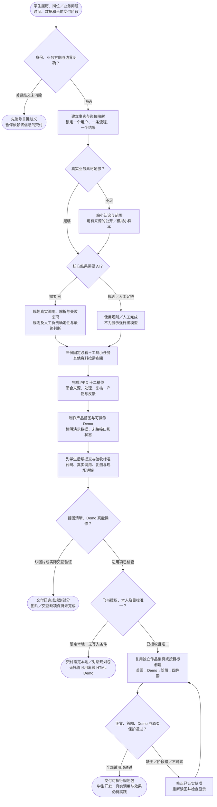

# AI 作品集规划：完整流程

输入：学生履历与能力缺口；目标岗位或业务问题；时间与数据限制。

交付：前置学习材料；完整 PRD 与可操作 Demo；后续实践验收标准。

[按原尺寸打开完整流程图](../assets/workflow.svg)

## 按什么顺序做

### 锁定业务与事实边界

读取学生经历、目标岗位、现有作品和素材，区分既有实践、演示和待开发。

### 设计资料、PRD 与责任

固定三份必看和一次工具小任务；PRD 十二槽位完整，规则、AI 与人工职责明确。

### 制作首图与可操作 Demo

首图讲清产品用户问题功能；Demo 真实可点并覆盖正常、空错、加载、复核和失败。

### 交付学生后续验收标准

规定真实调用、Prompt 迭代、Bad Case、复测和现场修改证据，不预填学生已完成。

### 按授权独立落位并回读

独立作品集页按首图—Demo—阶段—四件套排列，验证正文图片和实际使用效果。

## 验收

- 业务承接与 AI 实践兼具
- Demo 与 PRD 一致
- 演示与真实能力分开
- 首屏产品总览图实际可见且可读
- 三份固定必看材料保留

这里交付规划四件套；学生后续开发与实践另行完成。

## 对应规则

- [SKILL.md](../SKILL.md)
- [references/product-plan-contract.md](product-plan-contract.md)

可编辑的流程源码

