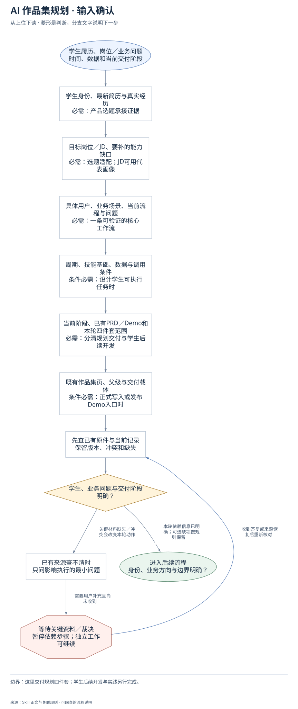
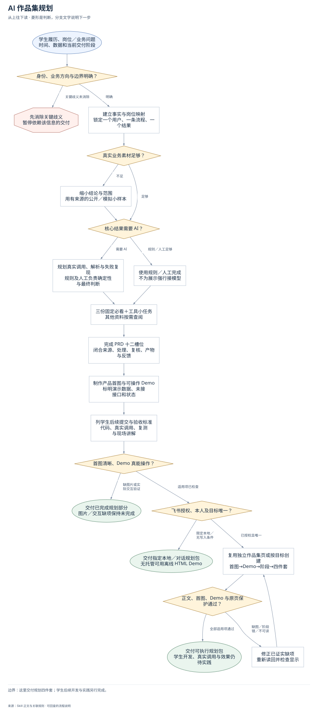

# AI 作品集规划：完整执行流程

先核对具体输入；已有材料能查明的直接读取，关键缺失或冲突才补充确认。沿完整图查看后续处理、失败去向与交付。

交付：前置学习材料；完整 PRD 与可操作 Demo；后续实践验收标准。

## 执行前确认哪些信息

| 输入 | 何时需要 | 从哪里取得 | 缺失或冲突怎么处理 |
| --- | --- | --- | --- |
| 学生身份、最新简历与真实经历 | 必需：产品选题承接证据 | 完整读简历、现有作品和业务素材，记本人动作、职责与结果 | 关键身份/事实有歧义先消除；不拿导师示例和未来功能当既有经历 |
| 目标岗位／JD、要补的能力缺口 | 必需：选题适配；JD可用代表画像 | 有真实JD读全文；无JD注明代表性岗位画像，从经历和岗位反推缺口 | 未定方向会改变选题时只问最关键一项，不先堆AI功能 |
| 具体用户、业务场景、当前流程与问题 | 必需：一条可验证的核心工作流 | 锁一个用户、一条流程、一个核心业务结果，明确当前怎么处理及产物给谁用 | 素材不足缩小范围，用公开/模拟小样本且标来源边界，不虚构企业接口 |
| 周期、技能基础、数据与调用条件 | 条件必需：设计学生可执行任务时 | 核1–3周可完成范围、现有项目/工具操作与数据权限；一周版推迟账号/数据库/爬虫 | 不要求学生预先给模型Key；分层定义不明不猜，用小任务产物调脚手架 |
| 当前阶段、已有PRD／Demo和本轮四件套范围 | 必需：分清规划交付与学生后续开发 | 登记构想/PRD/UIUX/开发/验收状态与本轮会改、只读、保护对象 | 规划不能画成已上线；源码、真实调用、评测是学生后续提交项 |
| 既有作品集页、父级与交付载体 | 条件必需：正式写入或发布Demo入口时 | 复用唯一学生下独立作品集页，核原页、本人、父级与写入授权 | 目标不明只暂停外部写入；无托管可离线可操作HTML，不以源码冒充Demo |

## 输入确认、补齐与返回

[按原尺寸查看输入确认图](../assets/input-confirmation.svg)

## 完整执行、判断与异常去向

[按原尺寸打开完整执行图](../assets/workflow.svg)

## 每一步具体怎么做

### 输入与范围

**1. 学生履历、岗位／业务问题；时间、数据和当前交付阶段**

接收学生原始履历、目标JD/代表画像、真实业务任务、已有作品、周期和本次阶段；规划交付与学生后续开发先分清。

下一步：学生身份、最新简历与真实经历；必需：产品选题承接证据。

依据：[SKILL.md](../SKILL.md) 中的“开始前”。

**2. 学生身份、最新简历与真实经历；必需：产品选题承接证据**

完整读简历、现有作品和业务素材，记本人动作、职责与结果；缺失处理：关键身份/事实有歧义先消除；不拿导师示例和未来功能当既有经历

下一步：目标岗位／JD、要补的能力缺口；必需：选题适配；JD可用代表画像。

依据：[SKILL.md](../SKILL.md) 中的“开始前”。

**3. 目标岗位／JD、要补的能力缺口；必需：选题适配；JD可用代表画像**

有真实JD读全文；无JD注明代表性岗位画像，从经历和岗位反推缺口；缺失处理：未定方向会改变选题时只问最关键一项，不先堆AI功能

下一步：具体用户、业务场景、当前流程与问题；必需：一条可验证的核心工作流。

依据：[SKILL.md](../SKILL.md) 中的“第二步：完整 PRD”。

**4. 具体用户、业务场景、当前流程与问题；必需：一条可验证的核心工作流**

锁一个用户、一条流程、一个核心业务结果，明确当前怎么处理及产物给谁用；缺失处理：素材不足缩小范围，用公开/模拟小样本且标来源边界，不虚构企业接口

下一步：周期、技能基础、数据与调用条件；条件必需：设计学生可执行任务时。

依据：[references/product-plan-contract.md](product-plan-contract.md) 中的“3. 业务闭环”。

**5. 周期、技能基础、数据与调用条件；条件必需：设计学生可执行任务时**

核1–3周可完成范围、现有项目/工具操作与数据权限；一周版推迟账号/数据库/爬虫；缺失处理：不要求学生预先给模型Key；分层定义不明不猜，用小任务产物调脚手架

下一步：当前阶段、已有PRD／Demo和本轮四件套范围；必需：分清规划交付与学生后续开发。

依据：[SKILL.md](../SKILL.md) 中的“决策规则”。

**6. 当前阶段、已有PRD／Demo和本轮四件套范围；必需：分清规划交付与学生后续开发**

登记构想/PRD/UIUX/开发/验收状态与本轮会改、只读、保护对象；缺失处理：规划不能画成已上线；源码、真实调用、评测是学生后续提交项

下一步：既有作品集页、父级与交付载体；条件必需：正式写入或发布Demo入口时。

依据：[SKILL.md](../SKILL.md) 中的“责任边界”。

**7. 既有作品集页、父级与交付载体；条件必需：正式写入或发布Demo入口时**

复用唯一学生下独立作品集页，核原页、本人、父级与写入授权；缺失处理：目标不明只暂停外部写入；无托管可离线可操作HTML，不以源码冒充Demo

下一步：先查已有原件与当前记录；保留版本、冲突和缺失。

依据：[SKILL.md](../SKILL.md) 中的“飞书交付”。

**8. 先查已有原件与当前记录；保留版本、冲突和缺失**

分开本人事实、公开事实、推断、知识和计划；保留通用面试/规划/课程原页。

下一步：学生、业务问题与交付阶段明确？。

依据：[SKILL.md](../SKILL.md) 中的“开始前”。

**9. 学生、业务问题与交付阶段明确？**

本轮规划依赖身份、业务方向、事实边界；可选工具和未定真实接口用明确开发任务处理，不能冒充已调用。

下一步：“本轮依赖信息已明确；可选缺项按规则保留” → 身份、业务方向与边界明确？；“关键材料缺失／冲突会改变本轮动作” → 已有来源查不清时；只问影响执行的最小问题。

依据：[SKILL.md](../SKILL.md) 中的“开始前”。

**10. 已有来源查不清时；只问影响执行的最小问题**

先查现有作品与任务资料，只有会改变选题或落点的关键歧义才问；等待时可整理已确认依据。

下一步：“需要用户补充且尚未收到” → 等待关键资料／裁决；暂停依赖步骤；独立工作可继续。

依据：[SKILL.md](../SKILL.md) 中的“开始前”。

**11. 等待关键资料／裁决；暂停依赖步骤；独立工作可继续**

没有收到补充前，不假定问题已解决；保留已确认材料和具体缺口。先查现有作品与任务资料，只有会改变选题或落点的关键歧义才问；等待时可整理已确认依据。

下一步：“收到答复或来源恢复后重新核对” → 先查已有原件与当前记录；保留版本、冲突和缺失。

依据：[SKILL.md](../SKILL.md) 中的“开始前”。

### 执行与核验

**1. 身份、业务方向与边界明确？**

检查学生、业务方向、事实边界和本轮落点是否能从资料确定；关键歧义先补齐，其余明确的规划准备继续，不能先给另一个学生套方案。

下一步：“关键歧义未消除” → 先消除关键歧义；暂停依赖该信息的交付；“明确” → 建立事实与岗位映射；锁定一个用户、一条流程、一个结果。

依据：[SKILL.md](../SKILL.md) 中的“四步规划交付”。

**2. 建立事实与岗位映射；锁定一个用户、一条流程、一个结果**

将本人动作/结果与公开岗位要求分开映射，确定真实缺口；为选题锁一个具体用户、一条工作流程和一个能进入实际业务的结果。

下一步：真实业务素材足够？。

依据：[SKILL.md](../SKILL.md) 中的“开始前”。

**3. 真实业务素材足够？**

核真实素材是否足以支撑该用户任务与目标结论；足够则进入处理方案，不足则缩小范围并安排有来源的公开或明确模拟样本。

下一步：“不足” → 缩小结论与范围；用有来源的公开／模拟小样本；“足够” → 核心结果需要 AI？。

依据：[SKILL.md](../SKILL.md) 中的“决策规则”。

**4. 缩小结论与范围；用有来源的公开／模拟小样本**

为10–30条起步样本说明来源、采集时间、字段、脱敏和模拟边界，含正常/异常/边界输入；不能编造平台权限或企业接口来填数据缺口。

下一步：核心结果需要 AI？。

依据：[SKILL.md](../SKILL.md) 中的“决策规则”。

**5. 核心结果需要 AI？**

判断AI是否直接解决文本理解、归纳、解释或生成等不确定任务；确定性判断用规则，事实与高风险业务决定保留人工，不为AI标签接模型。

下一步：“需要 AI” → 规划真实调用、解析与失败复现；规则及人工负责确定性与最终判断；“规则／人工足够” → 使用规则／人工完成；不为展示强行接模型。

依据：[SKILL.md](../SKILL.md) 中的“决策规则”。

**6. 规划真实调用、解析与失败复现；规则及人工负责确定性与最终判断**

在PRD安排学生完成输入—真实SDK/API/MCP/本地服务请求—返回—解析—展示与失败复现，说明结构化结果、鉴权、超时、额度和降级。

下一步：三份固定必看＋工具小任务；其他资料按需查阅。

依据：[references/product-plan-contract.md](product-plan-contract.md) 中的“7. AI 与技术边界”。

**7. 使用规则／人工完成；不为展示强行接模型**

用规则和人工完成足够确定的处理环节，说明检查与复核责任；删去对核心结果无作用的模型或复杂组件，仍保留可演示业务流程。

下一步：三份固定必看＋工具小任务；其他资料按需查阅。

依据：[SKILL.md](../SKILL.md) 中的“决策规则”。

**8. 三份固定必看＋工具小任务；其他资料按需查阅**

交付固定三份必看材料的完整标题/链接、学习顺序和一次改项目重跑的小任务；其他课程、Python/JSON/API只列选学，不新增开工门槛。

下一步：固定三份必看→工具小任务；其他课程只按需选读。

依据：[SKILL.md](../SKILL.md) 中的“第一步：前置资料与学习任务”。

**9. 完成 PRD 十二槽位；闭合来源、处理、复核、产物与反馈**

按十二槽位形成可直接执行的PRD：摘要事实、岗位定位、范围、业务/产品/技术架构、页面状态、字段、责任、学生计划与验收，不用散落建议充数。

下一步：PRD 1–4：摘要与事实；岗位定位、范围与非目标。

依据：[references/product-plan-contract.md](product-plan-contract.md) 中的“完整 PRD 十二槽位”。

**10. 制作产品首图与可操作 Demo；标明演示数据、未接接口和状态**

基于PRD制作可点击的正常主流程，并覆盖空、无效、加载、超时、待复核和失败状态；持续标演示数据/未接接口，图与源码都不能代替可操作Demo。

下一步：逐页验证输入→操作→输出；空／错／加载／复核／失败。

依据：[SKILL.md](../SKILL.md) 中的“第三步：UI/UX Demo”。

**11. 列学生后续提交与验收标准；代码、真实调用、复测与现场讲解**

把新环境运行、真实调用、正常/无效/失败路径、来源回查、人工修改、导入恢复、Prompt迭代、3个Bad Case与现场修改讲解写成证据化验收矩阵。

下一步：首图回答产品／用户／问题／功能；标清规划／Demo／待学生开发。

依据：[SKILL.md](../SKILL.md) 中的“第四步：验收标准”。

**12. 首图清晰、Demo 真能操作？**

实际检查首图四项与阶段是否清楚、Demo各页和状态能否点击验证；缺图或交互未验则保持该项未完成，不能拿静态截图报完整规划包。

下一步：“缺图片或实际交互验证” → 交付已完成规划部分；图片／交互缺项保持未完成；“适用项已检查” → 飞书授权、本人及目标唯一？。

依据：[SKILL.md](../SKILL.md) 中的“团队配置与能力”。

**13. 固定三份必看→工具小任务；其他课程只按需选读**

保留三份材料完整标题和链接；小任务是读取已有项目→改一处→重跑→截图解释；不把额外课程改成开工门槛。

下一步：完成 PRD 十二槽位；闭合来源、处理、复核、产物与反馈。

依据：[SKILL.md](../SKILL.md) 中的“第一步：前置资料与学习任务”。

**14. PRD 1–4：摘要与事实；岗位定位、范围与非目标**

填写产品推荐、目标岗位、学生依据、当前阶段；事实账本；用户场景与现状/目标流程；MVP、周期、依赖、风险和数据边界。

下一步：PRD 5–8：业务／产品架构；页面状态、对象与字段字典。

依据：[references/product-plan-contract.md](product-plan-contract.md) 中的“完整 PRD 十二槽位”。

**15. PRD 5–8：业务／产品架构；页面状态、对象与字段字典**

业务闭环各节点定义责任、输入、动作、输出、证据、异常及下一状态；产品架构、数据流各自表达真实关系；字段支持界面与引用版本。

下一步：PRD 9–12：规则／AI／人工；技术方案、任务与验收矩阵。

依据：[references/product-plan-contract.md](product-plan-contract.md) 中的“完整 PRD 十二槽位”。

**16. PRD 9–12：规则／AI／人工；技术方案、任务与验收矩阵**

指定结构化结果、来源引用、人工决定与导出阻断；说明调用/鉴权/解析/超时/重试/保存恢复；学生开发计划和证据矩阵不预填通过。

下一步：制作产品首图与可操作 Demo；标明演示数据、未接接口和状态。

依据：[references/product-plan-contract.md](product-plan-contract.md) 中的“完整 PRD 十二槽位”。

**17. 逐页验证输入→操作→输出；空／错／加载／复核／失败**

覆盖项目定义、样本来源、处理洞察、产物编辑、风险复核、测试复盘；明确演示数据和未接接口，真实点击主流程。

下一步：列学生后续提交与验收标准；代码、真实调用、复测与现场讲解。

依据：[references/product-plan-contract.md](product-plan-contract.md) 中的“5. 页面地图与交互合同”。

**18. 首图回答产品／用户／问题／功能；标清规划／Demo／待学生开发**

首图在标题后第一内容块，随后Demo、阶段/下一步、四件套；图文和功能状态与PRD一致，正常宽度可读。

下一步：首图清晰、Demo 真能操作？。

依据：[references/product-plan-contract.md](product-plan-contract.md) 中的“0. 首屏产品总览图”。

### 交付与验收

**1. 先消除关键歧义；暂停依赖该信息的交付**

保存已确认的经历与方案约束，把冲突压缩为一个待决问题；暂停依赖该信息的选题或写入，答复后重核原来源再续接。

下一步：“关键歧义补齐后重核” → 先查已有原件与当前记录；保留版本、冲突和缺失。

依据：[SKILL.md](../SKILL.md) 中的“四步规划交付”。

**2. 交付已完成规划部分；图片／交互缺项保持未完成**

交付已完成的规划内容和准确缺项，说明缺图片生成、交互测试或显示能力的影响；不给半成品冒充四件套已验收。

这是本路径的交付或转交结果。

依据：[SKILL.md](../SKILL.md) 中的“团队配置与能力”。

**3. 飞书授权、本人及目标唯一？**

已有授权、本人身份和唯一作品集目标齐备则写；本轮限定聊天/本地或目标不明按相应范围交付，不由本Skill扩大飞书权限。

下一步：“限定本地／无写入条件” → 交付指定本地／对话规划包；无托管可用离线 HTML Demo；“已授权且唯一” → 复用独立作品集页或按目标创建；首图→Demo→阶段→四件套。

依据：[SKILL.md](../SKILL.md) 中的“飞书交付”。

**4. 交付指定本地／对话规划包；无托管可用离线 HTML Demo**

按用户指定形式交付规划包；没有托管能力可以附离线可操作HTML及打开方法，明确未接能力和规划状态，不称产品上线或效果已验证。

这是本路径的交付或转交结果。

依据：[SKILL.md](../SKILL.md) 中的“团队配置与能力”。

**5. 复用独立作品集页或按目标创建；首图→Demo→阶段→四件套**

复用该学生唯一独立作品集页或在已确认父级创建；顺序为首图→Demo入口→当前阶段/下一步→前置资料、完整PRD、学生任务和验收标准。

下一步：正文、首图、Demo 与原页保护通过？。

依据：[SKILL.md](../SKILL.md) 中的“飞书交付”。

**6. 正文、首图、Demo 与原页保护通过？**

重新读回标题、父级、唯一性、正文和关键块顺序；核首图第一块、四项与阶段、Demo可访问可操作及原通用页未变，再查实际阅读显示。

下一步：“全部适用项通过” → 交付可执行规划包；学生开发、真实调用与效果仍待实践；“缺图／阶段错／不可读” → 修正已证实缺项；重新读回并检查显示。

依据：[references/product-plan-contract.md](product-plan-contract.md) 中的“11. 飞书落位与写后验收”。

**7. 修正已证实缺项；重新读回并检查显示**

只修本轮已证实的缺图、阶段误写、失效Demo入口或不可读内容；回原目标更新并重新读回/检查，不另建替代页。

下一步：复用独立作品集页或按目标创建；首图→Demo→阶段→四件套。

依据：[references/product-plan-contract.md](product-plan-contract.md) 中的“0. 首屏产品总览图”。

**8. 交付可执行规划包；学生开发、真实调用与效果仍待实践**

交付学生可照做的四件套规划及Demo入口，明确Agent已做材料、学生待开发/调用/测试、未来验收证据和仍待确认事项；成果指标只在真实验收后记录。

这是本路径的交付或转交结果。

依据：[SKILL.md](../SKILL.md) 中的“最终表达”。

## 验收

- 业务承接与 AI 实践兼具
- Demo 与 PRD 一致
- 演示与真实能力分开
- 首屏产品总览图实际可见且可读
- 三份固定必看材料保留

这里交付规划四件套；学生后续开发与实践另行完成。

## 对应规则

- [SKILL.md](../SKILL.md)
- [references/product-plan-contract.md](product-plan-contract.md)

```mermaid
flowchart TB
  in(["学生履历、岗位／业务问题<br/>时间、数据和当前交付阶段"])
  unique{"身份、业务方向与边界明确？"}
  stop(["先消除关键歧义<br/>暂停依赖该信息的交付"])
  ledger["建立事实与岗位映射<br/>锁定一个用户、一条流程、一个结果"]
  data{"真实业务素材足够？"}
  sample["缩小结论与范围<br/>用有来源的公开／模拟小样本"]
  ai{"核心结果需要 AI？"}
  aiplan["规划真实调用、解析与失败复现<br/>规则及人工负责确定性与最终判断"]
  rules["使用规则／人工完成<br/>不为展示强行接模型"]
  learn["三份固定必看＋工具小任务<br/>其他资料按需查阅"]
  prd["完成 PRD 十二槽位<br/>闭合来源、处理、复核、产物与反馈"]
  demo["制作产品首图与可操作 Demo<br/>标明演示数据、未接接口和状态"]
  standards["列学生后续提交与验收标准<br/>代码、真实调用、复测与现场讲解"]
  capability{"首图清晰、Demo 真能操作？"}
  partial(["交付已完成规划部分<br/>图片／交互缺项保持未完成"])
  delivery{"飞书授权、本人及目标唯一？"}
  local(["交付指定本地／对话规划包<br/>无托管可用离线 HTML Demo"])
  write["复用独立作品集页或按目标创建<br/>首图→Demo→阶段→四件套"]
  gate{"正文、首图、Demo 与原页保护通过？"}
  fix["修正已证实缺项<br/>重新读回并检查显示"]
  out(["交付可执行规划包<br/>学生开发、真实调用与效果仍待实践"])
  i_student["学生身份、最新简历与真实经历<br/>必需：产品选题承接证据"]
  i_role["目标岗位／JD、要补的能力缺口<br/>必需：选题适配；JD可用代表画像"]
  i_problem["具体用户、业务场景、当前流程与问题<br/>必需：一条可验证的核心工作流"]
  i_constraints["周期、技能基础、数据与调用条件<br/>条件必需：设计学生可执行任务时"]
  i_phase["当前阶段、已有PRD／Demo和本轮四件套范围<br/>必需：分清规划交付与学生后续开发"]
  i_target["既有作品集页、父级与交付载体<br/>条件必需：正式写入或发布Demo入口时"]
  i_existing["先查已有原件与当前记录<br/>保留版本、冲突和缺失"]
  i_ready{"学生、业务问题与交付阶段明确？"}
  i_clarify["已有来源查不清时<br/>只问影响执行的最小问题"]
  i_wait(["等待关键资料／裁决<br/>暂停依赖步骤；独立工作可继续"])
  learning_task["固定三份必看→工具小任务<br/>其他课程只按需选读"]
  prd_problem["PRD 1–4：摘要与事实<br/>岗位定位、范围与非目标"]
  prd_structure["PRD 5–8：业务／产品架构<br/>页面状态、对象与字段字典"]
  prd_responsibility["PRD 9–12：规则／AI／人工<br/>技术方案、任务与验收矩阵"]
  demo_states["逐页验证输入→操作→输出<br/>空／错／加载／复核／失败"]
  overview["首图回答产品／用户／问题／功能<br/>标清规划／Demo／待学生开发"]
  unique -->|"关键歧义未消除"| stop
  unique -->|"明确"| ledger
  ledger --> data
  data -->|"不足"| sample
  data -->|"足够"| ai
  sample --> ai
  ai -->|"需要 AI"| aiplan
  ai -->|"规则／人工足够"| rules
  aiplan --> learn
  rules --> learn
  capability -->|"缺图片或实际交互验证"| partial
  capability -->|"适用项已检查"| delivery
  delivery -->|"限定本地／无写入条件"| local
  delivery -->|"已授权且唯一"| write
  write --> gate
  gate -->|"全部适用项通过"| out
  gate -->|"缺图／阶段错／不可读"| fix
  fix --> write
  in --> i_student
  i_student --> i_role
  i_role --> i_problem
  i_problem --> i_constraints
  i_constraints --> i_phase
  i_phase --> i_target
  i_target --> i_existing
  i_existing --> i_ready
  i_ready -->|"本轮依赖信息已明确；可选缺项按规则保留"| unique
  i_ready -->|"关键材料缺失／冲突会改变本轮动作"| i_clarify
  i_clarify -->|"需要用户补充且尚未收到"| i_wait
  i_wait -->|"收到答复或来源恢复后重新核对"| i_existing
  learn --> learning_task
  learning_task --> prd
  prd --> prd_problem
  prd_problem --> prd_structure
  prd_structure --> prd_responsibility
  prd_responsibility --> demo
  demo --> demo_states
  demo_states --> standards
  standards --> overview
  overview --> capability
  stop -->|"关键歧义补齐后重核"| i_existing
```

可编辑的完整流程源码

