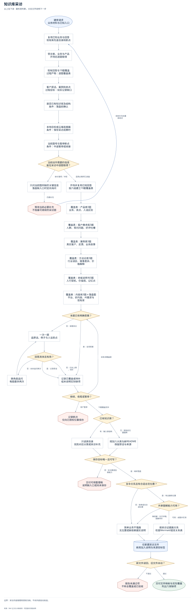
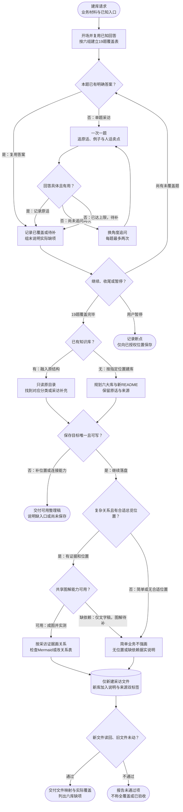

# 知识库采访：完整流程

输入：业务本人回答；现有知识库路径（如有）；业务与内容背景。

交付：业务知识库骨架；产品与客户原话素材；文件路径及资料缺口。

[按原尺寸打开完整流程图](../assets/workflow.svg)

## 按什么顺序做

### 复用入口与采访进度

使用当前成员材料；已有回答计入覆盖，每次只问一题。

### 追问具体事实

客户原话和卖点人话优先；单题最多追问两次，缺项待补。

### 完成六类采访与目标定位

逐组记录覆盖；第19题沿用或补齐既有库与保存位置。

### 按真实结构归位

已有库先只读结构，只新建补充；无库才新建六大库。

### 按复杂度安排总览

复杂关系在适合的新补充或新README中展示，简单业务记录无图原因。

### 逐项回读并报告

核位置、来源、缺项和旧文件未动；不可写时只交整理稿。

## 验收

- 19题均有覆盖或待补记录
- 每题最多两次追问且保留原话
- 只新建，原文件零修改移动删除
- 逐项读回位置、来源与真实覆盖
- 复杂关系在目标渲染器中可读；缺依赖不称已验收

采访内容按既有授权归档，不向外部自动发送。

## 对应规则

- [SKILL.md](../SKILL.md)
- [references/team-setup.md](team-setup.md)

可编辑的流程源码

