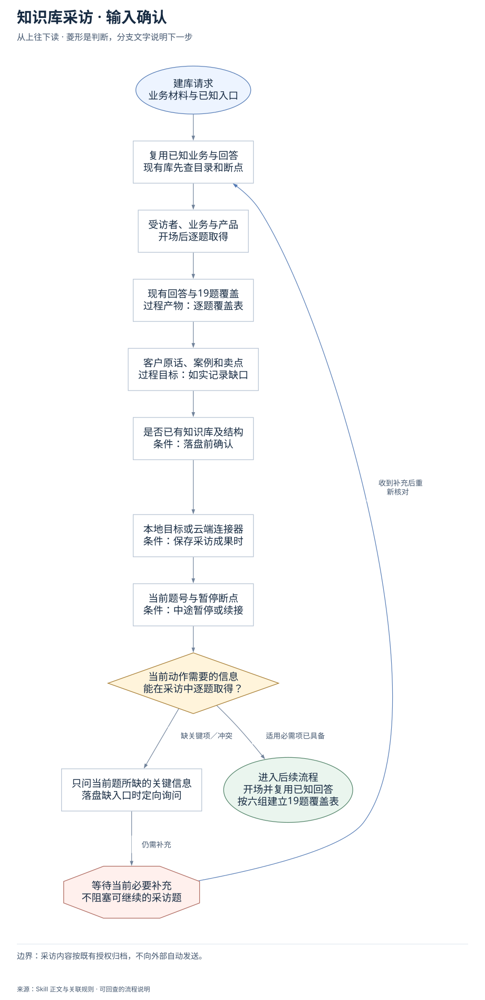

# 知识库采访：完整执行流程

先核对具体输入；已有材料能查明的直接读取，关键缺失或冲突才补充确认。沿完整图查看后续处理、失败去向与交付。

交付：业务知识库骨架；产品与客户原话素材；文件路径及资料缺口。

## 执行前确认哪些信息

| 输入 | 何时需要 | 从哪里取得 | 缺失或冲突怎么处理 |
| --- | --- | --- | --- |
| 受访者、业务与产品 | 开场后逐题取得 | 已有介绍直接复用，否则第1题了解卖什么、卖给谁和主推服务 | 按单题制开始采访，不要求先填完整业务表 |
| 现有回答与19题覆盖 | 过程产物：逐题覆盖表 | 从本次回答和已读资料映射19题；记录本次回答／已有资料／跳过／待补 | 内容不足每题最多追问两次，继续后续题并标待补 |
| 客户原话、案例和卖点 | 过程目标：如实记录缺口 | 逐题问具体例子、客户原话和人话卖点；已有可定位原话不改写 | 没有原话或真实故事就标待补，不能补成假案例 |
| 是否已有知识库及结构 | 条件：落盘前确认 | 沿用已给库入口或私有配置，已有库先只读目录树 | 只有入口缺失时问位置；未能写入时交可用稿而非称已建库 |
| 本地目标或云端连接器 | 条件：保存采访成果时 | 复用已授权本地位置；云端先查连接器、唯一目标及写入能力 | 路径不唯一或云端不可写只暂停落盘，不读作者资料或改已有文件 |
| 当前题号与暂停断点 | 条件：中途暂停或续接 | 读取会话或已授权保存的覆盖表，沿已覆盖题继续 | 没有可靠断点时用已有回答补覆盖表，不声称上次全部完成 |

## 输入确认、补齐与返回

[按原尺寸查看输入确认图](../assets/input-confirmation.svg)

## 完整执行、判断与异常去向

[按原尺寸打开完整执行图](../assets/workflow.svg)

## 每一步具体怎么做

### 输入与范围

**1. 建库请求；业务材料与已知入口**

建库请求；业务材料与已知入口。后续按实际结果分流：完成后：复用已知业务与回答，现有库先查目录和断点。

下一步：复用已知业务与回答；现有库先查目录和断点。

依据：[SKILL.md](../SKILL.md) 中的“一、角色定位”。

**2. 复用已知业务与回答；现有库先查目录和断点**

优先复用本轮材料、会话已有决定和本成员已授权来源。已有明确值直接沿用；先查可查来源，不重复索取。

下一步：受访者、业务与产品；开场后逐题取得。

依据：[SKILL.md](../SKILL.md) 中的“四、19 个问题”。

**3. 受访者、业务与产品；开场后逐题取得**

取得方式：已有介绍直接复用，否则第1题了解卖什么、卖给谁和主推服务。缺失处理：按单题制开始采访，不要求先填完整业务表。

下一步：现有回答与19题覆盖；过程产物：逐题覆盖表。

依据：[SKILL.md](../SKILL.md) 中的“三、开场白”。

**4. 现有回答与19题覆盖；过程产物：逐题覆盖表**

取得方式：从本次回答和已读资料映射19题；记录本次回答／已有资料／跳过／待补。缺失处理：内容不足每题最多追问两次，继续后续题并标待补。

下一步：客户原话、案例和卖点；过程目标：如实记录缺口。

依据：[SKILL.md](../SKILL.md) 中的“四、19 个问题”。

**5. 客户原话、案例和卖点；过程目标：如实记录缺口**

取得方式：逐题问具体例子、客户原话和人话卖点；已有可定位原话不改写。缺失处理：没有原话或真实故事就标待补，不能补成假案例。

下一步：是否已有知识库及结构；条件：落盘前确认。

依据：[SKILL.md](../SKILL.md) 中的“二、沟通法则”。

**6. 是否已有知识库及结构；条件：落盘前确认**

取得方式：沿用已给库入口或私有配置，已有库先只读目录树。缺失处理：只有入口缺失时问位置；未能写入时交可用稿而非称已建库。

下一步：本地目标或云端连接器；条件：保存采访成果时。

依据：[SKILL.md](../SKILL.md) 中的“第 19 题”。

**7. 本地目标或云端连接器；条件：保存采访成果时**

取得方式：复用已授权本地位置；云端先查连接器、唯一目标及写入能力。缺失处理：路径不唯一或云端不可写只暂停落盘，不读作者资料或改已有文件。

下一步：当前题号与暂停断点；条件：中途暂停或续接。

依据：[SKILL.md](../SKILL.md) 中的“五、落盘”。

**8. 当前题号与暂停断点；条件：中途暂停或续接**

取得方式：读取会话或已授权保存的覆盖表，沿已覆盖题继续。缺失处理：没有可靠断点时用已有回答补覆盖表，不声称上次全部完成。

下一步：当前动作需要的信息；能在采访中逐题取得？。

依据：[SKILL.md](../SKILL.md) 中的“六、质量标准”。

**9. 当前动作需要的信息；能在采访中逐题取得？**

建库请求已明确即可开场，第1–18题的未知业务内容由采访逐题取得，不能要求对方先填写完整资料。保存位置只在落盘时变为条件必需；已有回答不重问。

下一步：“缺关键项／冲突” → 只问当前题所缺的关键信息；落盘缺入口时定向询问；“适用必需项已具备” → 开场并复用已知回答；按六组建立19题覆盖表。

依据：[SKILL.md](../SKILL.md) 中的“四、19 个问题”。

**10. 只问当前题所缺的关键信息；落盘缺入口时定向询问**

先核对现有材料能否补齐，只问会改变当前动作或目标的关键缺口。来源冲突时保留原值和差异，不擅自合并。

下一步：“仍需补充” → 等待当前必要补充；不阻塞可继续的采访题。

依据：[SKILL.md](../SKILL.md) 中的“四、19 个问题”。

**11. 等待当前必要补充；不阻塞可继续的采访题**

暂停依赖缺失信息的动作，保留已完成读取、来源和断点；能够独立完成的部分照常交付。收到补充后重查字段再进入执行。

下一步：“收到补充后重新核对” → 复用已知业务与回答；现有库先查目录和断点。

依据：[SKILL.md](../SKILL.md) 中的“四、19 个问题”。

### 执行与核验

**1. 开场并复用已知回答；按六组建立19题覆盖表**

先沿已有回答建立六组19题覆盖表。随后循环核当前一题是否已覆盖、是否需追问以及是否继续；分组槽是采访记录结构，不是六组一次性问卷。

下一步：覆盖表：产品库3题；业务、卖点、人话区别。

依据：[SKILL.md](../SKILL.md) 中的“四、19 个问题（按六大库分组）”。

**2. 本题已有明确答案？**

逐题查看覆盖表：已由本次回答或已读资料明确回答则直接记录；尚未回答才提出当前一题，不把分组总览一次抛给用户。

下一步：“是：复用答案” → 记录已覆盖或待补；组末说明实际缺项；“否：单题采访” → 一次一题；追原话、例子与人话卖点。

依据：[SKILL.md](../SKILL.md) 中的“四、19 个问题（按六大库分组）”。

**3. 一次一题；追原话、例子与人话卖点**

一次一题；追原话、例子与人话卖点。后续按实际结果分流：完成后：回答具体且有用？。

下一步：回答具体且有用？。

依据：[SKILL.md](../SKILL.md) 中的“二、沟通法则（5 条）”。

**4. 回答具体且有用？**

回答具体且有用？。后续按实际结果分流：是：记录原话：记录已覆盖或待补，组末说明实际缺项；否：尚未追问两次：换角度追问，每题最多两次；否：已达上限，待补：记录已覆盖或待补，组末说明实际缺项。

下一步：“是：记录原话” → 记录已覆盖或待补；组末说明实际缺项；“否：尚未追问两次” → 换角度追问；每题最多两次；“否：已达上限，待补” → 记录已覆盖或待补；组末说明实际缺项。

依据：[SKILL.md](../SKILL.md) 中的“二、沟通法则（5 条）”。

**5. 换角度追问；每题最多两次**

换一个角度追问例子或原话；每题最多两次追问，然后进入下一题并保留待补项。

下一步：一次一题；追原话、例子与人话卖点。

依据：[SKILL.md](../SKILL.md) 中的“二、沟通法则（5 条）”。

**6. 记录已覆盖或待补；组末说明实际缺项**

记录已覆盖或待补；组末说明实际缺项。后续按实际结果分流：完成后：继续、收尾或暂停？。

下一步：继续、收尾或暂停？。

依据：[SKILL.md](../SKILL.md) 中的“四、19 个问题（按六大库分组）”。

**7. 继续、收尾或暂停？**

继续、收尾或暂停？。后续按实际结果分流：尚有未覆盖题：本题已有明确答案？；19题覆盖完毕：已有知识库？；用户暂停：记录断点，仅向已授权位置保存。

下一步：“尚有未覆盖题” → 本题已有明确答案？；“19题覆盖完毕” → 已有知识库？；“用户暂停” → 记录断点；仅向已授权位置保存。

依据：[SKILL.md](../SKILL.md) 中的“六、质量标准”。

**8. 已有知识库？**

已有知识库？。后续按实际结果分流：有：融入原结构：只读原目录，找到对应分类或采访补充；无：按指定位置建库：规划六大库与新README，保留原话与来源。

下一步：“有：融入原结构” → 只读原目录；找到对应分类或采访补充；“无：按指定位置建库” → 规划六大库与新README；保留原话与来源。

依据：[SKILL.md](../SKILL.md) 中的“第 19 题 · 收尾判断（决定怎么落盘）⭐”。

**9. 只读原目录；找到对应分类或采访补充**

只读原目录；找到对应分类或采访补充。后续按实际结果分流：完成后：保存目标唯一且可写？。

下一步：保存目标唯一且可写？。

依据：[SKILL.md](../SKILL.md) 中的“分支 A：对方已有知识库（融入，不打乱）”。

**10. 规划六大库与新README；保留原话与来源**

规划六大库与新README；保留原话与来源。后续按实际结果分流：完成后：保存目标唯一且可写？。

下一步：保存目标唯一且可写？。

依据：[SKILL.md](../SKILL.md) 中的“分支 B：对方没有知识库（新建六大库）”。

**11. 保存目标唯一且可写？**

保存目标唯一且可写？。后续按实际结果分流：否：补位置或连接能力：交付可用整理稿，说明缺入口或尚未保存；是：继续落盘：复杂关系且有合适总览位置？。

下一步：“否：补位置或连接能力” → 交付可用整理稿；说明缺入口或尚未保存；“是：继续落盘” → 复杂关系且有合适总览位置？。

依据：[SKILL.md](../SKILL.md) 中的“五、落盘（采访结束自动执行，不等用户说「总结」）”。

**12. 复杂关系且有合适总览位置？**

复杂关系且有合适总览位置？。后续按实际结果分流：是：有证据和位置：共享图解能力可用？；否：简单或无合适位置：简单业务不强画，无位置或缺依赖据实说明。

下一步：“是：有证据和位置” → 共享图解能力可用？；“否：简单或无合适位置” → 简单业务不强画；无位置或缺依赖据实说明。

依据：[SKILL.md](../SKILL.md) 中的“采访整理后的视觉判断”。

**13. 按采访证据画关系；检查Mermaid或改关系表**

按采访证据画关系；检查Mermaid或改关系表。后续按实际结果分流：完成后：仅新建采访文件，新库加入说明与来源双标签。

下一步：仅新建采访文件；新库加入说明与来源双标签。

依据：[SKILL.md](../SKILL.md) 中的“采访整理后的视觉判断”。

**14. 简单业务不强画；无位置或缺依赖据实说明**

简单业务不强画；无位置或缺依赖据实说明。后续按实际结果分流：完成后：仅新建采访文件，新库加入说明与来源双标签。

下一步：仅新建采访文件；新库加入说明与来源双标签。

依据：[SKILL.md](../SKILL.md) 中的“采访整理后的视觉判断”。

**15. 仅新建采访文件；新库加入说明与来源双标签**

旧库仅新建采访补充文件、不改README和既有文件；新库写六类文件与新README，保留来源、发言人与应用标签。

下一步：新文件读回、旧文件未动？。

依据：[SKILL.md](../SKILL.md) 中的“分支 B：对方没有知识库（新建六大库）”。

**16. 共享图解能力可用？**

共享图解能力可用？。后续按实际结果分流：可用：成图并实测：按采访证据画关系，检查Mermaid或改关系表；缺依赖：仅文字稿，图解待补：简单业务不强画，无位置或缺依赖据实说明。

下一步：“可用：成图并实测” → 按采访证据画关系；检查Mermaid或改关系表；“缺依赖：仅文字稿，图解待补” → 简单业务不强画；无位置或缺依赖据实说明。

依据：[SKILL.md](../SKILL.md) 中的“五、落盘（采访结束自动执行，不等用户说「总结」）”。

**17. 覆盖表：产品库3题；业务、卖点、人话区别**

先规划本组覆盖槽，再逐题采访，不一次抛给对方。覆盖第1–3题：业务、对象、主推产品及价位；最大的卖点和老客推荐原话；与同行不同的2–3个具体理由。已有答案不重复问。

下一步：覆盖表：客户需求库3题；人群、常问问题、好评吐槽。

依据：[SKILL.md](../SKILL.md) 中的“四、19 个问题”。

**18. 覆盖表：客户需求库3题；人群、常问问题、好评吐槽**

先规划本组覆盖槽，再逐题采访，不一次抛给对方。覆盖第4–6题：购买人群、至少3个高频问题、好评原话与可选吐槽；未取得目标数量照实记录缺口。

下一步：覆盖表：案例库3题；真实客户、反馈、业务故事。

依据：[SKILL.md](../SKILL.md) 中的“第二组 → 客户需求库”。

**19. 覆盖表：案例库3题；真实客户、反馈、业务故事**

先规划本组覆盖槽，再逐题采访，不一次抛给对方。覆盖第7–9题：一名印象深刻客户的来源和变化，令人意外的反馈，以及业务或产品背后的真实故事。

下一步：覆盖表：方法论库3题；行业误区、做事差异、价格解释。

依据：[SKILL.md](../SKILL.md) 中的“第三组 → 素材案例库”。

**20. 覆盖表：方法论库3题；行业误区、做事差异、价格解释**

先规划本组覆盖槽，再逐题采访，不一次抛给对方。覆盖第10–12题：2–3个行业误区、与同行不同的做事标准和不做什么、价格的实际解释。

下一步：覆盖表：老板说明书3题；入行契机、价值观、记忆点。

依据：[SKILL.md](../SKILL.md) 中的“第四组 → 方法论库”。

**21. 覆盖表：老板说明书3题；入行契机、价值观、记忆点**

先规划本组覆盖槽，再逐题采访，不一次抛给对方。覆盖第13–15题：为何入行、做人做事的差别、希望客户记住的词句；不把采访助手身份写成受访者。

下一步：覆盖表：内容库3题＋落盘题；平台、好内容、AI需求与现有库。

依据：[SKILL.md](../SKILL.md) 中的“第五组 → 老板说明书”。

**22. 覆盖表：内容库3题＋落盘题；平台、好内容、AI需求与现有库**

先规划本组覆盖槽，再逐题采访，不一次抛给对方。覆盖第16–18题的平台现状、内容痛点、可选高数据内容、优先产出类型，再由第19题判断融入旧库或新建。以上分组用于逐题覆盖表，实际仍每次只问1题。

下一步：本题已有明确答案？。

依据：[SKILL.md](../SKILL.md) 中的“第六组 → 内容生产库”。

### 交付与验收

**1. 记录断点；仅向已授权位置保存**

记录断点；仅向已授权位置保存。该分支的实际状态与未完成项保留在交付回执中。

此处保留待办与证据，补齐后接续原任务。

依据：[SKILL.md](../SKILL.md) 中的“六、质量标准”。

**2. 交付可用整理稿；说明缺入口或尚未保存**

交付可用整理稿；说明缺入口或尚未保存。该分支的实际状态与未完成项保留在交付回执中。

此处保留待办与证据，补齐后接续原任务。

依据：[SKILL.md](../SKILL.md) 中的“五、落盘（采访结束自动执行，不等用户说「总结」）”。

**3. 新文件读回、旧文件未动？**

逐个读回新文件位置、正文、来源与待补项；对比旧文件确保未修改、移动或删除。复杂图在真实目标渲染器检查。

下一步：“通过” → 交付文件映射与实际覆盖；列出六库缺项；“不通过” → 报告未通过项；不称全覆盖或已验收。

依据：[SKILL.md](../SKILL.md) 中的“六、质量标准”。

**4. 报告未通过项；不称全覆盖或已验收**

报告未通过项；不称全覆盖或已验收。该分支的实际状态与未完成项保留在交付回执中。

此处保留待办与证据，补齐后接续原任务。

依据：[SKILL.md](../SKILL.md) 中的“六、质量标准”。

**5. 交付文件映射与实际覆盖；列出六库缺项**

交付文件映射与实际覆盖；列出六库缺项。该分支的实际状态与未完成项保留在交付回执中。

这是本路径的交付或转交结果。

依据：[SKILL.md](../SKILL.md) 中的“两条分支共同的收尾汇报”。

## 验收

- 19题均有覆盖或待补记录
- 每题最多两次追问且保留原话
- 只新建，原文件零修改移动删除
- 逐项读回位置、来源与真实覆盖
- 复杂关系在目标渲染器中可读；缺依赖不称已验收

采访内容按既有授权归档，不向外部自动发送。

## 对应规则

- [SKILL.md](../SKILL.md)
- [references/team-setup.md](team-setup.md)

```mermaid
flowchart TB
  request(["建库请求<br/>业务材料与已知入口"])
  known["开场并复用已知回答<br/>按六组建立19题覆盖表"]
  covered{"本题已有明确答案？"}
  ask["一次一题<br/>追原话、例子与人话卖点"]
  specific{"回答具体且有用？"}
  follow["换角度追问<br/>每题最多两次"]
  record["记录已覆盖或待补<br/>组末说明实际缺项"]
  progress{"继续、收尾或暂停？"}
  pause(["记录断点<br/>仅向已授权位置保存"])
  existing{"已有知识库？"}
  structure["只读原目录<br/>找到对应分类或采访补充"]
  newplan["规划六大库与新README<br/>保留原话与来源"]
  target{"保存目标唯一且可写？"}
  draft(["交付可用整理稿<br/>说明缺入口或尚未保存"])
  complex{"复杂关系且有合适总览位置？"}
  visual["按采访证据画关系<br/>检查Mermaid或改关系表"]
  novisual["简单业务不强画<br/>无位置或缺依赖据实说明"]
  write[("仅新建采访文件<br/>新库加入说明与来源双标签")]
  verify{"新文件读回、旧文件未动？"}
  incomplete(["报告未通过项<br/>不称全覆盖或已验收"])
  done(["交付文件映射与实际覆盖<br/>列出六库缺项"])
  visualready{"共享图解能力可用？"}
  intake_lookup["复用已知业务与回答<br/>现有库先查目录和断点"]
  intake_person["受访者、业务与产品<br/>开场后逐题取得"]
  intake_answers["现有回答与19题覆盖<br/>过程产物：逐题覆盖表"]
  intake_voice["客户原话、案例和卖点<br/>过程目标：如实记录缺口"]
  intake_existing_kb["是否已有知识库及结构<br/>条件：落盘前确认"]
  intake_save_target["本地目标或云端连接器<br/>条件：保存采访成果时"]
  intake_progress["当前题号与暂停断点<br/>条件：中途暂停或续接"]
  intake_ready{"当前动作需要的信息<br/>能在采访中逐题取得？"}
  intake_clarify["只问当前题所缺的关键信息<br/>落盘缺入口时定向询问"]
  intake_wait(["等待当前必要补充<br/>不阻塞可继续的采访题"])
  group_product["覆盖表：产品库3题<br/>业务、卖点、人话区别"]
  group_customer["覆盖表：客户需求库3题<br/>人群、常问问题、好评吐槽"]
  group_case["覆盖表：案例库3题<br/>真实客户、反馈、业务故事"]
  group_method["覆盖表：方法论库3题<br/>行业误区、做事差异、价格解释"]
  group_owner["覆盖表：老板说明书3题<br/>入行契机、价值观、记忆点"]
  group_content["覆盖表：内容库3题＋落盘题<br/>平台、好内容、AI需求与现有库"]
  covered -->|"是：复用答案"| record
  covered -->|"否：单题采访"| ask
  ask --> specific
  specific -->|"是：记录原话"| record
  specific -->|"否：尚未追问两次"| follow
  specific -->|"否：已达上限，待补"| record
  follow --> ask
  record --> progress
  progress -->|"尚有未覆盖题"| covered
  progress -->|"19题覆盖完毕"| existing
  progress -->|"用户暂停"| pause
  existing -->|"有：融入原结构"| structure
  existing -->|"无：按指定位置建库"| newplan
  structure --> target
  newplan --> target
  target -->|"否：补位置或连接能力"| draft
  target -->|"是：继续落盘"| complex
  complex -->|"是：有证据和位置"| visualready
  complex -->|"否：简单或无合适位置"| novisual
  visual --> write
  novisual --> write
  write --> verify
  verify -->|"通过"| done
  verify -->|"不通过"| incomplete
  visualready -->|"可用：成图并实测"| visual
  visualready -->|"缺依赖：仅文字稿，图解待补"| novisual
  request --> intake_lookup
  intake_lookup --> intake_person
  intake_person --> intake_answers
  intake_answers --> intake_voice
  intake_voice --> intake_existing_kb
  intake_existing_kb --> intake_save_target
  intake_save_target --> intake_progress
  intake_progress --> intake_ready
  intake_ready -->|"缺关键项／冲突"| intake_clarify
  intake_clarify -->|"仍需补充"| intake_wait
  intake_wait -->|"收到补充后重新核对"| intake_lookup
  intake_ready -->|"适用必需项已具备"| known
  known --> group_product
  group_product --> group_customer
  group_customer --> group_case
  group_case --> group_method
  group_method --> group_owner
  group_owner --> group_content
  group_content --> covered
```

可编辑的完整流程源码

