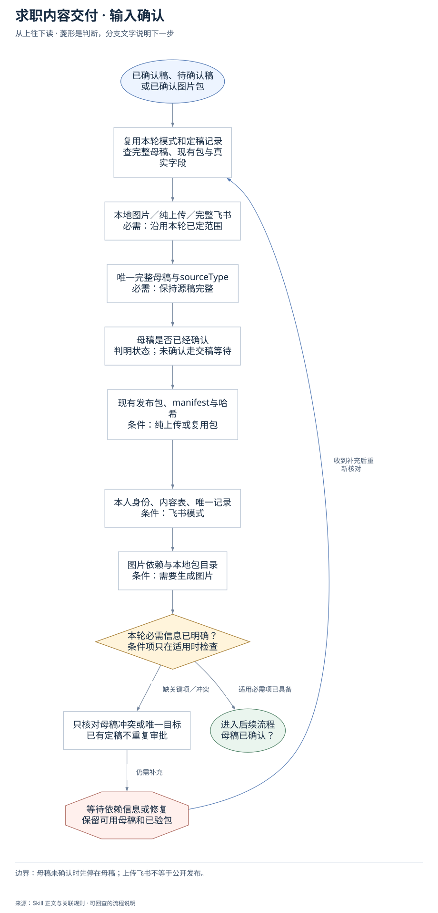
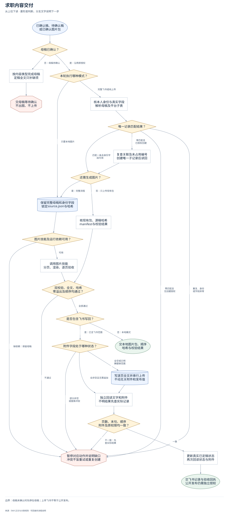

# 求职内容交付：完整执行流程

先核对具体输入；已有材料能查明的直接读取，关键缺失或冲突才补充确认。沿完整图查看后续处理、失败去向与交付。

交付：已验证图片包；逐页完整文案；授权后的飞书写回回执。

## 执行前确认哪些信息

| 输入 | 何时需要 | 从哪里取得 | 缺失或冲突怎么处理 |
| --- | --- | --- | --- |
| 本地图片／纯上传／完整飞书 | 必需：沿用本轮已定范围 | 从本次请求和既有约定判断，不让内部模式选择成为重复审批 | 若不同理解会改变写入对象，只有依赖该选择的外部写入等待澄清 |
| 唯一完整母稿与sourceType | 必需：保持源稿完整 | 飞书读关联母稿；本地读用户确认全文，区分参考改写与新文定稿 | 多份冲突或只读到节选时说明范围，不以平台摘要和历史分页代替全文 |
| 母稿是否已经确认 | 必需：判明状态，不要求已确认 | 从当前或会话已有明确的定稿回复核对，不重复索取同一次确认 | 未确认先完成并交母稿，然后等待；不提前出图或写附件 |
| 现有发布包、manifest与哈希 | 条件：纯上传或复用包 | 核最后确认目录、sourceHash、图片清单、自然顺序及双校验 | 缺校验或哈希冲突暂停上传；纯上传不擅自改稿重渲染 |
| 本人身份、内容表、唯一记录 | 条件：飞书模式 | 按任务入口或私有配置解析真实字段、母稿关联、唯一键和原权限 | 缺表或字段只停对应写入；重复记录先查冲突，不建替代Base |
| 图片依赖与本地包目录 | 条件：需要生成图片 | 检查已安装图片Skill、Node、Playwright、Chrome及授权输出目录 | 缺依赖保留母稿并说明未出包，不换渲染器假装通过 |

## 输入确认、补齐与返回

[按原尺寸查看输入确认图](../assets/input-confirmation.svg)

## 完整执行、判断与异常去向

[按原尺寸打开完整执行图](../assets/workflow.svg)

## 每一步具体怎么做

### 输入与范围

**1. 已确认稿、待确认稿；或已确认图片包**

已确认稿、待确认稿；或已确认图片包。后续按实际结果分流：完成后：复用本轮模式和定稿记录，查完整母稿、现有包与真实字段。

下一步：复用本轮模式和定稿记录；查完整母稿、现有包与真实字段。

依据：[SKILL.md](../SKILL.md) 中的“执行模式”。

**2. 复用本轮模式和定稿记录；查完整母稿、现有包与真实字段**

优先复用本轮材料、会话已有决定和本成员已授权来源。已有明确值直接沿用；先查可查来源，不重复索取。

下一步：本地图片／纯上传／完整飞书；必需：沿用本轮已定范围。

依据：[SKILL.md](../SKILL.md) 中的“执行模式”。

**3. 本地图片／纯上传／完整飞书；必需：沿用本轮已定范围**

取得方式：从本次请求和既有约定判断，不让内部模式选择成为重复审批。缺失处理：若不同理解会改变写入对象，只有依赖该选择的外部写入等待澄清。

下一步：唯一完整母稿与sourceType；必需：保持源稿完整。

依据：[SKILL.md](../SKILL.md) 中的“执行模式”。

**4. 唯一完整母稿与sourceType；必需：保持源稿完整**

取得方式：飞书读关联母稿；本地读用户确认全文，区分参考改写与新文定稿。缺失处理：多份冲突或只读到节选时说明范围，不以平台摘要和历史分页代替全文。

下一步：母稿是否已经确认；判明状态；未确认走交稿等待。

依据：[SKILL.md](../SKILL.md) 中的“硬规则”。

**5. 母稿是否已经确认；判明状态；未确认走交稿等待**

取得方式：从当前或会话已有明确的定稿回复核对，不重复索取同一次确认。缺失处理：未确认先完成并交母稿，然后等待；不提前出图或写附件。

下一步：现有发布包、manifest与哈希；条件：纯上传或复用包。

依据：[SKILL.md](../SKILL.md) 中的“母稿尚未确认”。

**6. 现有发布包、manifest与哈希；条件：纯上传或复用包**

取得方式：核最后确认目录、sourceHash、图片清单、自然顺序及双校验。缺失处理：缺校验或哈希冲突暂停上传；纯上传不擅自改稿重渲染。

下一步：本人身份、内容表、唯一记录；条件：飞书模式。

依据：[SKILL.md](../SKILL.md) 中的“只上传已确认图片包”。

**7. 本人身份、内容表、唯一记录；条件：飞书模式**

取得方式：按任务入口或私有配置解析真实字段、母稿关联、唯一键和原权限。缺失处理：缺表或字段只停对应写入；重复记录先查冲突，不建替代Base。

下一步：图片依赖与本地包目录；条件：需要生成图片。

依据：[references/feishu-writeback-rules.md](feishu-writeback-rules.md) 中的“3. 工具优先级”。

**8. 图片依赖与本地包目录；条件：需要生成图片**

取得方式：检查已安装图片Skill、Node、Playwright、Chrome及授权输出目录。缺失处理：缺依赖保留母稿并说明未出包，不换渲染器假装通过。

下一步：本轮必需信息已明确？；条件项只在适用时检查。

依据：[SKILL.md](../SKILL.md) 中的“**运行依赖：**”。

**9. 本轮必需信息已明确？；条件项只在适用时检查**

按每个字段的适用条件检查；可选偏好缺失采用本 Skill 的合理默认或保留未知，不阻塞无关步骤。母稿尚未确认是明确状态，不是阻塞母稿准备的输入缺失；进入后续待确认母稿分支，完成母稿后才等确认。

下一步：“缺关键项／冲突” → 只核对母稿冲突或唯一目标；已有定稿不重复审批；“适用必需项已具备” → 母稿已确认？。

依据：[SKILL.md](../SKILL.md) 中的“执行模式”。

**10. 只核对母稿冲突或唯一目标；已有定稿不重复审批**

先核对现有材料能否补齐，只问会改变当前动作或目标的关键缺口。来源冲突时保留原值和差异，不擅自合并。

下一步：“仍需补充” → 等待依赖信息或修复；保留可用母稿和已验包。

依据：[SKILL.md](../SKILL.md) 中的“执行模式”。

**11. 等待依赖信息或修复；保留可用母稿和已验包**

暂停依赖缺失信息的动作，保留已完成读取、来源和断点；能够独立完成的部分照常交付。收到补充后重查字段再进入执行。

下一步：“收到补充后重新核对” → 复用本轮模式和定稿记录；查完整母稿、现有包与真实字段。

依据：[SKILL.md](../SKILL.md) 中的“执行模式”。

### 执行与核验

**1. 母稿已确认？**

母稿已确认？。后续按实际结果分流：否：母稿待确认：按内容类型完成母稿，定稿全文只补缺项；是：沿用原授权：本轮执行哪种模式？。

下一步：“否：母稿待确认” → 按内容类型完成母稿；定稿全文只补缺项；“是：沿用原授权” → 本轮执行哪种模式？。

依据：[SKILL.md](../SKILL.md) 中的“母稿尚未确认”。

**2. 按内容类型完成母稿；定稿全文只补缺项**

按内容类型完成母稿；定稿全文只补缺项。后续按实际结果分流：完成后：先判参考改写或新文全文，保留定稿正文，只补缺失标题。

下一步：先判参考改写或新文全文；保留定稿正文，只补缺失标题。

依据：[references/content-generation-rules.md](content-generation-rules.md) 中的“1. 适用范围”。

**3. 本轮执行哪种模式？**

本轮执行哪种模式？。后续按实际结果分流：只要本地图片：保留完整母稿和身份字段，锁定source.json与哈希；完整飞书或纯上传：核本人身份与真实字段，解析母稿及平台子表。

下一步：“只要本地图片” → 保留完整母稿和身份字段；锁定source.json与哈希；“完整飞书或纯上传” → 核本人身份与真实字段；解析母稿及平台子表。

依据：[SKILL.md](../SKILL.md) 中的“执行模式”。

**4. 核本人身份与真实字段；解析母稿及平台子表**

核本人身份与真实字段；解析母稿及平台子表。后续按实际结果分流：完成后：读真实schema与关联母稿，记录唯一键、附件、状态和人工值。

下一步：读真实schema与关联母稿；记录唯一键、附件、状态和人工值。

依据：[references/feishu-writeback-rules.md](feishu-writeback-rules.md) 中的“3. 工具优先级”。

**5. 唯一记录匹配结果？**

唯一记录匹配结果？。后续按实际结果分流：匹配一条且身份字段可用：还需生成图片？；零匹配且已授权创建：复查关联及未占用编号，创建唯一子记录后读回；重复、身份或字段异常：暂停对应动作并说明缺口，冲突不盲重试或重复创建；零匹配且无创建授权：暂停对应动作并说明缺口，冲突不盲重试或重复创建。

下一步：“匹配一条且身份字段可用” → 还需生成图片？；“零匹配且已授权创建” → 复查关联及未占用编号；创建唯一子记录后读回；“重复、身份或字段异常” → 暂停对应动作并说明缺口；冲突不盲重试或重复创建；“零匹配且无创建授权” → 暂停对应动作并说明缺口；冲突不盲重试或重复创建。

依据：[references/feishu-writeback-rules.md](feishu-writeback-rules.md) 中的“4. 目标记录定位”。

**6. 复查关联及未占用编号；创建唯一子记录后读回**

复查关联及未占用编号；创建唯一子记录后读回。后续按实际结果分流：完成后：还需生成图片？。

下一步：还需生成图片？。

依据：[references/feishu-writeback-rules.md](feishu-writeback-rules.md) 中的“4. 目标记录定位”。

**7. 还需生成图片？**

还需生成图片？。后续按实际结果分流：是：完整流程：保留完整母稿和身份字段，锁定source.json与哈希；否：只上传现有包：核现有包、源稿哈希，manifest与校验结果。

下一步：“是：完整流程” → 保留完整母稿和身份字段；锁定source.json与哈希；“否：只上传现有包” → 核现有包、源稿哈希；manifest与校验结果。

依据：[SKILL.md](../SKILL.md) 中的“只上传已确认图片包”。

**8. 保留完整母稿和身份字段；锁定source.json与哈希**

锁定标题、全文、sourceType、已有业务身份和标准化sourceHash写只读source.json。本地无飞书ID时不造ID、不建记录凑字段。

下一步：图片技能及运行依赖可用？。

依据：[SKILL.md](../SKILL.md) 中的“只要本地图片”。

**9. 图片技能及运行依赖可用？**

图片技能及运行依赖可用？。后续按实际结果分流：可用：调用图片技能，分页、渲染、逐页验收；缺依赖：保留母稿：暂停对应动作并说明缺口，冲突不盲重试或重复创建。

下一步：“可用” → 调用图片技能；分页、渲染、逐页验收；“缺依赖：保留母稿” → 暂停对应动作并说明缺口；冲突不盲重试或重复创建。

依据：[SKILL.md](../SKILL.md) 中的“**运行依赖：**”。

**10. 调用图片技能；分页、渲染、逐页验收**

调用图片技能；分页、渲染、逐页验收。后续按实际结果分流：完成后：双校验、全文、哈希，零溢出及顺序均通过？。

下一步：双校验、全文、哈希；零溢出及顺序均通过？。

依据：[SKILL.md](../SKILL.md) 中的“**REQUIRED SUB-SKILL:**”。

**11. 核现有包、源稿哈希；manifest与校验结果**

核现有包、源稿哈希；manifest与校验结果。后续按实际结果分流：完成后：双校验、全文、哈希，零溢出及顺序均通过？。

下一步：双校验、全文、哈希；零溢出及顺序均通过？。

依据：[SKILL.md](../SKILL.md) 中的“只上传已确认图片包”。

**12. 双校验、全文、哈希；零溢出及顺序均通过？**

同时确认validation.json.ok、final-verification.json.ok、exactText=true、overflowCount=0、sourceHash和NN.png顺序；任何一项失败停在包校验。

下一步：“不通过” → 暂停对应动作并说明缺口；冲突不盲重试或重复创建；“全部通过” → 是否包含飞书写回？。

依据：[SKILL.md](../SKILL.md) 中的“4. 仅当返回包”。

**13. 是否包含飞书写回？**

是否包含飞书写回？。后续按实际结果分流：否：本地模式：交本地图片包、顺序，哈希与校验结果；是：已含飞书范围：附件字段处于哪种状态？。

下一步：“否：本地模式” → 交本地图片包、顺序；哈希与校验结果；“是：已含飞书范围” → 附件字段处于哪种状态？。

依据：[SKILL.md](../SKILL.md) 中的“执行模式”。

**14. 附件字段处于哪种状态？**

读取当前图片01至候选末字段：全空才正常传；部分非空先判断补缺或替换；全非空且未授权替换不再追加，未知结果先读回。

下一步：“全空或已明确替换范围” → 写逐页全文并串行上传；不动无关附件和发布值；“全非空且无需追加” → 独立回读文字和附件；不明结果先查实际记录；“部分非空或替换冲突” → 暂停对应动作并说明缺口；冲突不盲重试或重复创建。

依据：[references/feishu-writeback-rules.md](feishu-writeback-rules.md) 中的“8. 附件幂等”。

**15. 写逐页全文并串行上传；不动无关附件和发布值**

写逐页全文并串行上传；不动无关附件和发布值。后续按实际结果分流：完成后：独立回读文字和附件，不明结果先查实际记录。

下一步：独立回读文字和附件；不明结果先查实际记录。

依据：[references/feishu-writeback-rules.md](feishu-writeback-rules.md) 中的“7. 写入顺序”。

**16. 更新真实已定稿状态；再次回读状态与附件**

更新真实已定稿状态；再次回读状态与附件。后续按实际结果分流：完成后：交飞书记录与验收回执，公开发布仍需独立授权。

下一步：交飞书记录与验收回执；公开发布仍需独立授权。

依据：[references/feishu-writeback-rules.md](feishu-writeback-rules.md) 中的“7. 写入顺序”。

**17. 先判参考改写或新文全文；保留定稿正文，只补缺失标题**

新文全文模式保留标题、简介和正文，不为规范重写；参考改写按主要内容类型选择结构，截图不可辨的数字保持待确认。

下一步：岗位／方法／资讯／案例／综合；类型决定叙事与来源要求。

依据：[references/content-generation-rules.md](content-generation-rules.md) 中的“新文全文输入规则”。

**18. 岗位／方法／资讯／案例／综合；类型决定叙事与来源要求**

按原文目的选主contentType。资讯保留具体日期和来源，案例保留真实起点与选择，表格与数字不改变含义；完成全文自检后才交母稿。

下一步：交母稿等待确认；不出图、不上传。

依据：[references/content-generation-rules.md](content-generation-rules.md) 中的“3. 内容类型识别”。

**19. 读真实schema与关联母稿；记录唯一键、附件、状态和人工值**

静默核本人账号，读field-list和record-get；保存本次Base/table/record、内容ID、关联母稿以及字段语义、原权限和人工值。

下一步：唯一记录匹配结果？。

依据：[references/feishu-writeback-rules.md](feishu-writeback-rules.md) 中的“3. 工具优先级”。

### 交付与验收

**1. 交母稿等待确认；不出图、不上传**

交母稿等待确认；不出图、不上传。该分支的实际状态与未完成项保留在交付回执中。

此处保留待办与证据，补齐后接续原任务。

依据：[SKILL.md](../SKILL.md) 中的“母稿尚未确认”。

**2. 交本地图片包、顺序；哈希与校验结果**

交本地图片包、顺序；哈希与校验结果。该分支的实际状态与未完成项保留在交付回执中。

这是本路径的交付或转交结果。

依据：[SKILL.md](../SKILL.md) 中的“只要本地图片”。

**3. 独立回读文字和附件；不明结果先查实际记录**

独立回读文字和附件；不明结果先查实际记录。后续按实际结果分流：完成后：核逐页全文与最后一句，顺序拼接必须等于母稿。

下一步：核逐页全文与最后一句；顺序拼接必须等于母稿。

依据：[SKILL.md](../SKILL.md) 中的“只上传已确认图片包”。

**4. 页数、末句、顺序；附件及原权限均一致？**

页数、末句、顺序；附件及原权限均一致？。后续按实际结果分流：一致：更新真实已定稿状态，再次回读状态与附件；不一致：先查实际结果：暂停对应动作并说明缺口，冲突不盲重试或重复创建。

下一步：“一致” → 更新真实已定稿状态；再次回读状态与附件；“不一致：先查实际结果” → 暂停对应动作并说明缺口；冲突不盲重试或重复创建。

依据：[references/feishu-writeback-rules.md](feishu-writeback-rules.md) 中的“10. 最终读回”。

**5. 交飞书记录与验收回执；公开发布仍需独立授权**

交飞书记录与验收回执；公开发布仍需独立授权。该分支的实际状态与未完成项保留在交付回执中。

这是本路径的交付或转交结果。

依据：[SKILL.md](../SKILL.md) 中的“最终报告”。

**6. 暂停对应动作并说明缺口；冲突不盲重试或重复创建**

暂停对应动作并说明缺口；冲突不盲重试或重复创建。该分支的实际状态与未完成项保留在交付回执中。

此处保留待办与证据，补齐后接续原任务。

依据：[SKILL.md](../SKILL.md) 中的“校验失败、哈希不一致、附件冲突”。

**7. 核逐页全文与最后一句；顺序拼接必须等于母稿**

每页保留图片中实际全部文字；页数与图片数一致，顺序拼接保留完整母稿及末句，不能用摘要、字数或起止范围替代。

下一步：核01至N各一张；N+1以后空，是否发布保留。

依据：[references/feishu-writeback-rules.md](feishu-writeback-rules.md) 中的“6. “图片分页文案”的硬性格式”。

**8. 核01至N各一张；N+1以后空，是否发布保留**

逐字段比manifest文件名与顺序，检查没有混入旧包；保留是否发布和无关字段，最后才把真实存在的内容状态置已定稿并再次读回。

下一步：页数、末句、顺序；附件及原权限均一致？。

依据：[references/feishu-writeback-rules.md](feishu-writeback-rules.md) 中的“10. 最终读回”。

## 验收

- 唯一母稿和包哈希一致
- validation与final-verification均通过
- exactText=true且零溢出、页序一致
- 逐页全文含末句且每附件字段一张
- 身份关联及原权限回读，是否发布不误改

母稿未确认时先停在母稿；上传飞书不等于公开发布。

## 对应规则

- [SKILL.md](../SKILL.md)
- [references/content-generation-rules.md](content-generation-rules.md)
- [references/feishu-writeback-rules.md](feishu-writeback-rules.md)
- [references/team-setup.md](team-setup.md)

```mermaid
flowchart TB
  request(["已确认稿、待确认稿<br/>或已确认图片包"])
  approved{"母稿已确认？"}
  draft["按内容类型完成母稿<br/>定稿全文只补缺项"]
  wait(["交母稿等待确认<br/>不出图、不上传"])
  mode{"本轮执行哪种模式？"}
  identity["核本人身份与真实字段<br/>解析母稿及平台子表"]
  target{"唯一记录匹配结果？"}
  create["复查关联及未占用编号<br/>创建唯一子记录后读回"]
  generate{"还需生成图片？"}
  lock[("保留完整母稿和身份字段<br/>锁定source.json与哈希")]
  ready{"图片技能及运行依赖可用？"}
  render["调用图片技能<br/>分页、渲染、逐页验收"]
  existing["核现有包、源稿哈希<br/>manifest与校验结果"]
  package{"双校验、全文、哈希<br/>零溢出及顺序均通过？"}
  delivery{"是否包含飞书写回？"}
  local(["交本地图片包、顺序<br/>哈希与校验结果"])
  attachments{"附件字段处于哪种状态？"}
  write[("写逐页全文并串行上传<br/>不动无关附件和发布值")]
  readback["独立回读文字和附件<br/>不明结果先查实际记录"]
  qa{"页数、末句、顺序<br/>附件及原权限均一致？"}
  state["更新真实已定稿状态<br/>再次回读状态与附件"]
  done(["交飞书记录与验收回执<br/>公开发布仍需独立授权"])
  stop(["暂停对应动作并说明缺口<br/>冲突不盲重试或重复创建"])
  intake_lookup["复用本轮模式和定稿记录<br/>查完整母稿、现有包与真实字段"]
  intake_mode["本地图片／纯上传／完整飞书<br/>必需：沿用本轮已定范围"]
  intake_source["唯一完整母稿与sourceType<br/>必需：保持源稿完整"]
  intake_approval["母稿是否已经确认<br/>判明状态；未确认走交稿等待"]
  intake_package["现有发布包、manifest与哈希<br/>条件：纯上传或复用包"]
  intake_target["本人身份、内容表、唯一记录<br/>条件：飞书模式"]
  intake_dependencies["图片依赖与本地包目录<br/>条件：需要生成图片"]
  intake_ready{"本轮必需信息已明确？<br/>条件项只在适用时检查"}
  intake_clarify["只核对母稿冲突或唯一目标<br/>已有定稿不重复审批"]
  intake_wait(["等待依赖信息或修复<br/>保留可用母稿和已验包"])
  draft_source_type["先判参考改写或新文全文<br/>保留定稿正文，只补缺失标题"]
  draft_content_type["岗位／方法／资讯／案例／综合<br/>类型决定叙事与来源要求"]
  map_fields["读真实schema与关联母稿<br/>记录唯一键、附件、状态和人工值"]
  verify_page_text["核逐页全文与最后一句<br/>顺序拼接必须等于母稿"]
  verify_attachments["核01至N各一张<br/>N+1以后空，是否发布保留"]
  approved -->|"否：母稿待确认"| draft
  approved -->|"是：沿用原授权"| mode
  mode -->|"只要本地图片"| lock
  mode -->|"完整飞书或纯上传"| identity
  target -->|"匹配一条且身份字段可用"| generate
  target -->|"零匹配且已授权创建"| create
  target -->|"重复、身份或字段异常"| stop
  target -->|"零匹配且无创建授权"| stop
  create --> generate
  generate -->|"是：完整流程"| lock
  generate -->|"否：只上传现有包"| existing
  lock --> ready
  ready -->|"可用"| render
  ready -->|"缺依赖：保留母稿"| stop
  render --> package
  existing --> package
  package -->|"不通过"| stop
  package -->|"全部通过"| delivery
  delivery -->|"否：本地模式"| local
  delivery -->|"是：已含飞书范围"| attachments
  attachments -->|"全空或已明确替换范围"| write
  attachments -->|"全非空且无需追加"| readback
  attachments -->|"部分非空或替换冲突"| stop
  write --> readback
  qa -->|"一致"| state
  qa -->|"不一致：先查实际结果"| stop
  state --> done
  request --> intake_lookup
  intake_lookup --> intake_mode
  intake_mode --> intake_source
  intake_source --> intake_approval
  intake_approval --> intake_package
  intake_package --> intake_target
  intake_target --> intake_dependencies
  intake_dependencies --> intake_ready
  intake_ready -->|"缺关键项／冲突"| intake_clarify
  intake_clarify -->|"仍需补充"| intake_wait
  intake_wait -->|"收到补充后重新核对"| intake_lookup
  intake_ready -->|"适用必需项已具备"| approved
  draft --> draft_source_type
  draft_source_type --> draft_content_type
  draft_content_type --> wait
  identity --> map_fields
  map_fields --> target
  readback --> verify_page_text
  verify_page_text --> verify_attachments
  verify_attachments --> qa
```

可编辑的完整流程源码

