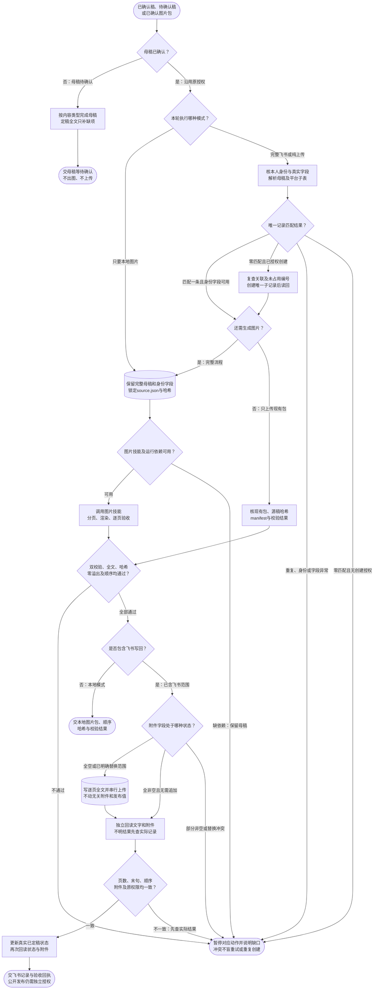

# 求职内容交付：完整流程

输入：已确认唯一母稿；目标图片包或飞书记录；本轮生产模式。

交付：已验证图片包；逐页完整文案；授权后的飞书写回回执。

[按原尺寸打开完整流程图](../assets/workflow.svg)

## 按什么顺序做

### 确认母稿与执行模式

未确认只交母稿；已确认按本地图片、纯上传、完整飞书范围执行。

### 核对飞书与唯一记录

仅飞书分支检查本人、真实字段与关联；零匹配按已给授权创建，多匹配停止。

### 锁定源稿并交由图片技能

保留完整标题正文和身份字段，按合同计算哈希；依赖缺失不替换渲染器。

### 验包与附件幂等

两份校验通过、全文一致、零溢出、哈希与顺序一致才继续；冲突停止。

### 按顺序写回并读回

逐页全文与附件串行写入；校验后更新真实已定稿状态，不改发布值。

### 按实际模式交付

本地仅交包；飞书交链接与身份字段、附件读回和状态。

## 验收

- 唯一母稿和包哈希一致
- validation与final-verification均通过
- exactText=true且零溢出、页序一致
- 逐页全文含末句且每附件字段一张
- 身份关联及原权限回读，是否发布不误改

母稿未确认时先停在母稿；上传飞书不等于公开发布。

## 对应规则

- [SKILL.md](../SKILL.md)
- [references/content-generation-rules.md](content-generation-rules.md)
- [references/feishu-writeback-rules.md](feishu-writeback-rules.md)
- [references/team-setup.md](team-setup.md)

可编辑的流程源码

