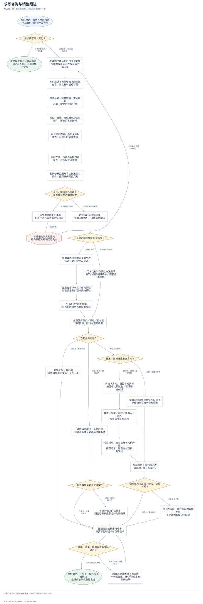
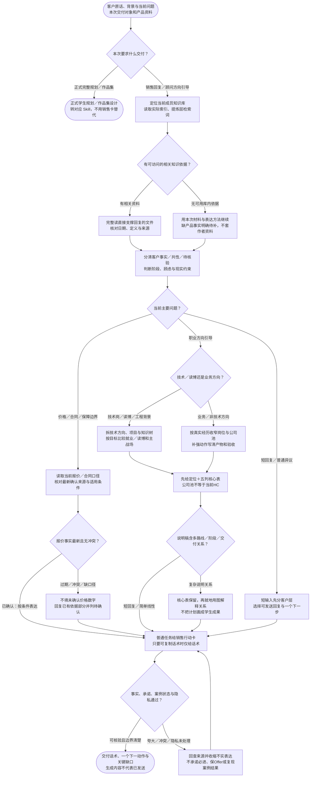

# 求职咨询与销售跟进：完整流程

输入：客户问题与对话；最新产品与报价口径；相关案例和服务证据。

交付：客户判断与知识抓手；可发送微信话术；跟进动作与风险提醒。

[按原尺寸打开完整流程图](../assets/workflow.svg)

## 按什么顺序做

### 按交付对象分流

普通回复和顾问方向引导由本 Skill 处理；正式学生规划、作品集转对应合同。

### 先检索当前成员知识库

读索引及直接相关全文，分清客户事实与库内依据；没有库时用本次材料继续并注明事实缺口。

### 诊断客户并选择任务路径

按问题处理短回复、方向建议或报价异议；技术与读博不套非技术模板，价格冲突不编数字。

### 组织可发内容与下一动作

只选一两个相关抓手，规划核心表可独立转发，复杂说明才配关系图。

### 核对承诺、案例与隐私

产品卖点回查当前定义；HC与Offer分开，输出话术不等于对外发送。

## 验收

- 卖点有当前来源
- 案例状态不夸大
- 不承诺必进或保 Offer

生成话术不代表已发送；正式学生规划转对应 Skill。

## 对应规则

- [SKILL.md](../SKILL.md)
- [references/knowledge-base-routing.md](knowledge-base-routing.md)
- [references/product-pricing-sources.md](product-pricing-sources.md)
- [references/technical-career-planning.md](technical-career-planning.md)

可编辑的流程源码

