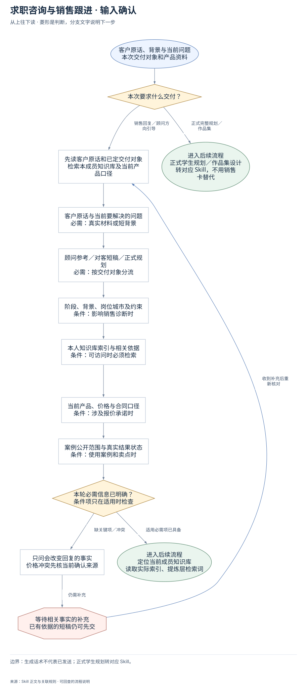

# 求职咨询与销售跟进：完整执行流程

先核对具体输入；已有材料能查明的直接读取，关键缺失或冲突才补充确认。沿完整图查看后续处理、失败去向与交付。

交付：客户判断与知识抓手；可发送微信话术；跟进动作与风险提醒。

## 执行前确认哪些信息

| 输入 | 何时需要 | 从哪里取得 | 缺失或冲突怎么处理 |
| --- | --- | --- | --- |
| 客户原话与当前要解决的问题 | 必需：真实材料或短背景 | 先读聊天、话术、简历或短背景；提取当前顾虑和本次希望回复的对象 | 输入短可显式使用合理假设，关键事实不能猜，不要求一开始填全简历 |
| 顾问参考／对客短稿／正式规划 | 必需：按交付对象分流 | 从用户要求辨认只要话术、销售行动卡、顾问方向引导还是正式学生文档 | 已有明确目标沿用；正式规划转专用Skill，不用内部销售卡替代 |
| 阶段、背景、岗位城市及约束 | 条件：影响销售诊断时 | 从当前客户证据读毕业时间、城市、英语、薪资偏好和经历，和共性案例分开 | 未知只列会改变判断的缺口，不把知识库典型客户套上当前客户 |
| 本人知识库索引与相关依据 | 条件：可访问时必须检索 | 任务入口→成员私有配置→当前授权工作区索引，完整打开直接支撑回复的文件 | 无可用库用本次材料和表达方法继续，缺产品事实照实保留 |
| 当前产品、价格与合同口径 | 条件：涉及报价承诺时 | 读最新且已确认报价、合同或产品口径，记录日期和适用档位 | 过旧或同层冲突先待确认；可交不含未确认价格数字的回复 |
| 案例公开范围与真实结果状态 | 条件：使用案例和卖点时 | 核案例是HC、Offer、进行中还是已完成，核卖点分母、周期和限制 | 未授权案例只内部类比或脱敏，不能编结果或承诺复现 |

## 输入确认、补齐与返回

[按原尺寸查看输入确认图](../assets/input-confirmation.svg)

## 完整执行、判断与异常去向

[按原尺寸打开完整执行图](../assets/workflow.svg)

## 每一步具体怎么做

### 输入与范围

**1. 客户原话、背景与当前问题；本次交付对象和产品资料**

客户原话、背景与当前问题；本次交付对象和产品资料。后续按实际结果分流：完成后：先读客户原话和已定交付对象，检索本成员知识库及当前产品口径。

下一步：本次要求什么交付？。

依据：[SKILL.md](../SKILL.md) 中的“默认输出”。

**2. 本次要求什么交付？**

先根据本次交付对象做边界分流；转专用 Skill 的请求直接携已有来源转交，不要求先填齐本 Skill 的后续执行字段。本次要求什么交付？。后续按实际结果分流：正式完整规划／作品集：正式学生规划／作品集设计，转对应 Skill，不用销售卡替代；销售回复／顾问方向引导：定位当前成员知识库，读取实际索引、提炼层检索词。

下一步：“正式完整规划／作品集” → 正式学生规划／作品集设计；转对应 Skill，不用销售卡替代；“销售回复／顾问方向引导” → 先读客户原话和已定交付对象；检索本成员知识库及当前产品口径。

依据：[SKILL.md](../SKILL.md) 中的“默认输出”。

**3. 先读客户原话和已定交付对象；检索本成员知识库及当前产品口径**

优先复用本轮材料、会话已有决定和本成员已授权来源。已有明确值直接沿用；先查可查来源，不重复索取。

下一步：客户原话与当前要解决的问题；必需：真实材料或短背景。

依据：[SKILL.md](../SKILL.md) 中的“运行规则”。

**4. 客户原话与当前要解决的问题；必需：真实材料或短背景**

取得方式：先读聊天、话术、简历或短背景；提取当前顾虑和本次希望回复的对象。缺失处理：输入短可显式使用合理假设，关键事实不能猜，不要求一开始填全简历。

下一步：顾问参考／对客短稿／正式规划；必需：按交付对象分流。

依据：[SKILL.md](../SKILL.md) 中的“默认输出”。

**5. 顾问参考／对客短稿／正式规划；必需：按交付对象分流**

取得方式：从用户要求辨认只要话术、销售行动卡、顾问方向引导还是正式学生文档。缺失处理：已有明确目标沿用；正式规划转专用Skill，不用内部销售卡替代。

下一步：阶段、背景、岗位城市及约束；条件：影响销售诊断时。

依据：[SKILL.md](../SKILL.md) 中的“默认输出”。

**6. 阶段、背景、岗位城市及约束；条件：影响销售诊断时**

取得方式：从当前客户证据读毕业时间、城市、英语、薪资偏好和经历，和共性案例分开。缺失处理：未知只列会改变判断的缺口，不把知识库典型客户套上当前客户。

下一步：本人知识库索引与相关依据；条件：可访问时必须检索。

依据：[SKILL.md](../SKILL.md) 中的“运行规则”。

**7. 本人知识库索引与相关依据；条件：可访问时必须检索**

取得方式：任务入口→成员私有配置→当前授权工作区索引，完整打开直接支撑回复的文件。缺失处理：无可用库用本次材料和表达方法继续，缺产品事实照实保留。

下一步：当前产品、价格与合同口径；条件：涉及报价承诺时。

依据：[references/knowledge-base-routing.md](knowledge-base-routing.md) 中的“定位知识库”。

**8. 当前产品、价格与合同口径；条件：涉及报价承诺时**

取得方式：读最新且已确认报价、合同或产品口径，记录日期和适用档位。缺失处理：过旧或同层冲突先待确认；可交不含未确认价格数字的回复。

下一步：案例公开范围与真实结果状态；条件：使用案例和卖点时。

依据：[references/product-pricing-sources.md](product-pricing-sources.md) 中的“报价规则”。

**9. 案例公开范围与真实结果状态；条件：使用案例和卖点时**

取得方式：核案例是HC、Offer、进行中还是已完成，核卖点分母、周期和限制。缺失处理：未授权案例只内部类比或脱敏，不能编结果或承诺复现。

下一步：本轮必需信息已明确？；条件项只在适用时检查。

依据：[SKILL.md](../SKILL.md) 中的“运行规则”。

**10. 本轮必需信息已明确？；条件项只在适用时检查**

按每个字段的适用条件检查；可选偏好缺失采用本 Skill 的合理默认或保留未知，不阻塞无关步骤。

下一步：“缺关键项／冲突” → 只问会改变回复的事实；价格冲突先核当前确认来源；“适用必需项已具备” → 定位当前成员知识库；读取实际索引、提炼层检索词。

依据：[SKILL.md](../SKILL.md) 中的“运行规则”。

**11. 只问会改变回复的事实；价格冲突先核当前确认来源**

先核对现有材料能否补齐，只问会改变当前动作或目标的关键缺口。来源冲突时保留原值和差异，不擅自合并。

下一步：“仍需补充” → 等待相关事实的补充；已有依据的短稿仍可先交。

依据：[SKILL.md](../SKILL.md) 中的“运行规则”。

**12. 等待相关事实的补充；已有依据的短稿仍可先交**

暂停依赖缺失信息的动作，保留已完成读取、来源和断点；能够独立完成的部分照常交付。收到补充后重查字段再进入执行。

下一步：“收到补充后重新核对” → 先读客户原话和已定交付对象；检索本成员知识库及当前产品口径。

依据：[SKILL.md](../SKILL.md) 中的“运行规则”。

### 执行与核验

**1. 定位当前成员知识库；读取实际索引、提炼层检索词**

定位当前成员知识库；读取实际索引、提炼层检索词。后续按实际结果分流：完成后：有可访问的相关知识依据？。

下一步：有可访问的相关知识依据？。

依据：[references/knowledge-base-routing.md](knowledge-base-routing.md) 中的“每次任务的最小预检”。

**2. 有可访问的相关知识依据？**

有可访问的相关知识依据？。后续按实际结果分流：有相关资料：完整读直接支撑回复的文件，核对日期、定义与来源；无可用库内依据：用本次材料与表达方法继续，缺产品事实明确待补，不套作者资料。

下一步：“有相关资料” → 完整读直接支撑回复的文件；核对日期、定义与来源；“无可用库内依据” → 用本次材料与表达方法继续；缺产品事实明确待补，不套作者资料。

依据：[references/knowledge-base-routing.md](knowledge-base-routing.md) 中的“定位知识库”。

**3. 完整读直接支撑回复的文件；核对日期、定义与来源**

完整读直接支撑回复的文件；核对日期、定义与来源。后续按实际结果分流：完成后：逐条分客户事实／库内共性，动态信息和口径冲突待核验。

下一步：逐条分客户事实／库内共性；动态信息和口径冲突待核验。

依据：[references/knowledge-base-routing.md](knowledge-base-routing.md) 中的“每次任务的最小预检”。

**4. 用本次材料与表达方法继续；缺产品事实明确待补，不套作者资料**

用本次材料与表达方法继续；缺产品事实明确待补，不套作者资料。后续按实际结果分流：完成后：分清客户事实／共性／待核验，判断阶段、顾虑与现实约束。

下一步：分清客户事实／共性／待核验；判断阶段、顾虑与现实约束。

依据：[references/knowledge-base-routing.md](knowledge-base-routing.md) 中的“定位知识库”。

**5. 分清客户事实／共性／待核验；判断阶段、顾虑与现实约束**

分清客户事实／共性／待核验；判断阶段、顾虑与现实约束。后续按实际结果分流：完成后：当前主要问题？。

下一步：当前主要问题？。

依据：[SKILL.md](../SKILL.md) 中的“运行规则”。

**6. 当前主要问题？**

当前主要问题？。后续按实际结果分流：短回复／普通异议：短输入先分客户层，选择可发送回复与一个下一步；价格／合同／保障边界：读取当前报价／合同口径，核对最新确认来源与适用条件；职业方向引导：技术／读博还是业务方向？。

下一步：“短回复／普通异议” → 短输入先分客户层；选择可发送回复与一个下一步；“价格／合同／保障边界” → 读取当前报价／合同口径；核对最新确认来源与适用条件；“职业方向引导” → 技术／读博还是业务方向？。

依据：[SKILL.md](../SKILL.md) 中的“运行规则”。

**7. 短输入先分客户层；选择可发送回复与一个下一步**

短输入先分客户层；选择可发送回复与一个下一步。后续按实际结果分流：完成后：普通任务给销售行动卡，只要可复制话术时仅给话术。

下一步：普通任务给销售行动卡；只要可复制话术时仅给话术。

依据：[SKILL.md](../SKILL.md) 中的“默认输出”。

**8. 读取当前报价／合同口径；核对最新确认来源与适用条件**

读取当前报价／合同口径；核对最新确认来源与适用条件。后续按实际结果分流：完成后：报价事实最新且无冲突？。

下一步：报价事实最新且无冲突？。

依据：[references/product-pricing-sources.md](product-pricing-sources.md) 中的“报价规则”。

**9. 报价事实最新且无冲突？**

按用户本次最新确认资料、当前产品口径、其他提炼层、来源层的次序核对；冲突未消除不把旧表数字写成现价。

下一步：“已确认：按条件表达” → 普通任务给销售行动卡；只要可复制话术时仅给话术；“过期／冲突／缺口径” → 不填未确认价格数字；回复已有依据部分并列待确认。

依据：[references/product-pricing-sources.md](product-pricing-sources.md) 中的“说明”。

**10. 不填未确认价格数字；回复已有依据部分并列待确认**

不填未确认价格数字；回复已有依据部分并列待确认。后续按实际结果分流：完成后：普通任务给销售行动卡，只要可复制话术时仅给话术。

下一步：普通任务给销售行动卡；只要可复制话术时仅给话术。

依据：[references/product-pricing-sources.md](product-pricing-sources.md) 中的“报价规则”。

**11. 技术／读博还是业务方向？**

技术／读博还是业务方向？。后续按实际结果分流：技术岗／读博／工程背景：拆技术方向、项目与知识树，按目标比较就业／读博和主战场；业务／非技术方向：按真实经历收窄岗位与公司池，补强动作写清产物和验收。

下一步：“技术岗／读博／工程背景” → 拆技术方向、项目与知识树；按目标比较就业／读博和主战场；“业务／非技术方向” → 按真实经历收窄岗位与公司池；补强动作写清产物和验收。

依据：[SKILL.md](../SKILL.md) 中的“运行规则”。

**12. 拆技术方向、项目与知识树；按目标比较就业／读博和主战场**

拆技术方向、项目与知识树；按目标比较就业／读博和主战场。后续按实际结果分流：完成后：算法／部署／系统／机器人／芯片，按真实项目判方向。

下一步：算法／部署／系统／机器人／芯片；按真实项目判方向。

依据：[references/technical-career-planning.md](technical-career-planning.md) 中的“技术规划核心问题”。

**13. 按真实经历收窄岗位与公司池；补强动作写清产物和验收**

按真实经历收窄岗位与公司池；补强动作写清产物和验收。后续按实际结果分流：完成后：先给定位＋五列核心表，公司池不等于当前HC。

下一步：先给定位＋五列核心表；公司池不等于当前HC。

依据：[SKILL.md](../SKILL.md) 中的“默认输出”。

**14. 先给定位＋五列核心表；公司池不等于当前HC**

先给定位＋五列核心表；公司池不等于当前HC。后续按实际结果分流：完成后：说明稿含多路线／阶段／交付关系？。

下一步：说明稿含多路线／阶段／交付关系？。

依据：[SKILL.md](../SKILL.md) 中的“默认输出”。

**15. 说明稿含多路线／阶段／交付关系？**

说明稿含多路线／阶段／交付关系？。后续按实际结果分流：复杂说明关系：核心表保留，再就地用图解释关系，不把计划画成学生成果；短回复／简单线性：普通任务给销售行动卡，只要可复制话术时仅给话术。

下一步：“复杂说明关系” → 核心表保留，再就地用图解释关系；不把计划画成学生成果；“短回复／简单线性” → 普通任务给销售行动卡；只要可复制话术时仅给话术。

依据：[SKILL.md](../SKILL.md) 中的“默认输出”。

**16. 核心表保留，再就地用图解释关系；不把计划画成学生成果**

核心表保留，再就地用图解释关系；不把计划画成学生成果。后续按实际结果分流：完成后：普通任务给销售行动卡，只要可复制话术时仅给话术。

下一步：普通任务给销售行动卡；只要可复制话术时仅给话术。

依据：[SKILL.md](../SKILL.md) 中的“默认输出”。

**17. 普通任务给销售行动卡；只要可复制话术时仅给话术**

普通任务给销售行动卡；只要可复制话术时仅给话术。后续按实际结果分流：完成后：事实、承诺、案例状态与隐私通过？。

下一步：事实、承诺、案例状态与隐私通过？。

依据：[SKILL.md](../SKILL.md) 中的“默认输出”。

**18. 事实、承诺、案例状态与隐私通过？**

逐句核对产品、服务、价格、案例结果和保障边界；只用当前证据支持的强度，删除必进、保Offer等绝对承诺，客户材料脱敏。

下一步：“可核验且边界清楚” → 交付话术、一个下一动作与关键缺口；生成内容不代表已发送；“夸大／冲突／隐私未处理” → 回查来源并收缩不实表达；不承诺必进、保Offer或复现案例结果。

依据：[SKILL.md](../SKILL.md) 中的“运行规则”。

**19. 回查来源并收缩不实表达；不承诺必进、保Offer或复现案例结果**

回查来源并收缩不实表达；不承诺必进、保Offer或复现案例结果。后续按实际结果分流：完成后：普通任务给销售行动卡，只要可复制话术时仅给话术。

下一步：普通任务给销售行动卡；只要可复制话术时仅给话术。

依据：[SKILL.md](../SKILL.md) 中的“输出风格”。

**20. 逐条分客户事实／库内共性；动态信息和口径冲突待核验**

客户事实只来自本次聊天或简历；知识库提供产品/案例/方法依据。当前客户未确认的预算、行动力或结果保持假设，不借他人经历补齐。

下一步：只选1–2个相关依据；对当前顾虑给可验证的解释。

依据：[references/knowledge-base-routing.md](knowledge-base-routing.md) 中的“每次任务的最小预检”。

**21. 只选1–2个相关依据；对当前顾虑给可验证的解释**

问贵先讲要解决的具体损失与交付，问靠谱讲可验证过程和准确案例状态；家长过程焦虑说明阶段、责任与检查点，不堆团队数字。

下一步：分清客户事实／共性／待核验；判断阶段、顾虑与现实约束。

依据：[references/knowledge-base-routing.md](knowledge-base-routing.md) 中的“销售抓手选择”。

**22. 算法／部署／系统／机器人／芯片；按真实项目判方向**

从技术栈、论文/RA、工程实习与项目贡献区分方向，不能把所有技术学生套进泛产品运营模板。

下一步：项目模块、真实指标与代码产物；简历版本、知识树与双轨时间线。

依据：[references/technical-career-planning.md](technical-career-planning.md) 中的“技术规划核心问题”。

**23. 项目模块、真实指标与代码产物；简历版本、知识树与双轨时间线**

按方向说明模块、测试/部署、可验证产物和面试知识树；就业/读博有不同证据条件，国内/海外主战场沿学生目标，公司池不等于当前HC。

下一步：先给定位＋五列核心表；公司池不等于当前HC。

依据：[references/technical-career-planning.md](technical-career-planning.md) 中的“技术规划输出模板”。

### 交付与验收

**1. 正式学生规划／作品集设计；转对应 Skill，不用销售卡替代**

正式学生规划／作品集设计；转对应 Skill，不用销售卡替代。该分支的实际状态与未完成项保留在交付回执中。

这是本路径的交付或转交结果。

依据：[SKILL.md](../SKILL.md) 中的“默认输出”。

**2. 交付话术、一个下一动作与关键缺口；生成内容不代表已发送**

按用户范围交付可复制话术或行动卡。行动卡含阶段判断、内部1–2个来源、可发送稿、一个下一动作/时间点、风险与关键缺口；交稿不代表已发送。

这是本路径的交付或转交结果。

依据：[SKILL.md](../SKILL.md) 中的“输出风格”。

## 验收

- 卖点有当前来源
- 案例状态不夸大
- 不承诺必进或保 Offer

生成话术不代表已发送；正式学生规划转对应 Skill。

## 对应规则

- [SKILL.md](../SKILL.md)
- [references/knowledge-base-routing.md](knowledge-base-routing.md)
- [references/product-pricing-sources.md](product-pricing-sources.md)
- [references/technical-career-planning.md](technical-career-planning.md)

```mermaid
flowchart TB
  in(["客户原话、背景与当前问题<br/>本次交付对象和产品资料"])
  route{"本次要求什么交付？"}
  companion(["正式学生规划／作品集设计<br/>转对应 Skill，不用销售卡替代"])
  kb["定位当前成员知识库<br/>读取实际索引、提炼层检索词"]
  available{"有可访问的相关知识依据？"}
  evidence["完整读直接支撑回复的文件<br/>核对日期、定义与来源"]
  nokb["用本次材料与表达方法继续<br/>缺产品事实明确待补，不套作者资料"]
  customer["分清客户事实／共性／待核验<br/>判断阶段、顾虑与现实约束"]
  task{"当前主要问题？"}
  short["短输入先分客户层<br/>选择可发送回复与一个下一步"]
  price["读取当前报价／合同口径<br/>核对最新确认来源与适用条件"]
  pricegate{"报价事实最新且无冲突？"}
  priceopen["不填未确认价格数字<br/>回复已有依据部分并列待确认"]
  planning{"技术／读博还是业务方向？"}
  technical["拆技术方向、项目与知识树<br/>按目标比较就业／读博和主战场"]
  business["按真实经历收窄岗位与公司池<br/>补强动作写清产物和验收"]
  coretable["先给定位＋五列核心表<br/>公司池不等于当前HC"]
  visual{"说明稿含多路线／阶段／交付关系？"}
  draw["核心表保留，再就地用图解释关系<br/>不把计划画成学生成果"]
  compose["普通任务给销售行动卡<br/>只要可复制话术时仅给话术"]
  gate{"事实、承诺、案例状态与隐私通过？"}
  fix["回查来源并收缩不实表达<br/>不承诺必进、保Offer或复现案例结果"]
  out(["交付话术、一个下一动作与关键缺口<br/>生成内容不代表已发送"])
  intake_lookup["先读客户原话和已定交付对象<br/>检索本成员知识库及当前产品口径"]
  intake_request["客户原话与当前要解决的问题<br/>必需：真实材料或短背景"]
  intake_audience["顾问参考／对客短稿／正式规划<br/>必需：按交付对象分流"]
  intake_customer["阶段、背景、岗位城市及约束<br/>条件：影响销售诊断时"]
  intake_kb["本人知识库索引与相关依据<br/>条件：可访问时必须检索"]
  intake_pricing["当前产品、价格与合同口径<br/>条件：涉及报价承诺时"]
  intake_evidence["案例公开范围与真实结果状态<br/>条件：使用案例和卖点时"]
  intake_ready{"本轮必需信息已明确？<br/>条件项只在适用时检查"}
  intake_clarify["只问会改变回复的事实<br/>价格冲突先核当前确认来源"]
  intake_wait(["等待相关事实的补充<br/>已有依据的短稿仍可先交"])
  separate_facts["逐条分客户事实／库内共性<br/>动态信息和口径冲突待核验"]
  choose_levers["只选1–2个相关依据<br/>对当前顾虑给可验证的解释"]
  tech_route["算法／部署／系统／机器人／芯片<br/>按真实项目判方向"]
  tech_outputs["项目模块、真实指标与代码产物<br/>简历版本、知识树与双轨时间线"]
  route -->|"正式完整规划／作品集"| companion
  route -->|"销售回复／顾问方向引导"| intake_lookup
  kb --> available
  available -->|"有相关资料"| evidence
  available -->|"无可用库内依据"| nokb
  nokb --> customer
  customer --> task
  task -->|"短回复／普通异议"| short
  task -->|"价格／合同／保障边界"| price
  task -->|"职业方向引导"| planning
  price --> pricegate
  pricegate -->|"已确认：按条件表达"| compose
  pricegate -->|"过期／冲突／缺口径"| priceopen
  priceopen --> compose
  planning -->|"技术岗／读博／工程背景"| technical
  planning -->|"业务／非技术方向"| business
  business --> coretable
  coretable --> visual
  visual -->|"复杂说明关系"| draw
  visual -->|"短回复／简单线性"| compose
  draw --> compose
  short --> compose
  compose --> gate
  gate -->|"可核验且边界清楚"| out
  gate -->|"夸大／冲突／隐私未处理"| fix
  fix --> compose
  in --> route
  intake_lookup --> intake_request
  intake_request --> intake_audience
  intake_audience --> intake_customer
  intake_customer --> intake_kb
  intake_kb --> intake_pricing
  intake_pricing --> intake_evidence
  intake_evidence --> intake_ready
  intake_ready -->|"缺关键项／冲突"| intake_clarify
  intake_clarify -->|"仍需补充"| intake_wait
  intake_wait -->|"收到补充后重新核对"| intake_lookup
  intake_ready -->|"适用必需项已具备"| kb
  evidence --> separate_facts
  separate_facts --> choose_levers
  choose_levers --> customer
  technical --> tech_route
  tech_route --> tech_outputs
  tech_outputs --> coretable
```

可编辑的完整流程源码

