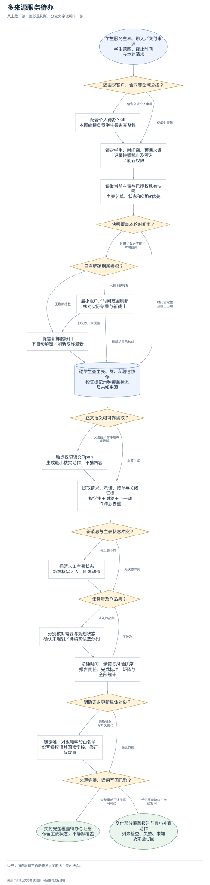

# 多来源服务待办：完整流程

输入：学生与来源范围；群聊、私聊和服务记录；资料截止时间。

交付：学生与来源覆盖表；待办和责任归属；作品集缺口与 Open。

[按原尺寸打开完整流程图](../assets/workflow.svg)

## 按什么顺序做

### 锁定范围、主表和新鲜度

默认只读现有快照，记录资料与解析截止时间、学生、时间窗及刷新/写入授权。

### 逐人逐渠道核对覆盖

以人工主表为名单和状态基准，学生群、私聊、协作及交付记录分别记真实覆盖状态。

### 从证据还原和去重待办

合并同一承诺，区分无人承接、用户承诺、已委派、等待与真实完成，冲突不静默覆盖主表。

### 分开作品集需要与规划状态

已确认需要且未规划与待核实候选分列，空白字段不直接推断缺规划。

### 报告完整性及按授权写回

统计所有覆盖格子与未知来源，缺口必须声明部分覆盖；写入模式只改白名单并全量回读。

## 验收

- 来源覆盖不漏报
- 完成有证据
- 需要与已规划分开

消息较新不自动覆盖人工服务主表的状态。

## 对应规则

- [SKILL.md](../SKILL.md)
- [references/evidence-and-output-contract.md](evidence-and-output-contract.md)

```mermaid
flowchart TB
  in(["学生服务主表、聊天／交付来源<br/>学生范围、截止时间与本轮请求"])
  domain{"还要求客户、合同等全域总控？"}
  personal["配合个人待办 Skill<br/>本图继续负责学生渠道完整性"]
  contract["锁定学生、时间窗、预期来源<br/>记录快照截止及写入／刷新权限"]
  snapshot["读取当前主表与已授权现有快照<br/>主表名单、状态和Offer优先"]
  fresh{"快照覆盖本轮时间窗？"}
  refresh{"已有明确刷新授权？"}
  update["最小账户／时间范围刷新<br/>核对实际结果与新截止"]
  gap["保留新鲜度缺口<br/>不自动解密／刷新或称最新"]
  matrix[("逐学生查主表、群、私聊与协作<br/>按证据记六种覆盖状态及未知来源")]
  semantic{"正文语义可可靠读取？"}
  touch["触点仅记语义Open<br/>生成最小核实动作，不猜内容"]
  todos["提取请求、承诺、接单与关闭证据<br/>按学生＋对象＋下一动作跨源去重"]
  conflict{"新消息与主表状态冲突？"}
  verify["保留人工主表状态<br/>新增核实／人工回填动作"]
  portfolio{"任务涉及作品集？"}
  twoaxes["分别核对需要与规划状态<br/>确认未规划／待核实候选分列"]
  report["按硬时间、承诺与风险排序<br/>报告责任、完成标准、矩阵与全部统计"]
  writeauth{"明确要求更新具体对象？"}
  write["锁定唯一对象和字段白名单<br/>仅写授权项并回读字段、修订与数量"]
  full{"来源完整、适用写回已验？"}
  out(["交付完整覆盖待办与证据<br/>保留主表状态，不静默覆盖"])
  partial(["交付部分覆盖报告与最小补查动作<br/>列未检查、失败、未知及未验写回"])
  in --> domain
  domain -->|"包含全域个人事项"| personal
  domain -->|"仅学生服务"| contract
  personal --> contract
  contract --> snapshot
  snapshot --> fresh
  fresh -->|"时间窗完整且截止已知"| matrix
  fresh -->|"过旧／截止不明／不可访问"| refresh
  refresh -->|"已有明确授权"| update
  refresh -->|"无刷新授权"| gap
  update -->|"刷新结果已核对"| matrix
  update -->|"仍失败／未覆盖"| gap
  gap --> matrix
  matrix --> semantic
  semantic -->|"仅语音／附件触点或截断"| touch
  semantic -->|"正文可读"| todos
  touch --> todos
  todos --> conflict
  conflict -->|"与主表冲突"| verify
  conflict -->|"无状态冲突"| portfolio
  verify --> portfolio
  portfolio -->|"涉及作品集"| twoaxes
  portfolio -->|"不涉及"| report
  twoaxes --> report
  report --> writeauth
  writeauth -->|"明确对象与写入授权"| write
  writeauth -->|"默认只读"| full
  write --> full
  full -->|"完整覆盖且适用写回已验"| out
  full -->|"任何覆盖缺口／未验写回"| partial
```

可编辑的流程源码

