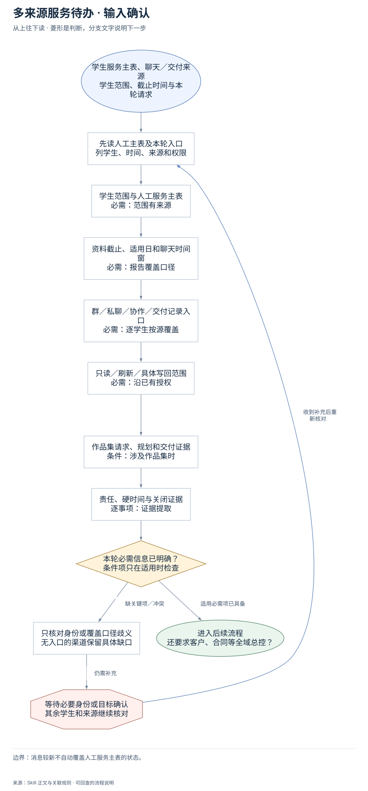

# 多来源服务待办：完整执行流程

先核对具体输入；已有材料能查明的直接读取，关键缺失或冲突才补充确认。沿完整图查看后续处理、失败去向与交付。

交付：学生与来源覆盖表；待办和责任归属；作品集缺口与 Open。

## 执行前确认哪些信息

| 输入 | 何时需要 | 从哪里取得 | 缺失或冲突怎么处理 |
| --- | --- | --- | --- |
| 学生范围与人工服务主表 | 必需：范围有来源 | 优先当前服务主表的在册名单、状态和Offer，再纳入聊天中新出现但未匹配身份 | 缺主表只交已覆盖范围，不声称全名单；身份冲突不合并 |
| 资料截止、适用日和聊天时间窗 | 必需：报告覆盖口径 | 沿任务时间要求，记录资料截至时点和计划日期，检查快照截止 | 快照未知或过旧列新鲜度缺口，不能写最新或全量 |
| 群／私聊／协作／交付记录入口 | 必需：逐学生按源覆盖 | 读取本轮材料、成员私有配置及已授权聊天连接器，建立预期来源矩阵 | 没提供也写未检查，不把未搜到或读取失败当无待办 |
| 只读／刷新／具体写回范围 | 必需：沿已有授权 | 默认只读现有快照；只有当前或会话已有刷新/对象写入授权才执行对应动作 | 缺授权暂停对应刷新或写入，保留只读可用结果，不默认解密 |
| 作品集请求、规划和交付证据 | 条件：涉及作品集时 | 读取学生请求、明确JD/策略、学员索引、规划页与真实交付 | 空白字段不等于需要且未规划；分需要与规划状态，证据不足待核实 |
| 责任、硬时间与关闭证据 | 逐事项：证据提取 | 从原话识别用户承诺、实质接单、期限和真实交付，不从建议推承诺 | 责任或语义未知标Open并生成最小核实动作；收到不等于接单 |

## 输入确认、补齐与返回

[按原尺寸查看输入确认图](../assets/input-confirmation.svg)

## 完整执行、判断与异常去向

[按原尺寸打开完整执行图](../assets/workflow.svg)

## 每一步具体怎么做

### 输入与范围

**1. 学生服务主表、聊天／交付来源；学生范围、截止时间与本轮请求**

学生服务主表、聊天／交付来源；学生范围、截止时间与本轮请求。后续按实际结果分流：完成后：先读人工主表及本轮入口，列学生、时间、来源和权限。

下一步：先读人工主表及本轮入口；列学生、时间、来源和权限。

依据：[SKILL.md](../SKILL.md) 中的“先锁定本轮合同”。

**2. 先读人工主表及本轮入口；列学生、时间、来源和权限**

优先复用本轮材料、会话已有决定和本成员已授权来源。已有明确值直接沿用；先查可查来源，不重复索取。

下一步：学生范围与人工服务主表；必需：范围有来源。

依据：[SKILL.md](../SKILL.md) 中的“先锁定本轮合同”。

**3. 学生范围与人工服务主表；必需：范围有来源**

取得方式：优先当前服务主表的在册名单、状态和Offer，再纳入聊天中新出现但未匹配身份。缺失处理：缺主表只交已覆盖范围，不声称全名单；身份冲突不合并。

下一步：资料截止、适用日和聊天时间窗；必需：报告覆盖口径。

依据：[SKILL.md](../SKILL.md) 中的“先锁定本轮合同”。

**4. 资料截止、适用日和聊天时间窗；必需：报告覆盖口径**

取得方式：沿任务时间要求，记录资料截至时点和计划日期，检查快照截止。缺失处理：快照未知或过旧列新鲜度缺口，不能写最新或全量。

下一步：群／私聊／协作／交付记录入口；必需：逐学生按源覆盖。

依据：[SKILL.md](../SKILL.md) 中的“先锁定本轮合同”。

**5. 群／私聊／协作／交付记录入口；必需：逐学生按源覆盖**

取得方式：读取本轮材料、成员私有配置及已授权聊天连接器，建立预期来源矩阵。缺失处理：没提供也写未检查，不把未搜到或读取失败当无待办。

下一步：只读／刷新／具体写回范围；必需：沿已有授权。

依据：[SKILL.md](../SKILL.md) 中的“建立“学生 × 来源”覆盖矩阵”。

**6. 只读／刷新／具体写回范围；必需：沿已有授权**

取得方式：默认只读现有快照；只有当前或会话已有刷新/对象写入授权才执行对应动作。缺失处理：缺授权暂停对应刷新或写入，保留只读可用结果，不默认解密。

下一步：作品集请求、规划和交付证据；条件：涉及作品集时。

依据：[SKILL.md](../SKILL.md) 中的“边界与分流”。

**7. 作品集请求、规划和交付证据；条件：涉及作品集时**

取得方式：读取学生请求、明确JD/策略、学员索引、规划页与真实交付。缺失处理：空白字段不等于需要且未规划；分需要与规划状态，证据不足待核实。

下一步：责任、硬时间与关闭证据；逐事项：证据提取。

依据：[SKILL.md](../SKILL.md) 中的“作品集缺口必须拆成两个判断”。

**8. 责任、硬时间与关闭证据；逐事项：证据提取**

取得方式：从原话识别用户承诺、实质接单、期限和真实交付，不从建议推承诺。缺失处理：责任或语义未知标Open并生成最小核实动作；收到不等于接单。

下一步：本轮必需信息已明确？；条件项只在适用时检查。

依据：[SKILL.md](../SKILL.md) 中的“从消息生成待办”。

**9. 本轮必需信息已明确？；条件项只在适用时检查**

按每个字段的适用条件检查；可选偏好缺失采用本 Skill 的合理默认或保留未知，不阻塞无关步骤。

下一步：“缺关键项／冲突” → 只核对身份或覆盖口径歧义；无入口的渠道保留具体缺口；“适用必需项已具备” → 还要求客户、合同等全域总控？。

依据：[SKILL.md](../SKILL.md) 中的“先锁定本轮合同”。

**10. 只核对身份或覆盖口径歧义；无入口的渠道保留具体缺口**

先核对现有材料能否补齐，只问会改变当前动作或目标的关键缺口。来源冲突时保留原值和差异，不擅自合并。

下一步：“仍需补充” → 等待必要身份或目标确认；其余学生和来源继续核对。

依据：[SKILL.md](../SKILL.md) 中的“先锁定本轮合同”。

**11. 等待必要身份或目标确认；其余学生和来源继续核对**

暂停依赖缺失信息的动作，保留已完成读取、来源和断点；能够独立完成的部分照常交付。收到补充后重查字段再进入执行。

下一步：“收到补充后重新核对” → 先读人工主表及本轮入口；列学生、时间、来源和权限。

依据：[SKILL.md](../SKILL.md) 中的“先锁定本轮合同”。

### 执行与核验

**1. 还要求客户、合同等全域总控？**

还要求客户、合同等全域总控？。后续按实际结果分流：包含全域个人事项：配合个人待办 Skill，本图继续负责学生渠道完整性；仅学生服务：锁定学生、时间窗、预期来源，记录快照截止及写入／刷新权限。

下一步：“包含全域个人事项” → 配合个人待办 Skill；本图继续负责学生渠道完整性；“仅学生服务” → 锁定学生、时间窗、预期来源；记录快照截止及写入／刷新权限。

依据：[SKILL.md](../SKILL.md) 中的“边界与分流”。

**2. 配合个人待办 Skill；本图继续负责学生渠道完整性**

配合个人待办 Skill；本图继续负责学生渠道完整性。后续按实际结果分流：完成后：锁定学生、时间窗、预期来源，记录快照截止及写入／刷新权限。

下一步：锁定学生、时间窗、预期来源；记录快照截止及写入／刷新权限。

依据：[SKILL.md](../SKILL.md) 中的“边界与分流”。

**3. 锁定学生、时间窗、预期来源；记录快照截止及写入／刷新权限**

锁定学生、时间窗、预期来源；记录快照截止及写入／刷新权限。后续按实际结果分流：完成后：读取当前主表与已授权现有快照，主表名单、状态和Offer优先。

下一步：读取当前主表与已授权现有快照；主表名单、状态和Offer优先。

依据：[SKILL.md](../SKILL.md) 中的“先锁定本轮合同”。

**4. 读取当前主表与已授权现有快照；主表名单、状态和Offer优先**

读取当前主表与已授权现有快照；主表名单、状态和Offer优先。后续按实际结果分流：完成后：快照覆盖本轮时间窗？。

下一步：快照覆盖本轮时间窗？。

依据：[SKILL.md](../SKILL.md) 中的“先锁定本轮合同”。

**5. 快照覆盖本轮时间窗？**

快照覆盖本轮时间窗？。后续按实际结果分流：时间窗完整且截止已知：逐学生查主表、群、私聊与协作，按证据记六种覆盖状态及未知来源；过旧／截止不明／不可访问：已有明确刷新授权？。

下一步：“时间窗完整且截止已知” → 逐学生查主表、群、私聊与协作；按证据记六种覆盖状态及未知来源；“过旧／截止不明／不可访问” → 已有明确刷新授权？。

依据：[SKILL.md](../SKILL.md) 中的“建立“学生 × 来源”覆盖矩阵”。

**6. 已有明确刷新授权？**

已有明确刷新授权？。后续按实际结果分流：已有明确授权：最小账户／时间范围刷新，核对实际结果与新截止；无刷新授权：保留新鲜度缺口，不自动解密／刷新或称最新。

下一步：“已有明确授权” → 最小账户／时间范围刷新；核对实际结果与新截止；“无刷新授权” → 保留新鲜度缺口；不自动解密／刷新或称最新。

依据：[SKILL.md](../SKILL.md) 中的“边界与分流”。

**7. 最小账户／时间范围刷新；核对实际结果与新截止**

最小账户／时间范围刷新；核对实际结果与新截止。后续按实际结果分流：刷新结果已核对：逐学生查主表、群、私聊与协作，按证据记六种覆盖状态及未知来源；仍失败／未覆盖：保留新鲜度缺口，不自动解密／刷新或称最新。

下一步：“刷新结果已核对” → 逐学生查主表、群、私聊与协作；按证据记六种覆盖状态及未知来源；“仍失败／未覆盖” → 保留新鲜度缺口；不自动解密／刷新或称最新。

依据：[SKILL.md](../SKILL.md) 中的“边界与分流”。

**8. 保留新鲜度缺口；不自动解密／刷新或称最新**

保留新鲜度缺口；不自动解密／刷新或称最新。后续按实际结果分流：完成后：逐学生查主表、群、私聊与协作，按证据记六种覆盖状态及未知来源。

下一步：逐学生查主表、群、私聊与协作；按证据记六种覆盖状态及未知来源。

依据：[SKILL.md](../SKILL.md) 中的“建立“学生 × 来源”覆盖矩阵”。

**9. 逐学生查主表、群、私聊与协作；按证据记六种覆盖状态及未知来源**

逐学生查主表、群、私聊与协作；按证据记六种覆盖状态及未知来源。后续按实际结果分流：完成后：按学生逐源真实检索，六种状态＋最近证据时间。

下一步：按学生逐源真实检索；六种状态＋最近证据时间。

依据：[SKILL.md](../SKILL.md) 中的“建立“学生 × 来源”覆盖矩阵”。

**10. 正文语义可可靠读取？**

正文语义可可靠读取？。后续按实际结果分流：仅语音／附件触点或截断：触点仅记语义Open，生成最小核实动作，不猜内容；正文可读：提取请求、承诺、接单与关闭证据，按学生＋对象＋下一动作跨源去重。

下一步：“仅语音／附件触点或截断” → 触点仅记语义Open；生成最小核实动作，不猜内容；“正文可读” → 提取请求、承诺、接单与关闭证据；按学生＋对象＋下一动作跨源去重。

依据：[SKILL.md](../SKILL.md) 中的“从消息生成待办”。

**11. 触点仅记语义Open；生成最小核实动作，不猜内容**

触点仅记语义Open；生成最小核实动作，不猜内容。后续按实际结果分流：完成后：提取请求、承诺、接单与关闭证据，按学生＋对象＋下一动作跨源去重。

下一步：提取请求、承诺、接单与关闭证据；按学生＋对象＋下一动作跨源去重。

依据：[SKILL.md](../SKILL.md) 中的“从消息生成待办”。

**12. 提取请求、承诺、接单与关闭证据；按学生＋对象＋下一动作跨源去重**

提取请求、承诺、接单与关闭证据；按学生＋对象＋下一动作跨源去重。后续按实际结果分流：完成后：一项一个下一动作与完成标准，附责任、时间、状态和原始证据。

下一步：一项一个下一动作与完成标准；附责任、时间、状态和原始证据。

依据：[SKILL.md](../SKILL.md) 中的“从消息生成待办”。

**13. 新消息与主表状态冲突？**

新消息与主表状态冲突？。后续按实际结果分流：与主表冲突：保留人工主表状态，新增核实／人工回填动作；无状态冲突：任务涉及作品集？。

下一步：“与主表冲突” → 保留人工主表状态；新增核实／人工回填动作；“无状态冲突” → 任务涉及作品集？。

依据：[SKILL.md](../SKILL.md) 中的“从消息生成待办”。

**14. 任务涉及作品集？**

任务涉及作品集？。后续按实际结果分流：涉及作品集：分别核对需要与规划状态，确认未规划／待核实候选分列；不涉及：按硬时间、承诺与风险排序，报告责任、完成标准、矩阵与全部统计。

下一步：“涉及作品集” → 分别核对需要与规划状态；确认未规划／待核实候选分列；“不涉及” → 按硬时间、承诺与风险排序；报告责任、完成标准、矩阵与全部统计。

依据：[SKILL.md](../SKILL.md) 中的“作品集缺口必须拆成两个判断”。

**15. 分别核对需要与规划状态；确认未规划／待核实候选分列**

分别核对需要与规划状态；确认未规划／待核实候选分列。后续按实际结果分流：完成后：按硬时间、承诺与风险排序，报告责任、完成标准、矩阵与全部统计。

下一步：按硬时间、承诺与风险排序；报告责任、完成标准、矩阵与全部统计。

依据：[references/evidence-and-output-contract.md](evidence-and-output-contract.md) 中的“作品集判断表”。

**16. 按硬时间、承诺与风险排序；报告责任、完成标准、矩阵与全部统计**

按硬时间、承诺与风险排序；报告责任、完成标准、矩阵与全部统计。后续按实际结果分流：完成后：明确要求更新具体对象？。

下一步：明确要求更新具体对象？。

依据：[references/evidence-and-output-contract.md](evidence-and-output-contract.md) 中的“默认输出结构”。

**17. 明确要求更新具体对象？**

明确要求更新具体对象？。后续按实际结果分流：明确对象与写入授权：锁定唯一对象和字段白名单，仅写授权项并回读字段、修订与数量；默认只读：来源完整、适用写回已验？。

下一步：“明确对象与写入授权” → 锁定唯一对象和字段白名单；仅写授权项并回读字段、修订与数量；“默认只读” → 来源完整、适用写回已验？。

依据：[references/evidence-and-output-contract.md](evidence-and-output-contract.md) 中的“写入模式的额外门槛”。

**18. 锁定唯一对象和字段白名单；仅写授权项并回读字段、修订与数量**

仅对已授权唯一对象、学生和字段做最小增量写入；先列会改/只读/不碰，写后核修订号、目标字段、公式和未授权字段零变化。

下一步：来源完整、适用写回已验？。

依据：[references/evidence-and-output-contract.md](evidence-and-output-contract.md) 中的“写入模式的额外门槛”。

**19. 来源完整、适用写回已验？**

任何未知联系人、部分覆盖、未检查、无匹配或读取失败都使报告为部分覆盖；写回存在未读回项必须标未验收，不能用CLI success顶替。

下一步：“完整覆盖且适用写回已验” → 交付完整覆盖待办与证据；保留主表状态，不静默覆盖；“任何覆盖缺口／未验写回” → 交付部分覆盖报告与最小补查动作；列未检查、失败、未知及未验写回。

依据：[SKILL.md](../SKILL.md) 中的“输出与验收”。

**20. 按学生逐源真实检索；六种状态＋最近证据时间**

无检索=未检查；已检索但不唯一=无匹配；定位后失败=读取失败；触点/截断/旧窗=部分覆盖；正文和时间窗查完=已覆盖；不适用须直接证据。

下一步：对账应查格子与七类数量；未知联系人来源单列。

依据：[references/evidence-and-output-contract.md](evidence-and-output-contract.md) 中的“覆盖矩阵字段”。

**21. 对账应查格子与七类数量；未知联系人来源单列**

分母为应检查格子减不适用；只有已覆盖计入覆盖率，部分/未查/无匹配/失败不计。未知学生来源在完成匹配前另报数量，不并入分母。

下一步：正文语义可可靠读取？。

依据：[references/evidence-and-output-contract.md](evidence-and-output-contract.md) 中的“覆盖矩阵字段”。

**22. 一项一个下一动作与完成标准；附责任、时间、状态和原始证据**

按学生+交付对象+下一动作跨源去重，保留全部关键证据、原始时间与事实等级；建议时间标建议，不伪装承诺。

下一步：无人实质承接归用户兜底；明确接单转盯结果，已发转等待。

依据：[references/evidence-and-output-contract.md](evidence-and-output-contract.md) 中的“证据字段”。

**23. 无人实质承接归用户兜底；明确接单转盯结果，已发转等待**

私聊承诺合并群请求，不再重复生成回复学生；转发、@、收到不算接单，关闭必须有真实完成标准对应证据。

下一步：新消息与主表状态冲突？。

依据：[references/evidence-and-output-contract.md](evidence-and-output-contract.md) 中的“优先级与归属”。

### 交付与验收

**1. 保留人工主表状态；新增核实／人工回填动作**

保留人工主表状态；新增核实／人工回填动作。后续按实际结果分流：完成后：任务涉及作品集？。

下一步：任务涉及作品集？。

依据：[references/evidence-and-output-contract.md](evidence-and-output-contract.md) 中的“优先级与归属”。

**2. 交付完整覆盖待办与证据；保留主表状态，不静默覆盖**

交付完整覆盖待办与证据；保留主表状态，不静默覆盖。该分支的实际状态与未完成项保留在交付回执中。

这是本路径的交付或转交结果。

依据：[SKILL.md](../SKILL.md) 中的“输出与验收”。

**3. 交付部分覆盖报告与最小补查动作；列未检查、失败、未知及未验写回**

交付部分覆盖报告与最小补查动作；列未检查、失败、未知及未验写回。该分支的实际状态与未完成项保留在交付回执中。

这是本路径的交付或转交结果。

依据：[SKILL.md](../SKILL.md) 中的“输出与验收”。

## 验收

- 来源覆盖不漏报
- 完成有证据
- 需要与已规划分开

消息较新不自动覆盖人工服务主表的状态。

## 对应规则

- [SKILL.md](../SKILL.md)
- [references/evidence-and-output-contract.md](evidence-and-output-contract.md)

```mermaid
flowchart TB
  in(["学生服务主表、聊天／交付来源<br/>学生范围、截止时间与本轮请求"])
  domain{"还要求客户、合同等全域总控？"}
  personal["配合个人待办 Skill<br/>本图继续负责学生渠道完整性"]
  contract["锁定学生、时间窗、预期来源<br/>记录快照截止及写入／刷新权限"]
  snapshot["读取当前主表与已授权现有快照<br/>主表名单、状态和Offer优先"]
  fresh{"快照覆盖本轮时间窗？"}
  refresh{"已有明确刷新授权？"}
  update["最小账户／时间范围刷新<br/>核对实际结果与新截止"]
  gap["保留新鲜度缺口<br/>不自动解密／刷新或称最新"]
  matrix[("逐学生查主表、群、私聊与协作<br/>按证据记六种覆盖状态及未知来源")]
  semantic{"正文语义可可靠读取？"}
  touch["触点仅记语义Open<br/>生成最小核实动作，不猜内容"]
  todos["提取请求、承诺、接单与关闭证据<br/>按学生＋对象＋下一动作跨源去重"]
  conflict{"新消息与主表状态冲突？"}
  verify["保留人工主表状态<br/>新增核实／人工回填动作"]
  portfolio{"任务涉及作品集？"}
  twoaxes["分别核对需要与规划状态<br/>确认未规划／待核实候选分列"]
  report["按硬时间、承诺与风险排序<br/>报告责任、完成标准、矩阵与全部统计"]
  writeauth{"明确要求更新具体对象？"}
  write["锁定唯一对象和字段白名单<br/>仅写授权项并回读字段、修订与数量"]
  full{"来源完整、适用写回已验？"}
  out(["交付完整覆盖待办与证据<br/>保留主表状态，不静默覆盖"])
  partial(["交付部分覆盖报告与最小补查动作<br/>列未检查、失败、未知及未验写回"])
  intake_lookup["先读人工主表及本轮入口<br/>列学生、时间、来源和权限"]
  intake_students["学生范围与人工服务主表<br/>必需：范围有来源"]
  intake_time["资料截止、适用日和聊天时间窗<br/>必需：报告覆盖口径"]
  intake_channels["群／私聊／协作／交付记录入口<br/>必需：逐学生按源覆盖"]
  intake_permissions["只读／刷新／具体写回范围<br/>必需：沿已有授权"]
  intake_portfolio["作品集请求、规划和交付证据<br/>条件：涉及作品集时"]
  intake_owner["责任、硬时间与关闭证据<br/>逐事项：证据提取"]
  intake_ready{"本轮必需信息已明确？<br/>条件项只在适用时检查"}
  intake_clarify["只核对身份或覆盖口径歧义<br/>无入口的渠道保留具体缺口"]
  intake_wait(["等待必要身份或目标确认<br/>其余学生和来源继续核对"])
  coverage_each["按学生逐源真实检索<br/>六种状态＋最近证据时间"]
  coverage_totals["对账应查格子与七类数量<br/>未知联系人来源单列"]
  todo_fields["一项一个下一动作与完成标准<br/>附责任、时间、状态和原始证据"]
  assign_by_evidence["无人实质承接归用户兜底<br/>明确接单转盯结果，已发转等待"]
  domain -->|"包含全域个人事项"| personal
  domain -->|"仅学生服务"| contract
  personal --> contract
  contract --> snapshot
  snapshot --> fresh
  fresh -->|"时间窗完整且截止已知"| matrix
  fresh -->|"过旧／截止不明／不可访问"| refresh
  refresh -->|"已有明确授权"| update
  refresh -->|"无刷新授权"| gap
  update -->|"刷新结果已核对"| matrix
  update -->|"仍失败／未覆盖"| gap
  gap --> matrix
  semantic -->|"仅语音／附件触点或截断"| touch
  semantic -->|"正文可读"| todos
  touch --> todos
  conflict -->|"与主表冲突"| verify
  conflict -->|"无状态冲突"| portfolio
  verify --> portfolio
  portfolio -->|"涉及作品集"| twoaxes
  portfolio -->|"不涉及"| report
  twoaxes --> report
  report --> writeauth
  writeauth -->|"明确对象与写入授权"| write
  writeauth -->|"默认只读"| full
  write --> full
  full -->|"完整覆盖且适用写回已验"| out
  full -->|"任何覆盖缺口／未验写回"| partial
  in --> intake_lookup
  intake_lookup --> intake_students
  intake_students --> intake_time
  intake_time --> intake_channels
  intake_channels --> intake_permissions
  intake_permissions --> intake_portfolio
  intake_portfolio --> intake_owner
  intake_owner --> intake_ready
  intake_ready -->|"缺关键项／冲突"| intake_clarify
  intake_clarify -->|"仍需补充"| intake_wait
  intake_wait -->|"收到补充后重新核对"| intake_lookup
  intake_ready -->|"适用必需项已具备"| domain
  matrix --> coverage_each
  coverage_each --> coverage_totals
  coverage_totals --> semantic
  todos --> todo_fields
  todo_fields --> assign_by_evidence
  assign_by_evidence --> conflict
```

可编辑的完整流程源码

