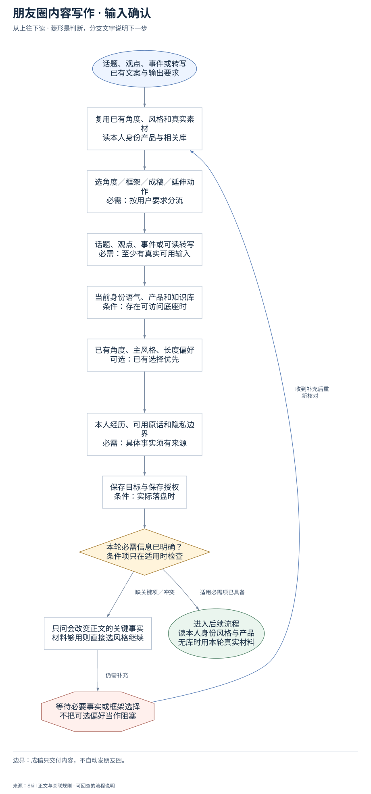
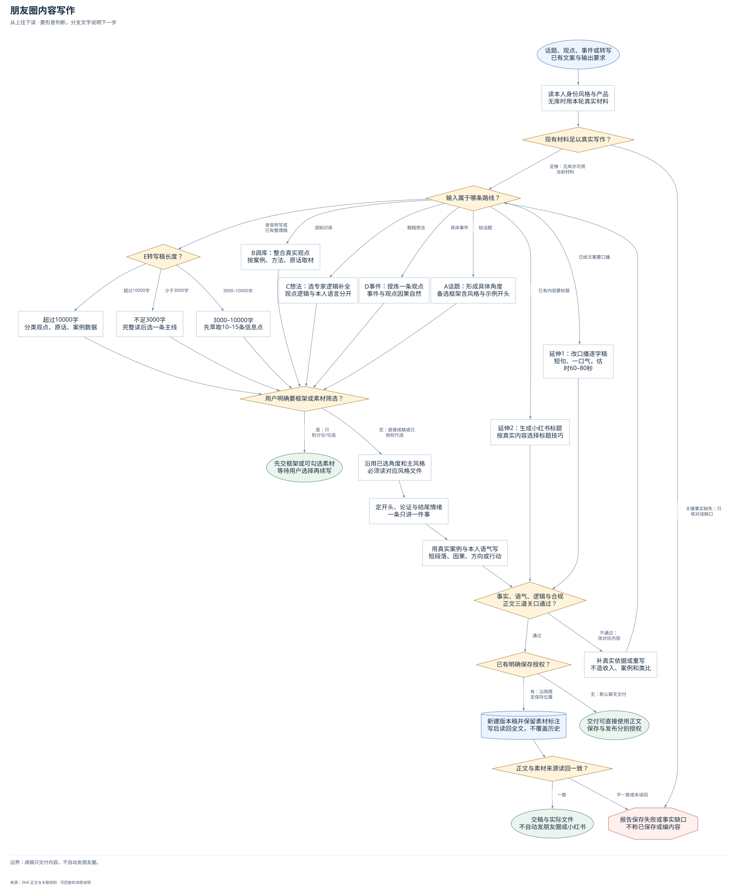

# 朋友圈内容写作：完整执行流程

先核对具体输入；已有材料能查明的直接读取，关键缺失或冲突才补充确认。沿完整图查看后续处理、失败去向与交付。

交付：朋友圈正文或框架；可选口播逐字稿；可选小红书标题。

## 执行前确认哪些信息

| 输入 | 何时需要 | 从哪里取得 | 缺失或冲突怎么处理 |
| --- | --- | --- | --- |
| 选角度／框架／成稿／延伸动作 | 必需：按用户要求分流 | 从用户动词和既有选择判断，已授权代选或成稿就直接写 | 只有不同理解实质改变内容时问关键问题；不能把内部选风格当审批 |
| 话题、观点、事件或可读转写 | 必需：至少有真实可用输入 | 完整读当前素材；事件与调库混合以事件为主，转写使用全文或已有整理稿 | 关键事实不足改为知识解释或问最小事实；不编案例、数字、原话 |
| 当前身份语气、产品和知识库 | 条件：存在可访问底座时 | 任务入口→成员私有配置索引，读身份/风格与产品；按主题读客户、案例、方法 | 无库可用当场真实素材继续；不能冒用作者经历，必要入口才询问 |
| 已有角度、主风格、长度偏好 | 可选：已有选择优先 | 复用用户角度与语气要求，按映射选一个主风格并读对应风格文件 | 无偏好按素材合理选择，默认中文案300–800字，不重复问 |
| 本人经历、可用原话和隐私边界 | 必需：具体事实须有来源 | 检查真实案例、结果、频率、数字和授权范围，客户故事脱敏 | 没有亲历证据不使用我经历过，收入金额和虚假效果不写 |
| 保存目标与保存授权 | 条件：实际落盘时 | 沿既定保存位置或已授权知识库目录，新建日期关键词版本稿 | 默认聊天交稿；未授权不写文件，保存不等于发布 |

## 输入确认、补齐与返回



[按原尺寸查看输入确认图](../assets/input-confirmation.svg)

## 完整执行、判断与异常去向



[按原尺寸打开完整执行图](../assets/workflow.svg)

## 每一步具体怎么做

### 输入与范围

**1. 话题、观点、事件或转写；已有文案与输出要求**

话题、观点、事件或转写；已有文案与输出要求。后续按实际结果分流：完成后：复用已有角度、风格和真实素材，读本人身份产品与相关库。

下一步：复用已有角度、风格和真实素材；读本人身份产品与相关库。

依据：[SKILL.md](../SKILL.md) 中的“输入源判断（写作前先做）”。

**2. 复用已有角度、风格和真实素材；读本人身份产品与相关库**

优先复用本轮材料、会话已有决定和本成员已授权来源。已有明确值直接沿用；先查可查来源，不重复索取。

下一步：选角度／框架／成稿／延伸动作；必需：按用户要求分流。

依据：[SKILL.md](../SKILL.md) 中的“⚠️ 执行纪律”。

**3. 选角度／框架／成稿／延伸动作；必需：按用户要求分流**

取得方式：从用户动词和既有选择判断，已授权代选或成稿就直接写。缺失处理：只有不同理解实质改变内容时问关键问题；不能把内部选风格当审批。

下一步：话题、观点、事件或可读转写；必需：至少有真实可用输入。

依据：[SKILL.md](../SKILL.md) 中的“⚠️ 执行纪律”。

**4. 话题、观点、事件或可读转写；必需：至少有真实可用输入**

取得方式：完整读当前素材；事件与调库混合以事件为主，转写使用全文或已有整理稿。缺失处理：关键事实不足改为知识解释或问最小事实；不编案例、数字、原话。

下一步：当前身份语气、产品和知识库；条件：存在可访问底座时。

依据：[SKILL.md](../SKILL.md) 中的“输入源判断”。

**5. 当前身份语气、产品和知识库；条件：存在可访问底座时**

取得方式：任务入口→成员私有配置索引，读身份/风格与产品；按主题读客户、案例、方法。缺失处理：无库可用当场真实素材继续；不能冒用作者经历，必要入口才询问。

下一步：已有角度、主风格、长度偏好；可选：已有选择优先。

依据：[SKILL.md](../SKILL.md) 中的“第 0 步”。

**6. 已有角度、主风格、长度偏好；可选：已有选择优先**

取得方式：复用用户角度与语气要求，按映射选一个主风格并读对应风格文件。缺失处理：无偏好按素材合理选择，默认中文案300–800字，不重复问。

下一步：本人经历、可用原话和隐私边界；必需：具体事实须有来源。

依据：[SKILL.md](../SKILL.md) 中的“7 种风格速查”。

**7. 本人经历、可用原话和隐私边界；必需：具体事实须有来源**

取得方式：检查真实案例、结果、频率、数字和授权范围，客户故事脱敏。缺失处理：没有亲历证据不使用我经历过，收入金额和虚假效果不写。

下一步：保存目标与保存授权；条件：实际落盘时。

依据：[SKILL.md](../SKILL.md) 中的“合规红线”。

**8. 保存目标与保存授权；条件：实际落盘时**

取得方式：沿既定保存位置或已授权知识库目录，新建日期关键词版本稿。缺失处理：默认聊天交稿；未授权不写文件，保存不等于发布。

下一步：本轮必需信息已明确？；条件项只在适用时检查。

依据：[SKILL.md](../SKILL.md) 中的“文件保存”。

**9. 本轮必需信息已明确？；条件项只在适用时检查**

按每个字段的适用条件检查；可选偏好缺失采用本 Skill 的合理默认或保留未知，不阻塞无关步骤。

下一步：“缺关键项／冲突” → 只问会改变正文的关键事实；材料够用则直接选风格继续；“适用必需项已具备” → 读本人身份风格与产品；无库时用本轮真实材料。

依据：[SKILL.md](../SKILL.md) 中的“⚠️ 执行纪律”。

**10. 只问会改变正文的关键事实；材料够用则直接选风格继续**

先核对现有材料能否补齐，只问会改变当前动作或目标的关键缺口。来源冲突时保留原值和差异，不擅自合并。

下一步：“仍需补充” → 等待必要事实或框架选择；不把可选偏好当作阻塞。

依据：[SKILL.md](../SKILL.md) 中的“⚠️ 执行纪律”。

**11. 等待必要事实或框架选择；不把可选偏好当作阻塞**

暂停依赖缺失信息的动作，保留已完成读取、来源和断点；能够独立完成的部分照常交付。收到补充后重查字段再进入执行。

下一步：“收到补充后重新核对” → 复用已有角度、风格和真实素材；读本人身份产品与相关库。

依据：[SKILL.md](../SKILL.md) 中的“⚠️ 执行纪律”。

### 执行与核验

**1. 读本人身份风格与产品；无库时用本轮真实材料**

读本人身份风格与产品；无库时用本轮真实材料。后续按实际结果分流：完成后：身份产品先读，主题材料按需，原话、案例、判断分清来源。

下一步：身份产品先读，主题材料按需；原话、案例、判断分清来源。

依据：[SKILL.md](../SKILL.md) 中的“第 0 步：读你的业务底座（每次写作前）”。

**2. 输入属于哪条路线？**

输入属于哪条路线？。后续按实际结果分流：给话题：A话题：形成具体角度，备选框架含风格与示例开头；调知识库：B调库：整合真实观点，按案例、方法、原话取材；粗糙想法：C想法：选专家逻辑补全，观点逻辑与本人语言分开；具体事件：D事件：提炼一条观点，事件与观点因果自然；录音转写或已有整理稿：E转写稿长度？；已给文案要口播：延伸1：改口播逐字稿，短句、一口气，估时60–80秒；已有内容要标题：延伸2：生成小红书标题，按真实内容选择标题技巧。

下一步：“给话题” → A话题：形成具体角度；备选框架含风格与示例开头；“调知识库” → B调库：整合真实观点；按案例、方法、原话取材；“粗糙想法” → C想法：选专家逻辑补全；观点逻辑与本人语言分开；“具体事件” → D事件：提炼一条观点；事件与观点因果自然；“录音转写或已有整理稿” → E转写稿长度？；“已给文案要口播” → 延伸1：改口播逐字稿；短句、一口气，估时60–80秒；“已有内容要标题” → 延伸2：生成小红书标题；按真实内容选择标题技巧。

依据：[SKILL.md](../SKILL.md) 中的“输入源判断（写作前先做）”。

**3. A话题：形成具体角度；备选框架含风格与示例开头**

A话题：形成具体角度；备选框架含风格与示例开头。后续按实际结果分流：完成后：用户明确要框架或素材筛选？。

下一步：用户明确要框架或素材筛选？。

依据：[SKILL.md](../SKILL.md) 中的“流程 A：话题 → 多角度框架 → 选定写作”。

**4. B调库：整合真实观点；按案例、方法、原话取材**

B调库：整合真实观点；按案例、方法、原话取材。后续按实际结果分流：完成后：用户明确要框架或素材筛选？。

下一步：用户明确要框架或素材筛选？。

依据：[SKILL.md](../SKILL.md) 中的“流程 B：调知识库 → 整合观点 → 写文案”。

**5. C想法：选专家逻辑补全；观点逻辑与本人语言分开**

C想法：选专家逻辑补全；观点逻辑与本人语言分开。后续按实际结果分流：完成后：用户明确要框架或素材筛选？。

下一步：用户明确要框架或素材筛选？。

依据：[SKILL.md](../SKILL.md) 中的“流程 C：粗糙想法 → 专家视角完善 → 写文案”。

**6. D事件：提炼一条观点；事件与观点因果自然**

D事件：提炼一条观点；事件与观点因果自然。后续按实际结果分流：完成后：用户明确要框架或素材筛选？。

下一步：用户明确要框架或素材筛选？。

依据：[SKILL.md](../SKILL.md) 中的“流程 D：具体事件 → 提炼观点 → 写文案”。

**7. E转写稿长度？**

按可读转写长度选处理深度：不足3000字全文一条主线；3000–10000字萃取10–15条；更长按观点/原话/案例数据分类。

下一步：“少于3000字” → 不足3000字；完整读后选一条主线；“3000–10000字” → 3000–10000字；先萃取10–15条信息点；“超过10000字” → 超过10000字；分类观点、原话、案例数据。

依据：[SKILL.md](../SKILL.md) 中的“流程 E：录音转写稿 → 萃取 → 勾选 → 写文案”。

**8. 不足3000字；完整读后选一条主线**

不足3000字；完整读后选一条主线。后续按实际结果分流：完成后：用户明确要框架或素材筛选？。

下一步：用户明确要框架或素材筛选？。

依据：[SKILL.md](../SKILL.md) 中的“流程 E：录音转写稿 → 萃取 → 勾选 → 写文案”。

**9. 3000–10000字；先萃取10–15条信息点**

3000–10000字；先萃取10–15条信息点。后续按实际结果分流：完成后：用户明确要框架或素材筛选？。

下一步：用户明确要框架或素材筛选？。

依据：[SKILL.md](../SKILL.md) 中的“流程 E：录音转写稿 → 萃取 → 勾选 → 写文案”。

**10. 超过10000字；分类观点、原话、案例数据**

超过10000字；分类观点、原话、案例数据。后续按实际结果分流：完成后：用户明确要框架或素材筛选？。

下一步：用户明确要框架或素材筛选？。

依据：[SKILL.md](../SKILL.md) 中的“流程 E：录音转写稿 → 萃取 → 勾选 → 写文案”。

**11. 用户明确要框架或素材筛选？**

仅当用户明确要求框架或素材筛选时提供中间产物并等待；已经要求成稿或授权代选时内部完成选择后直接续写，不增加确认轮。

下一步：“是：只到讨论/勾选” → 先交框架或可勾选素材；等待用户选择再续写；“否：直接成稿或已授权代选” → 沿用已选角度和主风格；必须读对应风格文件。

依据：[SKILL.md](../SKILL.md) 中的“⚠️ 执行纪律（必读）”。

**12. 沿用已选角度和主风格；必须读对应风格文件**

沿用已选角度和主风格；必须读对应风格文件。后续按实际结果分流：完成后：对应风格文件必须实际读取，单一主风格，辅助只丰富素材。

下一步：对应风格文件必须实际读取；单一主风格，辅助只丰富素材。

依据：[SKILL.md](../SKILL.md) 中的“7 种风格速查（详见 `references/`）”。

**13. 定开头、论证与结尾情绪；一条只讲一件事**

定开头、论证与结尾情绪；一条只讲一件事。后续按实际结果分流：完成后：用真实案例与本人语气写，短段落、因果、方向或行动。

下一步：用真实案例与本人语气写；短段落、因果、方向或行动。

依据：[SKILL.md](../SKILL.md) 中的“情绪路径设计（写正文前必做）”。

**14. 用真实案例与本人语气写；短段落、因果、方向或行动**

用真实案例与本人语气写；短段落、因果、方向或行动。后续按实际结果分流：完成后：业务元素→产品桥梁→辨识度，换署名仍通用就重写。

下一步：业务元素→产品桥梁→辨识度；换署名仍通用就重写。

依据：[SKILL.md](../SKILL.md) 中的“通用规范（所有风格共享）”。

**15. 延伸1：改口播逐字稿；短句、一口气，估时60–80秒**

延伸1：改口播逐字稿；短句、一口气，估时60–80秒。后续按实际结果分流：完成后：事实、语气、逻辑与合规，正文三道关口通过？。

下一步：事实、语气、逻辑与合规；正文三道关口通过？。

依据：[SKILL.md](../SKILL.md) 中的“延伸 1：朋友圈文案 → 口播逐字稿”。

**16. 延伸2：生成小红书标题；按真实内容选择标题技巧**

延伸2：生成小红书标题；按真实内容选择标题技巧。后续按实际结果分流：完成后：事实、语气、逻辑与合规，正文三道关口通过？。

下一步：事实、语气、逻辑与合规；正文三道关口通过？。

依据：[SKILL.md](../SKILL.md) 中的“延伸 2：生成小红书标题”。

**17. 补真实依据或重写；不造收入、案例和类比**

补真实依据或重写；不造收入、案例和类比。后续按实际结果分流：完成后：输入属于哪条路线？。

下一步：输入属于哪条路线？。

依据：[SKILL.md](../SKILL.md) 中的“合规红线”。

**18. 已有明确保存授权？**

已有明确保存授权？。后续按实际结果分流：无：默认聊天交付：交付可直接使用正文，保存与发布分别授权；有：沿用既定保存位置：新建版本稿并保留素材标注，写后读回全文，不覆盖历史。

下一步：“无：默认聊天交付” → 交付可直接使用正文；保存与发布分别授权；“有：沿用既定保存位置” → 新建版本稿并保留素材标注；写后读回全文，不覆盖历史。

依据：[SKILL.md](../SKILL.md) 中的“文件保存”。

**19. 新建版本稿并保留素材标注；写后读回全文，不覆盖历史**

新建版本稿并保留素材标注；写后读回全文，不覆盖历史。后续按实际结果分流：完成后：正文与素材来源读回一致？。

下一步：正文与素材来源读回一致？。

依据：[SKILL.md](../SKILL.md) 中的“文件保存”。

**20. 现有材料足以真实写作？**

现有材料足以真实写作？。后续按实际结果分流：足够：无库亦可用当前材料：输入属于哪条路线？；关键事实缺失：只核对该缺口：报告保存失败或事实缺口，不称已保存或编内容。

下一步：“足够：无库亦可用当前材料” → 输入属于哪条路线？；“关键事实缺失：只核对该缺口” → 报告保存失败或事实缺口；不称已保存或编内容。

依据：[SKILL.md](../SKILL.md) 中的“⚠️ 执行纪律（必读）”。

**21. 身份产品先读，主题材料按需；原话、案例、判断分清来源**

身份/产品决定语气和产品承接；痛点加读客户需求、故事读案例、专业判断读方法论。只读取材，不改知识库、AGENTS或历史范例。

下一步：现有材料足以真实写作？。

依据：[SKILL.md](../SKILL.md) 中的“第 0 步：读你的业务底座”。

**22. 对应风格文件必须实际读取；单一主风格，辅助只丰富素材**

按既定选择选A至G一种主风格并实际打开对应文件，示例只教结构。辅助风格只能丰富素材，不能混成多种主结构；需选几个框架按本次主入口的具体流程执行。

下一步：定开头、论证与结尾情绪；一条只讲一件事。

依据：[references/README.md](README.md) 中的“风格组合规则”。

**23. 业务元素→产品桥梁→辨识度；换署名仍通用就重写**

检查真实业务元素是否自然进入、桥梁是否服务正文、是否有用户独有视角；证据不足不为反差写绝对论断。

下一步：一件事、一条因果、一个方向；中文标点、短段落、隐私合规。

依据：[SKILL.md](../SKILL.md) 中的“三道关口”。

**24. 一件事、一条因果、一个方向；中文标点、短段落、隐私合规**

通读前后因果与结尾行动，核数字/原话/类比来自真实素材，删官话黑话与AI腔；不写收入金额、轻松赚钱或虚假结果。

下一步：事实、语气、逻辑与合规；正文三道关口通过？。

依据：[SKILL.md](../SKILL.md) 中的“质量自检清单”。

### 交付与验收

**1. 先交框架或可勾选素材；等待用户选择再续写**

用户明确要框架时按当前主入口流程A给3个框架，每个有切入点、主风格、示例开头、结构与关口/情绪状态；其他路线按其当前输入给可勾选素材。已有明确选择或直接成稿授权不再等待。

这是本路径的交付或转交结果。

依据：[SKILL.md](../SKILL.md) 中的“⚠️ 执行纪律（必读）”。

**2. 事实、语气、逻辑与合规；正文三道关口通过？**

事实、语气、逻辑与合规；正文三道关口通过？。后续按实际结果分流：不通过：改对应内容：补真实依据或重写，不造收入、案例和类比；通过：已有明确保存授权？。

下一步：“不通过：改对应内容” → 补真实依据或重写；不造收入、案例和类比；“通过” → 已有明确保存授权？。

依据：[SKILL.md](../SKILL.md) 中的“质量自检清单（写完逐项过）”。

**3. 交付可直接使用正文；保存与发布分别授权**

交付可直接使用正文；保存与发布分别授权。该分支的实际状态与未完成项保留在交付回执中。

这是本路径的交付或转交结果。

依据：[SKILL.md](../SKILL.md) 中的“文件保存”。

**4. 正文与素材来源读回一致？**

正文与素材来源读回一致？。后续按实际结果分流：一致：交稿与实际文件，不自动发朋友圈或小红书；不一致或未读回：报告保存失败或事实缺口，不称已保存或编内容。

下一步：“一致” → 交稿与实际文件；不自动发朋友圈或小红书；“不一致或未读回” → 报告保存失败或事实缺口；不称已保存或编内容。

依据：[SKILL.md](../SKILL.md) 中的“文件保存”。

**5. 交稿与实际文件；不自动发朋友圈或小红书**

交稿与实际文件；不自动发朋友圈或小红书。该分支的实际状态与未完成项保留在交付回执中。

这是本路径的交付或转交结果。

依据：[SKILL.md](../SKILL.md) 中的“文件保存”。

**6. 报告保存失败或事实缺口；不称已保存或编内容**

报告保存失败或事实缺口；不称已保存或编内容。该分支的实际状态与未完成项保留在交付回执中。

此处保留待办与证据，补齐后接续原任务。

依据：[SKILL.md](../SKILL.md) 中的“⚠️ 执行纪律（必读）”。

## 验收

- 本人成员资料与风格文件实际读取
- 5类输入及2项延伸不混路由
- 只有用户要求讨论或筛选才停等选择
- 三道关口、情绪路径与事实合规通过
- 客户脱敏，不承诺效果或写具体收入金额
- 保存后读回，不覆盖或自动发布

成稿只交付内容，不自动发朋友圈。

## 对应规则

- [SKILL.md](../SKILL.md)
- [references/README.md](README.md)
- [references/team-setup.md](team-setup.md)

<details>
<summary>可编辑的完整流程源码</summary>

```mermaid
flowchart TB
  input(["话题、观点、事件或转写<br/>已有文案与输出要求"])
  base["读本人身份风格与产品<br/>无库时用本轮真实材料"]
  route{"输入属于哪条路线？"}
  topic["A话题：形成具体角度<br/>备选框架含风格与示例开头"]
  knowledge["B调库：整合真实观点<br/>按案例、方法、原话取材"]
  idea["C想法：选专家逻辑补全<br/>观点逻辑与本人语言分开"]
  event["D事件：提炼一条观点<br/>事件与观点因果自然"]
  length{"E转写稿长度？"}
  short["不足3000字<br/>完整读后选一条主线"]
  medium["3000–10000字<br/>先萃取10–15条信息点"]
  long["超过10000字<br/>分类观点、原话、案例数据"]
  choose{"用户明确要框架或素材筛选？"}
  options(["先交框架或可勾选素材<br/>等待用户选择再续写"])
  style["沿用已选角度和主风格<br/>必须读对应风格文件"]
  emotion["定开头、论证与结尾情绪<br/>一条只讲一件事"]
  draft["用真实案例与本人语气写<br/>短段落、因果、方向或行动"]
  spoken["延伸1：改口播逐字稿<br/>短句、一口气，估时60–80秒"]
  titles["延伸2：生成小红书标题<br/>按真实内容选择标题技巧"]
  qa{"事实、语气、逻辑与合规<br/>正文三道关口通过？"}
  rewrite["补真实依据或重写<br/>不造收入、案例和类比"]
  save{"已有明确保存授权？"}
  chat(["交付可直接使用正文<br/>保存与发布分别授权"])
  file[("新建版本稿并保留素材标注<br/>写后读回全文，不覆盖历史")]
  readback{"正文与素材来源读回一致？"}
  done(["交稿与实际文件<br/>不自动发朋友圈或小红书"])
  stop(["报告保存失败或事实缺口<br/>不称已保存或编内容"])
  enough{"现有材料足以真实写作？"}
  intake_lookup["复用已有角度、风格和真实素材<br/>读本人身份产品与相关库"]
  intake_task["选角度／框架／成稿／延伸动作<br/>必需：按用户要求分流"]
  intake_material["话题、观点、事件或可读转写<br/>必需：至少有真实可用输入"]
  intake_business["当前身份语气、产品和知识库<br/>条件：存在可访问底座时"]
  intake_angle["已有角度、主风格、长度偏好<br/>可选：已有选择优先"]
  intake_truth["本人经历、可用原话和隐私边界<br/>必需：具体事实须有来源"]
  intake_save["保存目标与保存授权<br/>条件：实际落盘时"]
  intake_ready{"本轮必需信息已明确？<br/>条件项只在适用时检查"}
  intake_clarify["只问会改变正文的关键事实<br/>材料够用则直接选风格继续"]
  intake_wait(["等待必要事实或框架选择<br/>不把可选偏好当作阻塞"])
  material_scope["身份产品先读，主题材料按需<br/>原话、案例、判断分清来源"]
  style_read["对应风格文件必须实际读取<br/>单一主风格，辅助只丰富素材"]
  three_gates["业务元素→产品桥梁→辨识度<br/>换署名仍通用就重写"]
  content_logic["一件事、一条因果、一个方向<br/>中文标点、短段落、隐私合规"]
  route -->|"给话题"| topic
  route -->|"调知识库"| knowledge
  route -->|"粗糙想法"| idea
  route -->|"具体事件"| event
  route -->|"录音转写或已有整理稿"| length
  route -->|"已给文案要口播"| spoken
  route -->|"已有内容要标题"| titles
  topic --> choose
  knowledge --> choose
  idea --> choose
  event --> choose
  length -->|"少于3000字"| short
  length -->|"3000–10000字"| medium
  length -->|"超过10000字"| long
  short --> choose
  medium --> choose
  long --> choose
  choose -->|"是：只到讨论/勾选"| options
  choose -->|"否：直接成稿或已授权代选"| style
  emotion --> draft
  spoken --> qa
  titles --> qa
  qa -->|"不通过：改对应内容"| rewrite
  rewrite --> route
  qa -->|"通过"| save
  save -->|"无：默认聊天交付"| chat
  save -->|"有：沿用既定保存位置"| file
  file --> readback
  readback -->|"一致"| done
  readback -->|"不一致或未读回"| stop
  enough -->|"足够：无库亦可用当前材料"| route
  enough -->|"关键事实缺失：只核对该缺口"| stop
  input --> intake_lookup
  intake_lookup --> intake_task
  intake_task --> intake_material
  intake_material --> intake_business
  intake_business --> intake_angle
  intake_angle --> intake_truth
  intake_truth --> intake_save
  intake_save --> intake_ready
  intake_ready -->|"缺关键项／冲突"| intake_clarify
  intake_clarify -->|"仍需补充"| intake_wait
  intake_wait -->|"收到补充后重新核对"| intake_lookup
  intake_ready -->|"适用必需项已具备"| base
  base --> material_scope
  material_scope --> enough
  style --> style_read
  style_read --> emotion
  draft --> three_gates
  three_gates --> content_logic
  content_logic --> qa
```

</details>
