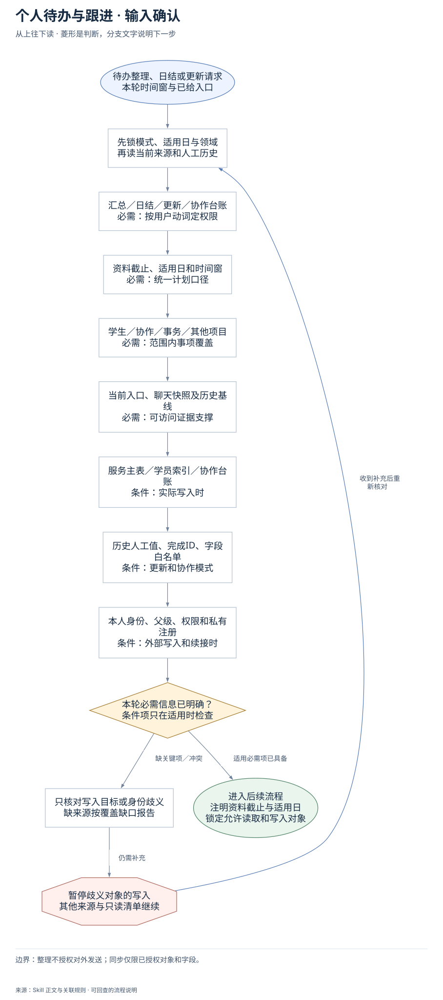
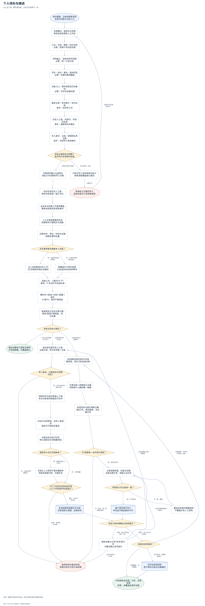

# 个人待办与跟进：完整执行流程

先核对具体输入；已有材料能查明的直接读取，关键缺失或冲突才补充确认。沿完整图查看后续处理、失败去向与交付。

交付：综合待办与晨间顺序；责任人、检查点与等待项；延期和来源覆盖记录；授权模式下的次日协同台账。

## 执行前确认哪些信息

| 输入 | 何时需要 | 从哪里取得 | 缺失或冲突怎么处理 |
| --- | --- | --- | --- |
| 汇总／日结／更新／协作台账 | 必需：按用户动词定权限 | 沿当前请求与明确持续授权；普通整理默认只读，协作只在已配时点或手动请求执行 | 意图不清先保留只读结果，不自动更新外部对象或建定时任务 |
| 资料截止、适用日和时间窗 | 必需：统一计划口径 | 记录实际材料截止和计划适用日，上海自然日；建议时间块与硬截止分开 | 来源截止不明标缺口，不称最新；历史次数未知从可靠基线起计 |
| 学生／协作／事务／其他项目 | 必需：范围内事项覆盖 | 按本轮范围读取聊天、飞书、会议、本地交付；学生通常多但不排除其他领域 | 缺少某域来源明确列未覆盖，不凭旧摘要补完成状态 |
| 当前入口、聊天快照及历史基线 | 必需：可访问证据支撑 | 任务来源优先、当前正文其次、真实交付再次、旧摘要仅索引；记录微信截止 | 缺新鲜度不默认刷新；有明确刷新授权才最小范围刷新并核结果 |
| 服务主表／学员索引／协作台账 | 条件：实际写入时 | 按字段语义解析用户指定的唯一目标，双台账联动分别读名册和结构 | 目标仍不唯一只问该对象，不能写同名历史表或只更新一边称两边完成 |
| 历史人工值、完成ID、字段白名单 | 条件：更新和协作模式 | 先全量读历史人工值、勾选排除集、当前记录与修订，缓存以云端为准 | 历史不可读不造勾选；并发或同ID冲突保留，只暂停对应补丁 |
| 本人身份、父级、权限和私有注册 | 条件：外部写入和续接时 | 复用当前成员私有注册，静默核本人owner/父级/权限，缓存缺失从云端恢复 | 目标不可读先报具体异常，不创建替代台账 |

## 输入确认、补齐与返回

[按原尺寸查看输入确认图](../assets/input-confirmation.svg)

## 完整执行、判断与异常去向

[按原尺寸打开完整执行图](../assets/workflow.svg)

## 每一步具体怎么做

### 输入与范围

**1. 待办整理、日结或更新请求；本轮时间窗与已给入口**

待办整理、日结或更新请求；本轮时间窗与已给入口。后续按实际结果分流：完成后：先锁模式、适用日与领域，再读当前来源和人工历史。

下一步：先锁模式、适用日与领域；再读当前来源和人工历史。

依据：[SKILL.md](../SKILL.md) 中的“先确定本轮模式”。

**2. 先锁模式、适用日与领域；再读当前来源和人工历史**

优先复用本轮材料、会话已有决定和本成员已授权来源。已有明确值直接沿用；先查可查来源，不重复索取。

下一步：汇总／日结／更新／协作台账；必需：按用户动词定权限。

依据：[SKILL.md](../SKILL.md) 中的“先确定本轮模式”。

**3. 汇总／日结／更新／协作台账；必需：按用户动词定权限**

取得方式：沿当前请求与明确持续授权；普通整理默认只读，协作只在已配时点或手动请求执行。缺失处理：意图不清先保留只读结果，不自动更新外部对象或建定时任务。

下一步：资料截止、适用日和时间窗；必需：统一计划口径。

依据：[SKILL.md](../SKILL.md) 中的“先确定本轮模式”。

**4. 资料截止、适用日和时间窗；必需：统一计划口径**

取得方式：记录实际材料截止和计划适用日，上海自然日；建议时间块与硬截止分开。缺失处理：来源截止不明标缺口，不称最新；历史次数未知从可靠基线起计。

下一步：学生／协作／事务／其他项目；必需：范围内事项覆盖。

依据：[SKILL.md](../SKILL.md) 中的“先确定本轮模式”。

**5. 学生／协作／事务／其他项目；必需：范围内事项覆盖**

取得方式：按本轮范围读取聊天、飞书、会议、本地交付；学生通常多但不排除其他领域。缺失处理：缺少某域来源明确列未覆盖，不凭旧摘要补完成状态。

下一步：当前入口、聊天快照及历史基线；必需：可访问证据支撑。

依据：[SKILL.md](../SKILL.md) 中的“建立动态来源清单”。

**6. 当前入口、聊天快照及历史基线；必需：可访问证据支撑**

取得方式：任务来源优先、当前正文其次、真实交付再次、旧摘要仅索引；记录微信截止。缺失处理：缺新鲜度不默认刷新；有明确刷新授权才最小范围刷新并核结果。

下一步：服务主表／学员索引／协作台账；条件：实际写入时。

依据：[SKILL.md](../SKILL.md) 中的“建立动态来源清单”。

**7. 服务主表／学员索引／协作台账；条件：实际写入时**

取得方式：按字段语义解析用户指定的唯一目标，双台账联动分别读名册和结构。缺失处理：目标仍不唯一只问该对象，不能写同名历史表或只更新一边称两边完成。

下一步：历史人工值、完成ID、字段白名单；条件：更新和协作模式。

依据：[SKILL.md](../SKILL.md) 中的“学生双台账联动”。

**8. 历史人工值、完成ID、字段白名单；条件：更新和协作模式**

取得方式：先全量读历史人工值、勾选排除集、当前记录与修订，缓存以云端为准。缺失处理：历史不可读不造勾选；并发或同ID冲突保留，只暂停对应补丁。

下一步：本人身份、父级、权限和私有注册；条件：外部写入和续接时。

依据：[references/maintained-collaboration.md](maintained-collaboration.md) 中的“人工协作权威与保护”。

**9. 本人身份、父级、权限和私有注册；条件：外部写入和续接时**

取得方式：复用当前成员私有注册，静默核本人owner/父级/权限，缓存缺失从云端恢复。缺失处理：目标不可读先报具体异常，不创建替代台账。

下一步：本轮必需信息已明确？；条件项只在适用时检查。

依据：[references/maintained-collaboration.md](maintained-collaboration.md) 中的“目标配置与授权”。

**10. 本轮必需信息已明确？；条件项只在适用时检查**

按每个字段的适用条件检查；可选偏好缺失采用本 Skill 的合理默认或保留未知，不阻塞无关步骤。

下一步：“缺关键项／冲突” → 只核对写入目标或身份歧义；缺来源按覆盖缺口报告；“适用必需项已具备” → 注明资料截止与适用日；锁定允许读取和写入对象。

依据：[SKILL.md](../SKILL.md) 中的“先确定本轮模式”。

**11. 只核对写入目标或身份歧义；缺来源按覆盖缺口报告**

先核对现有材料能否补齐，只问会改变当前动作或目标的关键缺口。来源冲突时保留原值和差异，不擅自合并。

下一步：“仍需补充” → 暂停歧义对象的写入；其他来源与只读清单继续。

依据：[SKILL.md](../SKILL.md) 中的“先确定本轮模式”。

**12. 暂停歧义对象的写入；其他来源与只读清单继续**

暂停依赖缺失信息的动作，保留已完成读取、来源和断点；能够独立完成的部分照常交付。收到补充后重查字段再进入执行。

下一步：“收到补充后重新核对” → 先锁模式、适用日与领域；再读当前来源和人工历史。

依据：[SKILL.md](../SKILL.md) 中的“先确定本轮模式”。

### 执行与核验

**1. 注明资料截止与适用日；锁定允许读取和写入对象**

注明资料截止与适用日；锁定允许读取和写入对象。后续按实际结果分流：完成后：协作先读历史人工值，再读可用来源，缺口可见。

下一步：协作先读历史人工值；再读可用来源，缺口可见。

依据：[SKILL.md](../SKILL.md) 中的“先确定本轮模式”。

**2. 协作先读历史人工值；再读可用来源，缺口可见**

协作先读历史人工值；再读可用来源，缺口可见。后续按实际结果分流：完成后：全名单与四类工作逐项覆盖，媒体未知和失败来源单列。

下一步：全名单与四类工作逐项覆盖；媒体未知和失败来源单列。

依据：[references/maintained-collaboration.md](maintained-collaboration.md) 中的“人工协作权威与保护”。

**3. 还原动作、责任、时间与证据；按稳定事项去重**

还原动作、责任、时间与证据；按稳定事项去重。后续按实际结果分流：完成后：学生事项是否需要本人兜底？。

下一步：学生事项是否需要本人兜底？。

依据：[SKILL.md](../SKILL.md) 中的“从证据中提取事项”。

**4. 学生事项是否需要本人兜底？**

学生事项是否需要本人兜底？。后续按实际结果分流：是：未接单或需主动跟进：无人实质接单列本人P0，过5天跟进仅限主动服务；否：已接单/等待/其他事项：明确接手才转盯结果，已发送但未验收转等待。

下一步：“是：未接单或需主动跟进” → 无人实质接单列本人P0；过5天跟进仅限主动服务；“否：已接单/等待/其他事项” → 明确接手才转盯结果；已发送但未验收转等待。

依据：[SKILL.md](../SKILL.md) 中的“学生群未回复的兜底归属”。

**5. 无人实质接单列本人P0；过5天跟进仅限主动服务**

无人实质接单列本人P0；过5天跟进仅限主动服务。后续按实际结果分流：完成后：四类工作、八桶与P0–P3，每项一个主动作与完成标准。

下一步：四类工作、八桶与P0–P3；每项一个主动作与完成标准。

依据：[SKILL.md](../SKILL.md) 中的“全量学生进度大表联动”。

**6. 明确接手才转盯结果；已发送但未验收转等待**

明确接手才转盯结果；已发送但未验收转等待。后续按实际结果分流：完成后：四类工作、八桶与P0–P3，每项一个主动作与完成标准。

下一步：四类工作、八桶与P0–P3；每项一个主动作与完成标准。

依据：[SKILL.md](../SKILL.md) 中的“判断完成、沟通与等待”。

**7. 四类工作、八桶与P0–P3；每项一个主动作与完成标准**

四类工作、八桶与P0–P3；每项一个主动作与完成标准。后续按实际结果分流：完成后：硬时间→承诺→风险→阻塞→成本，P0至P3，等待不算拖延。

下一步：硬时间→承诺→风险→阻塞→成本；P0至P3，等待不算拖延。

依据：[SKILL.md](../SKILL.md) 中的“用八个状态桶控制全局”。

**8. 继承真实计划与迁移计数；等待/受阻不算拖延，同日去重**

继承真实计划与迁移计数；等待/受阻不算拖延，同日去重。后续按实际结果分流：完成后：本轮实际执行模式？。

下一步：本轮实际执行模式？。

依据：[SKILL.md](../SKILL.md) 中的“优先级和延期控制”。

**9. 本轮实际执行模式？**

本轮实际执行模式？。后续按实际结果分流：汇总/日结/脱敏且不写入：输出完整执行清单与顺序，外发版脱敏，列覆盖缺口；已授权每日协作台账：读全部注册历史人工值，云端为准，同日复用唯一台账；已授权指定对象更新：动态解析授权目标与字段，服务表、索引分别名册对账。

下一步：“汇总/日结/脱敏且不写入” → 输出完整执行清单与顺序；外发版脱敏，列覆盖缺口；“已授权每日协作台账” → 读全部注册历史人工值；云端为准，同日复用唯一台账；“已授权指定对象更新” → 动态解析授权目标与字段；服务表、索引分别名册对账。

依据：[SKILL.md](../SKILL.md) 中的“先确定本轮模式”。

**10. 读全部注册历史人工值；云端为准，同日复用唯一台账**

读全部注册历史人工值；云端为准，同日复用唯一台账。后续按实际结果分流：完成后：本人身份、注册目标与权限可用？。

下一步：本人身份、注册目标与权限可用？。

依据：[references/maintained-collaboration.md](maintained-collaboration.md) 中的“人工协作权威与保护”。

**11. 本人身份、注册目标与权限可用？**

本人身份、注册目标与权限可用？。后续按实际结果分流：否：对象异常不建替代：暂停异常对象或字段，保留冲突与可用只读结果；是：已有对象或已授权父级：排除历史勾选并继承人工值，未完与新请求按稳定ID合并。

下一步：“否：对象异常不建替代” → 暂停异常对象或字段；保留冲突与可用只读结果；“是：已有对象或已授权父级” → 排除历史勾选并继承人工值；未完与新请求按稳定ID合并。

依据：[references/maintained-collaboration.md](maintained-collaboration.md) 中的“目标配置与授权”。

**12. 排除历史勾选并继承人工值；未完与新请求按稳定ID合并**

排除历史勾选并继承人工值；未完与新请求按稳定ID合并。后续按实际结果分流：完成后：历史已勾项排除，未完＋新请求，稳定ID不因改写重复。

下一步：历史已勾项排除，未完＋新请求；稳定ID不因改写重复。

依据：[references/maintained-collaboration.md](maintained-collaboration.md) 中的“人工协作权威与保护”。

**13. 提前导入的已完成副本？**

提前导入的已完成副本？。后续按实际结果分流：是：核副本独立人工变化：无独立人工新改才备份撤副本，有新改保留冲突，不删历史；否：正常增量：补丁只含白名单系统字段，人工六字段保护检查通过？。

下一步：“是：核副本独立人工变化” → 无独立人工新改才备份撤副本；有新改保留冲突，不删历史；“否：正常增量” → 补丁只含白名单系统字段；人工六字段保护检查通过？。

依据：[references/maintained-collaboration.md](maintained-collaboration.md) 中的“人工协作权威与保护”。

**14. 无独立人工新改才备份撤副本；有新改保留冲突，不删历史**

仅当前日提前导入的副本、前日后来勾选且副本没有独立人工新改时：先备份再按精确record_id撤副本，历史原件保留；有独立人工改动则保留冲突。

下一步：补丁只含白名单系统字段；人工六字段保护检查通过？。

依据：[references/maintained-collaboration.md](maintained-collaboration.md) 中的“人工协作权威与保护”。

**15. 补丁只含白名单系统字段；人工六字段保护检查通过？**

每个已有记录补丁先经collaboration_guard.py。六个人工字段负责人/状态/完成/备注/计划日期/优先级均不自动写，连人工清空也保护；新任务初始化不替人接单。

下一步：“通过：只补系统字段” → 复用或授权新建次日台账；无筛选默认视图，全部未完；“拒绝：含受保护字段” → 暂停异常对象或字段；保留冲突与可用只读结果。

依据：[references/maintained-collaboration.md](maintained-collaboration.md) 中的“人工协作权威与保护”。

**16. 复用或授权新建次日台账；无筛选默认视图，全部未完**

复用或授权新建次日台账；无筛选默认视图，全部未完。后续按实际结果分流：完成后：本批/台账完整独立回读通过？。

下一步：本批/台账完整独立回读通过？。

依据：[references/maintained-collaboration.md](maintained-collaboration.md) 中的“执行结构与默认无筛选视图”。

**17. 动态解析授权目标与字段；服务表、索引分别名册对账**

动态解析授权目标与字段；服务表、索引分别名册对账。后续按实际结果分流：完成后：主表名册＋跨表独立证据，对账索引人数和唯一档案。

下一步：主表名册＋跨表独立证据；对账索引人数和唯一档案。

依据：[SKILL.md](../SKILL.md) 中的“学生双台账联动：服务进度表与知识库索引”。

**18. 行/档案唯一且字段已授权？**

行/档案唯一且字段已授权？。后续按实际结果分流：否：身份、唯一性或授权缺口：暂停异常对象或字段，保留冲突与可用只读结果；是：锁定白名单：记录逐格前值、拟值与证据，无新证据不写，保留公式历史。

下一步：“否：身份、唯一性或授权缺口” → 暂停异常对象或字段；保留冲突与可用只读结果；“是：锁定白名单” → 记录逐格前值、拟值与证据；无新证据不写，保留公式历史。

依据：[SKILL.md](../SKILL.md) 中的“全量学生进度大表联动”。

**19. 记录逐格前值、拟值与证据；无新证据不写，保留公式历史**

记录逐格前值、拟值与证据；无新证据不写，保留公式历史。后续按实际结果分流：完成后：写前修订仍与差异一致？。

下一步：写前修订仍与差异一致？。

依据：[SKILL.md](../SKILL.md) 中的“全量学生进度大表联动”。

**20. 写前修订仍与差异一致？**

写前修订仍与差异一致？。后续按实际结果分流：不一致：重算：重读目标格并重算差异，不覆盖并发人工修改；一致：仅写差异：最小差异串行写入，学生批次每批最多20行。

下一步：“不一致：重算” → 重读目标格并重算差异；不覆盖并发人工修改；“一致：仅写差异” → 最小差异串行写入；学生批次每批最多20行。

依据：[SKILL.md](../SKILL.md) 中的“全量学生进度大表联动”。

**21. 重读目标格并重算差异；不覆盖并发人工修改**

重读目标格并重算差异；不覆盖并发人工修改。后续按实际结果分流：完成后：记录逐格前值、拟值与证据，无新证据不写，保留公式历史。

下一步：记录逐格前值、拟值与证据；无新证据不写，保留公式历史。

依据：[SKILL.md](../SKILL.md) 中的“全量学生进度大表联动”。

**22. 最小差异串行写入；学生批次每批最多20行**

最小差异串行写入；学生批次每批最多20行。后续按实际结果分流：完成后：本批/台账完整独立回读通过？。

下一步：本批/台账完整独立回读通过？。

依据：[SKILL.md](../SKILL.md) 中的“全量学生进度大表联动”。

**23. 按账本确认已写/未写/部分写；只重试确认未写部分**

按账本确认已写/未写/部分写；只重试确认未写部分。后续按实际结果分流：已定位普通更新未写部分：记录逐格前值、拟值与证据，无新证据不写，保留公式历史；台账先重读云端再重算：读全部注册历史人工值，云端为准，同日复用唯一台账；无法判定或人工冲突：暂停异常对象或字段，保留冲突与可用只读结果。

下一步：“已定位普通更新未写部分” → 记录逐格前值、拟值与证据；无新证据不写，保留公式历史；“台账先重读云端再重算” → 读全部注册历史人工值；云端为准，同日复用唯一台账；“无法判定或人工冲突” → 暂停异常对象或字段；保留冲突与可用只读结果。

依据：[SKILL.md](../SKILL.md) 中的“全量学生进度大表联动”。

**24. 验收后如何继续？**

验收后如何继续？。后续按实际结果分流：普通更新：还有批次或第二对象：动态解析授权目标与字段，服务表、索引分别名册对账；普通更新：全部覆盖：分别报告应处理、已写、无需变更，异常、未覆盖及保护证据；协作台账：全量回读通过：协作台账读回后，原子保存注册与证据缓存。

下一步：“普通更新：还有批次或第二对象” → 动态解析授权目标与字段；服务表、索引分别名册对账；“普通更新：全部覆盖” → 分别报告应处理、已写、无需变更；异常、未覆盖及保护证据；“协作台账：全量回读通过” → 协作台账读回后；原子保存注册与证据缓存。

依据：[SKILL.md](../SKILL.md) 中的“学生双台账联动：服务进度表与知识库索引”。

**25. 协作台账读回后；原子保存注册与证据缓存**

协作台账读回后；原子保存注册与证据缓存。后续按实际结果分流：完成后：分别报告应处理、已写、无需变更，异常、未覆盖及保护证据。

下一步：分别报告应处理、已写、无需变更；异常、未覆盖及保护证据。

依据：[references/maintained-collaboration.md](maintained-collaboration.md) 中的“来源与稳定ID”。

**26. 全名单与四类工作逐项覆盖；媒体未知和失败来源单列**

核全名单学生群、私聊、协作、飞书、会议、本地交付，同时覆盖客户合同/员工/事务/项目。媒体语义未读不能猜，来源不可用留缺口。

下一步：人工主表保留服务状态；较新聊天只增核实与进展。

依据：[references/maintained-collaboration.md](maintained-collaboration.md) 中的“来源与稳定ID”。

**27. 人工主表保留服务状态；较新聊天只增核实与进展**

服务主表决定服务状态；学员索引叙具体进展和下一步。Offer、已发会邀、新聊天不自动结束或恢复服务，冲突新增人工核实。

下一步：还原动作、责任、时间与证据；按稳定事项去重。

依据：[SKILL.md](../SKILL.md) 中的“学生双台账联动”。

**28. 硬时间→承诺→风险→阻塞→成本；P0至P3，等待不算拖延**

学生群无人实质承接归用户P0，明确接手转盯结果，已发送但待反馈转等待。每项唯一主类型、唯一主状态桶，不按消息数量重复建任务。

下一步：继承真实计划与迁移计数；等待/受阻不算拖延，同日去重。

依据：[SKILL.md](../SKILL.md) 中的“优先级和延期控制”。

**29. 主表名册＋跨表独立证据；对账索引人数和唯一档案**

分别动态解析服务表和知识库索引，核应覆盖人数、同名/重复/缺行、唯一档案链接。索引保留简历、历史图和原资源，新增身份不唯一先停该行。

下一步：有效双向沟通才刷新日期；超过5天、被动服务、空日期分列。

依据：[SKILL.md](../SKILL.md) 中的“学生双台账联动”。

**30. 有效双向沟通才刷新日期；超过5天、被动服务、空日期分列**

上海日期差严格大于5为6天以上。进行中非被动者生成主动回访，空日期单列回查不造日期；被动服务只观察，新请求未承接仍兜底；原公式不改。

下一步：行/档案唯一且字段已授权？。

依据：[SKILL.md](../SKILL.md) 中的“全量学生进度大表联动”。

**31. 历史已勾项排除，未完＋新请求；稳定ID不因改写重复**

以云端所有注册历史页的人工勾选为排除集，保留未完稳定ID、承诺、最新人工值；新编号递增且不复用关闭ID，创建超时先查云端ID。

下一步：全部未完分执行队列；默认视图无任何隐藏筛选。

依据：[references/maintained-collaboration.md](maintained-collaboration.md) 中的“来源与稳定ID”。

**32. 全部未完分执行队列；默认视图无任何隐藏筛选**

本人执行、协作盯办、等待低频与后置事项按执行分区/顺序展示全部未完。默认conditions为空，完成/认领前置；不以只展示前15条或过滤隐藏替代完整台账。

下一步：提前导入的已完成副本？。

依据：[references/maintained-collaboration.md](maintained-collaboration.md) 中的“执行结构与默认无筛选视图”。

### 交付与验收

**1. 输出完整执行清单与顺序；外发版脱敏，列覆盖缺口**

输出完整执行清单与顺序；外发版脱敏，列覆盖缺口。该分支的实际状态与未完成项保留在交付回执中。

这是本路径的交付或转交结果。

依据：[SKILL.md](../SKILL.md) 中的“生成次日执行版”。

**2. 本批/台账完整独立回读通过？**

核未完ID与新ID并集、历史勾选零带入、人工值继承、默认视图空conditions、执行字段/父级/owner/权限；服务表与索引分别核修订、公式、人数和资源。

下一步：“通过：含公式与只读锚点” → 验收后如何继续？；“超时、部分写或读回不一致” → 按账本确认已写/未写/部分写；只重试确认未写部分。

依据：[SKILL.md](../SKILL.md) 中的“最终自检”。

**3. 分别报告应处理、已写、无需变更；异常、未覆盖及保护证据**

分别报告应处理、已写、无需变更；异常、未覆盖及保护证据。该分支的实际状态与未完成项保留在交付回执中。

这是本路径的交付或转交结果。

依据：[SKILL.md](../SKILL.md) 中的“最终自检”。

**4. 暂停异常对象或字段；保留冲突与可用只读结果**

暂停异常对象或字段；保留冲突与可用只读结果。该分支的实际状态与未完成项保留在交付回执中。

此处保留待办与证据，补齐后接续原任务。

依据：[SKILL.md](../SKILL.md) 中的“写入和对外动作边界”。

## 验收

- 截止与未覆盖范围明确
- 全量名册每行归入已写/无需变更/异常/未覆盖
- 学生无人接单与主动服务过5天兜底正确
- 稳定ID、人工勾选排除及同目标日结转去重
- 六人工字段零自动覆盖且默认视图无筛选
- 服务主表与索引按授权分别回读
- 超时先判实际结果，公式和历史资源保留

整理不授权对外发送；同步仅限已授权对象和字段。

## 对应规则

- [SKILL.md](../SKILL.md)
- [references/maintained-collaboration.md](maintained-collaboration.md)
- [references/team-setup.md](team-setup.md)

```mermaid
flowchart TB
  input(["待办整理、日结或更新请求<br/>本轮时间窗与已给入口"])
  scope["注明资料截止与适用日<br/>锁定允许读取和写入对象"]
  read["协作先读历史人工值<br/>再读可用来源，缺口可见"]
  extract["还原动作、责任、时间与证据<br/>按稳定事项去重"]
  student{"学生事项是否需要本人兜底？"}
  fallback["无人实质接单列本人P0<br/>过5天跟进仅限主动服务"]
  assigned["明确接手才转盯结果<br/>已发送但未验收转等待"]
  classify["四类工作、八桶与P0–P3<br/>每项一个主动作与完成标准"]
  rollover["继承真实计划与迁移计数<br/>等待/受阻不算拖延，同日去重"]
  mode{"本轮实际执行模式？"}
  summary(["输出完整执行清单与顺序<br/>外发版脱敏，列覆盖缺口"])
  ledgerread["读全部注册历史人工值<br/>云端为准，同日复用唯一台账"]
  ledgertarget{"本人身份、注册目标与权限可用？"}
  merge["排除历史勾选并继承人工值<br/>未完与新请求按稳定ID合并"]
  early{"提前导入的已完成副本？"}
  withdraw["无独立人工新改才备份撤副本<br/>有新改保留冲突，不删历史"]
  guard{"补丁只含白名单系统字段<br/>人工六字段保护检查通过？"}
  ledgerwrite[("复用或授权新建次日台账<br/>无筛选默认视图，全部未完")]
  objects["动态解析授权目标与字段<br/>服务表、索引分别名册对账"]
  unique{"行/档案唯一且字段已授权？"}
  diff["记录逐格前值、拟值与证据<br/>无新证据不写，保留公式历史"]
  revision{"写前修订仍与差异一致？"}
  reread["重读目标格并重算差异<br/>不覆盖并发人工修改"]
  update[("最小差异串行写入<br/>学生批次每批最多20行")]
  qa{"本批/台账完整独立回读通过？"}
  recover["按账本确认已写/未写/部分写<br/>只重试确认未写部分"]
  next{"验收后如何继续？"}
  done(["分别报告应处理、已写、无需变更<br/>异常、未覆盖及保护证据"])
  stop(["暂停异常对象或字段<br/>保留冲突与可用只读结果"])
  cache[("协作台账读回后<br/>原子保存注册与证据缓存")]
  intake_lookup["先锁模式、适用日与领域<br/>再读当前来源和人工历史"]
  intake_mode["汇总／日结／更新／协作台账<br/>必需：按用户动词定权限"]
  intake_time["资料截止、适用日和时间窗<br/>必需：统一计划口径"]
  intake_domains["学生／协作／事务／其他项目<br/>必需：范围内事项覆盖"]
  intake_sources["当前入口、聊天快照及历史基线<br/>必需：可访问证据支撑"]
  intake_targets["服务主表／学员索引／协作台账<br/>条件：实际写入时"]
  intake_manual["历史人工值、完成ID、字段白名单<br/>条件：更新和协作模式"]
  intake_identity["本人身份、父级、权限和私有注册<br/>条件：外部写入和续接时"]
  intake_ready{"本轮必需信息已明确？<br/>条件项只在适用时检查"}
  intake_clarify["只核对写入目标或身份歧义<br/>缺来源按覆盖缺口报告"]
  intake_wait(["暂停歧义对象的写入<br/>其他来源与只读清单继续"])
  source_coverage["全名单与四类工作逐项覆盖<br/>媒体未知和失败来源单列"]
  source_conflict["人工主表保留服务状态<br/>较新聊天只增核实与进展"]
  priority_detail["硬时间→承诺→风险→阻塞→成本<br/>P0至P3，等待不算拖延"]
  roster_reconcile["主表名册＋跨表独立证据<br/>对账索引人数和唯一档案"]
  communication_rules["有效双向沟通才刷新日期<br/>超过5天、被动服务、空日期分列"]
  ledger_stable_ids["历史已勾项排除，未完＋新请求<br/>稳定ID不因改写重复"]
  ledger_views["全部未完分执行队列<br/>默认视图无任何隐藏筛选"]
  scope --> read
  extract --> student
  student -->|"是：未接单或需主动跟进"| fallback
  student -->|"否：已接单/等待/其他事项"| assigned
  fallback --> classify
  assigned --> classify
  rollover --> mode
  mode -->|"汇总/日结/脱敏且不写入"| summary
  mode -->|"已授权每日协作台账"| ledgerread
  mode -->|"已授权指定对象更新"| objects
  ledgerread --> ledgertarget
  ledgertarget -->|"否：对象异常不建替代"| stop
  ledgertarget -->|"是：已有对象或已授权父级"| merge
  early -->|"是：核副本独立人工变化"| withdraw
  early -->|"否：正常增量"| guard
  withdraw --> guard
  guard -->|"通过：只补系统字段"| ledgerwrite
  guard -->|"拒绝：含受保护字段"| stop
  ledgerwrite --> qa
  unique -->|"否：身份、唯一性或授权缺口"| stop
  unique -->|"是：锁定白名单"| diff
  diff --> revision
  revision -->|"不一致：重算"| reread
  reread --> diff
  revision -->|"一致：仅写差异"| update
  update --> qa
  qa -->|"通过：含公式与只读锚点"| next
  qa -->|"超时、部分写或读回不一致"| recover
  recover -->|"已定位普通更新未写部分"| diff
  recover -->|"台账先重读云端再重算"| ledgerread
  recover -->|"无法判定或人工冲突"| stop
  next -->|"普通更新：还有批次或第二对象"| objects
  next -->|"普通更新：全部覆盖"| done
  next -->|"协作台账：全量回读通过"| cache
  cache --> done
  input --> intake_lookup
  intake_lookup --> intake_mode
  intake_mode --> intake_time
  intake_time --> intake_domains
  intake_domains --> intake_sources
  intake_sources --> intake_targets
  intake_targets --> intake_manual
  intake_manual --> intake_identity
  intake_identity --> intake_ready
  intake_ready -->|"缺关键项／冲突"| intake_clarify
  intake_clarify -->|"仍需补充"| intake_wait
  intake_wait -->|"收到补充后重新核对"| intake_lookup
  intake_ready -->|"适用必需项已具备"| scope
  read --> source_coverage
  source_coverage --> source_conflict
  source_conflict --> extract
  classify --> priority_detail
  priority_detail --> rollover
  objects --> roster_reconcile
  roster_reconcile --> communication_rules
  communication_rules --> unique
  merge --> ledger_stable_ids
  ledger_stable_ids --> ledger_views
  ledger_views --> early
```

可编辑的完整流程源码

