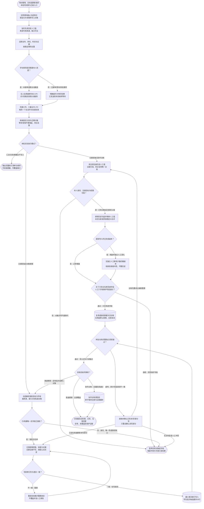

# 个人待办与跟进：完整流程

输入：当前聊天与真实记录；服务主表和项目状态；时间范围与完成反馈。

交付：综合待办与晨间顺序；责任人、检查点与等待项；延期和来源覆盖记录；授权模式下的次日协同台账。

[按原尺寸打开完整流程图](../assets/workflow.svg)

## 按什么顺序做

### 锁定模式与覆盖范围

记录资料截止、适用日期、来源与写入授权；不把整理当更新。

### 读取当前权威证据

动态读来源与全量名册；微信现有快照优先，未覆盖和新鲜度缺口可见。

### 恢复事项与责任

四类工作只归一类；学生新请求无人实质承接由本人兜底。

### 排序并审计结转

P0–P3和八桶；等待不算拖延，同ID同目标日不重复累计。

### 按授权维护目标

普通更新限定字段；全量学生与双台账分别对账，协作模式按专用合同。

### 保护人工并最小写入

人工六字段不覆盖，稳定ID去重；批次读回、超时先查不盲重试。

### 分别验收与交付

覆盖、数量、修订、公式、未授权字段与缺口分别报告。

## 验收

- 截止与未覆盖范围明确
- 全量名册每行归入已写/无需变更/异常/未覆盖
- 学生无人接单与主动服务过5天兜底正确
- 稳定ID、人工勾选排除及同目标日结转去重
- 六人工字段零自动覆盖且默认视图无筛选
- 服务主表与索引按授权分别回读
- 超时先判实际结果，公式和历史资源保留

整理不授权对外发送；同步仅限已授权对象和字段。

## 对应规则

- [SKILL.md](../SKILL.md)
- [references/maintained-collaboration.md](maintained-collaboration.md)
- [references/team-setup.md](team-setup.md)

可编辑的流程源码

