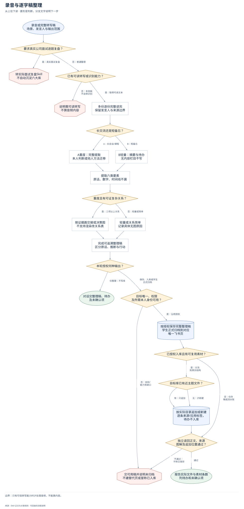
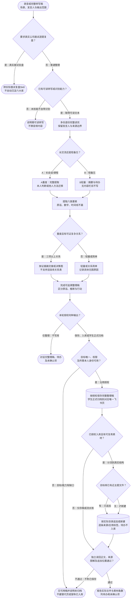

# 录音与逐字稿整理：完整流程

输入：可信转写稿或录音；场景与发言人信息；整理或入库范围。

交付：整理稿与核心结论；决策、原话及后续行动；已授权知识库条目。

[按原尺寸打开完整流程图](../assets/workflow.svg)

## 按什么顺序做

### 区分真实复盘与普通整理

真实正式面试转专用Skill；普通录音先确认可读转写。

### 选深度并完整读取

A重度区分自己主讲与别人分享；B轻量，全文读完再提取。

### 提取并组织整理稿

保留观点、方法、故事数字、原话、选题和待办，复杂关系按证据图解。

### 按范围选择交付面

默认对话整理；已授权保存沿用目标，学生正式归档定位唯一飞书。

### 仅有价值且授权时入库

按真实目录分流，近主题追加、无主题新建，待办不入库。

### 回读并报告实际结果

核保存内容、追加段落和来源；缺转写、目标或图解能力据实保留。

## 验收

- 完整读完后提取，逐份不混淆
- 真实面试转专用入口
- 未授权不落盘或入库
- 仅新建和追加，不改移删历史
- 写后回读来源、内容及真实显示

只有可信转写能力时才处理音频，不能猜内容。

## 对应规则

- [SKILL.md](../SKILL.md)
- [references/team-setup.md](team-setup.md)

可编辑的流程源码

