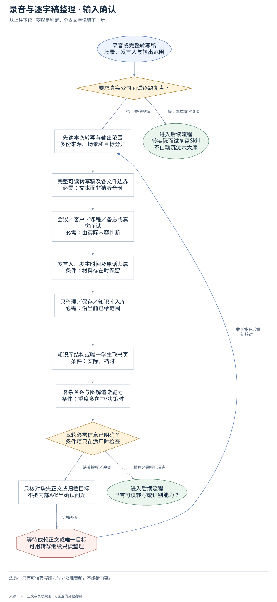

# 录音与逐字稿整理：完整执行流程

先核对具体输入；已有材料能查明的直接读取，关键缺失或冲突才补充确认。沿完整图查看后续处理、失败去向与交付。

交付：整理稿与核心结论；决策、原话及后续行动；已授权知识库条目。

## 执行前确认哪些信息

| 输入 | 何时需要 | 从哪里取得 | 缺失或冲突怎么处理 |
| --- | --- | --- | --- |
| 完整可读转写稿及各文件边界 | 必需：文本而非猜听音频 | 使用用户粘贴、指定文本路径或已有完整整理稿，多份逐份读 | 本Skill不自带识别；缺转写说明能力缺口，不能依据音频标题猜正文 |
| 会议／客户／课程／备忘或真实面试 | 必需：由实际内容判断 | 完整阅读后识别长交流或短备忘；真实公司面试逐题复盘转专用Skill | 场景不明且会改变交付或页面时才问，不为A/B内部模式额外审批 |
| 发言人、发生时间及原话归属 | 条件：材料存在时保留 | 按原稿保留参与人、具体数字、时间线、本人判断和他人方法 | 听不清或归属冲突标待确认，不把AI总结写成原话 |
| 只整理／保存／知识库入库 | 必需：沿当前已给范围 | 默认对话整理；保存/入库沿已有授权，不重复问 | 未授权跳过落盘，仍交可用整理稿与可沉淀素材 |
| 知识库结构或唯一学生飞书页 | 条件：实际归档时 | 复用任务入口或私有配置；已有库先读目录，学生正式归档对应唯一页面 | 缺入口或身份只停写入，不新建替代页，不按六大库重构旧库 |
| 复杂关系与图解渲染能力 | 条件：重度多角色/决策时 | 只依据转写中的角色、阶段、决策与时间画图，查可用视觉Skill和真实目标渲染器 | 能力缺失可交文字稿/图解设计并说明未视觉验收；轻量无图不阻塞 |

## 输入确认、补齐与返回

[按原尺寸查看输入确认图](../assets/input-confirmation.svg)

## 完整执行、判断与异常去向

[按原尺寸打开完整执行图](../assets/workflow.svg)

## 每一步具体怎么做

### 输入与范围

**1. 录音或完整转写稿；场景、发言人与输出范围**

录音或完整转写稿；场景、发言人与输出范围。后续按实际结果分流：完成后：先读本次转写与输出范围，多份来源、场景和目标分开。

下一步：要求真实公司面试逐题复盘？。

依据：[SKILL.md](../SKILL.md) 中的“五步流程”。

**2. 要求真实公司面试逐题复盘？**

先根据本次交付对象做边界分流；转专用 Skill 的请求直接携已有来源转交，不要求先填齐本 Skill 的后续执行字段。要求真实公司面试逐题复盘？。后续按实际结果分流：是：真实面试复盘：转实际面试复盘Skill，不自动沉淀六大库；否：普通整理：已有可读转写或识别能力？。

下一步：“是：真实面试复盘” → 转实际面试复盘Skill；不自动沉淀六大库；“否：普通整理” → 先读本次转写与输出范围；多份来源、场景和目标分开。

依据：[SKILL.md](../SKILL.md) 中的“**路由边界：**”。

**3. 先读本次转写与输出范围；多份来源、场景和目标分开**

优先复用本轮材料、会话已有决定和本成员已授权来源。已有明确值直接沿用；先查可查来源，不重复索取。

下一步：完整可读转写稿及各文件边界；必需：文本而非猜听音频。

依据：[SKILL.md](../SKILL.md) 中的“第 0 步”。

**4. 完整可读转写稿及各文件边界；必需：文本而非猜听音频**

取得方式：使用用户粘贴、指定文本路径或已有完整整理稿，多份逐份读。缺失处理：本Skill不自带识别；缺转写说明能力缺口，不能依据音频标题猜正文。

下一步：会议／客户／课程／备忘或真实面试；必需：由实际内容判断。

依据：[SKILL.md](../SKILL.md) 中的“第一步：读取”。

**5. 会议／客户／课程／备忘或真实面试；必需：由实际内容判断**

取得方式：完整阅读后识别长交流或短备忘；真实公司面试逐题复盘转专用Skill。缺失处理：场景不明且会改变交付或页面时才问，不为A/B内部模式额外审批。

下一步：发言人、发生时间及原话归属；条件：材料存在时保留。

依据：[SKILL.md](../SKILL.md) 中的“模式判断”。

**6. 发言人、发生时间及原话归属；条件：材料存在时保留**

取得方式：按原稿保留参与人、具体数字、时间线、本人判断和他人方法。缺失处理：听不清或归属冲突标待确认，不把AI总结写成原话。

下一步：只整理／保存／知识库入库；必需：沿当前已给范围。

依据：[SKILL.md](../SKILL.md) 中的“第二步：通读全文”。

**7. 只整理／保存／知识库入库；必需：沿当前已给范围**

取得方式：默认对话整理；保存/入库沿已有授权，不重复问。缺失处理：未授权跳过落盘，仍交可用整理稿与可沉淀素材。

下一步：知识库结构或唯一学生飞书页；条件：实际归档时。

依据：[SKILL.md](../SKILL.md) 中的“第 0 步”。

**8. 知识库结构或唯一学生飞书页；条件：实际归档时**

取得方式：复用任务入口或私有配置；已有库先读目录，学生正式归档对应唯一页面。缺失处理：缺入口或身份只停写入，不新建替代页，不按六大库重构旧库。

下一步：复杂关系与图解渲染能力；条件：重度多角色/决策时。

依据：[SKILL.md](../SKILL.md) 中的“**首用依赖：**”。

**9. 复杂关系与图解渲染能力；条件：重度多角色/决策时**

取得方式：只依据转写中的角色、阶段、决策与时间画图，查可用视觉Skill和真实目标渲染器。缺失处理：能力缺失可交文字稿/图解设计并说明未视觉验收；轻量无图不阻塞。

下一步：本轮必需信息已明确？；条件项只在适用时检查。

依据：[SKILL.md](../SKILL.md) 中的“**A 模式视觉触发：**”。

**10. 本轮必需信息已明确？；条件项只在适用时检查**

按每个字段的适用条件检查；可选偏好缺失采用本 Skill 的合理默认或保留未知，不阻塞无关步骤。

下一步：“缺关键项／冲突” → 只核对缺失正文或归档目标；不把内部A/B当确认问题；“适用必需项已具备” → 已有可读转写或识别能力？。

依据：[SKILL.md](../SKILL.md) 中的“第 0 步”。

**11. 只核对缺失正文或归档目标；不把内部A/B当确认问题**

先核对现有材料能否补齐，只问会改变当前动作或目标的关键缺口。来源冲突时保留原值和差异，不擅自合并。

下一步：“仍需补充” → 等待依赖正文或唯一目标；可用转写继续只读整理。

依据：[SKILL.md](../SKILL.md) 中的“第 0 步”。

**12. 等待依赖正文或唯一目标；可用转写继续只读整理**

暂停依赖缺失信息的动作，保留已完成读取、来源和断点；能够独立完成的部分照常交付。收到补充后重查字段再进入执行。

下一步：“收到补充后重新核对” → 先读本次转写与输出范围；多份来源、场景和目标分开。

依据：[SKILL.md](../SKILL.md) 中的“第 0 步”。

### 执行与核验

**1. 已有可读转写或识别能力？**

已有可读转写或识别能力？。后续按实际结果分流：否：本技能不自带识别：说明需可读转写，不猜音频内容；是：取得可读文本：多份逐份完整读完，保留发言人与来源边界。

下一步：“否：本技能不自带识别” → 说明需可读转写；不猜音频内容；“是：取得可读文本” → 多份逐份完整读完；保留发言人与来源边界。

依据：[SKILL.md](../SKILL.md) 中的“**首用依赖：**”。

**2. 多份逐份完整读完；保留发言人与来源边界**

多份逐份完整读完；保留发言人与来源边界。后续按实际结果分流：完成后：逐份完整读取后再整理，核截断、发言人和出处。

下一步：逐份完整读取后再整理；核截断、发言人和出处。

依据：[SKILL.md](../SKILL.md) 中的“第一步：读取”。

**3. 长交流还是短备忘？**

长交流还是短备忘？。后续按实际结果分流：A：长会谈/课程：A重度：完整提取，本人判断或他人方法迁移；B：短备忘：B轻量：摘要与待办，无内容栏目不写。

下一步：“A：长会谈/课程” → A重度：完整提取；本人判断或他人方法迁移；“B：短备忘” → B轻量：摘要与待办；无内容栏目不写。

依据：[SKILL.md](../SKILL.md) 中的“模式判断（读取输入后先做）”。

**4. A重度：完整提取；本人判断或他人方法迁移**

A重度：完整提取；本人判断或他人方法迁移。后续按实际结果分流：完成后：提取六类要素，原话、数字、时间线不漏。

下一步：提取六类要素；原话、数字、时间线不漏。

依据：[SKILL.md](../SKILL.md) 中的“模式判断（读取输入后先做）”。

**5. B轻量：摘要与待办；无内容栏目不写**

B轻量：摘要与待办；无内容栏目不写。后续按实际结果分流：完成后：提取六类要素，原话、数字、时间线不漏。

下一步：提取六类要素；原话、数字、时间线不漏。

依据：[SKILL.md](../SKILL.md) 中的“第三步：输出整理稿”。

**6. 提取六类要素；原话、数字、时间线不漏**

提取六类要素；原话、数字、时间线不漏。后续按实际结果分流：完成后：观点／方法／故事数据／客户原话，选题／待办，逐条有来源。

下一步：观点／方法／故事数据／客户原话；选题／待办，逐条有来源。

依据：[SKILL.md](../SKILL.md) 中的“第二步：通读全文，提取六类要素”。

**7. 重度且有可证复杂关系？**

重度且有可证复杂关系？。后续按实际结果分流：是：三项以上关系：按证据画交接或决策图，不支持渲染改关系表；否：轻量或简单：轻量或关系简单，记录具体无图原因。

下一步：“是：三项以上关系” → 按证据画交接或决策图；不支持渲染改关系表；“否：轻量或简单” → 轻量或关系简单；记录具体无图原因。

依据：[SKILL.md](../SKILL.md) 中的“**A 模式视觉触发：**”。

**8. 按证据画交接或决策图；不支持渲染改关系表**

按证据画交接或决策图；不支持渲染改关系表。后续按实际结果分流：完成后：完成可追溯整理稿，区分原话、推断与行动。

下一步：完成可追溯整理稿；区分原话、推断与行动。

依据：[SKILL.md](../SKILL.md) 中的“第三步：输出整理稿”。

**9. 轻量或关系简单；记录具体无图原因**

轻量或关系简单；记录具体无图原因。后续按实际结果分流：完成后：完成可追溯整理稿，区分原话、推断与行动。

下一步：完成可追溯整理稿；区分原话、推断与行动。

依据：[SKILL.md](../SKILL.md) 中的“**B 模式视觉豁免：**”。

**10. 完成可追溯整理稿；区分原话、推断与行动**

完成可追溯整理稿；区分原话、推断与行动。后续按实际结果分流：完成后：本轮授权何种输出？。

下一步：本轮授权何种输出？。

依据：[SKILL.md](../SKILL.md) 中的“第三步：输出整理稿”。

**11. 本轮授权何种输出？**

本轮授权何种输出？。后续按实际结果分流：仅整理：不写库：对话交整理稿、待办，及未确认项；保存、入库或学生正式归档：目标唯一、权限，及所需本人身份可用？。

下一步：“仅整理：不写库” → 对话交整理稿、待办；及未确认项；“保存、入库或学生正式归档” → 目标唯一、权限；及所需本人身份可用？。

依据：[SKILL.md](../SKILL.md) 中的“第 0 步：确认输出范围与知识库（仅入库时）”。

**12. 目标唯一、权限；及所需本人身份可用？**

目标唯一、权限；及所需本人身份可用？。后续按实际结果分流：否：目标/能力有缺口：交可用稿并说明未归档，不建替代页或冒称已入库；是：沿用授权：按授权保存完整整理稿，学生正式归档到对应唯一飞书页。

下一步：“否：目标/能力有缺口” → 交可用稿并说明未归档；不建替代页或冒称已入库；“是：沿用授权” → 按授权保存完整整理稿；学生正式归档到对应唯一飞书页。

依据：[SKILL.md](../SKILL.md) 中的“**学生交付路由：**”。

**13. 已授权入库且有可复用素材？**

已授权入库且有可复用素材？。后续按实际结果分流：否：仅存稿或流水账：独立读回正文、来源，图解及追加位置通过？；是：分流到真实结构：目标库已有近主题文件？。

下一步：“否：仅存稿或流水账” → 独立读回正文、来源；图解及追加位置通过？；“是：分流到真实结构” → 目标库已有近主题文件？。

依据：[SKILL.md](../SKILL.md) 中的“第四步：分流入库（已有授权时）”。

**14. 按授权保存完整整理稿；学生正式归档到对应唯一飞书页**

按授权保存完整整理稿；学生正式归档到对应唯一飞书页。后续按实际结果分流：完成后：学生归档按实际交付类型，其余沿授权本地/知识库目标。

下一步：学生归档按实际交付类型；其余沿授权本地/知识库目标。

依据：[SKILL.md](../SKILL.md) 中的“**学生交付路由：**”。

**15. 目标库已有近主题文件？**

目标库已有近主题文件？。后续按实际结果分流：有：只追加：按实际目录追加或新建，逐条来源/应用标签，待办不入库；无：才新建：按实际目录追加或新建，逐条来源/应用标签，待办不入库。

下一步：“有：只追加” → 按实际目录追加或新建；逐条来源/应用标签，待办不入库；“无：才新建” → 按实际目录追加或新建；逐条来源/应用标签，待办不入库。

依据：[SKILL.md](../SKILL.md) 中的“第四步：分流入库（已有授权时）”。

**16. 按实际目录追加或新建；逐条来源/应用标签，待办不入库**

按实际目录追加或新建；逐条来源/应用标签，待办不入库。后续按实际结果分流：完成后：按主题追加或新建，不改旧文，每条来源＋应用；待办不入库。

下一步：按主题追加或新建，不改旧文；每条来源＋应用；待办不入库。

依据：[SKILL.md](../SKILL.md) 中的“第四步：分流入库（已有授权时）”。

**17. 逐份完整读取后再整理；核截断、发言人和出处**

不能边读一段边整理或混合多份稿。遇工具截断继续读剩余部分；保留数字、时间线、案例细节和客户原话，存疑处保留待确认。

下一步：长交流还是短备忘？。

依据：[SKILL.md](../SKILL.md) 中的“执行纪律”。

**18. 观点／方法／故事数据／客户原话；选题／待办，逐条有来源**

原话照抄不美化，数据与时间不漏；A模式保留完整展开，B模式只写实际存在的栏目，不为了六类凑信息。

下一步：已决定/已指派才写正式行动；推断、可能性和知识补充分开。

依据：[SKILL.md](../SKILL.md) 中的“第二步：通读全文，提取六类要素”。

**19. 已决定/已指派才写正式行动；推断、可能性和知识补充分开**

转写中只有可以考虑、以后也许时不能画成已分配任务；负责人不明标待确认。关系图只连已有证据，放摘要后、详细观点前。

下一步：重度且有可证复杂关系？。

依据：[SKILL.md](../SKILL.md) 中的“第三步：输出整理稿”。

### 交付与验收

**1. 转实际面试复盘Skill；不自动沉淀六大库**

转实际面试复盘Skill；不自动沉淀六大库。该分支的实际状态与未完成项保留在交付回执中。

此处保留待办与证据，补齐后接续原任务。

依据：[SKILL.md](../SKILL.md) 中的“**路由边界：**”。

**2. 说明需可读转写；不猜音频内容**

说明需可读转写；不猜音频内容。该分支的实际状态与未完成项保留在交付回执中。

此处保留待办与证据，补齐后接续原任务。

依据：[SKILL.md](../SKILL.md) 中的“**首用依赖：**”。

**3. 对话交整理稿、待办；及未确认项**

对话交整理稿、待办；及未确认项。该分支的实际状态与未完成项保留在交付回执中。

这是本路径的交付或转交结果。

依据：[SKILL.md](../SKILL.md) 中的“第五步：汇报”。

**4. 交可用稿并说明未归档；不建替代页或冒称已入库**

交可用稿并说明未归档；不建替代页或冒称已入库。该分支的实际状态与未完成项保留在交付回执中。

此处保留待办与证据，补齐后接续原任务。

依据：[SKILL.md](../SKILL.md) 中的“**首用依赖：**”。

**5. 独立读回正文、来源；图解及追加位置通过？**

独立读回目标文件/页面、完整整理稿、实际追加段落、来源应用标签和图解显示；对照原文与原有内容，未保存或未读回不得称已入库。

下一步：“通过” → 报告实际文件与素材条数；列待办和未确认项；“不通过：不称已保存” → 交可用稿并说明未归档；不建替代页或冒称已入库。

依据：[SKILL.md](../SKILL.md) 中的“第五步：汇报”。

**6. 报告实际文件与素材条数；列待办和未确认项**

报告实际文件与素材条数；列待办和未确认项。该分支的实际状态与未完成项保留在交付回执中。

这是本路径的交付或转交结果。

依据：[SKILL.md](../SKILL.md) 中的“第五步：汇报”。

**7. 学生归档按实际交付类型；其余沿授权本地/知识库目标**

学生正式材料定位通用双端、公司/JD专岗页或由复盘Skill处理真实面试；不得把录音整理页冒作复盘页。知识库原整理稿保留在授权00-录音整理位置。

下一步：已授权入库且有可复用素材？。

依据：[SKILL.md](../SKILL.md) 中的“**学生交付路由：**”。

**8. 按主题追加或新建，不改旧文；每条来源＋应用；待办不入库**

依据实际目录将客户需求、案例、方法、选题、个人判断、产品新说法各归位。先看近主题文件，有则追加；无则新建，不移动删除历史。

下一步：独立读回正文、来源；图解及追加位置通过？。

依据：[SKILL.md](../SKILL.md) 中的“第四步：分流入库”。

## 验收

- 完整读完后提取，逐份不混淆
- 真实面试转专用入口
- 未授权不落盘或入库
- 仅新建和追加，不改移删历史
- 写后回读来源、内容及真实显示

只有可信转写能力时才处理音频，不能猜内容。

## 对应规则

- [SKILL.md](../SKILL.md)
- [references/team-setup.md](team-setup.md)

```mermaid
flowchart TB
  input(["录音或完整转写稿<br/>场景、发言人与输出范围"])
  interview{"要求真实公司面试逐题复盘？"}
  handoff(["转实际面试复盘Skill<br/>不自动沉淀六大库"])
  transcript{"已有可读转写或识别能力？"}
  missing(["说明需可读转写<br/>不猜音频内容"])
  read["多份逐份完整读完<br/>保留发言人与来源边界"]
  mode{"长交流还是短备忘？"}
  heavy["A重度：完整提取<br/>本人判断或他人方法迁移"]
  light["B轻量：摘要与待办<br/>无内容栏目不写"]
  extract["提取六类要素<br/>原话、数字、时间线不漏"]
  complex{"重度且有可证复杂关系？"}
  visual["按证据画交接或决策图<br/>不支持渲染改关系表"]
  novisual["轻量或关系简单<br/>记录具体无图原因"]
  draft["完成可追溯整理稿<br/>区分原话、推断与行动"]
  destination{"本轮授权何种输出？"}
  chat(["对话交整理稿、待办<br/>及未确认项"])
  target{"目标唯一、权限<br/>及所需本人身份可用？"}
  blocked(["交可用稿并说明未归档<br/>不建替代页或冒称已入库"])
  valuable{"已授权入库且有可复用素材？"}
  archive[("按授权保存完整整理稿<br/>学生正式归档到对应唯一飞书页")]
  similar{"目标库已有近主题文件？"}
  append[("按实际目录追加或新建<br/>逐条来源/应用标签，待办不入库")]
  qa{"独立读回正文、来源<br/>图解及追加位置通过？"}
  done(["报告实际文件与素材条数<br/>列待办和未确认项"])
  intake_lookup["先读本次转写与输出范围<br/>多份来源、场景和目标分开"]
  intake_source["完整可读转写稿及各文件边界<br/>必需：文本而非猜听音频"]
  intake_scene["会议／客户／课程／备忘或真实面试<br/>必需：由实际内容判断"]
  intake_speakers["发言人、发生时间及原话归属<br/>条件：材料存在时保留"]
  intake_output["只整理／保存／知识库入库<br/>必需：沿当前已给范围"]
  intake_target["知识库结构或唯一学生飞书页<br/>条件：实际归档时"]
  intake_visual["复杂关系与图解渲染能力<br/>条件：重度多角色/决策时"]
  intake_ready{"本轮必需信息已明确？<br/>条件项只在适用时检查"}
  intake_clarify["只核对缺失正文或归档目标<br/>不把内部A/B当确认问题"]
  intake_wait(["等待依赖正文或唯一目标<br/>可用转写继续只读整理"])
  transcript_integrity["逐份完整读取后再整理<br/>核截断、发言人和出处"]
  six_outputs["观点／方法／故事数据／客户原话<br/>选题／待办，逐条有来源"]
  separate_action["已决定/已指派才写正式行动<br/>推断、可能性和知识补充分开"]
  archive_location["学生归档按实际交付类型<br/>其余沿授权本地/知识库目标"]
  archive_tags["按主题追加或新建，不改旧文<br/>每条来源＋应用；待办不入库"]
  interview -->|"是：真实面试复盘"| handoff
  interview -->|"否：普通整理"| intake_lookup
  transcript -->|"否：本技能不自带识别"| missing
  transcript -->|"是：取得可读文本"| read
  mode -->|"A：长会谈/课程"| heavy
  mode -->|"B：短备忘"| light
  heavy --> extract
  light --> extract
  complex -->|"是：三项以上关系"| visual
  complex -->|"否：轻量或简单"| novisual
  visual --> draft
  novisual --> draft
  draft --> destination
  destination -->|"仅整理：不写库"| chat
  destination -->|"保存、入库或学生正式归档"| target
  target -->|"否：目标/能力有缺口"| blocked
  target -->|"是：沿用授权"| archive
  valuable -->|"否：仅存稿或流水账"| qa
  valuable -->|"是：分流到真实结构"| similar
  similar -->|"有：只追加"| append
  similar -->|"无：才新建"| append
  qa -->|"通过"| done
  qa -->|"不通过：不称已保存"| blocked
  input --> interview
  intake_lookup --> intake_source
  intake_source --> intake_scene
  intake_scene --> intake_speakers
  intake_speakers --> intake_output
  intake_output --> intake_target
  intake_target --> intake_visual
  intake_visual --> intake_ready
  intake_ready -->|"缺关键项／冲突"| intake_clarify
  intake_clarify -->|"仍需补充"| intake_wait
  intake_wait -->|"收到补充后重新核对"| intake_lookup
  intake_ready -->|"适用必需项已具备"| transcript
  read --> transcript_integrity
  transcript_integrity --> mode
  extract --> six_outputs
  six_outputs --> separate_action
  separate_action --> complex
  archive --> archive_location
  archive_location --> valuable
  append --> archive_tags
  archive_tags --> qa
```

可编辑的完整流程源码

