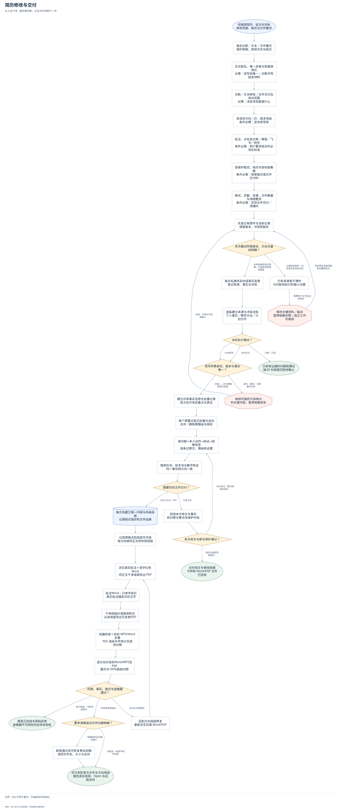
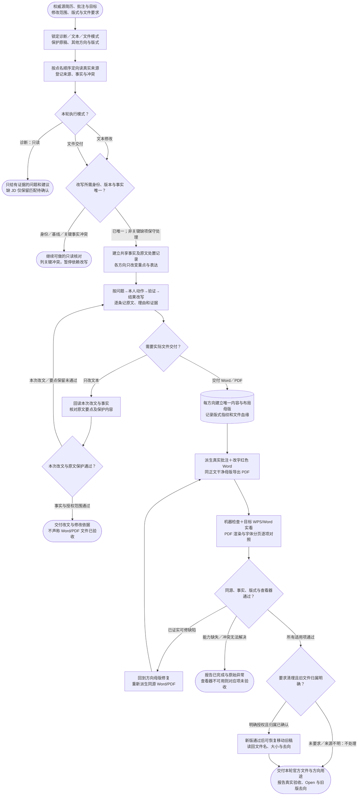

# 简历修改与交付：完整流程

输入：权威简历版本；目标方向、JD 或批注；版式与文件保护要求。

交付：定向简历或修改说明；批注及干净 Word / PDF；版本与验收记录。

[按原尺寸打开完整流程图](../assets/workflow.svg)

## 按什么顺序做

### 锁定三种模式与保护范围

诊断、文本修改、文件交付分别定完成门，不把小范围请求扩成整套产物。

### 按顺序取证并处理冲突

定向读取用户点名来源，建立事实、原文与版本记录；关键冲突先停止依赖改写。

### 共用事实、分方向改写

保留原文动作，记录原文—改文—理由—证据，方向变化只改变强调不改变事实。

### 文件模式派生同源 Word/PDF

每方向唯一母版生成批注 Word 与干净 PDF，只处理明确授权的旧文件。

### 按模式真实验收

诊断验判断，文本验改文；文件必须机器检查加目标查看器、字体分页和同源对照。

## 验收

- 事实与来源一致
- 受保护内容保留
- 目标应用与视觉检查

优化不等于重写；不编造经历和指标。

## 对应规则

- [SKILL.md](../SKILL.md)
- [references/evidence-and-content.md](evidence-and-content.md)
- [references/qa-contract.md](qa-contract.md)
- [references/source-intake-and-traceability.md](source-intake-and-traceability.md)
- [references/word-pdf-delivery.md](word-pdf-delivery.md)

可编辑的流程源码

