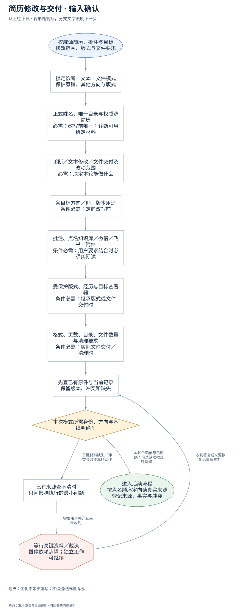
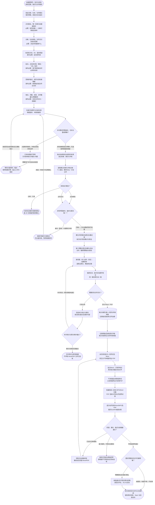

# 简历修改与交付：完整执行流程

先核对具体输入；已有材料能查明的直接读取，关键缺失或冲突才补充确认。沿完整图查看后续处理、失败去向与交付。

交付：定向简历或修改说明；批注及干净 Word / PDF；版本与验收记录。

## 执行前确认哪些信息

| 输入 | 何时需要 | 从哪里取得 | 缺失或冲突怎么处理 |
| --- | --- | --- | --- |
| 正式姓名、唯一目录与权威源简历 | 必需：改写前唯一；诊断可用给定材料 | 核文件名、正文身份、原件、历史方向和用户确认，不以修改时间自动裁决 | 身份/版本冲突只读比对；诊断可继续明确范围内的问题分析 |
| 诊断／文本修改／文件交付及改动范围 | 必需：决定本轮能做什么 | 从请求拆内容、批注、版式、格式、页数与清理范围 | 范围关键不清只问必要问题，不因诊断自动生成或移动文件 |
| 各目标方向／JD、版本用途 | 条件必需：定向改写前 | 每方向单独表达与交付链，共用事实母账；无JD诊断标明匹配未定 | 方向不明暂停定向改写；不把两个方向混进一个母版 |
| 批注、点名知识库／微信／飞书／附件 | 条件必需：用户要求结合时必须实际读 | 按当前请求→本地→任务相关微信→飞书→知识库→JD取证，记精确定位与覆盖 | 点名来源缺失明确未读；先完成其他可确认内容，不声称已结合 |
| 受保护版式、经历与目标查看器 | 条件必需：继承版式或文件交付时 | 真实渲染用户指定/最后可用源版，登记纸张、表格、字体/字号、边距、页底 | 基线文件缺失或无法对应截图先补齐；只改内容不换模板 |
| 格式、页数、目录、文件数量与清理要求 | 条件必需：实际文件交付／清理时 | 记录每方向Word/PDF用途、单页/密度和Mac兼容等本轮要求 | 不套历史四文件与批注数量；来源不明旧稿不移动，缺查看器不报验收通过 |

## 输入确认、补齐与返回

[按原尺寸查看输入确认图](../assets/input-confirmation.svg)

## 完整执行、判断与异常去向

[按原尺寸打开完整执行图](../assets/workflow.svg)

## 每一步具体怎么做

### 输入与范围

**1. 权威源简历、批注与目标；修改范围、版式与文件要求**

收集权威源简历、用户批注/截图、目标方向与本轮交付标准；先确认诊断、文本还是文件模式，不能把生成文件当所有请求的终态。

下一步：锁定诊断／文本／文件模式；保护原稿、其他方向与版式。

依据：[SKILL.md](../SKILL.md) 中的“第一道门：锁定本次任务”。

**2. 锁定诊断／文本／文件模式；保护原稿、其他方向与版式**

把本轮内容、批注、版式、格式、页数、清理和查看器要求逐项锁定；原稿、其他方向、完整经历和未授权页面列保护基线。

下一步：正式姓名、唯一目录与权威源简历；必需：改写前唯一；诊断可用给定材料。

依据：[SKILL.md](../SKILL.md) 中的“结果定义”。

**3. 正式姓名、唯一目录与权威源简历；必需：改写前唯一；诊断可用给定材料**

核文件名、正文身份、原件、历史方向和用户确认，不以修改时间自动裁决；缺失处理：身份/版本冲突只读比对；诊断可继续明确范围内的问题分析

下一步：诊断／文本修改／文件交付及改动范围；必需：决定本轮能做什么。

依据：[SKILL.md](../SKILL.md) 中的“第一道门：锁定本次任务”。

**4. 诊断／文本修改／文件交付及改动范围；必需：决定本轮能做什么**

从请求拆内容、批注、版式、格式、页数与清理范围；缺失处理：范围关键不清只问必要问题，不因诊断自动生成或移动文件

下一步：各目标方向／JD、版本用途；条件必需：定向改写前。

依据：[SKILL.md](../SKILL.md) 中的“结果定义”。

**5. 各目标方向／JD、版本用途；条件必需：定向改写前**

每方向单独表达与交付链，共用事实母账；无JD诊断标明匹配未定；缺失处理：方向不明暂停定向改写；不把两个方向混进一个母版

下一步：批注、点名知识库／微信／飞书／附件；条件必需：用户要求结合时必须实际读。

依据：[SKILL.md](../SKILL.md) 中的“第一道门：锁定本次任务”。

**6. 批注、点名知识库／微信／飞书／附件；条件必需：用户要求结合时必须实际读**

按当前请求→本地→任务相关微信→飞书→知识库→JD取证，记精确定位与覆盖；缺失处理：点名来源缺失明确未读；先完成其他可确认内容，不声称已结合

下一步：受保护版式、经历与目标查看器；条件必需：继承版式或文件交付时。

依据：[SKILL.md](../SKILL.md) 中的“第二道门：按顺序建立证据链”。

**7. 受保护版式、经历与目标查看器；条件必需：继承版式或文件交付时**

真实渲染用户指定/最后可用源版，登记纸张、表格、字体/字号、边距、页底；缺失处理：基线文件缺失或无法对应截图先补齐；只改内容不换模板

下一步：格式、页数、目录、文件数量与清理要求；条件必需：实际文件交付／清理时。

依据：[SKILL.md](../SKILL.md) 中的“第一道门：锁定本次任务”。

**8. 格式、页数、目录、文件数量与清理要求；条件必需：实际文件交付／清理时**

记录每方向Word/PDF用途、单页/密度和Mac兼容等本轮要求；缺失处理：不套历史四文件与批注数量；来源不明旧稿不移动，缺查看器不报验收通过

下一步：先查已有原件与当前记录；保留版本、冲突和缺失。

依据：[SKILL.md](../SKILL.md) 中的“文件交付合同”。

**9. 先查已有原件与当前记录；保留版本、冲突和缺失**

保留两种原说法、来源和建议裁决；不是最新文件自动胜出，不选择最好看数字。

下一步：本次模式所需身份、方向与基线明确？。

依据：[SKILL.md](../SKILL.md) 中的“第一道门：锁定本次任务”。

**10. 本次模式所需身份、方向与基线明确？**

诊断不因无JD或母版停止；文本改写检查本轮事实；文件模式才依赖版式和查看器。关键冲突暂停依赖改写。

下一步：“本轮依赖信息已明确；可选缺项按规则保留” → 按点名顺序定向读真实来源；登记来源、事实与冲突；“关键材料缺失／冲突会改变本轮动作” → 已有来源查不清时；只问影响执行的最小问题。

依据：[SKILL.md](../SKILL.md) 中的“第一道门：锁定本次任务”。

**11. 已有来源查不清时；只问影响执行的最小问题**

先查原件与已确认版本；把无法裁决的身份/数字/责任/版式问题压缩为最小问题。

下一步：“需要用户补充且尚未收到” → 等待关键资料／裁决；暂停依赖步骤；独立工作可继续。

依据：[SKILL.md](../SKILL.md) 中的“第一道门：锁定本次任务”。

**12. 等待关键资料／裁决；暂停依赖步骤；独立工作可继续**

没有收到补充前，不假定问题已解决；保留已确认材料和具体缺口。先查原件与已确认版本；把无法裁决的身份/数字/责任/版式问题压缩为最小问题。

下一步：“收到答复或来源恢复后重新核对” → 先查已有原件与当前记录；保留版本、冲突和缺失。

依据：[SKILL.md](../SKILL.md) 中的“第一道门：锁定本次任务”。

### 执行与核验

**1. 按点名顺序定向读真实来源；登记来源、事实与冲突**

按当前请求→本地版本→相关微信→飞书→知识库→JD顺序定向读取点名材料，记来源与定位；未实际读到的来源不能声称已结合。

下一步：逐条建立来源与冲突台账；个人事实／教学方法／计划分开。

依据：[SKILL.md](../SKILL.md) 中的“第二道门：按顺序建立证据链”。

**2. 本轮执行模式？**

诊断止于问题与建议；文本模式只改授权要点并读回；实际文件交付才进入母版、Word/PDF派生、实机验收和最终目录清点。

下一步：“诊断：只读” → 只给有证据的问题和建议；缺 JD 仅保留匹配待确认；“文本修改” → 改写所需身份、版本与事实唯一？；“文件交付” → 改写所需身份、版本与事实唯一？。

依据：[SKILL.md](../SKILL.md) 中的“结果定义”。

**3. 改写所需身份、版本与事实唯一？**

改写前核学生、方向、源版本、关键责任/数字及所需版式基线；不唯一先只读追查，非关键缺项可保守处理，不能擅选最好看版本。

下一步：“身份／基线／关键事实冲突” → 继续可做的只读核对；列关键冲突，暂停依赖改写；“已唯一；非关键缺项保守处理” → 建立共享事实及原文处置记录；各方向只改变重点与表达。

依据：[SKILL.md](../SKILL.md) 中的“第一道门：锁定本次任务”。

**4. 建立共享事实及原文处置记录；各方向只改变重点与表达**

所有方向共用公司、岗位、时间、动作、产物和数字事实母账；本轮被改要点有原文—处置—改文—理由—证据，文件模式再记录完整血缘。

下一步：每个原要点登记处置与去向；合并／删除需理由与授权。

依据：[SKILL.md](../SKILL.md) 中的“第三道门：按模式保留追溯记录”。

**5. 按问题→本人动作→验证→结果改写；逐条记原文、理由和证据**

按问题/需求、本人动作、产物与验证、真实结果组织要点；压缩先删重复空话/背景，保留职责、判断、动作链和可解释结果，每条改动可回查。

下一步：强责任词、技术词与数字核证；同一事实跨方向一致。

依据：[SKILL.md](../SKILL.md) 中的“内容修改合同”。

**6. 需要实际文件交付？**

仅文本请求走本次改文与原文保护检查；用户要求真实Word/PDF才进入方向母版链，不因存在模板自动生成文件或整理旧稿。

下一步：“只改文本” → 回读本次改文与事实；核对原文要点及保护内容；“交付 Word／PDF” → 每方向建立唯一内容与布局母版；记录版式指纹和文件血缘。

依据：[SKILL.md](../SKILL.md) 中的“按模式执行的总流程”。

**7. 回读本次改文与事实；核对原文要点及保护内容**

逐句对照原要点和事实来源，核本次改写没有升级责任、丢失动作或污染其他方向；未改正文和版式保持保护，不能以文本通过称文件已验收。

下一步：本次改文与原文保护通过？。

依据：[SKILL.md](../SKILL.md) 中的“完成门”。

**8. 每方向建立唯一内容与布局母版；记录版式指纹和文件血缘**

每方向建立一个内容与布局母版ID，绑定权威源和共享事实；登记源→母版→批注Word→干净母版→PDF路径，禁止各格式独立改文重排。

下一步：记录原版式到局部文字级；每方向锁同正文同布局母版。

依据：[references/word-pdf-delivery.md](word-pdf-delivery.md) 中的“2. 每方向唯一母版”。

**9. 派生真实批注＋改字红色 Word；同正文干净母版导出 PDF**

从同方向母版派生完整正文的真实批注Word，只标实际改字红色；同正文同布局的干净母版移除审阅样式后导PDF，不另写一版。

下一步：批注Word：只改字标红；真实批注锚定对应文字。

依据：[SKILL.md](../SKILL.md) 中的“文件交付合同”。

**10. 要求清理且旧文件归属明确？**

只有用户明确要求清理且旧文件确属本任务才处理；新版必须已验收。来源不明、其他方向/学生、原稿和仍引用母版保持原处。

下一步：“明确授权且归属已确认” → 新版通过后可恢复移动旧稿；读回文件名、大小与去向；“未要求／来源不明：不处理” → 交付本轮官方文件与方向用途；报告真实验收、Open 与旧版去向。

依据：[references/word-pdf-delivery.md](word-pdf-delivery.md) 中的“7. 命名、四文件配对与目录”。

**11. 新版通过后可恢复移动旧稿；读回文件名、大小与去向**

将已确认旧交付移至目录外可恢复备份或废纸篓，记录源路径、目标和数量；移动后核文件名、大小与可读取性，不能凭命令成功称可恢复。

下一步：交付本轮官方文件与方向用途；报告真实验收、Open 与旧版去向。

依据：[references/qa-contract.md](qa-contract.md) 中的“10. 最终目录与旧版本”。

**12. 本次改文与原文保护通过？**

本轮被改要点有事实依据、原文动作可追踪、保护内容未变才交文本；发现越界或事实遗漏回改写，不启动无关文件/版式流程。

下一步：“事实与授权范围通过” → 交付改文与修改依据；不声称 Word/PDF 文件已验收；“本次改文／要点保留未通过” → 按问题→本人动作→验证→结果改写；逐条记原文、理由和证据。

依据：[SKILL.md](../SKILL.md) 中的“完成门”。

**13. 逐条建立来源与冲突台账；个人事实／教学方法／计划分开**

为每个候选事实记录文件段落、消息时间或飞书块/坐标；同一自述重复出现仍是一条来源链；未读附件保留缺口。

下一步：本轮执行模式？。

依据：[references/source-intake-and-traceability.md](source-intake-and-traceability.md) 中的“6. 来源矩阵”。

**14. 每个原要点登记处置与去向；合并／删除需理由与授权**

拆原文中的动作、责任、产物、验证和结果，逐项映射新文；压缩先去重复空话，不能静默丢失完整动作链。

下一步：按问题→本人动作→验证→结果改写；逐条记原文、理由和证据。

依据：[references/evidence-and-content.md](evidence-and-content.md) 中的“2. 从源简历到目标简历”。

**15. 强责任词、技术词与数字核证；同一事实跨方向一致**

0–1/主导/上线及AI技术名词需本人动作、产物和解释证据；数字核定义、分母、周期、基线、来源与归因；不足保守写。

下一步：需要实际文件交付？。

依据：[references/evidence-and-content.md](evidence-and-content.md) 中的“6. 术语与强责任动词”。

### 交付与验收

**1. 只给有证据的问题和建议；缺 JD 仅保留匹配待确认**

只交有原文定位和依据的问题优先级及建议；无JD仍能审表达、事实与结构，具体岗位匹配保留待确认，不附带改文或生成文件。

这是本路径的交付或转交结果。

依据：[SKILL.md](../SKILL.md) 中的“完成门”。

**2. 继续可做的只读核对；列关键冲突，暂停依赖改写**

列出冲突原文、来源、影响与一个最小待决问题，保留其余可确认内容；身份/指标/版式补齐后才进入依赖改写，不猜测裁决。

下一步：“来源／冲突补齐后再确认” → 先查已有原件与当前记录；保留版本、冲突和缺失。

依据：[references/source-intake-and-traceability.md](source-intake-and-traceability.md) 中的“8. 停止条件”。

**3. 交付改文与修改依据；不声称 Word/PDF 文件已验收**

交付授权段落的新文本及必要修改依据，指出尚缺具体事实；不输出未要求文件，不声称Word/PDF同源或目标查看器已通过。

这是本路径的交付或转交结果。

依据：[SKILL.md](../SKILL.md) 中的“最终回报格式”。

**4. 机器检查＋目标 WPS/Word 实看；PDF 渲染与字体分页逐项对照**

运行脚本检查comment锚点、红字、字体字号漂移、页数/密度与文本一致；再在目标WPS/Word及PDF实际检查整页和局部，不拿元数据替实看。

下一步：逐方向开目标Word/WPS及PDF；整页与100%局部对照。

依据：[SKILL.md](../SKILL.md) 中的“真实验收合同”。

**5. 同源、事实、版式与查看器通过？**

核事实/原文完整、同母版血缘、真实批注/红字、干净PDF、页数/密度/字体/链接和目标查看器；具体缺陷可修，缺能力或未裁决冲突保留未验收。

下一步：“已证实可修缺陷” → 回到方向母版修复；重新派生同源 Word/PDF；“能力缺失／冲突无法解决” → 报告已完成与原始异常；查看器不可用则对应项未验收；“所有适用项通过” → 要求清理且旧文件归属明确？。

依据：[references/qa-contract.md](qa-contract.md) 中的“11. 完成门”。

**6. 回到方向母版修复；重新派生同源 Word/PDF**

按真实异常回对应方向母版修正文或布局，再重新派生Word与PDF并复验；不能只修PDF或缩小字号掩盖丢文、字体回退和截断。

下一步：派生真实批注＋改字红色 Word；同正文干净母版导出 PDF。

依据：[references/word-pdf-delivery.md](word-pdf-delivery.md) 中的“4. 干净母版与 PDF”。

**7. 报告已完成与原始异常；查看器不可用则对应项未验收**

交付已完成部分及原始报错/截图，注明缺目标WPS、Mac实机、字体或事实裁决的具体影响与最小后续条件，不报告兼容或整项通过。

这是本路径的交付或转交结果。

依据：[references/qa-contract.md](qa-contract.md) 中的“11. 完成门”。

**8. 交付本轮官方文件与方向用途；报告真实验收、Open 与旧版去向**

逐方向给官方文件、Word批注/PDF用途和母版配对，说明改动、真实验收范围、未确认项、目录数量及已授权旧稿去向；不套历史固定数量。

这是本路径的交付或转交结果。

依据：[SKILL.md](../SKILL.md) 中的“最终回报格式”。

**9. 记录原版式到局部文字级；每方向锁同正文同布局母版**

纸张、节、页边距、表格边框、run字体字号、行高、日期对齐和页底均有基线；Word/PDF不得各自另排。

下一步：派生真实批注＋改字红色 Word；同正文干净母版导出 PDF。

依据：[references/word-pdf-delivery.md](word-pdf-delivery.md) 中的“1. 先做版式指纹”。

**10. 批注Word：只改字标红；真实批注锚定对应文字**

检查真实comment对象、锚点、可点击批注、无隐藏/修订/意外斜体；不机械凑批注数。

下一步：干净母版仅清审阅样式；从该母版导出可复制PDF。

依据：[references/word-pdf-delivery.md](word-pdf-delivery.md) 中的“3. Word 批注版”。

**11. 干净母版仅清审阅样式；从该母版导出可复制PDF**

同正文/布局去批注红字，再导PDF；检查文本、链接、日期、数字、纸张、字体和主要换行；不手工单修PDF。

下一步：机器检查＋目标 WPS/Word 实看；PDF 渲染与字体分页逐项对照。

依据：[references/word-pdf-delivery.md](word-pdf-delivery.md) 中的“4. 干净母版与 PDF”。

**12. 逐方向开目标Word/WPS及PDF；整页与100%局部对照**

机器查comment、红字、字体字号漂移、页数、密度、文本一致；真实查看器核批注锚点、换行/边框、无截断与审稿痕迹，明确要求Mac才以Mac实机为门。

下一步：同源、事实、版式与查看器通过？。

依据：[references/qa-contract.md](qa-contract.md) 中的“7. WPS/Word 实机验收”。

## 验收

- 事实与来源一致
- 受保护内容保留
- 目标应用与视觉检查

优化不等于重写；不编造经历和指标。

## 对应规则

- [SKILL.md](../SKILL.md)
- [references/evidence-and-content.md](evidence-and-content.md)
- [references/qa-contract.md](qa-contract.md)
- [references/source-intake-and-traceability.md](source-intake-and-traceability.md)
- [references/word-pdf-delivery.md](word-pdf-delivery.md)

可编辑的完整流程源码

