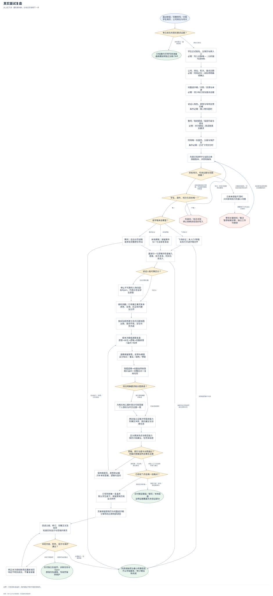
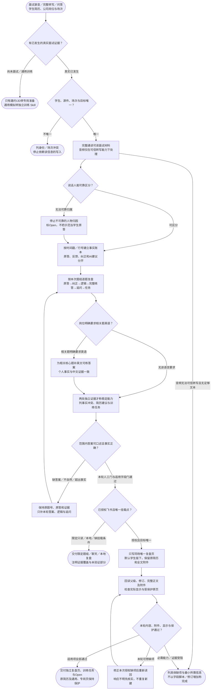

# 真实面试复盘：完整流程

输入：已发生面试的完整逐字稿；学生简历与场次信息；明确复盘对象。

交付：逐题面试复盘；跨题结论与训练任务；唯一复盘页及来源附件。

[按原尺寸打开完整流程图](../assets/workflow.svg)

## 按什么顺序做

### 核对真实面试及场次

已有面试证据才复盘；邀约/JD转专岗，学生、场次和唯一页不明时暂停依赖写入。

### 完整读取并分清说话人

通读逐字稿，保留时间戳或行号；发言人不明停止人物归因，不猜音频内容。

### 逐题纠正并提供完整练答

原答、反馈、诊断和知识分开，每题给答题逻辑、完整答案、追问应对与训练，相关题按英语要求补版本。

### 形成结论与简历建议

稳定能力至少两处独立证据，只提简历建议，保留具体事实冲突和下一轮风险。

### 独立交付与范围验收

复用同场页并保留原简历和全文附件；本地字段门加逐题人工门、远端读回和显示检查。

## 验收

- 真实与模拟分开
- 无反馈不冒充导师
- 原页和附件保留

只改目标复盘页；简历建议不等于授权改简历。

## 对应规则

- [SKILL.md](../SKILL.md)
- [references/feishu-boundary-and-acceptance.md](feishu-boundary-and-acceptance.md)
- [references/review-content-contract.md](review-content-contract.md)

可编辑的流程源码

