# 真实面试复盘：完整执行流程

先核对具体输入；已有材料能查明的直接读取，关键缺失或冲突才补充确认。沿完整图查看后续处理、失败去向与交付。

交付：逐题面试复盘；跨题结论与训练任务；唯一复盘页及来源附件。

## 执行前确认哪些信息

| 输入 | 何时需要 | 从哪里取得 | 缺失或冲突怎么处理 |
| --- | --- | --- | --- |
| 学生正式姓名、主简历与原入口 | 必需：写入对象唯一；分析按可读材料 | 读原简历正文及既有学生主页/双端入口，不凭文件名或旧总结认人 | 身份/主简历有冲突暂停依赖写入，其余只读核对继续 |
| 公司、岗位、轮次、面试日期 | 必需：同场定位；未知项明确待确认 | 从邀约、原记录与现有同场页核实，不把HR轮次写成岗位名 | 不猜公司岗位日期；多场无法区分只问场次，未知非关键字段可待确认 |
| 完整逐字稿／问答／反馈与来源 | 必需：至少有已发生面试证据 | 完整读取文本，记录覆盖范围；只有录音时确认可信转写能力 | 无可信转写不猜内容；只有JD/邀约转专岗准备，不伪造复盘 |
| 说话人角色、原答与导师反馈归属 | 条件必需：做人物归因时 | 区分面试官、学生、导师、旁听者；核时间戳/行号/稳定片段 | 说话人不清停止人物归因并标待确认；没有导师反馈就写未提供 |
| 整场／指定题组／局部升级与语言 | 必需：本次题组；英语按真实要求 | 确认本次范围、原题号和JD/邀约英语要求，保护未授权题目 | 不为字段门扩题；英语要求未知不机械全部加英文 |
| 同场唯一复盘页、父级与保护页 | 条件必需：正式飞书交付时 | 本轮指定/已有同场页优先，否则学生准备版下；读取原简历与完整逐字稿附件 | 学生版缺失只确认挂载点，不另造通用材料；页面冲突暂停写入 |

## 输入确认、补齐与返回

[按原尺寸查看输入确认图](../assets/input-confirmation.svg)

## 完整执行、判断与异常去向

[按原尺寸打开完整执行图](../assets/workflow.svg)

## 每一步具体怎么做

### 输入与范围

**1. 面试录音／完整转写／问答；学生简历、公司岗位与场次**

接收一场实际已发生面试的完整录音转写、问答记录或明确反馈，连同学生原简历和公司/岗位/轮次/日期；先辨本次是复盘还是面前准备。

下一步：有已发生的真实面试证据？。

依据：[SKILL.md](../SKILL.md) 中的“1. **核对身份与场次。**”。

**2. 有已发生的真实面试证据？**

有已发生问答/反馈证据才复盘；仅JD或邀约转专岗准备，通用训练转模拟Skill，同时要复盘和下一轮准备时分别确定对象。

下一步：“尚未面试／通用训练” → 只有邀约/JD转专岗准备；通用模拟转独立训练 Skill；“真实已发生” → 学生正式姓名、主简历与原入口；必需：写入对象唯一；分析按可读材料。

依据：[SKILL.md](../SKILL.md) 中的“先分流并锁定范围”。

**3. 学生正式姓名、主简历与原入口；必需：写入对象唯一；分析按可读材料**

读原简历正文及既有学生主页/双端入口，不凭文件名或旧总结认人；缺失处理：身份/主简历有冲突暂停依赖写入，其余只读核对继续

下一步：公司、岗位、轮次、面试日期；必需：同场定位；未知项明确待确认。

依据：[SKILL.md](../SKILL.md) 中的“工作流程”。

**4. 公司、岗位、轮次、面试日期；必需：同场定位；未知项明确待确认**

从邀约、原记录与现有同场页核实，不把HR轮次写成岗位名；缺失处理：不猜公司岗位日期；多场无法区分只问场次，未知非关键字段可待确认

下一步：完整逐字稿／问答／反馈与来源；必需：至少有已发生面试证据。

依据：[SKILL.md](../SKILL.md) 中的“工作流程”。

**5. 完整逐字稿／问答／反馈与来源；必需：至少有已发生面试证据**

完整读取文本，记录覆盖范围；只有录音时确认可信转写能力；缺失处理：无可信转写不猜内容；只有JD/邀约转专岗准备，不伪造复盘

下一步：说话人角色、原答与导师反馈归属；条件必需：做人物归因时。

依据：[references/review-content-contract.md](review-content-contract.md) 中的“输入与证据边界”。

**6. 说话人角色、原答与导师反馈归属；条件必需：做人物归因时**

区分面试官、学生、导师、旁听者；核时间戳/行号/稳定片段；缺失处理：说话人不清停止人物归因并标待确认；没有导师反馈就写未提供

下一步：整场／指定题组／局部升级与语言；必需：本次题组；英语按真实要求。

依据：[SKILL.md](../SKILL.md) 中的“工作流程”。

**7. 整场／指定题组／局部升级与语言；必需：本次题组；英语按真实要求**

确认本次范围、原题号和JD/邀约英语要求，保护未授权题目；缺失处理：不为字段门扩题；英语要求未知不机械全部加英文

下一步：同场唯一复盘页、父级与保护页；条件必需：正式飞书交付时。

依据：[references/review-content-contract.md](review-content-contract.md) 中的“逐题复盘卡”。

**8. 同场唯一复盘页、父级与保护页；条件必需：正式飞书交付时**

本轮指定/已有同场页优先，否则学生准备版下；读取原简历与完整逐字稿附件；缺失处理：学生版缺失只确认挂载点，不另造通用材料；页面冲突暂停写入

下一步：先查已有原件与当前记录；保留版本、冲突和缺失。

依据：[references/feishu-boundary-and-acceptance.md](feishu-boundary-and-acceptance.md) 中的“目标页”。

**9. 先查已有原件与当前记录；保留版本、冲突和缺失**

记录各来源截止与覆盖、原回答、导师纠正和AI建议；保留真实矛盾，不把口述差泛化成经历不真实。

下一步：本轮场次、可读证据与范围明确？。

依据：[SKILL.md](../SKILL.md) 中的“工作流程”。

**10. 本轮场次、可读证据与范围明确？**

以真实面试证据为入口；缺JD/导师反馈可以标未提供，缺可读证据不能评价真实回答；关键身份/场次/页面冲突只暂停依赖步骤。

下一步：“本轮依赖信息已明确；可选缺项按规则保留” → 学生、源件、场次与目标唯一？；“关键材料缺失／冲突会改变本轮动作” → 已有来源查不清时；只问影响执行的最小问题。

依据：[SKILL.md](../SKILL.md) 中的“工作流程”。

**11. 已有来源查不清时；只问影响执行的最小问题**

先查邀约、原文与同场页；仍无法定位仅问学生/场次/题组中会改变执行的最小项。

下一步：“需要用户补充且尚未收到” → 等待关键资料／裁决；暂停依赖步骤；独立工作可继续。

依据：[SKILL.md](../SKILL.md) 中的“工作流程”。

**12. 等待关键资料／裁决；暂停依赖步骤；独立工作可继续**

没有收到补充前，不假定问题已解决；保留已确认材料和具体缺口。先查邀约、原文与同场页；仍无法定位仅问学生/场次/题组中会改变执行的最小项。

下一步：“收到答复或来源恢复后重新核对” → 先查已有原件与当前记录；保留版本、冲突和缺失。

依据：[SKILL.md](../SKILL.md) 中的“工作流程”。

### 执行与核验

**1. 学生、源件、场次与目标唯一？**

核正文姓名、主简历、面试场次和同场目标页是否唯一；公司/岗位/日期等普通未知可注明待确认，实质同名/多场/多页冲突先停止依赖写入。

下一步：“不唯一” → 列身份／场次冲突；停止依赖该信息的写入；“唯一” → 完整通读可读面试材料；音频仅在可信转写能力下处理。

依据：[SKILL.md](../SKILL.md) 中的“1. **核对身份与场次。**”。

**2. 完整通读可读面试材料；音频仅在可信转写能力下处理**

先完整通读本次证据并记录覆盖；只有录音时先确认可信转写能力。无足够可读文本则说明证据缺口，不能凭音频文件名猜表现。

下一步：说话人能可靠区分？；“音频无法可信转写且无足够文本” → 列具体缺项与最小所需信息；不以字段脚本／修订增加称完成。

依据：[SKILL.md](../SKILL.md) 中的“2. **完整读取证据。**”。

**3. 说话人能可靠区分？**

逐片段区分学生、面试官、导师及旁听者；可可靠归属才评价个人回答，说话人含糊部分转待确认而不强行归因。

下一步：“无法可靠归属” → 停止不可靠的人物归因；标Open，不把示范当学生原答；“可区分” → 按时间戳／行号建立事实账本；原答、反馈、纠正和AI建议分开。

依据：[SKILL.md](../SKILL.md) 中的“2. **完整读取证据。**”。

**4. 停止不可靠的人物归因；标Open，不把示范当学生原答**

保存说话人不明的原片段及定位，停止该段人物归因；导师示范、提示和AI补充不能写成学生原答，可继续明确片段的复盘。

下一步：按时间戳／行号建立事实账本；原答、反馈、纠正和AI建议分开。

依据：[references/review-content-contract.md](review-content-contract.md) 中的“输入与证据边界”。

**5. 按时间戳／行号建立事实账本；原答、反馈、纠正和AI建议分开**

每个判断关联时间戳、行号或稳定短片段；分开实际问题、学生原答、面试官反馈、导师纠正与AI建议，正文必要短摘录先脱敏。

下一步：按实际顺序建立场次问题地图；主题、是否作答、定位与优先级。

依据：[SKILL.md](../SKILL.md) 中的“3. **建立可定位证据账本。**”。

**6. 按本次题组逐题复盘；原答→纠正→逻辑→完整练答→追问→任务**

对本次范围内每道核心题保留原答和表现，给根因、知识纠正、答题逻辑、完整口语练答、至少一个相关追问及完整应对、可验收训练任务。

下一步：逐题保留原答、反馈与根因；区分知识／事实／结构／停顿。

依据：[references/review-content-contract.md](review-content-contract.md) 中的“逐题复盘卡”。

**7. 岗位明确要求相关题英语？**

只有JD/邀约明确要求英语且与当前核心题相关才补英文；其他题保持中文训练，不为英语字段机械扩题或改变已授权题组。

下一步：“相关题明确要求英语” → 为相关核心题补英文可练答案；个人事实与中文证据一致；“无该语言要求” → 两处独立证据才称稳定能力；列事实冲突、简历建议与训练任务。

依据：[SKILL.md](../SKILL.md) 中的“4. **逐题复盘并给出可练答案。**”。

**8. 为相关核心题补英文可练答案；个人事实与中文证据一致**

为指定相关题写完整自然英文练答，核术语、数字和个人事实与中文/证据一致；不能用术语表或生硬逐字翻译充当可练答案。

下一步：两处独立证据才称稳定能力；列事实冲突、简历建议与训练任务。

依据：[references/review-content-contract.md](review-content-contract.md) 中的“参考答案的内容标准”。

**9. 两处独立证据才称稳定能力；列事实冲突、简历建议与训练任务**

至少两处独立片段才支持稳定能力；单点归本轮亮点。按证据列停顿、跑题、追问失守、责任/指标冲突、简历建议与下一轮训练重点。

下一步：区分偶发亮点与稳定能力；简历只给建议，任务有验收。

依据：[SKILL.md](../SKILL.md) 中的“5. **形成跨题结论。**”。

**10. 范围内答案可口述且事实正确？**

逐题人工核答案正确、自然可讲、基于事实，有逻辑/完整追问应对和产物验收；完整页再跑内容字段门，有限题组只验本次，不拿非空字段代替质量。

下一步：“缺答案／不自然／超出事实” → 保持原题号、原答和证据；只补本轮答案、逻辑与追问；“本轮人工门与适用字段门通过” → 已授权飞书且唯一挂载点？。

依据：[SKILL.md](../SKILL.md) 中的“8. **独立验收。**”。

**11. 按实际顺序建立场次问题地图；主题、是否作答、定位与优先级**

先有全场问题地图，再选本轮核心题；正文只用必要脱敏短摘录，完整原件作为受控附件。

下一步：按本次题组逐题复盘；原答→纠正→逻辑→完整练答→追问→任务。

依据：[references/review-content-contract.md](review-content-contract.md) 中的“固定结构”。

**12. 逐题保留原答、反馈与根因；区分知识／事实／结构／停顿**

每题记录原问题、证据定位、学生实际回答、当场表现、导师/面试官原反馈、应掌握知识和判断依据。

下一步：答题逻辑→完整自然练答；相关追问＋完整应对＋复练任务。

依据：[references/review-content-contract.md](review-content-contract.md) 中的“逐题复盘卡”。

**13. 答题逻辑→完整自然练答；相关追问＋完整应对＋复练任务**

经历只用已确认事实；知识用解释、情境写假设；缺细节先给已确认信息可回答版，再列待补，不以提纲占完整答案。

下一步：岗位明确要求相关题英语？。

依据：[references/review-content-contract.md](review-content-contract.md) 中的“参考答案的内容标准”。

**14. 区分偶发亮点与稳定能力；简历只给建议，任务有验收**

稳定能力至少两处独立证据；冲突保留原话与待确认；任务列优先级、产物、完成标准和复测；不直接修改简历。

下一步：范围内答案可口述且事实正确？。

依据：[references/review-content-contract.md](review-content-contract.md) 中的“固定结构”。

### 交付与验收

**1. 只有邀约/JD转专岗准备；通用模拟转独立训练 Skill**

把已有简历、JD/邀约和本次目标转对应面前准备或通用训练Skill；不能把预想问题或AI参考答案包装为学生已经面过的原答。

这是本路径的交付或转交结果。

依据：[SKILL.md](../SKILL.md) 中的“先分流并锁定范围”。

**2. 列身份／场次冲突；停止依赖该信息的写入**

列出学生、场次或页面候选及冲突证据，只问决定写入对象的最小问题；保留其余只读分析，答案补齐后重核原入口。

下一步：“场次／目标冲突解除后重核” → 先查已有原件与当前记录；保留版本、冲突和缺失。

依据：[SKILL.md](../SKILL.md) 中的“1. **核对身份与场次。**”。

**3. 保持原题号、原答和证据；只补本轮答案、逻辑与追问**

保留原题号、原问题、学生原答与证据定位，仅补本轮缺失的答题逻辑、自然练答、追问应对或指定英语；不能改成更好看的虚构原答。

下一步：按本次题组逐题复盘；原答→纠正→逻辑→完整练答→追问→任务。

依据：[references/review-content-contract.md](review-content-contract.md) 中的“完成门”。

**4. 已授权飞书且唯一挂载点？**

当前已授权飞书且同场唯一落点确认后写复盘页；限定只读/本地或挂载缺失先交已完成复盘，不能由Skill自行扩写通用材料或造新档案。

下一步：“限定只读／本地／缺挂载条件” → 交付限定题组／聊天／本地复盘；注明证据覆盖与未验证部分；“授权且目标唯一” → 只写同场唯一复盘页；默认学生版下，保留原简历和全文附件。

依据：[SKILL.md](../SKILL.md) 中的“先分流并锁定范围”。

**5. 交付限定题组／聊天／本地复盘；注明证据覆盖与未验证部分**

交本次指定题组、聊天或本地复盘及来源覆盖，保留未提供反馈和待补事实；有限分析不冒充附件齐全的完整正式复盘页。

这是本路径的交付或转交结果。

依据：[references/review-content-contract.md](review-content-contract.md) 中的“完成门”。

**6. 只写同场唯一复盘页；默认学生版下，保留原简历和全文附件**

优先原位更新同场唯一页并保持原父级；新页默认学生准备版下，页首保留原简历及完整逐字稿附件，通用/专岗页与原简历只读。

下一步：页首保留原简历与完整逐字稿；分章写后立即局部读回。

依据：[SKILL.md](../SKILL.md) 中的“7. **精准交付。**”。

**7. 回读父级、修订、完整正文及附件；检查实际显示与受保护原页**

独立读回父级、标题唯一性、修订、全文、附件类型/大小/位置、块顺序与手工内容；核原页保护，并在学生端或等价渲染检查阅读效果。

下一步：本轮内容、附件、显示与保护通过？。

依据：[references/feishu-boundary-and-acceptance.md](feishu-boundary-and-acceptance.md) 中的“写后验收”。

**8. 本轮内容、附件、显示与保护通过？**

把本轮题组内容门、原简历和完整逐字稿附件、实际显示及保护基线逐项核对；可修缺陷继续修，缺证据/能力保持部分完成，不用修订增加代替验收。

下一步：“适用项全部通过” → 交付独立复盘页、训练任务与Open；原简历及通用、专岗页保持保护；“本轮可修缺项” → 修正本次授权缺项后重新读回；响应不明先核实，不重复新建；“必需能力／证据受阻” → 列具体缺项与最小所需信息；不以字段脚本／修订增加称完成。

依据：[SKILL.md](../SKILL.md) 中的“8. **独立验收。**”。

**9. 修正本次授权缺项后重新读回；响应不明先核实，不重复新建**

只修本轮已授权的正文/附件/显示缺项；写入超时先读回实际结果，重试确认未写部分，修后重新验当前复盘与受保护对象。

下一步：回读父级、修订、完整正文及附件；检查实际显示与受保护原页。

依据：[references/feishu-boundary-and-acceptance.md](feishu-boundary-and-acceptance.md) 中的“正式写入”。

**10. 列具体缺项与最小所需信息；不以字段脚本／修订增加称完成**

列明已验内容、具体缺失的证据或显示环节、原始失败和最小所需信息；字段脚本通过只说明覆盖，不宣称完整复盘交付。

这是本路径的交付或转交结果。

依据：[references/feishu-boundary-and-acceptance.md](feishu-boundary-and-acceptance.md) 中的“写后验收”。

**11. 交付独立复盘页、训练任务与Open；原简历及通用、专岗页保持保护**

给唯一复盘页与当前修订、具体训练任务和影响复练的待确认项，说明原简历/通用/专岗页保护核对及实际显示覆盖；学生练会与文档完成分开。

这是本路径的交付或转交结果。

依据：[SKILL.md](../SKILL.md) 中的“8. **独立验收。**”。

**12. 页首保留原简历与完整逐字稿；分章写后立即局部读回**

只写同场复盘页，原答/题号不变；超时先查实际写入避免重复；附件核名称、类型、大小、位置与可访问性。

下一步：回读父级、修订、完整正文及附件；检查实际显示与受保护原页。

依据：[references/feishu-boundary-and-acceptance.md](feishu-boundary-and-acceptance.md) 中的“正式写入”。

## 验收

- 真实与模拟分开
- 无反馈不冒充导师
- 原页和附件保留

只改目标复盘页；简历建议不等于授权改简历。

## 对应规则

- [SKILL.md](../SKILL.md)
- [references/feishu-boundary-and-acceptance.md](feishu-boundary-and-acceptance.md)
- [references/review-content-contract.md](review-content-contract.md)

```mermaid
flowchart TB
  in(["面试录音／完整转写／问答<br/>学生简历、公司岗位与场次"])
  route{"有已发生的真实面试证据？"}
  prepare(["只有邀约/JD转专岗准备<br/>通用模拟转独立训练 Skill"])
  unique{"学生、源件、场次与目标唯一？"}
  stop(["列身份／场次冲突<br/>停止依赖该信息的写入"])
  read["完整通读可读面试材料<br/>音频仅在可信转写能力下处理"]
  speaker{"说话人能可靠区分？"}
  open["停止不可靠的人物归因<br/>标Open，不把示范当学生原答"]
  ledger["按时间戳／行号建立事实账本<br/>原答、反馈、纠正和AI建议分开"]
  cards["按本次题组逐题复盘<br/>原答→纠正→逻辑→完整练答→追问→任务"]
  english{"岗位明确要求相关题英语？"}
  enanswers["为相关核心题补英文可练答案<br/>个人事实与中文证据一致"]
  cross["两处独立证据才称稳定能力<br/>列事实冲突、简历建议与训练任务"]
  contentgate{"范围内答案可口述且事实正确？"}
  repair["保持原题号、原答和证据<br/>只补本轮答案、逻辑与追问"]
  delivery{"已授权飞书且唯一挂载点？"}
  draft(["交付限定题组／聊天／本地复盘<br/>注明证据覆盖与未验证部分"])
  write["只写同场唯一复盘页<br/>默认学生版下，保留原简历和全文附件"]
  qa["回读父级、修订、完整正文及附件<br/>检查实际显示与受保护原页"]
  gate{"本轮内容、附件、显示与保护通过？"}
  fix["修正本次授权缺项后重新读回<br/>响应不明先核实，不重复新建"]
  partial(["列具体缺项与最小所需信息<br/>不以字段脚本／修订增加称完成"])
  out(["交付独立复盘页、训练任务与Open<br/>原简历及通用、专岗页保持保护"])
  i_identity["学生正式姓名、主简历与原入口<br/>必需：写入对象唯一；分析按可读材料"]
  i_session["公司、岗位、轮次、面试日期<br/>必需：同场定位；未知项明确待确认"]
  i_transcript["完整逐字稿／问答／反馈与来源<br/>必需：至少有已发生面试证据"]
  i_speaker["说话人角色、原答与导师反馈归属<br/>条件必需：做人物归因时"]
  i_scope["整场／指定题组／局部升级与语言<br/>必需：本次题组；英语按真实要求"]
  i_destination["同场唯一复盘页、父级与保护页<br/>条件必需：正式飞书交付时"]
  i_existing["先查已有原件与当前记录<br/>保留版本、冲突和缺失"]
  i_ready{"本轮场次、可读证据与范围明确？"}
  i_clarify["已有来源查不清时<br/>只问影响执行的最小问题"]
  i_wait(["等待关键资料／裁决<br/>暂停依赖步骤；独立工作可继续"])
  question_map["按实际顺序建立场次问题地图<br/>主题、是否作答、定位与优先级"]
  card_diagnosis["逐题保留原答、反馈与根因<br/>区分知识／事实／结构／停顿"]
  card_answer["答题逻辑→完整自然练答<br/>相关追问＋完整应对＋复练任务"]
  train_tasks["区分偶发亮点与稳定能力<br/>简历只给建议，任务有验收"]
  attachments["页首保留原简历与完整逐字稿<br/>分章写后立即局部读回"]
  in --> route
  route -->|"尚未面试／通用训练"| prepare
  unique -->|"不唯一"| stop
  unique -->|"唯一"| read
  read --> speaker
  read -->|"音频无法可信转写且无足够文本"| partial
  speaker -->|"无法可靠归属"| open
  speaker -->|"可区分"| ledger
  open --> ledger
  english -->|"相关题明确要求英语"| enanswers
  english -->|"无该语言要求"| cross
  enanswers --> cross
  contentgate -->|"缺答案／不自然／超出事实"| repair
  repair --> cards
  contentgate -->|"本轮人工门与适用字段门通过"| delivery
  delivery -->|"限定只读／本地／缺挂载条件"| draft
  delivery -->|"授权且目标唯一"| write
  qa --> gate
  gate -->|"适用项全部通过"| out
  gate -->|"本轮可修缺项"| fix
  gate -->|"必需能力／证据受阻"| partial
  fix --> qa
  route -->|"真实已发生"| i_identity
  i_identity --> i_session
  i_session --> i_transcript
  i_transcript --> i_speaker
  i_speaker --> i_scope
  i_scope --> i_destination
  i_destination --> i_existing
  i_existing --> i_ready
  i_ready -->|"本轮依赖信息已明确；可选缺项按规则保留"| unique
  i_ready -->|"关键材料缺失／冲突会改变本轮动作"| i_clarify
  i_clarify -->|"需要用户补充且尚未收到"| i_wait
  i_wait -->|"收到答复或来源恢复后重新核对"| i_existing
  ledger --> question_map
  question_map --> cards
  cards --> card_diagnosis
  card_diagnosis --> card_answer
  card_answer --> english
  cross --> train_tasks
  train_tasks --> contentgate
  write --> attachments
  attachments --> qa
  stop -->|"场次／目标冲突解除后重核"| i_existing
```

可编辑的完整流程源码

