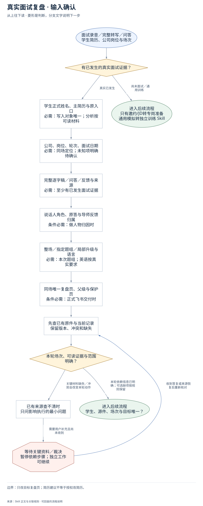
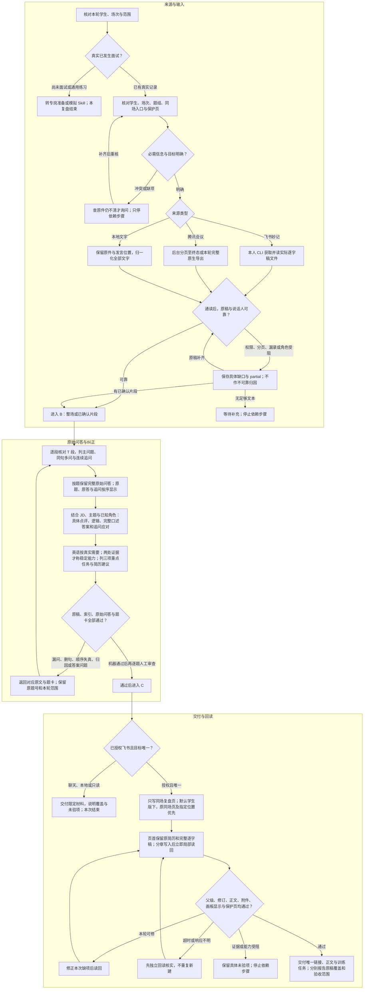

# 真实面试复盘：从原稿到可练答案

先选对本轮来源，核对完整逐字稿，再建立全量问题索引。复盘围绕学生实际回答展开，最后验证原稿、问题和题卡三者对应。详细命令及 JSON 结构见 [逐字稿输入指南](transcript-intake.md)。

## 输入确认

| 必需信息 | 自行取得的来源 | 缺失时处理 |
| --- | --- | --- |
| 本轮学生与场次 | 简历正文、邀约、指定原件、原学生入口 | 同名或多场冲突只暂停依赖写入，不猜归属 |
| 完整原稿与来源类型 | 妙记文件、腾讯详情／完整导出、本地文字 | 摘要不算原稿；读取失败保留明确缺口 |
| 说话人、时间或段落位置 | 原身份说明、真实问答与时间戳 | 不凭发言量猜；不确定片段暂停归因 |
| 本次题组、语言及岗位 | 用户范围、JD、本轮主题及已知面试官职责 | JD或层级未知可继续有证据的分析，不虚构 |
| 同场唯一写入页 | 已指定页面或学生准备版下原复盘页 | 未唯一时先做只读／本地，不新建替代页 |

## 执行与异常路径

图按 A「来源与输入」、B「原始问答与纠正」、C「交付与回读」续接。右侧分支保留暂停、补齐返回与停止条件；局部题组不扩大为整场改写。

1. **分流。** 尚未面试走专岗准备；通用练习走模拟 Skill；本流程处理已发生的真实问答。只补几题时保护其他正文、题号和原答。
2. **获取本轮原稿。** 妙记用本人 CLI 获取并打开 transcript_file；腾讯在已授权后台详情读取实际请求，分页至终态，或用本轮完整原生导出。原稿、云录制转写与独立转写不混淆，不启动全账号下载。无后台或权限能力时只停该读取步骤。
3. **核对输入。** 归一化后完整通读，检查双方发言、说话人、首尾、分页、时间覆盖、空段与转写不清。逐项解释异常；源稿确实缺失时保留 limitations 和 partial，空原稿不能验收。不将接口成功当作录音没有漏录。
4. **逐段建问题索引。** 每个 T 段都有核对记录。主问题、连续追问、同句多问分别编号；反问与事务问题写排除原因。原句定位到原稿，未知角色不评分；先确认问题覆盖，再写答案。
5. **给出逐题纠正。** 结合实际 JD、本轮主题与已知角色判断考察点。按题保留完整原始提问、候选人原答和连续追问，不以摘要代替；再结合当场表现与原反馈，解释知识或判断差距，给完整自然参考答案、答题逻辑、相关追问应对和训练任务。英语仅按本轮真实需要；本人事实、导师纠正和知识补充分开。
6. **选择下一轮动作。** 优先安排三项最影响下一轮的问题，写产物与验收。稳定能力须有两处独立证据；同公司多轮比较保留历史，不用主观分数估计录用概率。简历只给建议，不修改原文件。
7. **三方对照。** 默认正式校验必须带原稿与索引。漏题、过期指纹、未核对段落、无原句和无题卡映射返回修正；机器通过后再次逐段人工抽题与核对答案。局部题组走 partial 覆盖检查，不补写范围外章节。
8. **按授权交付。** 正式材料默认复用学生准备版下同场唯一复盘页；保留原简历与完整逐字稿附件。原生画板、正文及附件写后回读、看实际阅读效果，保护通用页、专岗页及人工内容。超时先回读，仅续接未写部分，不重复建页。只读／本地例外按本轮限制交付。

## 完成与保留项

交付报告或唯一链接、优先训练任务、问题覆盖统计及影响判断的缺口。原稿读取完成、机器检查通过、正式文档交付和学生练会是不同状态。不能用格式检查、修订增加或静态截图代替完整验收。

## 可编辑流程源码

