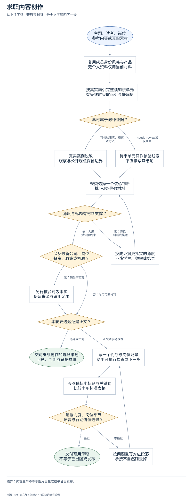
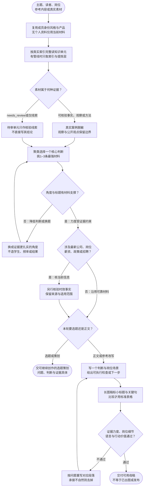

# 求职内容创作：完整流程

输入：主题、问题或素材；目标读者与岗位；知识库和真实案例。

交付：求职内容母稿；岗位解释与案例表达；图文排版提示。

[按原尺寸打开完整流程图](../assets/workflow.svg)

## 按什么顺序做

### 读取成员素材与索引

先读身份风格与产品；按主题从真实索引完整读取相关知识单元。

### 建立证据底盘

区分真实案例、个人观察、外部观点与待审线索，不冒用经历。

### 选证据充分的核心问题

从材料聚类并选1–3个支撑点；无支撑换角度，时效事实另行核验。

### 按请求交付选题或成稿

正文围绕一个核心判断，解释岗位具体工作、追问和证明产出。

### 设置图文排版重点

长图母稿保留准确标题、重点句与合格表格，不新增事实。

### 逐项审稿后交付

核标题力度、两个岗位特有判断与行动价值；不通过重写。

## 验收

- 素材按真实索引完整读取
- 待审结论不直接进入正文
- 标题与数字频率强度有证据
- 至少两个岗位特有判断、追问或场景
- 去掉CTA及排版标记仍独立有用

内容生产不等于图片已生成或平台已发布。

## 对应规则

- [SKILL.md](../SKILL.md)
- [references/team-setup.md](team-setup.md)

可编辑的流程源码

