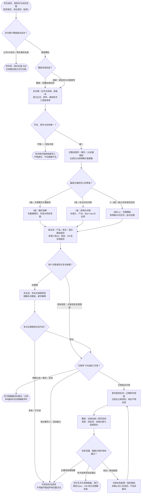

# 通用模拟面试：完整流程

输入：学生身份与源简历；已有双端页面；岗位意向与训练范围。

交付：老师内部指导版；学生准备与训练版；问题目录、附件与图解。

[按原尺寸打开完整流程图](../assets/workflow.svg)

## 按什么顺序做

### 先分流并锁定整册或局部

明确公司/JD和已发生面试转专用 Skill；局部请求只改目标块及必要双端关联。

### 定位唯一身份、页面及保护清单

复用双端原页与历史恢复点，完整读取源简历，保留附件、有效媒体和手工内容。

### 建立证据并选场次路线

先做事实、JD矩阵、个性化锚点；按口述等级选讲解、训练或模拟，按岗位选路线。

### 组织双端及前置图解

三档匹配JD、关键指标、S/K和问题目录一致；复杂图先成功预览再写，学生版不泄漏内部字段。

### 直写、读回与范围验收

整册执行远端全册和逐页验收；局部只验本次范围与保护清单，响应不明先读回。

## 验收

- 双端目录一致
- 学生版不含内部备注
- 手工内容与原图保留

未提供真实 JD 时只用明确标注的代表画像，不虚构邀约。

## 对应规则

- [SKILL.md](../SKILL.md)
- [references/feishu-delivery-contract.md](feishu-delivery-contract.md)
- [references/interview-content-contract.md](interview-content-contract.md)
- [references/interview-quality-contract.md](interview-quality-contract.md)
- [references/interview-session-contract.md](interview-session-contract.md)

可编辑的流程源码

