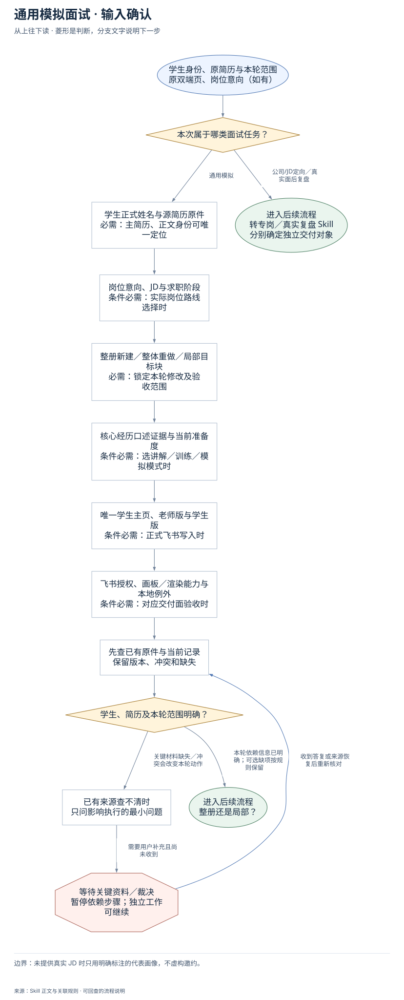
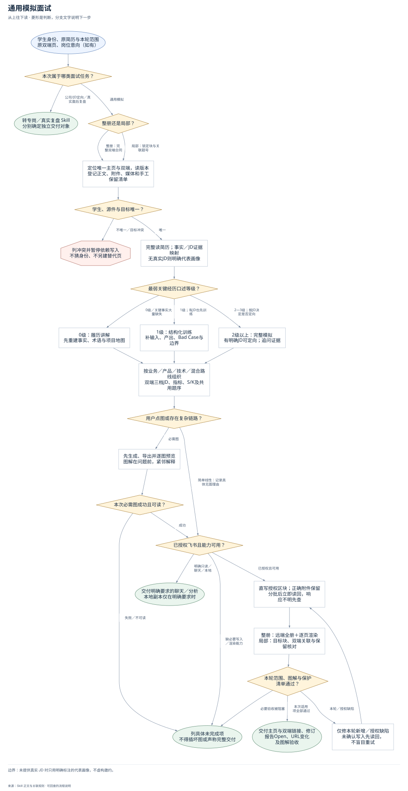

# 通用模拟面试：完整执行流程

先核对具体输入；已有材料能查明的直接读取，关键缺失或冲突才补充确认。沿完整图查看后续处理、失败去向与交付。

交付：老师内部指导版；学生准备与训练版；问题与履历双向对应；主回答和追问回应；问题目录、附件与图解。

## 执行前确认哪些信息

| 输入 | 何时需要 | 从哪里取得 | 缺失或冲突怎么处理 |
| --- | --- | --- | --- |
| 学生正式姓名与源简历原件 | 必需：主简历、正文身份可唯一定位 | 给路径直接只读原件；只给姓名用配置根/显式root定位候选，核正文和版本 | 多候选列冲突，不建目录复制文件，不按姓名猜学校或意向 |
| 岗位意向、JD与求职阶段 | 条件必需：实际岗位路线选择时 | 从本轮确认与真实简历读取；明确公司/JD面前定向准备转专岗 | 无真实JD保留意向待确认或代表性画像，不造已收到面试 |
| 整册新建／整体重做／局部目标块 | 必需：锁定本轮修改及验收范围 | 记录目标块、双端关联题号、当前版本、正文/附件/媒体与手工保留清单 | 范围不明只问关键区别；局部不因全册旧报错重写其他章节 |
| 核心经历口述证据与当前准备度 | 条件必需：选讲解／训练／模拟模式时 | 逐段核场景、输入、动作、输出、结果、Bad Case与职责边界，以最弱关键经历定模式 | 无口述证据明确待训练，不凭学校/公司/流畅度假定已能抗压 |
| 唯一学生主页、老师版与学生版 | 条件必需：正式飞书写入时 | 按标准与旧标题别名一起找唯一双端，读完整XML、修订、附件与手工内容 | 多页停止依赖写入；已有正确附件保留，不建替代页掩盖失败 |
| 飞书授权、图片/渲染能力与本地例外 | 条件必需：对应交付面验收时 | 复用已有授权和当前本人能力；明确聊天/只读/导出按其范围 | 无必需能力列未完成；本地副本仅用户明确要求，不成为默认前置 |
| 已有题目、本人讲解及来源 | 可选：用于更新问题和履历档案 | 读原双端页、已授权相关讲解和已有故事，保留真实问答与后写示范的差别 | 无口述不声称已经会答；按已证实履历出题，不补造失败或数字 |

## 输入确认、补齐与返回

[按原尺寸查看输入确认图](../assets/input-confirmation.svg)

## 完整执行、判断与异常去向

[按原尺寸打开完整执行图](../assets/workflow.svg)

## 每一步具体怎么做

### 输入与范围

**1. 学生身份、原简历与本轮范围；原双端页、岗位意向（如有）**

接收学生姓名/简历原路径、已有双端入口和本轮要求，先区分通用模拟、公司专岗和真实复盘，明确整册或指定局部。

下一步：本次属于哪类面试任务？。

依据：[SKILL.md](../SKILL.md) 中的“1. 解析输入。”。

**2. 本次属于哪类面试任务？**

通用理解/模拟进入本流程；明确公司JD面前定向准备转专岗，真实面后证据转复盘；同一请求含多类时各有独立目标，不合进通用双端。

下一步：“公司/JD定向／真实面后复盘” → 转专岗／真实复盘 Skill；分别确定独立交付对象；“通用模拟” → 学生正式姓名与源简历原件；必需：主简历、正文身份可唯一定位。

依据：[SKILL.md](../SKILL.md) 中的“**先分流：**”。

**3. 学生正式姓名与源简历原件；必需：主简历、正文身份可唯一定位**

给路径直接只读原件；只给姓名用配置根/显式root定位候选，核正文和版本；缺失处理：多候选列冲突，不建目录复制文件，不按姓名猜学校或意向

下一步：岗位意向、JD与求职阶段；条件必需：实际岗位路线选择时。

依据：[SKILL.md](../SKILL.md) 中的“1. 解析输入。”。

**4. 岗位意向、JD与求职阶段；条件必需：实际岗位路线选择时**

从本轮确认与真实简历读取；明确公司/JD面前定向准备转专岗；缺失处理：无真实JD保留意向待确认或代表性画像，不造已收到面试

下一步：整册新建／整体重做／局部目标块；必需：锁定本轮修改及验收范围。

依据：[SKILL.md](../SKILL.md) 中的“3. 解析简历，建立事实账本”。

**5. 整册新建／整体重做／局部目标块；必需：锁定本轮修改及验收范围**

记录目标块、双端关联题号、当前版本、正文/附件/媒体与手工保留清单；缺失处理：范围不明只问关键区别；局部不因全册旧报错重写其他章节

下一步：核心经历口述证据与当前准备度；条件必需：选讲解／训练／模拟模式时。

依据：[SKILL.md](../SKILL.md) 中的“验收范围先锁定”。

**6. 核心经历口述证据与当前准备度；条件必需：选讲解／训练／模拟模式时**

逐段核场景、输入、动作、输出、结果、Bad Case与职责边界，以最弱关键经历定模式；缺失处理：无口述证据明确待训练，不凭学校/公司/流畅度假定已能抗压

下一步：唯一学生主页、老师版与学生版；条件必需：正式飞书写入时。

依据：[references/interview-session-contract.md](interview-session-contract.md) 中的“准备度分流”。

**7. 唯一学生主页、老师版与学生版；条件必需：正式飞书写入时**

按标准与旧标题别名一起找唯一双端，读完整XML、修订、附件与手工内容；缺失处理：多页停止依赖写入；已有正确附件保留，不建替代页掩盖失败

下一步：飞书授权、画板／渲染能力与本地例外；条件必需：对应交付面验收时。

依据：[SKILL.md](../SKILL.md) 中的“2. 先做飞书预检。”。

**8. 飞书授权、画板／渲染能力与本地例外；条件必需：对应交付面验收时**

复用已有授权和当前本人能力；明确聊天/只读/导出按其范围；缺失处理：无必需能力列未完成；本地副本仅用户明确要求，不成为默认前置

下一步：已有题目、本人讲解及来源；可选：用于更新问题和履历档案。

依据：[SKILL.md](../SKILL.md) 中的“团队配置与依赖”。

**9. 先查已有原件与当前记录；保留版本、冲突和缺失**

保留既有三档JD、指标、题卡、附件、有效媒体和手工内容；旧摘要只是线索。

下一步：学生、简历及本轮范围明确？。

依据：[SKILL.md](../SKILL.md) 中的“1. 解析输入。”。

**10. 学生、简历及本轮范围明确？**

通用训练无真实JD可用代表画像；写入前身份/主简历/目标页要唯一。准备度缺证不妨碍先重建事实，但不能冒称已掌握。

下一步：“本轮依赖信息已明确；可选缺项按规则保留” → 整册还是局部？；“关键材料缺失／冲突会改变本轮动作” → 已有来源查不清时；只问影响执行的最小问题。

依据：[SKILL.md](../SKILL.md) 中的“1. 解析输入。”。

**11. 已有来源查不清时；只问影响执行的最小问题**

先读已有来源和双端；只询问会改变学生身份、主版本、目标范围的最小问题。

下一步：“需要用户补充且尚未收到” → 等待关键资料／裁决；暂停依赖步骤；独立工作可继续。

依据：[SKILL.md](../SKILL.md) 中的“1. 解析输入。”。

**12. 等待关键资料／裁决；暂停依赖步骤；独立工作可继续**

没有收到补充前，不假定问题已解决；保留已确认材料和具体缺口。先读已有来源和双端；只询问会改变学生身份、主版本、目标范围的最小问题。

下一步：“收到答复或来源恢复后重新核对” → 先查已有原件与当前记录；保留版本、冲突和缺失。

依据：[SKILL.md](../SKILL.md) 中的“1. 解析输入。”。

**13. 已有题目、本人讲解及来源；可选：用于更新问题和履历档案**

读原双端页、已授权相关讲解和已有故事，保留真实问答与后写示范的差别；无口述不声称已经会答；按已证实履历出题，不补造失败或数字

下一步：先查已有原件与当前记录；保留版本、冲突和缺失。

依据：[references/question-and-evidence-dossiers.md](question-and-evidence-dossiers.md) 中的“问题档案：从来源判断追问重点”。

### 执行与核验

**1. 整册还是局部？**

整册新建/重做执行完整双端合同；局部只锁目标块、相关题号和版本，核受影响一致性/显示及保留清单，旧无关错误不扩大修复。

下一步：“整册：完整双端合同” → 定位唯一主页与双端，读版本；登记正文、附件、媒体和手工保留清单；“局部：锁定块与关联题号” → 定位唯一主页与双端，读版本；登记正文、附件、媒体和手工保留清单。

依据：[SKILL.md](../SKILL.md) 中的“验收范围先锁定”。

**2. 定位唯一主页与双端，读版本；登记正文、附件、媒体和手工保留清单**

在已确认学生范围查唯一主页和双端，新旧别名合计每角色只能一页；更新前读完整XML、修订和章节/JD/指标/附件/媒体/手工保留清单。

下一步：学生、源件与目标唯一？。

依据：[SKILL.md](../SKILL.md) 中的“2. 先做飞书预检。”。

**3. 学生、源件与目标唯一？**

核学生正文身份、主简历及双端目标是否唯一；用户只给姓名可只读定位，多个候选先列冲突，不能猜事实、新建替代页或复制原件建档。

下一步：“不唯一／目标冲突” → 列冲突并暂停依赖写入；不猜身份、不另建替代页；“唯一” → 完整读简历；事实／JD证据映射；无真实JD则明确代表画像。

依据：[SKILL.md](../SKILL.md) 中的“1. 解析输入。”。

**4. 完整读简历；事实／JD证据映射；无真实JD则明确代表画像**

完整读原简历，把本人事实、外核、推断、知识和待补分开；先建JD逐条证据矩阵和个性化锚点，无真实JD明确代表画像，未确认意向不猜。

下一步：建立三档JD与逐条证据矩阵；岗位日常／证据／差距／原因／建议。

依据：[SKILL.md](../SKILL.md) 中的“3. 解析简历，建立事实账本”。

**5. 最弱关键经历口述等级？**

按岗位最相关核心经历分别用0–3口述等级查场景、动作、输入输出、验证和边界；以最弱关键经历定讲解/训练/模拟，不凭学历或公司名推断掌握。没有实际口述时记未评估，不判0级；先给可练稿与首次口述任务。

下一步：“0级／关键事实大量缺失” → 0级：履历讲解；先重建事实、术语与项目地图；“1级；有JD也先训练” → 1级：结构化训练；补输入、产出、Bad Case与边界；“2—3级；按JD决定是否定向” → 2级以上：完整模拟；有明确JD可定向；追问证据；“没有实际口述证据” → 未评估：先给基于事实的可练稿；首次口述后再确定等级与训练模式。

依据：[references/interview-session-contract.md](interview-session-contract.md) 中的“准备度分流”。

**6. 0级：履历讲解；先重建事实、术语与项目地图**

关键经历只会复述或事实大量缺失时，先重建业务背景、术语、本人动作和项目地图；列要补证的内容与达到结构化训练的具体条件。

下一步：按业务／产品／技术／混合路线组织；双端三档JD、指标、S/K及共用题序。

依据：[references/interview-session-contract.md](interview-session-contract.md) 中的“准备度分流”。

**7. 1级：结构化训练；补输入、产出、Bad Case与边界**

能讲功能但缺完整链路时，围绕一段核心经历反复练场景—输入—动作—产物—Bad Case—边界；即使有JD也先训练，不强入定向模拟。

下一步：按业务／产品／技术／混合路线组织；双端三档JD、指标、S/K及共用题序。

依据：[references/interview-session-contract.md](interview-session-contract.md) 中的“准备度分流”。

**8. 2级以上：完整模拟；有明确JD可定向；追问证据**

关键经历能讲完整链路后，按分类问题做一至两层证据追问；真实JD仅在达到准备度时用于定向，未达条件不以高压模拟代替教学。

下一步：按业务／产品／技术／混合路线组织；双端三档JD、指标、S/K及共用题序。

依据：[references/interview-session-contract.md](interview-session-contract.md) 中的“准备度分流”。

**9. 按业务／产品／技术／混合路线组织；双端三档JD、指标、S/K及共用题序**

老师版按快速上手、岗位证据、履历/项目/指标、架构、流程、题卡、反馈；学生版按先懂岗位和项目再练题，双端共享岗位、S/K和题序但字段分角色。

下一步：指标口径扫盲逐项覆盖；至少三张；例子与本人边界。

依据：[SKILL.md](../SKILL.md) 中的“5. 在当前任务中形成老师版”。

**10. 先生成、导出并逐图预览；图解在问题前，紧邻解释**

必需图先在任务专属临时目录生成、导出并逐张看文字、箭头、分支、终态和字号；确认可读后放对应解释旁且在问题区前。

下一步：本次必需图成功且可读？。

依据：[references/interview-quality-contract.md](interview-quality-contract.md) 中的“六、阅读顺序与视觉呈现”。

**11. 本次必需图成功且可读？**

确认本轮每张必需图成功生成并实际预览可读，媒体有正确内容与尺寸；失败不插占位、空token或坏链接，保留图解未完成项。

下一步：“失败／不可读” → 列具体未完成项；不得插坏图或声称完整交付；“成功” → 已授权飞书且能力可用？。

依据：[SKILL.md](../SKILL.md) 中的“6. 整册写入前完成整页排版计划”。

**12. 建立三档JD与逐条证据矩阵；岗位日常／证据／差距／原因／建议**

90/80/70是结构判断不是算法得分；三张JD卡只在同一章节，两端岗位与顺序一致，保留真实来源/日期或示例标识。

下一步：个人履历建档：Pxx项目地图与S故事；产物、指标口径、职责与对应题号。

依据：[references/interview-content-contract.md](interview-content-contract.md) 中的“三档匹配 JD”。

**13. 个人履历建档：Pxx项目地图与S故事；产物、指标口径、职责与对应题号**

核心经历逐段列业务场景、用户、输入、流程、输出、指标来源、产物、职责、异常和取舍；数值核分母、基线、周期、护栏与归因。

下一步：最弱关键经历口述等级？。

依据：[references/interview-session-contract.md](interview-session-contract.md) 中的“项目地图与必做产物”。

**14. 指标口径扫盲逐项覆盖；至少三张；例子与本人边界**

每项进入JD、项目、结果或题卡的关键指标都可找到卡：大白话、算法/判断、重要性、误判、本人边界；自定义指标保留可校验引用。

下一步：先建S个人故事与K岗位知识；每题选择一种表达身份。

依据：[references/interview-content-contract.md](interview-content-contract.md) 中的“学生版固定结构”。

**15. 先建S个人故事与K岗位知识；每题选择一种表达身份**

S只收已确认事实；K充分教工作方法和例外。亲历S、迁移S+K、知识K、假设K并声明条件；同题两端身份一致。

下一步：问题档案：问法、意图与追问路径；按岗位方向确定重点，不造面试官。

依据：[references/interview-content-contract.md](interview-content-contract.md) 中的“S／K 锚点与四种表达”。

**16. 同目录出双端四部分题组；基础≥6、八大问8、深挖≥4、专业≥4**

双端题目目录和顺序一致；老师给判断和带教，学生先有具体主回答及追问回应，改写区可选；不泄漏内部评分与施压脚本。

下一步：逐题给主回答与有答案的追问；核心题沿动作继续问取舍或例外。

依据：[references/interview-content-contract.md](interview-content-contract.md) 中的“双端问题目录”。

**17. 选择业务／产品／技术／混合路线；按准备度组织约60分钟课程**

业务讲流程指标归因，产品讲体验和取舍，技术讲架构调用与异常，确有跨职能才混合；AI工具出现不自动改技术路线。

下一步：用户点图或存在复杂链路？。

依据：[references/interview-session-contract.md](interview-session-contract.md) 中的“岗位追问路线”。

**18. 问题档案：问法、意图与追问路径；按岗位方向确定重点，不造面试官**

复用已有问题与来源，按已确认方向或代表性岗位判断先练什么；每题对应履历或K知识，核心经历反向可查题号。

下一步：同目录出双端四部分题组；基础≥6、八大问8、深挖≥4、专业≥4。

依据：[references/question-and-evidence-dossiers.md](question-and-evidence-dossiers.md) 中的“问题档案：从来源判断追问重点”。

**19. 逐题给主回答与有答案的追问；核心题沿动作继续问取舍或例外**

每题至少一组问答，核心题通常沿两层继续问；缺数字仍可讲实际产物，不能成立的亲历故事保留缺口，改写练习不代替答案。

下一步：选择业务／产品／技术／混合路线；按准备度组织约60分钟课程。

依据：[references/question-and-evidence-dossiers.md](question-and-evidence-dossiers.md) 中的“把档案转成能说出口的答案”。

**20. 未评估：先给基于事实的可练稿；首次口述后再确定等级与训练模式**

没有实际口述记录不等于只能复述；基于已确认动作与产物准备回答，布置首次口述，听到证据后再选择模式。

下一步：按业务／产品／技术／混合路线组织；双端三档JD、指标、S/K及共用题序。

依据：[references/interview-session-contract.md](interview-session-contract.md) 中的“准备度分流”。

### 交付与验收

**1. 转专岗／真实复盘 Skill；分别确定独立交付对象**

把已读简历、公司JD/邀约或真实逐字稿与相应目标交给专岗/复盘Skill；保护原通用双端，不能为分流删除已有有效内容。

这是本路径的交付或转交结果。

依据：[SKILL.md](../SKILL.md) 中的“**先分流：**”。

**2. 列冲突并暂停依赖写入；不猜身份、不另建替代页**

保留候选原件和页面冲突，暂停依赖该身份/版本的写入；只问必要学生或主简历问题，其他只读核对继续，明确后回原入口续接。

下一步：“身份／主版本明确后重核” → 先查已有原件与当前记录；保留版本、冲突和缺失。

依据：[SKILL.md](../SKILL.md) 中的“团队配置与依赖”。

**3. 用户点图或存在复杂链路？**

用户点名图的项目或核心链路有多角色、多系统、分支、回流/回退即列必需图；普通定义和简单线性步骤可文字，写具体无图理由。

下一步：“必需图” → 先生成、导出并逐图预览；图解在问题前，紧邻解释；“简单线性：记录具体无图理由” → 已授权飞书且能力可用？。

依据：[SKILL.md](../SKILL.md) 中的“6. 整册写入前完成整页排版计划”。

**4. 列具体未完成项；不得插坏图或声称完整交付**

交代已完成正文与具体图解/写入/渲染缺口，保留原页面和有效媒体；不能以目录齐、脚本通过或部分图成功称整册交付。

这是本路径的交付或转交结果。

依据：[SKILL.md](../SKILL.md) 中的“团队配置与依赖”。

**5. 已授权飞书且能力可用？**

复用当前明确飞书授权并核本人和工具；已有范围不重复确认。明确聊天/只读走对应例外，正式写入或渲染缺能力只暂停受影响步骤。

下一步：“明确只读／聊天／本地” → 交付明确要求的聊天／分析；本地副本仅在明确要求时；“缺必要写入／渲染能力” → 列具体未完成项；不得插坏图或声称完整交付；“已授权且可用” → 直写授权区块；正确附件保留；分批后立即读回，响应不明先查。

依据：[SKILL.md](../SKILL.md) 中的“团队配置与依赖”。

**6. 交付明确要求的聊天／分析；本地副本仅在明确要求时**

交用户明确要求的聊天/分析并说明覆盖；本地副本只有用户明确要求才额外生成，不能默认留持久母稿、备份或交付索引。

这是本路径的交付或转交结果。

依据：[SKILL.md](../SKILL.md) 中的“边界”。

**7. 直写授权区块；正确附件保留；分批后立即读回，响应不明先查**

老师/学生内容在当前任务中定稿后直接分章写授权区块；新建首块上传原简历，更新先核正确附件并保留，失败立即读回确认不盲目重试。

下一步：仅改授权区块、每批局部读回；正确附件媒体保留，疑似超时先查。

依据：[SKILL.md](../SKILL.md) 中的“7. 整册新建时从原始路径上传简历”。

**8. 整册：远端全册＋逐页渲染；局部：目标块、双端关联与保留核对**

整册运行远端全册校验并再次逐项比保留清单，新增图逐张实看、双端逐页渲染；局部验目标块、相关双端题号、事实显示与保护对象。

下一步：本轮范围、图解与保护清单通过？。

依据：[references/feishu-delivery-contract.md](feishu-delivery-contract.md) 中的“按本次范围验收”。

**9. 本轮范围、图解与保护清单通过？**

核两端JD卡、题目编号/标题/顺序/表达类型、指标覆盖、题前图解、附件首块、无坏媒体和学生端无内部字段；仅对本次适用项下通过结论。

下一步：“本次适用项全部通过” → 交付主页与双端链接、修订；报告Open、URL变化及图解验收；“本轮／授权缺陷” → 仅修本轮新增／授权缺陷；未确认写入先读回，不盲目重试；“必要验收被阻塞” → 列具体未完成项；不得插坏图或声称完整交付。

依据：[SKILL.md](../SKILL.md) 中的“9. 整册自动校验通过后”。

**10. 仅修本轮新增／授权缺陷；未确认写入先读回，不盲目重试**

只修本轮新增或已授权缺陷，再读回和复验受影响范围；旧全册无关报错只报告，响应不明先查实际写入而非创建替代页。

下一步：直写授权区块；正确附件保留；分批后立即读回，响应不明先查。

依据：[SKILL.md](../SKILL.md) 中的“验收范围先锁定”。

**11. 交付主页与双端链接、修订；报告Open、URL变化及图解验收**

给主页、老师版和学生版链接、最新远端修订与图解验收结果，说明URL变化、待补事实和无法验证项；正式飞书流程不交本地文件链接。

这是本路径的交付或转交结果。

依据：[SKILL.md](../SKILL.md) 中的“10. 最终只交付飞书主页”。

**12. 仅改授权区块、每批局部读回；正确附件媒体保留，疑似超时先查**

新建双端首块为原简历附件；更新核版本/名称/类型/大小/可访问性后只补缺失；响应不明先读回而非重复创建。

下一步：整册：远端全册＋逐页渲染；局部：目标块、双端关联与保留核对。

依据：[references/feishu-delivery-contract.md](feishu-delivery-contract.md) 中的“预检、更新与迁移”。

## 验收

- 双端目录一致
- 可用题主回答与追问回应具体；我的版本为可选练习
- 学生版不含内部备注
- 手工内容与原图保留

未提供真实 JD 时只用明确标注的代表画像，不虚构邀约。

## 对应规则

- [SKILL.md](../SKILL.md)
- [references/feishu-delivery-contract.md](feishu-delivery-contract.md)
- [references/interview-content-contract.md](interview-content-contract.md)
- [references/interview-quality-contract.md](interview-quality-contract.md)
- [references/interview-session-contract.md](interview-session-contract.md)
- [references/local-output-contract.md](local-output-contract.md)
- [references/question-and-evidence-dossiers.md](question-and-evidence-dossiers.md)

```mermaid
flowchart TB
  in(["学生身份、原简历与本轮范围<br/>原双端页、岗位意向（如有）"])
  route{"本次属于哪类面试任务？"}
  companion(["转专岗／真实复盘 Skill<br/>分别确定独立交付对象"])
  scope{"整册还是局部？"}
  precheck["定位唯一主页与双端，读版本<br/>登记正文、附件、媒体和手工保留清单"]
  unique{"学生、源件与目标唯一？"}
  stop(["列冲突并暂停依赖写入<br/>不猜身份、不另建替代页"])
  facts["完整读简历；事实／JD证据映射<br/>无真实JD则明确代表画像"]
  level{"最弱关键经历口述等级？"}
  explain["0级：履历讲解<br/>先重建事实、术语与项目地图"]
  train["1级：结构化训练<br/>补输入、产出、Bad Case与边界"]
  simulate["2级以上：完整模拟<br/>有明确JD可定向；追问证据"]
  body["按业务／产品／技术／混合路线组织<br/>双端三档JD、指标、S/K及共用题序"]
  visual{"用户点图或存在复杂链路？"}
  preview["先生成、导出并逐图预览<br/>图解在问题前，紧邻解释"]
  imagegate{"本次必需图成功且可读？"}
  partial(["列具体未完成项<br/>不得插坏图或声称完整交付"])
  delivery{"已授权飞书且能力可用？"}
  limited(["交付明确要求的聊天／分析<br/>本地副本仅在明确要求时"])
  write["直写授权区块；正确附件保留<br/>分批后立即读回，响应不明先查"]
  qa["整册：远端全册＋逐页渲染<br/>局部：目标块、双端关联与保留核对"]
  gate{"本轮范围、图解与保护清单通过？"}
  repair["仅修本轮新增／授权缺陷<br/>未确认写入先读回，不盲目重试"]
  out(["交付主页与双端链接、修订<br/>报告Open、URL变化及图解验收"])
  i_identity["学生正式姓名与源简历原件<br/>必需：主简历、正文身份可唯一定位"]
  i_intent["岗位意向、JD与求职阶段<br/>条件必需：实际岗位路线选择时"]
  i_scope["整册新建／整体重做／局部目标块<br/>必需：锁定本轮修改及验收范围"]
  i_readiness["核心经历口述证据与当前准备度<br/>条件必需：选讲解／训练／模拟模式时"]
  i_pages["唯一学生主页、老师版与学生版<br/>条件必需：正式飞书写入时"]
  i_format["飞书授权、画板／渲染能力与本地例外<br/>条件必需：对应交付面验收时"]
  i_existing["先查已有原件与当前记录<br/>保留版本、冲突和缺失"]
  i_ready{"学生、简历及本轮范围明确？"}
  i_clarify["已有来源查不清时<br/>只问影响执行的最小问题"]
  i_wait(["等待关键资料／裁决<br/>暂停依赖步骤；独立工作可继续"])
  jd_cards["建立三档JD与逐条证据矩阵<br/>岗位日常／证据／差距／原因／建议"]
  project_cards["个人履历建档：Pxx项目地图与S故事<br/>产物、指标口径、职责与对应题号"]
  metrics["指标口径扫盲逐项覆盖<br/>至少三张；例子与本人边界"]
  anchors["先建S个人故事与K岗位知识<br/>每题选择一种表达身份"]
  question_catalog["同目录出双端四部分题组<br/>基础≥6、八大问8、深挖≥4、专业≥4"]
  session_route["选择业务／产品／技术／混合路线<br/>按准备度组织约60分钟课程"]
  batch_readback["仅改授权区块、每批局部读回<br/>正确附件媒体保留，疑似超时先查"]
  question_dossier["问题档案：问法、意图与追问路径<br/>按岗位方向确定重点，不造面试官"]
  answer_practice["逐题给主回答与有答案的追问<br/>核心题沿动作继续问取舍或例外"]
  i_question_sources["已有题目、本人讲解及来源<br/>可选：用于更新问题和履历档案"]
  not_evaluated["未评估：先给基于事实的可练稿<br/>首次口述后再确定等级与训练模式"]
  in --> route
  route -->|"公司/JD定向／真实面后复盘"| companion
  scope -->|"整册：完整双端合同"| precheck
  scope -->|"局部：锁定块与关联题号"| precheck
  precheck --> unique
  unique -->|"不唯一／目标冲突"| stop
  unique -->|"唯一"| facts
  level -->|"0级／关键事实大量缺失"| explain
  level -->|"1级；有JD也先训练"| train
  level -->|"2—3级；按JD决定是否定向"| simulate
  explain --> body
  train --> body
  simulate --> body
  visual -->|"必需图"| preview
  visual -->|"简单线性：记录具体无图理由"| delivery
  preview --> imagegate
  imagegate -->|"失败／不可读"| partial
  imagegate -->|"成功"| delivery
  delivery -->|"明确只读／聊天／本地"| limited
  delivery -->|"缺必要写入／渲染能力"| partial
  delivery -->|"已授权且可用"| write
  qa --> gate
  gate -->|"本次适用项全部通过"| out
  gate -->|"本轮／授权缺陷"| repair
  gate -->|"必要验收被阻塞"| partial
  repair --> write
  route -->|"通用模拟"| i_identity
  i_identity --> i_intent
  i_intent --> i_scope
  i_scope --> i_readiness
  i_readiness --> i_pages
  i_pages --> i_format
  i_format --> i_question_sources
  i_existing --> i_ready
  i_ready -->|"本轮依赖信息已明确；可选缺项按规则保留"| scope
  i_ready -->|"关键材料缺失／冲突会改变本轮动作"| i_clarify
  i_clarify -->|"需要用户补充且尚未收到"| i_wait
  i_wait -->|"收到答复或来源恢复后重新核对"| i_existing
  facts --> jd_cards
  jd_cards --> project_cards
  project_cards --> level
  body --> metrics
  metrics --> anchors
  session_route --> visual
  write --> batch_readback
  batch_readback --> qa
  stop -->|"身份／主版本明确后重核"| i_existing
  anchors --> question_dossier
  question_dossier --> question_catalog
  question_catalog --> answer_practice
  answer_practice --> session_route
  i_question_sources --> i_existing
  level -->|"没有实际口述证据"| not_evaluated
  not_evaluated --> body
```

可编辑的完整流程源码

