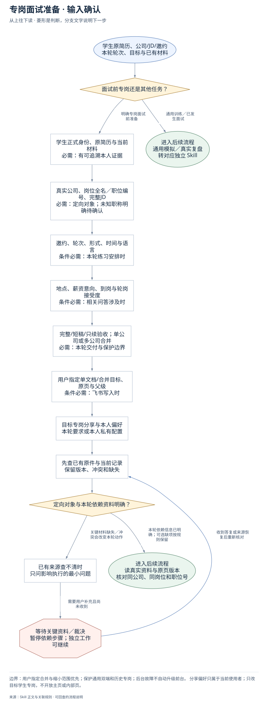
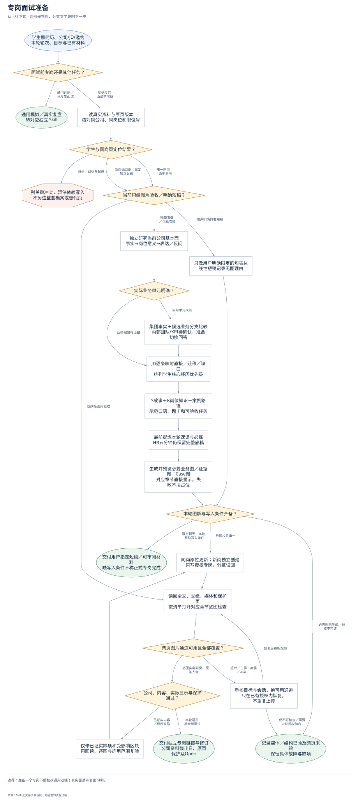

# 专岗面试准备：完整执行流程

先核对具体输入；已有材料能查明的直接读取，关键缺失或冲突才补充确认。沿完整图查看后续处理、失败去向与交付。

交付：按用户指定单文档或默认专岗页交付；公司事实→任务/交付/指标/案例；可口述表达、训练产物及真实验收范围。

## 执行前确认哪些信息

| 输入 | 何时需要 | 从哪里取得 | 缺失或冲突怎么处理 |
| --- | --- | --- | --- |
| 学生正式身份、原简历与当前材料 | 必需：有可追溯本人证据 | 完整读原简历、当前通用/同岗页、用户参考和已有故事；原件只读 | 主版本或同名身份歧义先查；参考只借方法不复制个人事实 |
| 真实公司、岗位全名／职位编号、完整JD | 必需：定向对象；未知职称明确待确认 | 优先官方JD、职位页面和邀约截图核同公司同岗；岗位不全用已知公司+岗位待确认 | 没有明确专岗信息转通用准备；不把HR初筛当岗位名称 |
| 邀约、轮次、形式、时间与语言 | 条件必需：本轮练习安排时 | 读本轮邀约；提炼先练项、意向硬条件与面试前动态复核窗口 | 未知按待确认；五分钟轮次不自动缩完整底稿，只用户限定才短稿 |
| 地点、薪资意向、到岗与轮岗接受度 | 条件必需：相关问答涉及时 | 从本人已确认资料读取硬条件，用于自我介绍/意向回答 | 没有确认不替学生承诺；只追问影响当前表达的关键条件 |
| 完整/短稿/只续验收；单公司或多公司合并 | 必需：本轮交付与保护边界 | 按用户明确范围定内容和文档组织；五分钟轮次不等于短稿；合并要求不拆页 | 先查本轮原话与目标；仅关键歧义确认，不因模板扩大范围 |
| 用户指定单文档/合并目标、原页与父级 | 条件必需：飞书写入时 | 优先用户指定及唯一同岗/合并页；读XML修订、媒体和手工内容，记录保护页 | 多个目标先消歧；默认新岗独立仅适用于无指定合并，已有页不迁移 |
| 目标专岗分享范围与本人偏好 | 条件必需：飞书交付分享时 | 读用户本轮明确要求或本人私有role_prep_delivery已确认偏好；保存目标原权限 | 未授权保留现有权限；不继承作者授权，不索取学生账号 |

## 输入确认、补齐与返回

[按原尺寸查看输入确认图](../assets/input-confirmation.svg)

## 完整执行、判断与异常去向

[按原尺寸打开完整执行图](../assets/workflow.svg)

## 每一步具体怎么做

### 输入与范围

**1. 学生原简历、公司/JD/邀约；本轮轮次、目标与已有材料**

接收原简历、公司岗位/JD/邀约、轮次时间和已有关联材料；先确认面前专岗还是通用训练/面后复盘，不按轮次短自动缩小交付。

下一步：面试前专岗还是其他任务？。

依据：[SKILL.md](../SKILL.md) 中的“1. **读取真实资料。**”。

**2. 面试前专岗还是其他任务？**

明确公司岗位的面前准备进入专岗；没有专岗目标的通用模拟和真实已发生面试复盘各转独立Skill，保留已有通用页和同场记录。

下一步：“通用训练／已发生面试” → 通用模拟／真实复盘；转对应独立 Skill；“明确专岗面试前准备” → 学生正式身份、原简历与当前材料；必需：有可追溯本人证据。

依据：[SKILL.md](../SKILL.md) 中的“调用与维护”。

**3. 学生正式身份、原简历与当前材料；必需：有可追溯本人证据**

完整读原简历、当前通用/同岗页、用户参考和已有故事；原件只读；缺失处理：主版本或同名身份歧义先查；参考只借方法不复制个人事实

下一步：真实公司、岗位全名／职位编号、完整JD；必需：定向对象；未知职称明确待确认。

依据：[SKILL.md](../SKILL.md) 中的“1. **读取真实资料。**”。

**4. 真实公司、岗位全名／职位编号、完整JD；必需：定向对象；未知职称明确待确认**

优先官方JD、职位页面和邀约截图核同公司同岗；岗位不全用已知公司+岗位待确认；缺失处理：没有明确专岗信息转通用准备；不把HR初筛当岗位名称

下一步：邀约、轮次、形式、时间与语言；条件必需：本轮练习安排时。

依据：[SKILL.md](../SKILL.md) 中的“交付对象先确定”。

**5. 邀约、轮次、形式、时间与语言；条件必需：本轮练习安排时**

读本轮邀约；提炼先练项、意向硬条件与面试前动态复核窗口；缺失处理：未知按待确认；五分钟轮次不自动缩完整底稿，只用户限定才短稿

下一步：地点、薪资意向、到岗与轮岗接受度；条件必需：相关问答涉及时。

依据：[references/content-and-expression.md](content-and-expression.md) 中的“阅读顺序与每部分的用途”。

**6. 地点、薪资意向、到岗与轮岗接受度；条件必需：相关问答涉及时**

从本人已确认资料读取硬条件，用于自我介绍/意向回答；缺失处理：没有确认不替学生承诺；只追问影响当前表达的关键条件

下一步：完整/短稿/只续验收；单公司或多公司合并；必需：本轮交付与保护边界。

依据：[references/content-and-expression.md](content-and-expression.md) 中的“示范稿怎样表达”。

**7. 完整/短稿/只续验收；单公司或多公司合并；必需：本轮交付与保护边界**

按用户明确范围定内容和文档组织；五分钟轮次不等于短稿；合并要求不拆页；缺失处理：先查本轮原话与目标；仅关键歧义确认，不因模板扩大范围

下一步：用户指定单文档/合并目标、原页与父级；条件必需：飞书写入时。

依据：[SKILL.md](../SKILL.md) 中的“4. **适配本轮，不丢准备底稿。**”。

**8. 用户指定单文档/合并目标、原页与父级；条件必需：飞书写入时**

优先用户指定及唯一同岗/合并页；读XML修订、媒体和手工内容，记录保护页；缺失处理：多个目标先消歧；默认新岗独立仅适用于无指定合并，已有页不迁移

下一步：目标专岗分享与本人偏好；本轮要求或本人私有配置。

依据：[references/feishu-boundary-and-acceptance.md](feishu-boundary-and-acceptance.md) 中的“先定位，再写入”。

**9. 先查已有原件与当前记录；保留版本、冲突和缺失**

当前原件优先，旧总结作线索；学生证据与公开公司事实隔离，通用页和其他专岗保持保护。

下一步：定向对象与本轮依赖资料明确？。

依据：[SKILL.md](../SKILL.md) 中的“1. **读取真实资料。**”。

**10. 定向对象与本轮依赖资料明确？**

关键学生/专岗身份和范围要明确；业务单元未知可分支准备，轮次/硬条件未知不编造，现有证据先研究。

下一步：“本轮依赖信息已明确；可选缺项按规则保留” → 读真实资料与原页版本；核对同公司、同岗位和职位号；“关键材料缺失／冲突会改变本轮动作” → 已有来源查不清时；只问影响执行的最小问题。

依据：[SKILL.md](../SKILL.md) 中的“1. **读取真实资料。**”。

**11. 已有来源查不清时；只问影响执行的最小问题**

先查原JD、邀约与既有页；仍有身份/岗位/范围歧义，仅询问决定下一步的一项。

下一步：“需要用户补充且尚未收到” → 等待关键资料／裁决；暂停依赖步骤；独立工作可继续。

依据：[SKILL.md](../SKILL.md) 中的“1. **读取真实资料。**”。

**12. 等待关键资料／裁决；暂停依赖步骤；独立工作可继续**

没有收到补充前，不假定问题已解决；保留已确认材料和具体缺口。先查原JD、邀约与既有页；仍有身份/岗位/范围歧义，仅询问决定下一步的一项。

下一步：“收到答复或来源恢复后重新核对” → 先查已有原件与当前记录；保留版本、冲突和缺失。

依据：[SKILL.md](../SKILL.md) 中的“1. **读取真实资料。**”。

**13. 目标专岗分享与本人偏好；本轮要求或本人私有配置**

读取本轮明确要求或本人已确认分享偏好；未授权保留原权限，团队成员不继承。

下一步：先查已有原件与当前记录；保留版本、冲突和缺失。

依据：[references/feishu-boundary-and-acceptance.md](feishu-boundary-and-acceptance.md) 中的““所有人可见”的设置与验收”。

### 执行与核验

**1. 读真实资料与原页版本；核对同公司、同岗位和职位号**

完整读原简历、邀约、已有同岗材料和当前页修订，按公司、岗位全名及职位编号匹配；参考资料仅用于结构与方法，不迁移其他学生事实。

下一步：学生与同岗页定位结果？。

依据：[references/feishu-boundary-and-acceptance.md](feishu-boundary-and-acceptance.md) 中的“先定位，再写入”。

**2. 学生与同岗页定位结果？**

先按用户指定单文档/合并目标定位；唯一同岗原位更新，未指定合并且确为新岗才独立创建；多候选先暂停依赖写入。

下一步：“身份／目标多候选” → 列关键冲突，暂停依赖写入；不另造整套档案或替代页；“唯一同岗：原地复用” → 用户指定合并一份还是默认专岗？；“无旧页：锁定用户指定/默认父级” → 用户指定合并一份还是默认专岗？。

依据：[SKILL.md](../SKILL.md) 中的“交付对象先确定”。

**3. 当前只续图表验收／明确短稿？**

只续图片验收直接复用原页清单；用户明确只要短话术才交短稿。HR五分钟只是本轮信息，完整专岗仍做底稿并前置速读。

下一步：“仅续接图片验收” → CLI清单＋当前后台能力发现；全文与每张图分别取证；“用户明确只要短稿” → 只做用户明确限定的短表达；线性短稿记录无图理由；“完整准备／仅轮次短” → 按公司类型研究基本面与真实业务；背景/产品/客户/收费/渠道/竞争。

依据：[SKILL.md](../SKILL.md) 中的“4. **适配本轮，不丢准备底稿。**”。

**4. 只做用户明确限定的短表达；线性短稿记录无图理由**

按用户明确限定的字数/时长/题组给自然短表达，事实只取已确认内容；简单线性短稿记无图理由，不把短稿报成完整专岗。

下一步：本轮图解与写入条件齐备？。

依据：[references/content-and-expression.md](content-and-expression.md) 中的“专岗图解合同”。

**5. 按公司类型研究基本面与真实业务；背景/产品/客户/收费/渠道/竞争**

先查主体、创始团队、发展与融资/经营变化、代表商品/功能、使用与付费方、价格口径、地域渠道、竞争和相关岗位；每条关键事实登记来源日期。

下一步：官网各业务页＋公司类型相关渠道；不只首页；未知先补查并登记。

依据：[references/company-fundamentals-research.md](company-fundamentals-research.md) 中的“研究与正文的对应关系”。

**6. 实际业务单元明确？**

核实际业务归属是否被JD/邀约证据确认。有证据按该单元展开；无证据先做集团与候选业务分支，不替学生选一个看似最像的团队。

下一步：“业务归属有证据” → 公司事实接核心职责与学生证据；任务→交付→指标→案例；“实际单元未知” → 集团事实＋候选业务分支比较；内部团队/KPI待确认，准备切换回答。

依据：[references/company-fundamentals-research.md](company-fundamentals-research.md) 中的“从事实到岗位工作”。

**7. 集团事实＋候选业务分支比较；内部团队/KPI待确认，准备切换回答**

按JD业务池比较不同分支的用户、流程、指标和风险，内部团队/KPI/招聘动机保留待确认；准备开场确认问题与可切换回答。

下一步：公司事实接核心职责与学生证据；任务→交付→指标→案例。

依据：[references/company-fundamentals-research.md](company-fundamentals-research.md) 中的“从事实到岗位工作”。

**8. 公司事实接核心职责与学生证据；任务→交付→指标→案例**

把公司事实转成该岗位具体任务、交付给谁、怎样判断、有哪些异常；再映射学生直接/迁移证据与知识缺口，不按关键词打匹配分。

下一步：逐职责：对象/动作/产物/上下游；判断口径与异常，再映射证据。

依据：[SKILL.md](../SKILL.md) 中的“2. **先完成公司基本面”。

**9. 按单文档/多公司组织正文；业务讲解、S/K、表达与案例**

多公司同页时先共同总览，各公司展开研究和岗位工作，再差异比较；共用学生故事只写一次，不拼接薄稿或反复免责声明。

下一步：S故事与K知识分开复用；亲历／迁移／知识／假设逐题选。

依据：[SKILL.md](../SKILL.md) 中的“3. **完整组织专岗内容。**”。

**10. 最前提炼本轮速读与必练；HR五分钟仍保留完整底稿**

在同一专岗页最前给本轮速读、自我介绍、意向硬条件与必练顺序，并指向完整准备底稿；临近面试可先给聊天速读再完成原授权范围。

下一步：生成并预览必要业务图／证据图／Case图；对应章节直接显示，失败不插占位。

依据：[SKILL.md](../SKILL.md) 中的“4. **适配本轮，不丢准备底稿。**”。

**11. 生成并预览必要业务图／证据图／Case图；对应章节直接显示，失败不插占位**

按实际关系制作业务链与岗位位置、JD证据矩阵、Case判断路径，先独立预览再直接嵌对应正文；公开抽象不画成内部架构，失败不插占位。

下一步：逐图核业务链与Case；正文原生画板，来源保留。

依据：[references/content-and-expression.md](content-and-expression.md) 中的“专岗图解合同”。

**12. CLI清单＋当前后台能力发现；全文与每张图分别取证**

读回归属、父级、修订、全文和媒体清单；刷新当前浏览器/标签能力，核DOM与实时画面，按清单覆盖每公司每张图。

下一步：后台文字与截图各层结果？。

依据：[references/feishu-image-browser-recovery.md](feishu-image-browser-recovery.md) 中的“后台发现与恢复顺序”。

**13. 后台文字与截图各层结果？**

DOM能读正文不代表图片显示通过；高层AX包装超时不代表后台DOM不可用，按具体失败层检查。

下一步：“全文和全部图片实际覆盖” → 公司/职责/案例/文风/显示都通过？；“AX/DOM/截图具体层故障” → 刷新发现→browser→tabs→DOM/截图；同层同参数两次失败停止原样重试。

依据：[references/feishu-image-browser-recovery.md](feishu-image-browser-recovery.md) 中的“先分清失败发生在哪一层”。

**14. 刷新发现→browser→tabs→DOM/截图；同层同参数两次失败停止原样重试**

按当前文档识别动态实例和标签，复用既有目标；同层句柄只用其文档API，不混高低层截图接口，不硬编码ID、不请求切前台。

下一步：“恢复后重新观察” → CLI清单＋当前后台能力发现；全文与每张图分别取证；“可用后台路径仍缺真实画面” → 分别交代文字/媒体已验与视觉partial；列未查看图和具体失败层。

依据：[references/feishu-image-browser-recovery.md](feishu-image-browser-recovery.md) 中的“后台发现与恢复顺序”。

**15. 官网各业务页＋公司类型相关渠道；不只首页；未知先补查并登记**

按JD和公司类型查产品/定价/团队/新闻、财报/投资方公告、渠道/服务、安全/帮助与相关招聘；关键未知登记已查渠道和下一条有效线索。

下一步：核心业务有证据且未知已合理补查？。

依据：[references/company-fundamentals-research.md](company-fundamentals-research.md) 中的“取证顺序与不足时的继续动作”。

**16. 逐职责：对象/动作/产物/上下游；判断口径与异常，再映射证据**

每个高优先级职责都对应代表产品、用户或渠道，讲清动作、交付、指标定义和常见异常，再列真实经历/可迁移/缺口。

下一步：按单文档/多公司组织正文；业务讲解、S/K、表达与案例。

依据：[references/content-and-expression.md](content-and-expression.md) 中的“讲清岗位日常与案例”。

**17. S故事与K知识分开复用；亲历／迁移／知识／假设逐题选**

个人故事核背景、动作、结果、职责、失败和取舍；K补通常做法/原因/例外/指标。三段重点示范说得出口，没做过不删知识也不冒认。

下一步：具体产品/用户/市场/渠道案例；追问→原因分支→取舍→检验。

依据：[references/content-and-expression.md](content-and-expression.md) 中的“岗位知识也要复用，不因“没做过”而删除”。

**18. 具体产品/用户/市场/渠道案例；追问→原因分支→取舍→检验**

每公司核心场景有实际题面、追问、至少两种合理解释、动作与协作方、指标/护栏及学生练习产物；不以题数或通用流程通过。

下一步：最前提炼本轮速读与必练；HR五分钟仍保留完整底稿。

依据：[references/content-and-expression.md](content-and-expression.md) 中的“讲清岗位日常与案例”。

**19. 用户指定合并一份还是默认专岗？**

用户指定文档/合并要求优先；已有独立页保留，不为模板迁移。

下一步：“指定一份/合并” → 锁定一份目标与共同总览；分公司章节＋差异比较；“无合并指定：原页或默认独立” → 当前只续图表验收／明确短稿？。

依据：[SKILL.md](../SKILL.md) 中的“交付对象先确定”。

**20. 锁定一份目标与共同总览；分公司章节＋差异比较**

共用学生事实只写一次；每公司仍完整讲具体业务、岗位、案例，已有专岗不移动不删除。

下一步：当前只续图表验收／明确短稿？。

依据：[references/content-and-expression.md](content-and-expression.md) 中的“多公司合并怎样组织”。

**21. 核心业务有证据且未知已合理补查？**

产品/用户/收费/渠道等核心关系要能解释；创始/融资未公开不阻塞，但需相关渠道取证与准确未知。

下一步：“可解释核心业务；必要未知有取证记录” → 实际业务单元明确？；“相关渠道尚未查全” → 按事实缺口换有效来源类型；记录已查渠道与未知影响；“相关渠道已尽；关键业务仍无法解释” → 交付用户指定短稿／可审阅材料；缺写入条件不称正式专岗完成。

依据：[references/company-fundamentals-research.md](company-fundamentals-research.md) 中的“公司模块完成门”。

**22. 按事实缺口换有效来源类型；记录已查渠道与未知影响**

在相关官方页、公告/访谈、渠道/帮助和可信交叉来源查证；同类无增量结果不机械重复，不将查证任务逐项转交用户。

下一步：“补查后重核；仍未知说明影响” → 核心业务有证据且未知已合理补查？。

依据：[references/company-fundamentals-research.md](company-fundamentals-research.md) 中的“取证顺序与不足时的继续动作”。

### 交付与验收

**1. 通用模拟／真实复盘；转对应独立 Skill**

把真实简历、目标和面试证据交对应通用模拟或复盘Skill，分别确定独立交付位置，不在当前专岗页混入真实复盘或重做通用双端。

这是本路径的交付或转交结果。

依据：[SKILL.md](../SKILL.md) 中的“调用与维护”。

**2. 列关键冲突，暂停依赖写入；不另造整套档案或替代页**

列出同名学生、同岗候选或父级冲突，只问决定落点的一项必要问题；保留已有页和独立研究，不自动重建档案或迁移父级。

下一步：“专岗／页面歧义解除后重核” → 先查已有原件与当前记录；保留版本、冲突和缺失。

依据：[SKILL.md](../SKILL.md) 中的“交付对象先确定”。

**3. 本轮图解与写入条件齐备？**

本轮必需图已生成/预览、本人身份、唯一目标与写入授权齐备才正式写；明确短稿/本地遵守其范围，缺图或写入能力列具体未完成项。

下一步：“限定聊天／本地／暂缺写入条件” → 交付用户指定短稿／可审阅材料；缺写入条件不称正式专岗完成；“已授权且唯一” → 只写指定单文档或默认专岗页；按块局部更新，分章独立读回；“必需图未生成／预览不可读” → 分别交代文字/媒体已验与视觉partial；列未查看图和具体失败层。

依据：[SKILL.md](../SKILL.md) 中的“5. **精准交付。**”。

**4. 交付用户指定短稿／可审阅材料；缺写入条件不称正式专岗完成**

交用户指定短稿或已完成可审阅内容，列缺的关键事实、正文图或写入条件；没有完成正式页面与实际显示不能称完整专岗交付。

这是本路径的交付或转交结果。

依据：[SKILL.md](../SKILL.md) 中的“交付对象先确定”。

**5. 只写指定单文档或默认专岗页；按块局部更新，分章独立读回**

合并时只写已确认的一份文档，不额外建公司页；默认新岗独立仅适用于无合并指定。保留手工填写、附件与父级；目标页分享按下一步已授权要求处理。

下一步：本轮或本人偏好已授权；所有人可查看？。

依据：[references/feishu-boundary-and-acceptance.md](feishu-boundary-and-acceptance.md) 中的“正式写入”。

**6. 分别交代文字/媒体已验与视觉partial；列未查看图和具体失败层**

可用后台路径有界尝试后仍缺真实画面，准确列未查看章节/图片和通道，不以PDF/DOM冒充视觉完成，不把工具故障转成前台确认。

这是本路径的交付或转交结果。

依据：[references/feishu-image-browser-recovery.md](feishu-image-browser-recovery.md) 中的“证据与完成门”。

**7. 公司/职责/案例/文风/显示都通过？**

核研究合同、公司替换检查、职责到任务/产物/指标、真实场景推演、口述、合并差异、逐图质量与实际显示，及原页保护；不靠题数。

下一步：“本轮适用项全部通过” → 交付实际目标、修订与资料日期；修改/只读/保护/未知和验收范围；“已证实内容／显示缺陷” → 仅修已证实缺项和受影响区块；再回读、逐图与适用范围复验。

依据：[SKILL.md](../SKILL.md) 中的“6. **逐项验收。**”。

**8. 仅修已证实缺项和受影响区块；再回读、逐图与适用范围复验**

定位本轮已证实缺图、裁切、错位、字小或内容缺陷，按块修原页并回读；再验所有受影响图、章节及原页保护，不顺手扩改通用双端。

下一步：只写指定单文档或默认专岗页；按块局部更新，分章独立读回。

依据：[references/feishu-boundary-and-acceptance.md](feishu-boundary-and-acceptance.md) 中的“最终表面视觉验收”。

**9. 交付实际目标、修订与资料日期；修改/只读/保护/未知和验收范围**

给实际目标链接和当前修订、修改与只读核对对象、本地备份和未触碰对象、公司资料截止日与影响使用的未知，区分文字/视觉和学生训练。

这是本路径的交付或转交结果。

依据：[SKILL.md](../SKILL.md) 中的“6. **逐项验收。**”。

**10. 逐图核业务链与Case；正文原生画板，来源保留**

复杂关系默认原生画板置于对应章节，impeccable辅助阅读设计；检查中文、分支、职责、原生节点、导出与实际宽度；原生表格已清楚时不重复出图。

下一步：本轮图解与写入条件齐备？。

依据：[references/content-and-expression.md](content-and-expression.md) 中的“专岗图解合同”。

**11. 本轮或本人偏好已授权；所有人可查看？**

所有人可见对应获得链接任何人阅读；只作用目标学生专岗。

下一步：“已明确授权，不重复问” → 底层文档最小权限更新；external_access＋anyone_readable；“未授权：保留原权限” → CLI清单＋当前后台能力发现；全文与每张图分别取证。

依据：[references/feishu-boundary-and-acceptance.md](feishu-boundary-and-acceptance.md) 中的““所有人可见”的设置与验收”。

**12. 底层文档最小权限更新；external_access＋anyone_readable**

写前快照，解析底层obj token/type；当前CLI核参后只改授权阅读字段，超时先读回。

下一步：独立GET读回分享字段；比较其余权限与保护页。

依据：[references/feishu-boundary-and-acceptance.md](feishu-boundary-and-acceptance.md) 中的““所有人可见”的设置与验收”。

**13. 独立GET读回分享字段；比较其余权限与保护页**

回读外部访问与链接阅读，检查平台继承联动；区分字段、本人显示和匿名访问。策略受限报告实际范围，不放宽父级。

下一步：“记录实际权限与限制” → CLI清单＋当前后台能力发现；全文与每张图分别取证。

依据：[references/feishu-boundary-and-acceptance.md](feishu-boundary-and-acceptance.md) 中的““所有人可见”的设置与验收”。

## 验收

- 公司类型对应的基本面与具体业务有证据
- 核心职责连到任务、产物、指标和专属案例
- 合并总览与差异比较；学生事实不冒认
- 全文回读与后台逐图实际检查；保护范围核对
- 授权分享字段独立读回；本人显示与匿名/组织外访问分别报告

用户指定合并与缩小范围优先；保护通用双端和历史专岗；后台故障不自动升级前台。 分享偏好只属于当前使用者；只改目标学生专岗，不开放主页或内部页。

## 对应规则

- [SKILL.md](../SKILL.md)
- [references/company-fundamentals-research.md](company-fundamentals-research.md)
- [references/content-and-expression.md](content-and-expression.md)
- [references/feishu-boundary-and-acceptance.md](feishu-boundary-and-acceptance.md)
- [references/feishu-image-browser-recovery.md](feishu-image-browser-recovery.md)
- [references/team-setup.md](team-setup.md)

```mermaid
flowchart TB
  in(["学生原简历、公司/JD/邀约<br/>本轮轮次、目标与已有材料"])
  route{"面试前专岗还是其他任务？"}
  companion(["通用模拟／真实复盘<br/>转对应独立 Skill"])
  locate["读真实资料与原页版本<br/>核对同公司、同岗位和职位号"]
  target{"学生与同岗页定位结果？"}
  stop(["列关键冲突，暂停依赖写入<br/>不另造整套档案或替代页"])
  scope{"当前只续图表验收／明确短稿？"}
  short["只做用户明确限定的短表达<br/>线性短稿记录无图理由"]
  company["按公司类型研究基本面与真实业务<br/>背景/产品/客户/收费/渠道/竞争"]
  unit{"实际业务单元明确？"}
  branches["集团事实＋候选业务分支比较<br/>内部团队/KPI待确认，准备切换回答"]
  evidence["公司事实接核心职责与学生证据<br/>任务→交付→指标→案例"]
  body["按单文档/多公司组织正文<br/>业务讲解、S/K、表达与案例"]
  round["最前提炼本轮速读与必练<br/>HR五分钟仍保留完整底稿"]
  images["生成并预览必要业务图／证据图／Case图<br/>对应章节直接显示，失败不插占位"]
  delivery{"本轮图解与写入条件齐备？"}
  draft(["交付用户指定短稿／可审阅材料<br/>缺写入条件不称正式专岗完成"])
  write["只写指定单文档或默认专岗页<br/>按块局部更新，分章独立读回"]
  inventory["CLI清单＋当前后台能力发现<br/>全文与每张图分别取证"]
  display{"后台文字与截图各层结果？"}
  recover["刷新发现→browser→tabs→DOM/截图<br/>同层同参数两次失败停止原样重试"]
  partial(["分别交代文字/媒体已验与视觉partial<br/>列未查看图和具体失败层"])
  gate{"公司/职责/案例/文风/显示都通过？"}
  fix["仅修已证实缺项和受影响区块<br/>再回读、逐图与适用范围复验"]
  out(["交付实际目标、修订与资料日期<br/>修改/只读/保护/未知和验收范围"])
  i_student["学生正式身份、原简历与当前材料<br/>必需：有可追溯本人证据"]
  i_job["真实公司、岗位全名／职位编号、完整JD<br/>必需：定向对象；未知职称明确待确认"]
  i_interview["邀约、轮次、形式、时间与语言<br/>条件必需：本轮练习安排时"]
  i_conditions["地点、薪资意向、到岗与轮岗接受度<br/>条件必需：相关问答涉及时"]
  i_scope["完整/短稿/只续验收；单公司或多公司合并<br/>必需：本轮交付与保护边界"]
  i_destination["用户指定单文档/合并目标、原页与父级<br/>条件必需：飞书写入时"]
  i_existing["先查已有原件与当前记录<br/>保留版本、冲突和缺失"]
  i_ready{"定向对象与本轮依赖资料明确？"}
  i_clarify["已有来源查不清时<br/>只问影响执行的最小问题"]
  i_wait(["等待关键资料／裁决<br/>暂停依赖步骤；独立工作可继续"])
  official_sources["官网各业务页＋公司类型相关渠道<br/>不只首页；未知先补查并登记"]
  jd_matrix["逐职责：对象/动作/产物/上下游<br/>判断口径与异常，再映射证据"]
  story_knowledge["S故事与K知识分开复用<br/>亲历／迁移／知识／假设逐题选"]
  cases_tasks["具体产品/用户/市场/渠道案例<br/>追问→原因分支→取舍→检验"]
  image_qc["逐图核业务链与Case<br/>正文原生画板，来源保留"]
  layout{"用户指定合并一份还是默认专岗？"}
  merged["锁定一份目标与共同总览<br/>分公司章节＋差异比较"]
  research_gap{"核心业务有证据且未知已合理补查？"}
  supplement["按事实缺口换有效来源类型<br/>记录已查渠道与未知影响"]
  i_sharing["目标专岗分享与本人偏好<br/>本轮要求或本人私有配置"]
  share_rule{"本轮或本人偏好已授权<br/>所有人可查看？"}
  share_patch["底层文档最小权限更新<br/>external_access＋anyone_readable"]
  share_verify["独立GET读回分享字段<br/>比较其余权限与保护页"]
  in --> route
  route -->|"通用训练／已发生面试"| companion
  locate --> target
  target -->|"身份／目标多候选"| stop
  target -->|"唯一同岗：原地复用"| layout
  target -->|"无旧页：锁定用户指定/默认父级"| layout
  scope -->|"仅续接图片验收"| inventory
  scope -->|"用户明确只要短稿"| short
  scope -->|"完整准备／仅轮次短"| company
  unit -->|"业务归属有证据"| evidence
  unit -->|"实际单元未知"| branches
  branches --> evidence
  round --> images
  short --> delivery
  delivery -->|"限定聊天／本地／暂缺写入条件"| draft
  delivery -->|"已授权且唯一"| write
  write --> share_rule
  inventory --> display
  display -->|"全文和全部图片实际覆盖"| gate
  display -->|"AX/DOM/截图具体层故障"| recover
  recover -->|"恢复后重新观察"| inventory
  recover -->|"可用后台路径仍缺真实画面"| partial
  gate -->|"本轮适用项全部通过"| out
  gate -->|"已证实内容／显示缺陷"| fix
  fix --> write
  delivery -->|"必需图未生成／预览不可读"| partial
  route -->|"明确专岗面试前准备"| i_student
  i_student --> i_job
  i_job --> i_interview
  i_interview --> i_conditions
  i_conditions --> i_scope
  i_scope --> i_destination
  i_destination --> i_sharing
  i_existing --> i_ready
  i_ready -->|"本轮依赖信息已明确；可选缺项按规则保留"| locate
  i_ready -->|"关键材料缺失／冲突会改变本轮动作"| i_clarify
  i_clarify -->|"需要用户补充且尚未收到"| i_wait
  i_wait -->|"收到答复或来源恢复后重新核对"| i_existing
  company --> official_sources
  official_sources --> research_gap
  evidence --> jd_matrix
  jd_matrix --> body
  body --> story_knowledge
  story_knowledge --> cases_tasks
  cases_tasks --> round
  images --> image_qc
  image_qc --> delivery
  stop -->|"专岗／页面歧义解除后重核"| i_existing
  layout -->|"指定一份/合并"| merged
  layout -->|"无合并指定：原页或默认独立"| scope
  merged --> scope
  research_gap -->|"可解释核心业务；必要未知有取证记录"| unit
  research_gap -->|"相关渠道尚未查全"| supplement
  supplement -->|"补查后重核；仍未知说明影响"| research_gap
  research_gap -->|"相关渠道已尽；关键业务仍无法解释"| draft
  i_sharing --> i_existing
  share_rule -->|"已明确授权，不重复问"| share_patch
  share_rule -->|"未授权：保留原权限"| inventory
  share_patch --> share_verify
  share_verify -->|"记录实际权限与限制"| inventory
```

可编辑的完整流程源码

