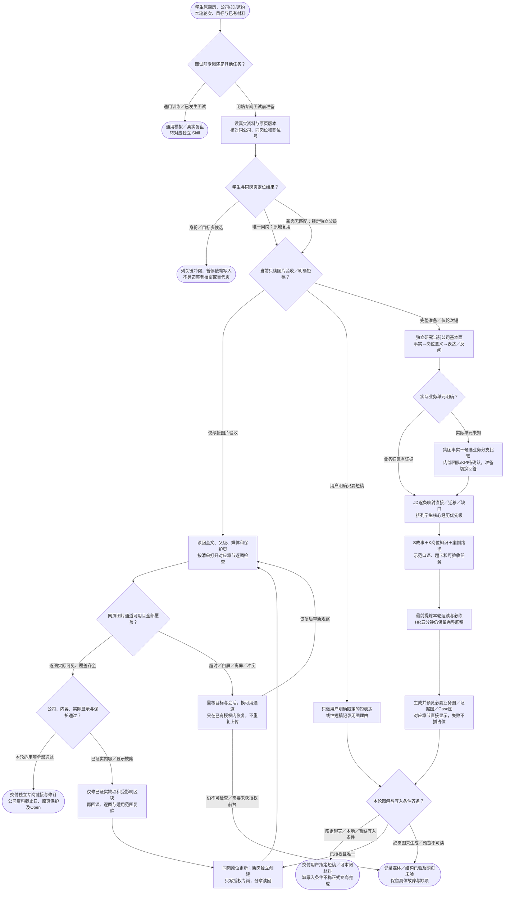

# 专岗面试准备：完整流程

输入：最新简历与已有材料；公司、岗位和 JD 或邀约；唯一专岗目标。

交付：独立专岗准备材料；公司与 JD 证据矩阵；示范稿、案例与训练任务。

[按原尺寸打开完整流程图](../assets/workflow.svg)

## 按什么顺序做

### 先确定专岗对象与保护页

唯一同岗页原地更新，新岗独立；通用双端和其他专岗保持只读，图片验收续接不重做研究。

### 公司基本面与 JD 证据

先做独立公司调研和岗位含义，再映射直接证据、迁移证据与缺口；业务单元未知分支准备。

### 完整组织故事、知识和表达

S/K与四种表达身份分开，提供示范稿、案例及训练；短轮次先给速读仍保留完整底稿。

### 精准写入对应专岗页

图解先预览，直接嵌入对应正文；只修改已确定专岗，不扩写通用材料。

### 逐图与全文独立验收

结构和网页显示均核对；通道异常按恢复合同处理，已证实缺陷才局部修复。

## 验收

- 公司调研过完成门
- 事实与知识分开
- 正文图解和原页回读
- 图解直接嵌入正文并逐图实际检查

准备一个专岗不授权改通用双端；真实面试转复盘 Skill。

## 对应规则

- [SKILL.md](../SKILL.md)
- [references/company-fundamentals-research.md](company-fundamentals-research.md)
- [references/content-and-expression.md](content-and-expression.md)
- [references/feishu-boundary-and-acceptance.md](feishu-boundary-and-acceptance.md)
- [references/feishu-image-browser-recovery.md](feishu-image-browser-recovery.md)

可编辑的流程源码

