# 专岗面试准备：完整执行流程

先核对具体输入；已有材料能查明的直接读取，关键缺失或冲突才补充确认。沿完整图查看后续处理、失败去向与交付。

交付：独立专岗准备材料；公司与 JD 证据矩阵；示范稿、案例与训练任务。

## 执行前确认哪些信息

| 输入 | 何时需要 | 从哪里取得 | 缺失或冲突怎么处理 |
| --- | --- | --- | --- |
| 学生正式身份、原简历与当前材料 | 必需：有可追溯本人证据 | 完整读原简历、当前通用/同岗页、用户参考和已有故事；原件只读 | 主版本或同名身份歧义先查；参考只借方法不复制个人事实 |
| 真实公司、岗位全名／职位编号、完整JD | 必需：定向对象；未知职称明确待确认 | 优先官方JD、职位页面和邀约截图核同公司同岗；岗位不全用已知公司+岗位待确认 | 没有明确专岗信息转通用准备；不把HR初筛当岗位名称 |
| 邀约、轮次、形式、时间与语言 | 条件必需：本轮练习安排时 | 读本轮邀约；提炼先练项、意向硬条件与面试前动态复核窗口 | 未知按待确认；五分钟轮次不自动缩完整底稿，只用户限定才短稿 |
| 地点、薪资意向、到岗与轮岗接受度 | 条件必需：相关问答涉及时 | 从本人已确认资料读取硬条件，用于自我介绍/意向回答 | 没有确认不替学生承诺；只追问影响当前表达的关键条件 |
| 完整专岗／明确短稿／只续图片验收 | 必需：本轮交付与保护边界 | 区分轮次短与用户明确缩范围；仅续图片就复用原页，不重研公司重写正文 | 范围实质不清只问一个问题，不因模板扩大到通用双端 |
| 同岗唯一原页、父级与正式交付授权 | 条件必需：飞书写入时 | 按公司/岗位/编号查用户指定及候选同岗页，记录XML修订、附件媒体、手工内容 | 多个候选只问必要项；同岗原位更新，新岗独立页，不擅自迁移父级 |

## 输入确认、补齐与返回

[按原尺寸查看输入确认图](../assets/input-confirmation.svg)

## 完整执行、判断与异常去向

[按原尺寸打开完整执行图](../assets/workflow.svg)

## 每一步具体怎么做

### 输入与范围

**1. 学生原简历、公司/JD/邀约；本轮轮次、目标与已有材料**

接收原简历、公司岗位/JD/邀约、轮次时间和已有关联材料；先确认面前专岗还是通用训练/面后复盘，不按轮次短自动缩小交付。

下一步：面试前专岗还是其他任务？。

依据：[SKILL.md](../SKILL.md) 中的“1. **读取真实资料。**”。

**2. 面试前专岗还是其他任务？**

明确公司岗位的面前准备进入专岗；没有专岗目标的通用模拟和真实已发生面试复盘各转独立Skill，保留已有通用页和同场记录。

下一步：“通用训练／已发生面试” → 通用模拟／真实复盘；转对应独立 Skill；“明确专岗面试前准备” → 学生正式身份、原简历与当前材料；必需：有可追溯本人证据。

依据：[SKILL.md](../SKILL.md) 中的“调用与维护”。

**3. 学生正式身份、原简历与当前材料；必需：有可追溯本人证据**

完整读原简历、当前通用/同岗页、用户参考和已有故事；原件只读；缺失处理：主版本或同名身份歧义先查；参考只借方法不复制个人事实

下一步：真实公司、岗位全名／职位编号、完整JD；必需：定向对象；未知职称明确待确认。

依据：[SKILL.md](../SKILL.md) 中的“1. **读取真实资料。**”。

**4. 真实公司、岗位全名／职位编号、完整JD；必需：定向对象；未知职称明确待确认**

优先官方JD、职位页面和邀约截图核同公司同岗；岗位不全用已知公司+岗位待确认；缺失处理：没有明确专岗信息转通用准备；不把HR初筛当岗位名称

下一步：邀约、轮次、形式、时间与语言；条件必需：本轮练习安排时。

依据：[SKILL.md](../SKILL.md) 中的“交付对象先确定”。

**5. 邀约、轮次、形式、时间与语言；条件必需：本轮练习安排时**

读本轮邀约；提炼先练项、意向硬条件与面试前动态复核窗口；缺失处理：未知按待确认；五分钟轮次不自动缩完整底稿，只用户限定才短稿

下一步：地点、薪资意向、到岗与轮岗接受度；条件必需：相关问答涉及时。

依据：[references/content-and-expression.md](content-and-expression.md) 中的“阅读顺序与每部分的用途”。

**6. 地点、薪资意向、到岗与轮岗接受度；条件必需：相关问答涉及时**

从本人已确认资料读取硬条件，用于自我介绍/意向回答；缺失处理：没有确认不替学生承诺；只追问影响当前表达的关键条件

下一步：完整专岗／明确短稿／只续图片验收；必需：本轮交付与保护边界。

依据：[references/content-and-expression.md](content-and-expression.md) 中的“示范稿怎样表达”。

**7. 完整专岗／明确短稿／只续图片验收；必需：本轮交付与保护边界**

区分轮次短与用户明确缩范围；仅续图片就复用原页，不重研公司重写正文；缺失处理：范围实质不清只问一个问题，不因模板扩大到通用双端

下一步：同岗唯一原页、父级与正式交付授权；条件必需：飞书写入时。

依据：[SKILL.md](../SKILL.md) 中的“4. **适配本轮，不丢准备底稿。**”。

**8. 同岗唯一原页、父级与正式交付授权；条件必需：飞书写入时**

按公司/岗位/编号查用户指定及候选同岗页，记录XML修订、附件媒体、手工内容；缺失处理：多个候选只问必要项；同岗原位更新，新岗独立页，不擅自迁移父级

下一步：先查已有原件与当前记录；保留版本、冲突和缺失。

依据：[references/feishu-boundary-and-acceptance.md](feishu-boundary-and-acceptance.md) 中的“先定位，再写入”。

**9. 先查已有原件与当前记录；保留版本、冲突和缺失**

当前原件优先，旧总结作线索；学生证据与公开公司事实隔离，通用页和其他专岗保持保护。

下一步：定向对象与本轮依赖资料明确？。

依据：[SKILL.md](../SKILL.md) 中的“1. **读取真实资料。**”。

**10. 定向对象与本轮依赖资料明确？**

关键学生/专岗身份和范围要明确；业务单元未知可分支准备，轮次/硬条件未知不编造，现有证据先研究。

下一步：“本轮依赖信息已明确；可选缺项按规则保留” → 读真实资料与原页版本；核对同公司、同岗位和职位号；“关键材料缺失／冲突会改变本轮动作” → 已有来源查不清时；只问影响执行的最小问题。

依据：[SKILL.md](../SKILL.md) 中的“1. **读取真实资料。**”。

**11. 已有来源查不清时；只问影响执行的最小问题**

先查原JD、邀约与既有页；仍有身份/岗位/范围歧义，仅询问决定下一步的一项。

下一步：“需要用户补充且尚未收到” → 等待关键资料／裁决；暂停依赖步骤；独立工作可继续。

依据：[SKILL.md](../SKILL.md) 中的“1. **读取真实资料。**”。

**12. 等待关键资料／裁决；暂停依赖步骤；独立工作可继续**

没有收到补充前，不假定问题已解决；保留已确认材料和具体缺口。先查原JD、邀约与既有页；仍有身份/岗位/范围歧义，仅询问决定下一步的一项。

下一步：“收到答复或来源恢复后重新核对” → 先查已有原件与当前记录；保留版本、冲突和缺失。

依据：[SKILL.md](../SKILL.md) 中的“1. **读取真实资料。**”。

### 执行与核验

**1. 读真实资料与原页版本；核对同公司、同岗位和职位号**

完整读原简历、邀约、已有同岗材料和当前页修订，按公司、岗位全名及职位编号匹配；参考资料仅用于结构与方法，不迁移其他学生事实。

下一步：学生与同岗页定位结果？。

依据：[references/feishu-boundary-and-acceptance.md](feishu-boundary-and-acceptance.md) 中的“先定位，再写入”。

**2. 学生与同岗页定位结果？**

先用户指定入口和既有同岗页，再查已确认范围候选：唯一同岗原位更新，确为新岗才按已确认父级独立创建，多个匹配暂停写入。

下一步：“身份／目标多候选” → 列关键冲突，暂停依赖写入；不另造整套档案或替代页；“唯一同岗：原地复用” → 当前只续图片验收／明确短稿？；“新岗无匹配：锁定独立父级” → 当前只续图片验收／明确短稿？。

依据：[SKILL.md](../SKILL.md) 中的“交付对象先确定”。

**3. 当前只续图片验收／明确短稿？**

只续图片验收直接复用原页清单；用户明确只要短话术才交短稿。HR五分钟只是本轮信息，完整专岗仍做底稿并前置速读。

下一步：“仅续接图片验收” → 读回全文、父级、媒体和保护页；按清单打开对应章节逐图检查；“用户明确只要短稿” → 只做用户明确限定的短表达；线性短稿记录无图理由；“完整准备／仅轮次短” → 独立研究当前公司基本面；事实→岗位意义→表达／反问。

依据：[SKILL.md](../SKILL.md) 中的“4. **适配本轮，不丢准备底稿。**”。

**4. 只做用户明确限定的短表达；线性短稿记录无图理由**

按用户明确限定的字数/时长/题组给自然短表达，事实只取已确认内容；简单线性短稿记无图理由，不把短稿报成完整专岗。

下一步：本轮图解与写入条件齐备？。

依据：[references/content-and-expression.md](content-and-expression.md) 中的“专岗图解合同”。

**5. 独立研究当前公司基本面；事实→岗位意义→表达／反问**

独立整理当前公司定位、业务版图、经营逻辑、战略信号、产品链、竞争与风险；每条事实转成岗位意义、真实迁移证据或反问，关键动态有来源日期。

下一步：按官方JD→财报→官网核当前事实；每条动态信息带日期和来源。

依据：[references/company-fundamentals-research.md](company-fundamentals-research.md) 中的“最低交付结构”。

**6. 实际业务单元明确？**

核实际业务归属是否被JD/邀约证据确认。有证据按该单元展开；无证据先做集团与候选业务分支，不替学生选一个看似最像的团队。

下一步：“业务归属有证据” → JD逐条映射直接／迁移／缺口；排列学生核心经历优先级；“实际单元未知” → 集团事实＋候选业务分支比较；内部团队/KPI待确认，准备切换回答。

依据：[references/company-fundamentals-research.md](company-fundamentals-research.md) 中的“业务单元不明时怎样做”。

**7. 集团事实＋候选业务分支比较；内部团队/KPI待确认，准备切换回答**

按JD业务池比较不同分支的用户、流程、指标和风险，内部团队/KPI/招聘动机保留待确认；准备开场确认问题与可切换回答。

下一步：JD逐条映射直接／迁移／缺口；排列学生核心经历优先级。

依据：[references/company-fundamentals-research.md](company-fundamentals-research.md) 中的“业务单元不明时怎样做”。

**8. JD逐条映射直接／迁移／缺口；排列学生核心经历优先级**

逐条把JD职责翻成日常任务与交付标准，映射学生原始证据为直接、可迁移或缺口，排序核心经历并指出待补事实，不用无证据精准匹配分。

下一步：逐职责：大白话→直接／迁移／缺口；经历排序、待补事实与证明方式。

依据：[SKILL.md](../SKILL.md) 中的“2. **先完成公司基本面”。

**9. S故事＋K岗位知识＋案例路径；示范口语、题卡和可验收任务**

先理解公司与岗位，再用S个人故事/K岗位知识组织题卡、自然示范、案例判断与任务；亲历/迁移/知识/假设身份逐题明确，学生正文不泄漏内部评分。

下一步：S故事与K知识分开复用；亲历／迁移／知识／假设逐题选。

依据：[SKILL.md](../SKILL.md) 中的“3. **完整组织专岗内容。**”。

**10. 最前提炼本轮速读与必练；HR五分钟仍保留完整底稿**

在同一专岗页最前给本轮速读、自我介绍、意向硬条件与必练顺序，并指向完整准备底稿；临近面试可先给聊天速读再完成原授权范围。

下一步：生成并预览必要业务图／证据图／Case图；对应章节直接显示，失败不插占位。

依据：[SKILL.md](../SKILL.md) 中的“4. **适配本轮，不丢准备底稿。**”。

**11. 生成并预览必要业务图／证据图／Case图；对应章节直接显示，失败不插占位**

按实际关系制作业务链与岗位位置、JD证据矩阵、Case判断路径，先独立预览再直接嵌对应正文；公开抽象不画成内部架构，失败不插占位。

下一步：逐图核业务链、证据矩阵、Case；正文就地图片，原始来源保留。

依据：[references/content-and-expression.md](content-and-expression.md) 中的“专岗图解合同”。

**12. 读回全文、父级、媒体和保护页；按清单打开对应章节逐图检查**

CLI读回全文、父级、修订、原简历/JD、非空媒体和章节顺序；列出每张正文图片所在章节与块ID，再按清单在真实页面逐图检查。

下一步：网页图片通道可用且全部覆盖？。

依据：[references/feishu-image-browser-recovery.md](feishu-image-browser-recovery.md) 中的“直接执行的顺序”。

**13. 网页图片通道可用且全部覆盖？**

检查网页通道能返回对应章节和实时画面且清单图均实际查看；媒体token/PDF正常不能代替在线图片检查，超时白屏先判断通道。

下一步：“逐图实际可见、覆盖齐全” → 公司、内容、成图与显示通过？；“超时／白屏／离屏／冲突” → 重核目标与会话，换可用通道；只在已有授权内恢复，不重复上传。

依据：[references/feishu-image-browser-recovery.md](feishu-image-browser-recovery.md) 中的“故障速查”。

**14. 重核目标与会话，换可用通道；只在已有授权内恢复，不重复上传**

重核目标网址、标签/会话和截图，连续同样失败停止原样重试并换可用后台通道；只在已有授权内恢复，未证实图片坏不重复上传。

下一步：“恢复后重新观察” → 读回全文、父级、媒体和保护页；按清单打开对应章节逐图检查；“仍不可检查／需要未获授权前台” → 记录媒体／结构已验及网页未验；保留具体故障与缺项。

依据：[references/feishu-image-browser-recovery.md](feishu-image-browser-recovery.md) 中的“故障速查”。

**15. 按官方JD→财报→官网核当前事实；每条动态信息带日期和来源**

独立记录定位、业务版图、经营逻辑、战略信号、产品链、竞争风险；面试已知时前24小时复核岗位和动态资料，不能旧口径冒充当前。

下一步：实际业务单元明确？。

依据：[references/company-fundamentals-research.md](company-fundamentals-research.md) 中的“来源层级与时效”。

**16. 逐职责：大白话→直接／迁移／缺口；经历排序、待补事实与证明方式**

逐项解释日常任务、交付和验收，将原始经历映射JD要求；不以相似关键词或无证据百分比替代适配判断。

下一步：S故事＋K岗位知识＋案例路径；示范口语、题卡和可验收任务。

依据：[references/content-and-expression.md](content-and-expression.md) 中的“阅读顺序与每部分的用途”。

**17. S故事与K知识分开复用；亲历／迁移／知识／假设逐题选**

个人故事核背景、动作、结果、职责、失败和取舍；K补通常做法/原因/例外/指标。三段重点示范说得出口，没做过不删知识也不冒认。

下一步：Case：已知→追问→原因分支；动作、指标／护栏与复核。

依据：[references/content-and-expression.md](content-and-expression.md) 中的“岗位知识也要复用，不因“没做过”而删除”。

**18. Case：已知→追问→原因分支；动作、指标／护栏与复核**

题卡有本生事实/S-K依据、自然表达、我的版本与检查提示；任务定义优先级、产物、验收；案例说明是假设迁移训练。

下一步：最前提炼本轮速读与必练；HR五分钟仍保留完整底稿。

依据：[references/content-and-expression.md](content-and-expression.md) 中的“学生训练题卡”。

### 交付与验收

**1. 通用模拟／真实复盘；转对应独立 Skill**

把真实简历、目标和面试证据交对应通用模拟或复盘Skill，分别确定独立交付位置，不在当前专岗页混入真实复盘或重做通用双端。

这是本路径的交付或转交结果。

依据：[SKILL.md](../SKILL.md) 中的“调用与维护”。

**2. 列关键冲突，暂停依赖写入；不另造整套档案或替代页**

列出同名学生、同岗候选或父级冲突，只问决定落点的一项必要问题；保留已有页和独立研究，不自动重建档案或迁移父级。

下一步：“专岗／页面歧义解除后重核” → 先查已有原件与当前记录；保留版本、冲突和缺失。

依据：[SKILL.md](../SKILL.md) 中的“交付对象先确定”。

**3. 本轮图解与写入条件齐备？**

本轮必需图已生成/预览、本人身份、唯一目标与写入授权齐备才正式写；明确短稿/本地遵守其范围，缺图或写入能力列具体未完成项。

下一步：“限定聊天／本地／暂缺写入条件” → 交付用户指定短稿／可审阅材料；缺写入条件不称正式专岗完成；“已授权且唯一” → 同岗原位更新；新岗独立创建；只写授权专岗，分章读回；“必需图未生成／预览不可读” → 记录媒体／结构已验及网页未验；保留具体故障与缺项。

依据：[SKILL.md](../SKILL.md) 中的“5. **精准交付。**”。

**4. 交付用户指定短稿／可审阅材料；缺写入条件不称正式专岗完成**

交用户指定短稿或已完成可审阅内容，列缺的关键事实、正文图或写入条件；没有完成正式页面与实际显示不能称完整专岗交付。

这是本路径的交付或转交结果。

依据：[SKILL.md](../SKILL.md) 中的“交付对象先确定”。

**5. 同岗原位更新；新岗独立创建；只写授权专岗，分章读回**

同公司同职位唯一页保持URL/父级原位更新，新岗位在已确认父级建独立页；分章写后局部读回，保留原简历来源、真实JD、有效内容与手工填写。

下一步：读回全文、父级、媒体和保护页；按清单打开对应章节逐图检查。

依据：[references/feishu-boundary-and-acceptance.md](feishu-boundary-and-acceptance.md) 中的“正式写入”。

**6. 记录媒体／结构已验及网页未验；保留具体故障与缺项**

分别记录媒体/结构已验证和网页未覆盖的具体图片、原始通道故障及最小条件；保留有效图和当前页，不拿旧首屏或PDF抵网页验收。

这是本路径的交付或转交结果。

依据：[references/feishu-image-browser-recovery.md](feishu-image-browser-recovery.md) 中的“本轮证据与完成门”。

**7. 公司、内容、成图与显示通过？**

核公司独立调研完成门、JD证据/故事/示范/任务可用、全部必需图图意/逻辑/层级/可读性/视觉作用、实际显示与原页保护；只续图片任务不借机重研重写。

下一步：“本轮适用项全部通过” → 交付独立专岗链接与修订；公司资料截止日、原页保护及Open；“已证实内容／显示缺陷” → 仅修已证实缺项和受影响区块；再回读、逐图与适用范围复验。

依据：[SKILL.md](../SKILL.md) 中的“6. **逐项验收。**”。

**8. 仅修已证实缺项和受影响区块；再回读、逐图与适用范围复验**

定位本轮已证实缺图、裁切、错位、字小或内容缺陷，按块修原页并回读；再验所有受影响图、章节及原页保护，不顺手扩改通用双端。

下一步：同岗原位更新；新岗独立创建；只写授权专岗，分章读回。

依据：[references/feishu-boundary-and-acceptance.md](feishu-boundary-and-acceptance.md) 中的“最终表面视觉验收”。

**9. 交付独立专岗链接与修订；公司资料截止日、原页保护及Open**

给独立专岗页和当前修订、公司资料截止日、关键待补事实、实际读回/逐图显示范围及原页保护结果；文档完成与学生已练会分开报告。

这是本路径的交付或转交结果。

依据：[SKILL.md](../SKILL.md) 中的“6. **逐项验收。**”。

**10. 逐图核业务链、证据矩阵、Case；正文就地图片，原始来源保留**

图片按真实关系生成，独立预览中文、分支、职责边界与字号后嵌入对应章节，不能首屏一张或链接替代全套图解。

下一步：本轮图解与写入条件齐备？。

依据：[references/content-and-expression.md](content-and-expression.md) 中的“专岗图解合同”。

## 验收

- 公司调研过完成门
- 事实与知识分开
- 正文图解和原页回读
- 图解直接嵌入正文并逐图实际检查

准备一个专岗不授权改通用双端；真实面试转复盘 Skill。

## 对应规则

- [SKILL.md](../SKILL.md)
- [references/company-fundamentals-research.md](company-fundamentals-research.md)
- [references/content-and-expression.md](content-and-expression.md)
- [references/feishu-boundary-and-acceptance.md](feishu-boundary-and-acceptance.md)
- [references/feishu-image-browser-recovery.md](feishu-image-browser-recovery.md)

```mermaid
flowchart TB
  in(["学生原简历、公司/JD/邀约<br/>本轮轮次、目标与已有材料"])
  route{"面试前专岗还是其他任务？"}
  companion(["通用模拟／真实复盘<br/>转对应独立 Skill"])
  locate["读真实资料与原页版本<br/>核对同公司、同岗位和职位号"]
  target{"学生与同岗页定位结果？"}
  stop(["列关键冲突，暂停依赖写入<br/>不另造整套档案或替代页"])
  scope{"当前只续图片验收／明确短稿？"}
  short["只做用户明确限定的短表达<br/>线性短稿记录无图理由"]
  company["独立研究当前公司基本面<br/>事实→岗位意义→表达／反问"]
  unit{"实际业务单元明确？"}
  branches["集团事实＋候选业务分支比较<br/>内部团队/KPI待确认，准备切换回答"]
  evidence["JD逐条映射直接／迁移／缺口<br/>排列学生核心经历优先级"]
  body["S故事＋K岗位知识＋案例路径<br/>示范口语、题卡和可验收任务"]
  round["最前提炼本轮速读与必练<br/>HR五分钟仍保留完整底稿"]
  images["生成并预览必要业务图／证据图／Case图<br/>对应章节直接显示，失败不插占位"]
  delivery{"本轮图解与写入条件齐备？"}
  draft(["交付用户指定短稿／可审阅材料<br/>缺写入条件不称正式专岗完成"])
  write["同岗原位更新；新岗独立创建<br/>只写授权专岗，分章读回"]
  inventory["读回全文、父级、媒体和保护页<br/>按清单打开对应章节逐图检查"]
  display{"网页图片通道可用且全部覆盖？"}
  recover["重核目标与会话，换可用通道<br/>只在已有授权内恢复，不重复上传"]
  partial(["记录媒体／结构已验及网页未验<br/>保留具体故障与缺项"])
  gate{"公司、内容、成图与显示通过？"}
  fix["仅修已证实缺项和受影响区块<br/>再回读、逐图与适用范围复验"]
  out(["交付独立专岗链接与修订<br/>公司资料截止日、原页保护及Open"])
  i_student["学生正式身份、原简历与当前材料<br/>必需：有可追溯本人证据"]
  i_job["真实公司、岗位全名／职位编号、完整JD<br/>必需：定向对象；未知职称明确待确认"]
  i_interview["邀约、轮次、形式、时间与语言<br/>条件必需：本轮练习安排时"]
  i_conditions["地点、薪资意向、到岗与轮岗接受度<br/>条件必需：相关问答涉及时"]
  i_scope["完整专岗／明确短稿／只续图片验收<br/>必需：本轮交付与保护边界"]
  i_destination["同岗唯一原页、父级与正式交付授权<br/>条件必需：飞书写入时"]
  i_existing["先查已有原件与当前记录<br/>保留版本、冲突和缺失"]
  i_ready{"定向对象与本轮依赖资料明确？"}
  i_clarify["已有来源查不清时<br/>只问影响执行的最小问题"]
  i_wait(["等待关键资料／裁决<br/>暂停依赖步骤；独立工作可继续"])
  official_sources["按官方JD→财报→官网核当前事实<br/>每条动态信息带日期和来源"]
  jd_matrix["逐职责：大白话→直接／迁移／缺口<br/>经历排序、待补事实与证明方式"]
  story_knowledge["S故事与K知识分开复用<br/>亲历／迁移／知识／假设逐题选"]
  cases_tasks["Case：已知→追问→原因分支<br/>动作、指标／护栏与复核"]
  image_qc["逐图核业务链、证据矩阵、Case<br/>正文就地图片，原始来源保留"]
  in --> route
  route -->|"通用训练／已发生面试"| companion
  locate --> target
  target -->|"身份／目标多候选"| stop
  target -->|"唯一同岗：原地复用"| scope
  target -->|"新岗无匹配：锁定独立父级"| scope
  scope -->|"仅续接图片验收"| inventory
  scope -->|"用户明确只要短稿"| short
  scope -->|"完整准备／仅轮次短"| company
  unit -->|"业务归属有证据"| evidence
  unit -->|"实际单元未知"| branches
  branches --> evidence
  round --> images
  short --> delivery
  delivery -->|"限定聊天／本地／暂缺写入条件"| draft
  delivery -->|"已授权且唯一"| write
  write --> inventory
  inventory --> display
  display -->|"逐图实际可见、覆盖齐全"| gate
  display -->|"超时／白屏／离屏／冲突"| recover
  recover -->|"恢复后重新观察"| inventory
  recover -->|"仍不可检查／需要未获授权前台"| partial
  gate -->|"本轮适用项全部通过"| out
  gate -->|"已证实内容／显示缺陷"| fix
  fix --> write
  delivery -->|"必需图未生成／预览不可读"| partial
  route -->|"明确专岗面试前准备"| i_student
  i_student --> i_job
  i_job --> i_interview
  i_interview --> i_conditions
  i_conditions --> i_scope
  i_scope --> i_destination
  i_destination --> i_existing
  i_existing --> i_ready
  i_ready -->|"本轮依赖信息已明确；可选缺项按规则保留"| locate
  i_ready -->|"关键材料缺失／冲突会改变本轮动作"| i_clarify
  i_clarify -->|"需要用户补充且尚未收到"| i_wait
  i_wait -->|"收到答复或来源恢复后重新核对"| i_existing
  company --> official_sources
  official_sources --> unit
  evidence --> jd_matrix
  jd_matrix --> body
  body --> story_knowledge
  story_knowledge --> cases_tasks
  cases_tasks --> round
  images --> image_qc
  image_qc --> delivery
  stop -->|"专岗／页面歧义解除后重核"| i_existing
```

可编辑的完整流程源码

