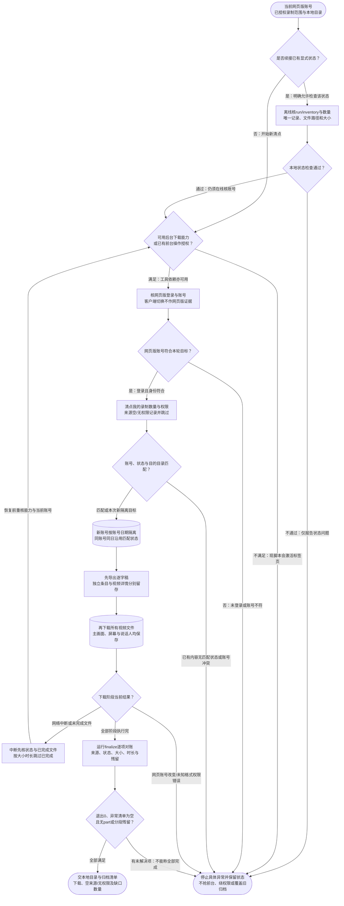

# 腾讯会议归档：完整流程

输入：网页版已登录账号；录制导出范围；本地归档目录。

交付：本地视频与逐字稿；归档清单 CSV；异常和未解决项。

[按原尺寸打开完整流程图](../assets/workflow.svg)

## 按什么顺序做

### 检查运行能力与授权

网页版当前登录为准；后台能力未验证且无前台授权时停止，不静默安装。

### 续接状态与账号核对

显式状态可离线检查，但通过不代表网页版登录、下载权限或完成。

### 清点并隔离归档

inventory核账号和录制数；新账号隔离，同账号同日复用，冲突不覆盖。

### 依次下载不同来源

先transcripts后videos，多路视频及独立/详情逐字稿分别保留。

### 按状态恢复与逐项验收

账号变化停止；中断可续跑，大小与时长核对后不重复下载。

### finalize对账并交付

来源、状态、大小、MP4时长和残留分段均核；异常空且退出0才称全部完成。

## 验收

- 后台能力或前台授权与网页版账号当前核对
- 目录隔离和状态匹配，不覆盖旧归档
- 无权限和空来源记录跳过不绕过
- 多路视频及两种逐字稿各自保留
- 文件大小、可读MP4时长与残留文件逐项对账
- finalize退出0且异常清单空才称全部完成
- 离线续接通过不等于线上导出完成

不绕过无权限录制；不自动处理内容或上传网盘。

## 对应规则

- [SKILL.md](../SKILL.md)
- [references/team-setup.md](team-setup.md)

可编辑的流程源码

