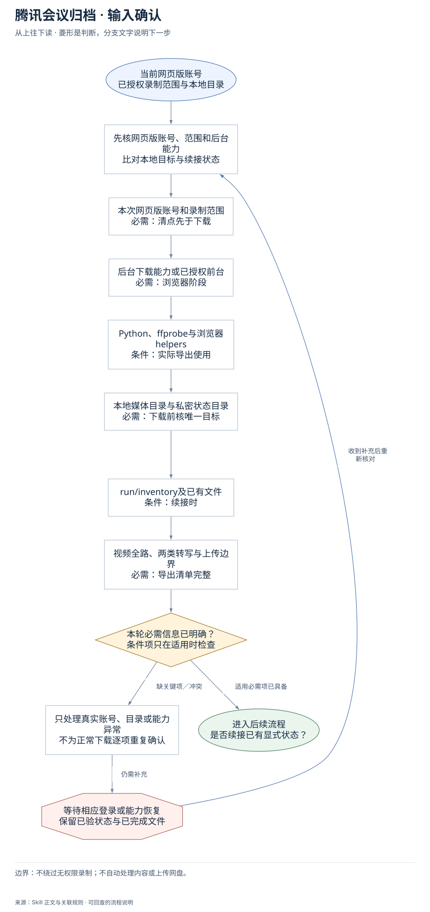
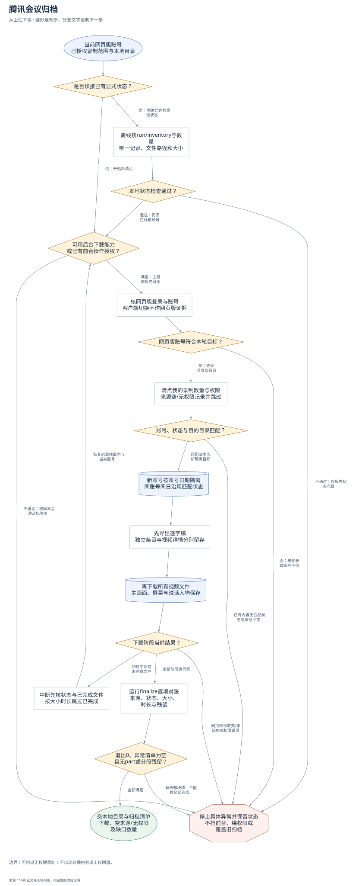
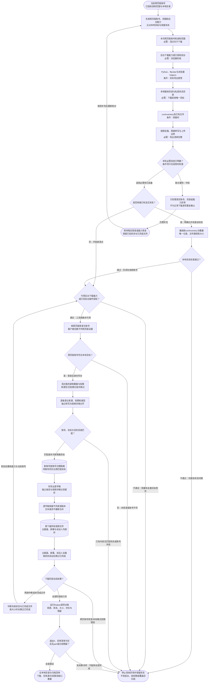

# 腾讯会议归档：完整执行流程

先核对具体输入；已有材料能查明的直接读取，关键缺失或冲突才补充确认。沿完整图查看后续处理、失败去向与交付。

交付：本地视频与逐字稿；归档清单 CSV；异常和未解决项。

## 执行前确认哪些信息

| 输入 | 何时需要 | 从哪里取得 | 缺失或冲突怎么处理 |
| --- | --- | --- | --- |
| 本次网页版账号和录制范围 | 必需：清点先于下载 | 读网页版实际账号标识和我的录制数量，与任务/旧归档对应 | 客户端切换不作网页版证据；不符停清点，不混入旧账号目录 |
| 后台下载能力或已授权前台 | 必需：浏览器阶段 | 读取browser-use并验证不激活窗口的实际路线；旧脚本switch_tab会激活 | 无后台能力且未授权前台只停浏览器步骤，不擅自运行旧脚本或开收费云会话 |
| Python、ffprobe与浏览器helpers | 条件：实际导出使用 | 核当前已安装能力和权限，离线检查仅读取指定状态 | 缺依赖明确报告，不静默安装或以离线检查代替登录核对 |
| 本地媒体目录与私密状态目录 | 必需：下载前核唯一目标 | 核inventory返回state_dir/dest账号；新账号按账号日期隔离，同账号同日匹配状态续接 | 目的目录非空却无匹配状态时不覆盖；不写正在上传的旧归档 |
| run/inventory及已有文件 | 条件：续接时 | --check-state仅指定当前授权目录，核数量、唯一记录、路径、大小 | 检查失败保留异常；通过也不证明登录/下载权限/视频可播 |
| 视频全路、两类转写与上传边界 | 必需：导出清单完整 | 独立转写和视频详情逐字稿分别导出，主画面/共享屏幕/说话人多路均保留 | 来源空或无权限记录跳过，不绕权限；不默认网盘上传或公开 |

## 输入确认、补齐与返回

[按原尺寸查看输入确认图](../assets/input-confirmation.svg)

## 完整执行、判断与异常去向

[按原尺寸打开完整执行图](../assets/workflow.svg)

## 每一步具体怎么做

### 输入与范围

**1. 当前网页版账号；已授权录制范围与本地目录**

当前网页版账号；已授权录制范围与本地目录。后续按实际结果分流：完成后：先核网页版账号、范围和后台能力，比对本地目标与续接状态。

下一步：先核网页版账号、范围和后台能力；比对本地目标与续接状态。

依据：[SKILL.md](../SKILL.md) 中的“开始前”。

**2. 先核网页版账号、范围和后台能力；比对本地目标与续接状态**

优先复用本轮材料、会话已有决定和本成员已授权来源。已有明确值直接沿用；先查可查来源，不重复索取。

下一步：本次网页版账号和录制范围；必需：清点先于下载。

依据：[SKILL.md](../SKILL.md) 中的“开始前”。

**3. 本次网页版账号和录制范围；必需：清点先于下载**

取得方式：读网页版实际账号标识和我的录制数量，与任务/旧归档对应。缺失处理：客户端切换不作网页版证据；不符停清点，不混入旧账号目录。

下一步：后台下载能力或已授权前台；必需：浏览器阶段。

依据：[SKILL.md](../SKILL.md) 中的“开始前”。

**4. 后台下载能力或已授权前台；必需：浏览器阶段**

取得方式：读取browser-use并验证不激活窗口的实际路线；旧脚本switch_tab会激活。缺失处理：无后台能力且未授权前台只停浏览器步骤，不擅自运行旧脚本或开收费云会话。

下一步：Python、ffprobe与浏览器helpers；条件：实际导出使用。

依据：[SKILL.md](../SKILL.md) 中的“开始前”。

**5. Python、ffprobe与浏览器helpers；条件：实际导出使用**

取得方式：核当前已安装能力和权限，离线检查仅读取指定状态。缺失处理：缺依赖明确报告，不静默安装或以离线检查代替登录核对。

下一步：本地媒体目录与私密状态目录；必需：下载前核唯一目标。

依据：[SKILL.md](../SKILL.md) 中的“开始前”。

**6. 本地媒体目录与私密状态目录；必需：下载前核唯一目标**

取得方式：核inventory返回state_dir/dest账号；新账号按账号日期隔离，同账号同日匹配状态续接。缺失处理：目的目录非空却无匹配状态时不覆盖；不写正在上传的旧归档。

下一步：run/inventory及已有文件；条件：续接时。

依据：[SKILL.md](../SKILL.md) 中的“执行”。

**7. run/inventory及已有文件；条件：续接时**

取得方式：--check-state仅指定当前授权目录，核数量、唯一记录、路径、大小。缺失处理：检查失败保留异常；通过也不证明登录/下载权限/视频可播。

下一步：视频全路、两类转写与上传边界；必需：导出清单完整。

依据：[SKILL.md](../SKILL.md) 中的“安装验收与离线续接检查”。

**8. 视频全路、两类转写与上传边界；必需：导出清单完整**

取得方式：独立转写和视频详情逐字稿分别导出，主画面/共享屏幕/说话人多路均保留。缺失处理：来源空或无权限记录跳过，不绕权限；不默认网盘上传或公开。

下一步：本轮必需信息已明确？；条件项只在适用时检查。

依据：[SKILL.md](../SKILL.md) 中的“关键边界”。

**9. 本轮必需信息已明确？；条件项只在适用时检查**

按每个字段的适用条件检查；可选偏好缺失采用本 Skill 的合理默认或保留未知，不阻塞无关步骤。

下一步：“缺关键项／冲突” → 只处理真实账号、目录或能力异常；不为正常下载逐项重复确认；“适用必需项已具备” → 是否续接已有显式状态？。

依据：[SKILL.md](../SKILL.md) 中的“开始前”。

**10. 只处理真实账号、目录或能力异常；不为正常下载逐项重复确认**

先核对现有材料能否补齐，只问会改变当前动作或目标的关键缺口。来源冲突时保留原值和差异，不擅自合并。

下一步：“仍需补充” → 等待相应登录或能力恢复；保留已验状态与已完成文件。

依据：[SKILL.md](../SKILL.md) 中的“开始前”。

**11. 等待相应登录或能力恢复；保留已验状态与已完成文件**

暂停依赖缺失信息的动作，保留已完成读取、来源和断点；能够独立完成的部分照常交付。收到补充后重查字段再进入执行。

下一步：“收到补充后重新核对” → 先核网页版账号、范围和后台能力；比对本地目标与续接状态。

依据：[SKILL.md](../SKILL.md) 中的“开始前”。

### 执行与核验

**1. 是否续接已有显式状态？**

是否续接已有显式状态？。后续按实际结果分流：是：明确允许检查该状态：离线核run/inventory与数量，唯一记录、文件路径和大小；否：开始新清点：可用后台下载能力，或已有前台操作授权？。

下一步：“是：明确允许检查该状态” → 离线核run/inventory与数量；唯一记录、文件路径和大小；“否：开始新清点” → 可用后台下载能力；或已有前台操作授权？。

依据：[SKILL.md](../SKILL.md) 中的“安装验收与离线续接检查”。

**2. 离线核run/inventory与数量；唯一记录、文件路径和大小**

离线核run/inventory与数量；唯一记录、文件路径和大小。后续按实际结果分流：完成后：本地状态检查通过？。

下一步：本地状态检查通过？。

依据：[SKILL.md](../SKILL.md) 中的“安装验收与离线续接检查”。

**3. 本地状态检查通过？**

本地状态检查通过？。后续按实际结果分流：通过：仍须在线核账号：可用后台下载能力，或已有前台操作授权？；不通过：仅报告状态问题：停止具体异常并保留状态，不抢前台、绕权限或覆盖旧归档。

下一步：“通过：仍须在线核账号” → 可用后台下载能力；或已有前台操作授权？；“不通过：仅报告状态问题” → 停止具体异常并保留状态；不抢前台、绕权限或覆盖旧归档。

依据：[SKILL.md](../SKILL.md) 中的“安装验收与离线续接检查”。

**4. 可用后台下载能力；或已有前台操作授权？**

可用后台下载能力；或已有前台操作授权？。后续按实际结果分流：满足：工具依赖亦可用：核网页版登录与账号，客户端切换不作网页版证据；不满足：现脚本会激活标签页：停止具体异常并保留状态，不抢前台、绕权限或覆盖旧归档。

下一步：“满足：工具依赖亦可用” → 核网页版登录与账号；客户端切换不作网页版证据；“不满足：现脚本会激活标签页” → 停止具体异常并保留状态；不抢前台、绕权限或覆盖旧归档。

依据：[SKILL.md](../SKILL.md) 中的“开始前”。

**5. 核网页版登录与账号；客户端切换不作网页版证据**

核网页版登录与账号；客户端切换不作网页版证据。后续按实际结果分流：完成后：网页版账号符合本轮目标？。

下一步：网页版账号符合本轮目标？。

依据：[SKILL.md](../SKILL.md) 中的“开始前”。

**6. 网页版账号符合本轮目标？**

网页版账号符合本轮目标？。后续按实际结果分流：是：登录且身份符合：清点我的录制数量与权限，来源空/无权限记录并跳过；否：未登录或账号不符：停止具体异常并保留状态，不抢前台、绕权限或覆盖旧归档。

下一步：“是：登录且身份符合” → 清点我的录制数量与权限；来源空/无权限记录并跳过；“否：未登录或账号不符” → 停止具体异常并保留状态；不抢前台、绕权限或覆盖旧归档。

依据：[SKILL.md](../SKILL.md) 中的“开始前”。

**7. 清点我的录制数量与权限；来源空/无权限记录并跳过**

清点我的录制数量与权限；来源空/无权限记录并跳过。后续按实际结果分流：完成后：逐条登记来源、权限和类型，独立转写与视频详情分开。

下一步：逐条登记来源、权限和类型；独立转写与视频详情分开。

依据：[SKILL.md](../SKILL.md) 中的“开始前”。

**8. 账号、状态与目的目录匹配？**

账号、状态与目的目录匹配？。后续按实际结果分流：匹配或本次新隔离目标：新账号按账号日期隔离，同账号同日沿用匹配状态；已有内容无匹配状态或账号冲突：停止具体异常并保留状态，不抢前台、绕权限或覆盖旧归档。

下一步：“匹配或本次新隔离目标” → 新账号按账号日期隔离；同账号同日沿用匹配状态；“已有内容无匹配状态或账号冲突” → 停止具体异常并保留状态；不抢前台、绕权限或覆盖旧归档。

依据：[SKILL.md](../SKILL.md) 中的“关键边界”。

**9. 新账号按账号日期隔离；同账号同日沿用匹配状态**

新账号按账号日期隔离；同账号同日沿用匹配状态。后续按实际结果分流：完成后：先导出逐字稿，独立条目与视频详情分别留存。

下一步：先导出逐字稿；独立条目与视频详情分别留存。

依据：[SKILL.md](../SKILL.md) 中的“关键边界”。

**10. 先导出逐字稿；独立条目与视频详情分别留存**

先导出逐字稿；独立条目与视频详情分别留存。后续按实际结果分流：完成后：逐字稿保留不同来源版本，文本差异不静默合并。

下一步：逐字稿保留不同来源版本；文本差异不静默合并。

依据：[SKILL.md](../SKILL.md) 中的“关键边界”。

**11. 再下载所有视频文件；主画面、屏幕与说话人均保存**

再下载所有视频文件；主画面、屏幕与说话人均保存。后续按实际结果分流：完成后：主画面、屏幕、说话人全路，按状态验证后跳过已完成。

下一步：主画面、屏幕、说话人全路；按状态验证后跳过已完成。

依据：[SKILL.md](../SKILL.md) 中的“关键边界”。

**12. 下载阶段当前结果？**

下载阶段当前结果？。后续按实际结果分流：全部阶段执行完：运行finalize逐项对账，来源、状态、大小、时长与残留；网络中断或未完成文件：中断先核状态与已完成文件，按大小时长跳过已完成；网页账号改变/未知格式权限错误：停止具体异常并保留状态，不抢前台、绕权限或覆盖旧归档。

下一步：“全部阶段执行完” → 运行finalize逐项对账；来源、状态、大小、时长与残留；“网络中断或未完成文件” → 中断先核状态与已完成文件；按大小时长跳过已完成；“网页账号改变/未知格式权限错误” → 停止具体异常并保留状态；不抢前台、绕权限或覆盖旧归档。

依据：[SKILL.md](../SKILL.md) 中的“网页账号中途改变时脚本会停止”。

**13. 中断先核状态与已完成文件；按大小时长跳过已完成**

中断先核状态与已完成文件；按大小时长跳过已完成。后续按实际结果分流：恢复前重核能力与当前账号：可用后台下载能力，或已有前台操作授权？。

下一步：“恢复前重核能力与当前账号” → 可用后台下载能力；或已有前台操作授权？。

依据：[SKILL.md](../SKILL.md) 中的“中断后原命令可续跑”。

**14. 运行finalize逐项对账；来源、状态、大小、时长与残留**

运行finalize逐项对应来源记录、下载状态、本地路径、文件大小、ffprobe可读时长，检查无.part或分段残留；任何异常保留清单并只续未完成项。

下一步：退出0、异常清单为空；且无part或分段残留？。

依据：[SKILL.md](../SKILL.md) 中的“`finalize` 必须逐项”。

**15. 逐条登记来源、权限和类型；独立转写与视频详情分开**

我的录制的可见数量、来源唯一记录和权限逐项记录；空来源/无权限明确计数，不将未看条目当已下载，不进入历史会议或改录制。

下一步：账号、状态与目的目录匹配？。

依据：[SKILL.md](../SKILL.md) 中的“关键边界”。

**16. 逐字稿保留不同来源版本；文本差异不静默合并**

独立转写条目和视频详情的逐字稿可能文字不同，分别导出并在清单标明来源；导出只落本地，不进行内容整理或写入业务知识库。

下一步：再下载所有视频文件；主画面、屏幕与说话人均保存。

依据：[SKILL.md](../SKILL.md) 中的“关键边界”。

**17. 主画面、屏幕、说话人全路；按状态验证后跳过已完成**

检查一个视频对应的所有文件，逐路保存；已有完成文件核大小和可读时长再跳过。网页账号中途改变立即停止并保留已完成状态。

下一步：下载阶段当前结果？。

依据：[SKILL.md](../SKILL.md) 中的“关键边界”。

### 交付与验收

**1. 退出0、异常清单为空；且无part或分段残留？**

退出0、异常清单为空；且无part或分段残留？。后续按实际结果分流：全部满足：交本地目录与归档清单，下载、空来源/无权限及缺口数量；有未解决项：不能称全部完成：停止具体异常并保留状态，不抢前台、绕权限或覆盖旧归档。

下一步：“全部满足” → 交本地目录与归档清单；下载、空来源/无权限及缺口数量；“有未解决项：不能称全部完成” → 停止具体异常并保留状态；不抢前台、绕权限或覆盖旧归档。

依据：[SKILL.md](../SKILL.md) 中的“`finalize` 必须逐项”。

**2. 交本地目录与归档清单；下载、空来源/无权限及缺口数量**

只有退出0且异常清单空可称全部导出完成；交本地目录和归档清单.csv，分别报下载、来源空/无权限、未解决数量。下载不等于上传或公开。

这是本路径的交付或转交结果。

依据：[SKILL.md](../SKILL.md) 中的“交付桌面目录和 `归档清单.csv`”。

**3. 停止具体异常并保留状态；不抢前台、绕权限或覆盖旧归档**

停止具体异常并保留状态；不抢前台、绕权限或覆盖旧归档。该分支的实际状态与未完成项保留在交付回执中。

此处保留待办与证据，补齐后接续原任务。

依据：[SKILL.md](../SKILL.md) 中的“关键边界”。

## 验收

- 后台能力或前台授权与网页版账号当前核对
- 目录隔离和状态匹配，不覆盖旧归档
- 无权限和空来源记录跳过不绕过
- 多路视频及两种逐字稿各自保留
- 文件大小、可读MP4时长与残留文件逐项对账
- finalize退出0且异常清单空才称全部完成
- 离线续接通过不等于线上导出完成

不绕过无权限录制；不自动处理内容或上传网盘。

## 对应规则

- [SKILL.md](../SKILL.md)
- [references/team-setup.md](team-setup.md)

可编辑的完整流程源码

