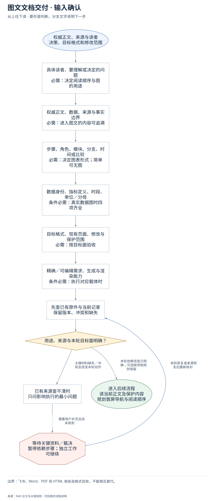

# 图文文档交付：完整执行流程

先核对具体输入；已有材料能查明的直接读取，关键缺失或冲突才补充确认。沿完整图查看后续处理、失败去向与交付。

交付：图文一致的正式文档；对应章节的图表；visual_contract 与验收记录。

## 执行前确认哪些信息

| 输入 | 何时需要 | 从哪里取得 | 缺失或冲突怎么处理 |
| --- | --- | --- | --- |
| 具体读者、要理解或决定的问题 | 必需：决定阅读顺序与图的用途 | 从当前请求明确读者、决策、所需理解和实际阅读宽度 | 用途不清先问最关键一项，不先套图形或装饰模板 |
| 权威正文、数据、来源与事实边界 | 必需：进入图文的内容可追溯 | 完整读取正文、原始图表和受保护内容，区分本人事实、外部事实、推断、教学与待确认 | 缺事实不为凑图编架构/数字；未知在对应正文和图注说明 |
| 步骤、角色、模块、分支、时间或比较 | 必需：决定图表形式；简单可无图 | 按实际关系标复杂度：依赖步骤、角色协作、回路、状态、时间、同口径比较 | 简单线性且图不增理解则记具体无图理由，不机械要求图片数 |
| 数据身份、指标定义、时段、单位／分母 | 条件必需：真实数据图时四项齐全 | 逐系列核来源与同口径，明确时间、指标计算和单位 | 任一缺失不用数据图；改来源陈述、证据矩阵或明确概念图 |
| 目标格式、现有页面、修改与保护范围 | 必需：按目标面验收 | 确认飞书/Word/PDF/Markdown/HTML及新建、实质修订或局部，记录媒体和阅读路径基线 | 不拿另一格式成功代替目标面；局部不因旧无关缺陷重做整篇 |
| 精确／可编辑需求、生成与渲染能力 | 条件必需：执行对应载体时 | 检查当前图片/原生/程序工具、正文嵌入、结构读回和最终渲染能力 | 缺必需能力只交已完成部分，明确目标面未验收；不声称调用未安装Skill |

## 输入确认、补齐与返回

[按原尺寸查看输入确认图](../assets/input-confirmation.svg)

## 完整执行、判断与异常去向

[按原尺寸打开完整执行图](../assets/workflow.svg)

## 每一步具体怎么做

### 输入与范围

**1. 权威正文、来源与读者；决策、目标格式和修改范围**

接收权威正文、原始图表/数据、目标读者、要理解/决定的问题和输出格式；明确新建、实质改稿或局部，以及原文/媒体保护范围。

下一步：具体读者、要理解或决定的问题；必需：决定阅读顺序与图的用途。

依据：[SKILL.md](../SKILL.md) 中的“Delivery contract”。

**2. 具体读者、要理解或决定的问题；必需：决定阅读顺序与图的用途**

从当前请求明确读者、决策、所需理解和实际阅读宽度；缺失处理：用途不清先问最关键一项，不先套图形或装饰模板

下一步：权威正文、数据、来源与事实边界；必需：进入图文的内容可追溯。

依据：[SKILL.md](../SKILL.md) 中的“Delivery contract”。

**3. 权威正文、数据、来源与事实边界；必需：进入图文的内容可追溯**

完整读取正文、原始图表和受保护内容，区分本人事实、外部事实、推断、教学与待确认；缺失处理：缺事实不为凑图编架构/数字；未知在对应正文和图注说明

下一步：步骤、角色、模块、分支、时间或比较；必需：决定图表形式；简单可无图。

依据：[SKILL.md](../SKILL.md) 中的“Delivery contract”。

**4. 步骤、角色、模块、分支、时间或比较；必需：决定图表形式；简单可无图**

按实际关系标复杂度：依赖步骤、角色协作、回路、状态、时间、同口径比较；缺失处理：简单线性且图不增理解则记具体无图理由，不机械要求图片数

下一步：数据身份、指标定义、时段、单位／分母；条件必需：真实数据图时四项齐全。

依据：[references/visual-decision-matrix.md](visual-decision-matrix.md) 中的“Complexity test”。

**5. 数据身份、指标定义、时段、单位／分母；条件必需：真实数据图时四项齐全**

逐系列核来源与同口径，明确时间、指标计算和单位；缺失处理：任一缺失不用数据图；改来源陈述、证据矩阵或明确概念图

下一步：目标格式、现有页面、修改与保护范围；必需：按目标面验收。

依据：[references/visual-decision-matrix.md](visual-decision-matrix.md) 中的“Data-chart gate”。

**6. 目标格式、现有页面、修改与保护范围；必需：按目标面验收**

确认飞书/Word/PDF/Markdown/HTML及新建、实质修订或局部，记录媒体和阅读路径基线；缺失处理：不拿另一格式成功代替目标面；局部不因旧无关缺陷重做整篇

下一步：精确／可编辑需求、生成与渲染能力；条件必需：执行对应载体时。

依据：[SKILL.md](../SKILL.md) 中的“Target-format visual contract”。

**7. 精确／可编辑需求、生成与渲染能力；条件必需：执行对应载体时**

检查当前图片/原生/程序工具、正文嵌入、结构读回和最终渲染能力；缺失处理：缺必需能力只交已完成部分，明确目标面未验收；不声称调用未安装Skill

下一步：先查已有原件与当前记录；保留版本、冲突和缺失。

依据：[SKILL.md](../SKILL.md) 中的“First use and available tools”。

**8. 先查已有原件与当前记录；保留版本、冲突和缺失**

冲突保留源文与状态，保护已有有效媒体；布局和色彩不能把推断包装成事实。

下一步：用途、来源与本轮目标面明确？。

依据：[SKILL.md](../SKILL.md) 中的“Delivery contract”。

**9. 用途、来源与本轮目标面明确？**

先锁阅读任务、资料边界和格式；数据四项缺失有合法替代，不因缺可编辑画板阻塞本来只需图片的交付。

下一步：“本轮依赖信息已明确；可选缺项按规则保留” → 读当前正文及保护内容；规划首屏导航与阅读顺序；“关键材料缺失／冲突会改变本轮动作” → 已有来源查不清时；只问影响执行的最小问题。

依据：[SKILL.md](../SKILL.md) 中的“Delivery contract”。

**10. 已有来源查不清时；只问影响执行的最小问题**

先读现有正文和要求，仍缺会改变图形逻辑/交付面的信息才问。

下一步：“需要用户补充且尚未收到” → 等待关键资料／裁决；暂停依赖步骤；独立工作可继续。

依据：[SKILL.md](../SKILL.md) 中的“Delivery contract”。

**11. 等待关键资料／裁决；暂停依赖步骤；独立工作可继续**

没有收到补充前，不假定问题已解决；保留已确认材料和具体缺口。先读现有正文和要求，仍缺会改变图形逻辑/交付面的信息才问。

下一步：“收到答复或来源恢复后重新核对” → 先查已有原件与当前记录；保留版本、冲突和缺失。

依据：[SKILL.md](../SKILL.md) 中的“Delivery contract”。

### 执行与核验

**1. 读当前正文及保护内容；规划首屏导航与阅读顺序**

完整读当前正文与有效媒体，按读者先理解什么、再判断什么、最后行动什么安排阅读路径；较长材料首20%有简短目录、总览或路线图。

下一步：复杂关系或比较需要图表？。

依据：[references/layout-and-information-design.md](layout-and-information-design.md) 中的“Reading order”。

**2. 复杂关系或比较需要图表？**

检查是否有三个以上依赖步骤/模块/角色、分支/回路/失败、时间阶段、需要一起比较的取舍或可信量化变化；有就按关系配图，否则可文字。

下一步：“否：图不增加理解” → 简单线性内容保留文字；记录具体no_visual_reason；“是：关系需要可视化” → 按关系选流程/架构/时间线；或比较表，锁文案与关系。

依据：[references/visual-decision-matrix.md](visual-decision-matrix.md) 中的“Complexity test”。

**3. 简单线性内容保留文字；记录具体no_visual_reason**

保留已经清楚的简单结论或线性说明，并在视觉合同写具体无图理由；不能仅因篇幅短就豁免仍存在的复杂关系。

下一步：图表紧邻对应讲解；保留来源、图注与事实边界。

依据：[SKILL.md](../SKILL.md) 中的“Target-format visual contract”。

**4. 按关系选流程/架构/时间线；或比较表，锁文案与关系**

步骤分支用流程，输入模块用架构，角色交接用泳道，日期阶段用时间线，选项证据用短矩阵；先锁文案、分支与终态，再选实际工具。

下一步：锁准文案、节点关系与阅读路径；图内短标签、细节回正文。

依据：[references/visual-decision-matrix.md](visual-decision-matrix.md) 中的“Decide from the relationship, not from a desired image count”。

**5. 是否为真实数据图？**

判断图是否要表达真实数量、趋势、分布或构成；是则检查量化四项，非量化教学/关系图按事实边界设计，不伪装成测得数据。

下一步：“是：数据图” → 来源、定义、时段；单位或分母齐全？；“否：关系或教学图” → 成图需要何种精度与能力？。

依据：[references/visual-decision-matrix.md](visual-decision-matrix.md) 中的“Data-chart gate”。

**6. 来源、定义、时段；单位或分母齐全？**

逐数据系列核来源/数据集身份、指标定义、时间范围及单位或分母；四项齐全才画真实数据图，任一缺失选其他来源表达形式。

下一步：“四项齐全” → 真实统计图或明确可编辑要求；使用相应工具；“有缺失：不画数据图” → 改来源陈述、证据表；或明确标注的概念图。

依据：[references/visual-decision-matrix.md](visual-decision-matrix.md) 中的“Data-chart gate”。

**7. 改来源陈述、证据表；或明确标注的概念图**

保留能证实的来源陈述，用证据矩阵或明确概念图表达关系；缺分母/时段/定义的数字不做定量走势，不为成图补造数据。

下一步：成图需要何种精度与能力？。

依据：[references/visual-decision-matrix.md](visual-decision-matrix.md) 中的“Data-chart gate”。

**8. 成图需要何种精度与能力？**

真实统计图需要精确计算，或用户明确要求可编辑原生图时使用相应工具；其余讲解图锁定文案后直接用 GPT Image 2 生成。

下一步：“真实统计图/明确原生编辑要求” → 真实统计图或明确可编辑要求；使用相应工具；“总览或教学信息图” → 总览与教学图锁准结构；直接用 GPT Image 2 生成。

依据：[SKILL.md](../SKILL.md) 中的“Non-negotiable boundaries”。

**9. 真实统计图或明确可编辑要求；使用相应工具**

以可靠数据/精确关系生成原生或程序化图表，保留源数据、单位、定义、引用和可编辑来源；计算结果与图中系列逐项一致。

下一步：逐字核中文、数字和连线；分支、回路与终态不漏。

依据：[SKILL.md](../SKILL.md) 中的“Non-negotiable boundaries”。

**10. 总览与教学图锁准结构；直接用 GPT Image 2 生成**

先定准确文案、关键节点和阅读路径，直接使用 GPT Image 2 生成教学图；不先用画板或脚本做低质量框图。工具不可用时说明，版本未显示时不虚报。

下一步：逐字核中文、数字和连线；分支、回路与终态不漏。

依据：[SKILL.md](../SKILL.md) 中的“Non-negotiable boundaries”。

**11. 逐字核中文、数字和连线；分支、回路与终态不漏**

实际看最终图的每个中文、数字、公式、箭头起止、判断分支、回路和终态，确认与锁定逻辑及事实状态一致，再准备嵌入。

下一步：图意、逻辑与视觉达标？。

依据：[references/render-and-acceptance.md](render-and-acceptance.md) 中的“For AI-generated figures”。

**12. 图意、逻辑与视觉达标？**

按 figure-quality.md 在实际阅读宽度检查图意、逻辑、层级、可读性和视觉作用；记录逐图证据与具体观察，标题未兑现、仅换色套框或未验证时不通过。

下一步：“不通过” → 定向修图或改载体；不为美观改变逻辑；“通过” → 图表紧邻对应讲解；保留来源、图注与事实边界。

依据：[SKILL.md](../SKILL.md) 中的“Non-negotiable boundaries”。

**13. 定向修图或改载体；不为美观改变逻辑**

按已发现的具体文字/连接/字号缺陷定向修图，必要时换更可读载体；重查最终图，不能为视觉整齐删分支或改变事实。

下一步：逐字核中文、数字和连线；分支、回路与终态不漏。

依据：[SKILL.md](../SKILL.md) 中的“Non-negotiable boundaries”。

**14. 图表紧邻对应讲解；保留来源、图注与事实边界**

图放在解释该关系的正文旁，保留有用图注、来源、抽象/待确认边界；不集中成图片墙，源代码和附件不能替代目标正文需要看到的图。

下一步：按格式嵌入并回读媒体位置；图注、来源和事实边界不丢。

依据：[SKILL.md](../SKILL.md) 中的“Target-format visual contract”。

**15. 本轮验收范围？**

新建或实质修订按整篇最终目标面逐页/全表面检查；局部只检查改动与受影响阅读路径，并对照保护媒体，旧无关缺陷只报告。

下一步：“新建或实质修订整篇” → 渲染实际目标格式；逐页/全表面检查；“局部修改” → 渲染改动与受影响阅读路径；对比保护媒体与原内容。

依据：[SKILL.md](../SKILL.md) 中的“5. For a new or substantially revised document”。

**16. 渲染实际目标格式；逐页/全表面检查**

将实际交付格式完整渲染或导出，核标题层级、媒体位置/数量、图注、来源与首尾内容，再按正常宽度逐页查看，不能只验源Markdown。

下一步：能完成目标面结构和视觉检查？。

依据：[references/render-and-acceptance.md](render-and-acceptance.md) 中的“Completion sequence”。

**17. 渲染改动与受影响阅读路径；对比保护媒体与原内容**

渲染本次改动和受影响的上下文/关联路径，对比原文与媒体保护基线；不因为局部通过声称全篇或其他平台也通过。

下一步：能完成目标面结构和视觉检查？。

依据：[SKILL.md](../SKILL.md) 中的“5. For a new or substantially revised document”。

**18. 能完成目标面结构和视觉检查？**

确认当前确有目标格式结构读回和视觉检查能力，且已经实际检查；无渲染/网页/媒体能力只能说明对应面未验，不能拿另一格式代替。

下一步：“缺能力：不能验目标面” → 说明缺失能力或未验收范围；不以CLI/语法成功代替显示；“具备且完成实际检查” → 结构媒体、全页阅读；裁切、字小、表格均通过？。

依据：[SKILL.md](../SKILL.md) 中的“First use and available tools”。

**19. 记录真实视觉计划、媒体；页数、检查页及问题清单**

按真实工作填写必需图ID、图形类型/用途/章节/事实边界/来源，媒体token或非空src、实际页数/已检查页和剩余问题，不能编验收记录。

下一步：运行manifest校验通过？。

依据：[references/render-and-acceptance.md](render-and-acceptance.md) 中的“Required manifest shape”。

**20. 锁准文案、节点关系与阅读路径；图内短标签、细节回正文**

在工具前定义图的起点、关键判断、回路、失败和终态；每个节点在关系中有明确角色，图不是正文压缩进框。

下一步：是否为真实数据图？。

依据：[references/layout-and-information-design.md](layout-and-information-design.md) 中的“Diagrams”。

### 交付与验收

**1. 说明缺失能力或未验收范围；不以CLI/语法成功代替显示**

保留已完成正文和有效媒体，列具体缺失能力、未检查页面/图片及影响；不把CLI成功、HTTP200、非空token或Mermaid有效当实际显示通过。

此处保留待办与证据，补齐后接续原任务。

依据：[references/render-and-acceptance.md](render-and-acceptance.md) 中的“Failure conditions”。

**2. 结构媒体、全页阅读；裁切、字小、表格均通过？**

逐页/本轮受影响面核裁切、重叠、最小字、图例、图文距离、表宽/分页和阅读顺序，并核媒体/来源/图注；发现缺陷回源修后重渲。

下一步：“不通过：有显示缺陷” → 修授权范围内显示缺陷；不支持格式改图片或原生表；“通过：需审页面无遗漏” → 逐页／受影响路径检查阅读；标题、图文距离、字号与表宽。

依据：[references/render-and-acceptance.md](render-and-acceptance.md) 中的“Completion sequence”。

**3. 修授权范围内显示缺陷；不支持格式改图片或原生表**

在授权范围修已证实显示缺陷；目标渲染不支持源码时导可读图片或合适原生表，保留事实和来源，重新检查受影响表面。

下一步：“修后重渲” → 本轮验收范围？。

依据：[SKILL.md](../SKILL.md) 中的“Common mistakes”。

**4. 运行manifest校验通过？**

运行视觉manifest校验只证明声明字段完整；字段错误补真实记录，实际缺图/未读页/显示问题仍未完成，即使脚本返回成功也不能结清。

下一步：“通过且真实验收完整” → 交付目标格式图文文档；及可追溯验收记录；“字段或记录缺陷：补真实证据” → 记录真实视觉计划、媒体；页数、检查页及问题清单；“真实验收仍有缺口” → 说明缺失能力或未验收范围；不以CLI/语法成功代替显示。

依据：[SKILL.md](../SKILL.md) 中的“6. Record the result in a `visual_contract` manifest”。

**5. 交付目标格式图文文档；及可追溯验收记录**

交付目标格式中实际可读的图文正文及对应入口，说明真实结构/媒体/页级检查范围与残余限制，保留可定位来源和验收记录。

这是本路径的交付或转交结果。

依据：[SKILL.md](../SKILL.md) 中的“Delivery contract”。

**6. 按格式嵌入并回读媒体位置；图注、来源和事实边界不丢**

飞书图就地嵌正文图片并保留有效画板；Word/PDF/HTML/Markdown用稳定可渲染载体；源码只作可编辑来源。

下一步：本轮验收范围？。

依据：[SKILL.md](../SKILL.md) 中的“Target-format visual contract”。

**7. 逐页／受影响路径检查阅读；标题、图文距离、字号与表宽**

首20%有总览/目录，复杂章按结论→证据→邻近图解→解释边界→动作；无图文分离、密集长表、误导颜色或分页缺陷。

下一步：记录真实视觉计划、媒体；页数、检查页及问题清单。

依据：[references/layout-and-information-design.md](layout-and-information-design.md) 中的“Reading order”。

## 验收

- 视觉类型匹配关系与目标格式
- 数据图四要素齐全，事实状态不混
- 首屏导航、层级、图文位置可读
- AI图中文字数字箭头及分支逐项核
- 实际目标格式结构与媒体回读
- 整篇或局部按范围检查且问题已修复重渲
- manifest校验不替代实际页面验收

飞书、Word、PDF 和 HTML 按各自格式验收，不能相互替代。

## 对应规则

- [SKILL.md](../SKILL.md)
- [references/layout-and-information-design.md](layout-and-information-design.md)
- [references/render-and-acceptance.md](render-and-acceptance.md)
- [references/team-setup.md](team-setup.md)
- [references/visual-decision-matrix.md](visual-decision-matrix.md)

```mermaid
flowchart TB
  input(["权威正文、来源与读者<br/>决策、目标格式和修改范围"])
  read["读当前正文及保护内容<br/>规划首屏导航与阅读顺序"]
  complex{"复杂关系或比较需要图表？"}
  none["简单线性内容保留文字<br/>记录具体no_visual_reason"]
  plan["按关系选流程/架构/时间线<br/>或比较表，锁文案与关系"]
  data{"是否为真实数据图？"}
  dataready{"来源、定义、时段<br/>单位或分母齐全？"}
  alternative["改来源陈述、证据表<br/>或明确标注的概念图"]
  tool{"成图需要何种精度与能力？"}
  native["真实统计图或明确可编辑要求<br/>使用相应工具"]
  teaching["总览与教学图锁准结构<br/>直接用 GPT Image 2 生成"]
  figure["逐字核中文、数字和连线<br/>分支、回路与终态不漏"]
  figqa{"图意、逻辑与视觉达标？"}
  fixfigure["定向修图或改载体<br/>不为美观改变逻辑"]
  embed["图表紧邻对应讲解<br/>保留来源、图注与事实边界"]
  surface{"本轮验收范围？"}
  full["渲染实际目标格式<br/>逐页/全表面检查"]
  local["渲染改动与受影响阅读路径<br/>对比保护媒体与原内容"]
  capability{"能完成目标面结构和视觉检查？"}
  stop(["说明缺失能力或未验收范围<br/>不以CLI/语法成功代替显示"])
  qa{"结构媒体、全页阅读<br/>裁切、字小、表格均通过？"}
  repair["修授权范围内显示缺陷<br/>不支持格式改图片或原生表"]
  manifest[("记录真实视觉计划、媒体<br/>页数、检查页及问题清单")]
  validate{"运行manifest校验通过？"}
  done(["交付目标格式图文文档<br/>及可追溯验收记录"])
  i_reader["具体读者、要理解或决定的问题<br/>必需：决定阅读顺序与图的用途"]
  i_source["权威正文、数据、来源与事实边界<br/>必需：进入图文的内容可追溯"]
  i_relationship["步骤、角色、模块、分支、时间或比较<br/>必需：决定图表形式；简单可无图"]
  i_data["数据身份、指标定义、时段、单位／分母<br/>条件必需：真实数据图时四项齐全"]
  i_surface["目标格式、现有页面、修改与保护范围<br/>必需：按目标面验收"]
  i_tools["精确／可编辑需求、生成与渲染能力<br/>条件必需：执行对应载体时"]
  i_existing["先查已有原件与当前记录<br/>保留版本、冲突和缺失"]
  i_ready{"用途、来源与本轮目标面明确？"}
  i_clarify["已有来源查不清时<br/>只问影响执行的最小问题"]
  i_wait(["等待关键资料／裁决<br/>暂停依赖步骤；独立工作可继续"])
  wording["锁准文案、节点关系与阅读路径<br/>图内短标签、细节回正文"]
  format_media["按格式嵌入并回读媒体位置<br/>图注、来源和事实边界不丢"]
  reading_test["逐页／受影响路径检查阅读<br/>标题、图文距离、字号与表宽"]
  read --> complex
  complex -->|"否：图不增加理解"| none
  complex -->|"是：关系需要可视化"| plan
  none --> embed
  data -->|"是：数据图"| dataready
  data -->|"否：关系或教学图"| tool
  dataready -->|"四项齐全"| native
  dataready -->|"有缺失：不画数据图"| alternative
  alternative --> tool
  tool -->|"真实统计图/明确原生编辑要求"| native
  tool -->|"总览或教学信息图"| teaching
  native --> figure
  teaching --> figure
  figure --> figqa
  figqa -->|"不通过"| fixfigure
  fixfigure --> figure
  figqa -->|"通过"| embed
  surface -->|"新建或实质修订整篇"| full
  surface -->|"局部修改"| local
  full --> capability
  local --> capability
  capability -->|"缺能力：不能验目标面"| stop
  capability -->|"具备且完成实际检查"| qa
  qa -->|"不通过：有显示缺陷"| repair
  repair -->|"修后重渲"| surface
  manifest --> validate
  validate -->|"通过且真实验收完整"| done
  validate -->|"字段或记录缺陷：补真实证据"| manifest
  validate -->|"真实验收仍有缺口"| stop
  input --> i_reader
  i_reader --> i_source
  i_source --> i_relationship
  i_relationship --> i_data
  i_data --> i_surface
  i_surface --> i_tools
  i_tools --> i_existing
  i_existing --> i_ready
  i_ready -->|"本轮依赖信息已明确；可选缺项按规则保留"| read
  i_ready -->|"关键材料缺失／冲突会改变本轮动作"| i_clarify
  i_clarify -->|"需要用户补充且尚未收到"| i_wait
  i_wait -->|"收到答复或来源恢复后重新核对"| i_existing
  plan --> wording
  wording --> data
  embed --> format_media
  format_media --> surface
  qa -->|"通过：需审页面无遗漏"| reading_test
  reading_test --> manifest
```

可编辑的完整流程源码

