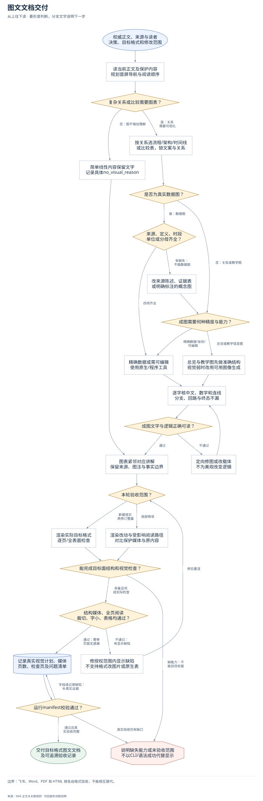
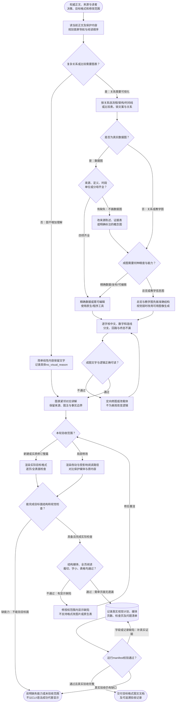

# 图文文档交付：完整流程

输入：权威正文与来源；读者、决策和目标格式；流程关系或可信数据。

交付：图文一致的正式文档；对应章节的图表；visual_contract 与验收记录。

[按原尺寸打开完整流程图](../assets/workflow.svg)

## 按什么顺序做

### 锁定阅读任务与目标格式

先确认读者、决策、权威来源、修改范围和受保护基线。

### 选择视觉或说明无图

按关系复杂度决策，数据图必须有来源、定义、时段和单位。

### 规划信息与成图方式

先锁文案关系与阅读顺序；按精度和成图质量选原生、程序或图像生成。

### 正文就近嵌图

保留事实边界，图紧邻解释；飞书正文图片不被链接或附件代替。

### 按范围渲染并回读

整篇实质修订逐页检查，局部修改检查受影响阅读路径和保护内容。

### 失败修复重渲并记录

修裁切、字小、媒体缺失等，再按目标面检查，填manifest并运行校验。

## 验收

- 视觉类型匹配关系与目标格式
- 数据图四要素齐全，事实状态不混
- 首屏导航、层级、图文位置可读
- AI图中文字数字箭头及分支逐项核
- 实际目标格式结构与媒体回读
- 整篇或局部按范围检查且问题已修复重渲
- manifest校验不替代实际页面验收

飞书、Word、PDF 和 HTML 按各自格式验收，不能相互替代。

## 对应规则

- [SKILL.md](../SKILL.md)
- [references/layout-and-information-design.md](layout-and-information-design.md)
- [references/render-and-acceptance.md](render-and-acceptance.md)
- [references/team-setup.md](team-setup.md)
- [references/visual-decision-matrix.md](visual-decision-matrix.md)

可编辑的流程源码

