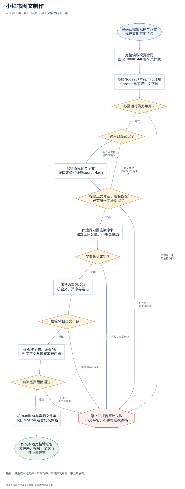
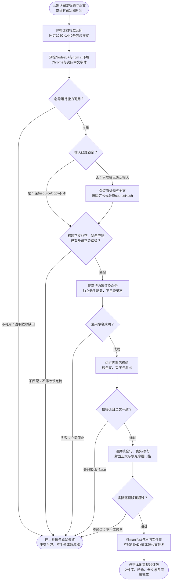

# 小红书图文制作：完整流程

输入：已锁定 source.json；完整标题与正文；匹配的 sourceHash。

交付：按顺序的 NN.png；manifest 与验证结果；正文一致性和填充率。

[按原尺寸打开完整流程图](../assets/workflow.svg)

## 按什么顺序做

### 读取锁定视觉合同

完整读visual-contract，默认沿用备忘录模板，未授权不改样式。

### 预检运行依赖

Node20+、Playwright、独立无头Chrome与中文字体；不复用登录浏览器。

### 准备并核对锁定输入

新输入按标题与去空白正文计算哈希；已锁定文件不得改写。

### 调用内置渲染和校验

只运行随包生产命令，任一步失败立即停，不返回半包或手工修复。

### 检查全文与逐页版面

全句与表行不拆，封面含正文，长文填充率达硬门槛。

### 交付验证包

仅声明产物文件；返回路径、文件顺序、哈希、exactText及每页填充率。

## 验收

- source.json与copy.json锁定后不改
- 只用内置渲染器及校验器
- 任一失败立即停，不返回部分包
- exactText、sourceHash及全文顺序一致
- 零溢出、完整句/表行与逐页fillRatio门槛
- 只返回合同声明文件集

只生成本地文件；不写飞书、不打开发布面、不公开发布。

## 对应规则

- [SKILL.md](../SKILL.md)
- [references/team-setup.md](team-setup.md)
- [references/visual-contract.md](visual-contract.md)

可编辑的流程源码

