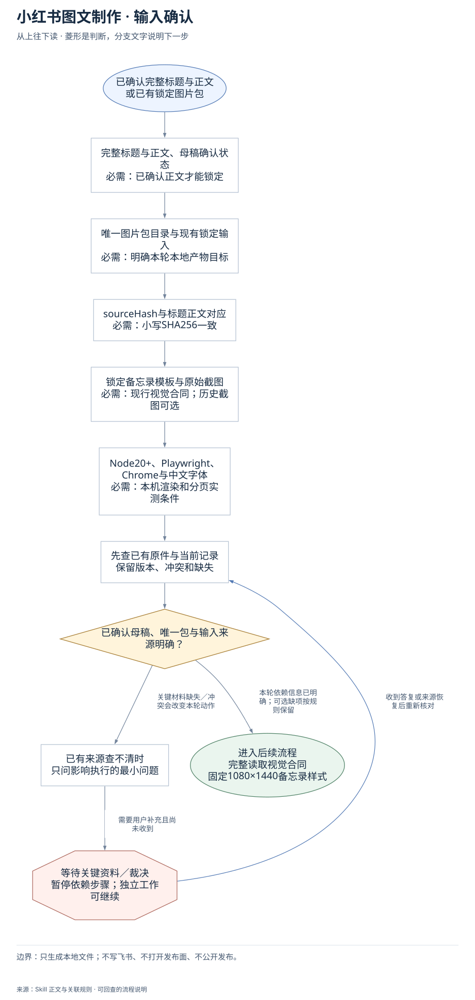

# 小红书图文制作：完整执行流程

先核对具体输入；已有材料能查明的直接读取，关键缺失或冲突才补充确认。沿完整图查看后续处理、失败去向与交付。

交付：按顺序的 NN.png；manifest 与验证结果；正文一致性和填充率。

## 执行前确认哪些信息

| 输入 | 何时需要 | 从哪里取得 | 缺失或冲突怎么处理 |
| --- | --- | --- | --- |
| 完整标题与正文、母稿确认状态 | 必需：已确认正文才能锁定 | 优先当前成员已确认母稿，标题非空且正文完整；未锁定先按公式准备 | 未确认仅索取唯一完整母稿；不得用摘要、改稿或补写代替 |
| 唯一图片包目录与现有锁定输入 | 必需：明确本轮本地产物目标 | 读package-dir/source.json及已有copy.json，保留身份字段；核是否重生成原包 | 目录或版本冲突先定位，不误写其他包，不发明飞书身份字段 |
| sourceHash与标题正文对应 | 必需：小写SHA256一致 | 按title.trim加换行加去空白body的UTF8公式核hash，已锁定文件只读 | 已锁定hash不符停止报告，不能修改源稿或copy使之通过 |
| 锁定备忘录模板与原始截图 | 必需：现行视觉合同；历史截图可选 | 完整读1080×1440合同，用户提供截图时额外对照；不默认换海报或卡片风 | 缺历史截图不阻塞；改模板须有当前明确授权且不能替代内置渲染器 |
| Node20+、Playwright、Chrome与中文字体 | 必需：本机渲染和分页实测条件 | 从当前安装目录npm ci；发现或显式给Chrome路径；使用独立无头配置和真实字体 | 能力缺失明确补哪个依赖；不复用登录浏览器，不保证未经验证平台支持 |

## 输入确认、补齐与返回

[按原尺寸查看输入确认图](../assets/input-confirmation.svg)

## 完整执行、判断与异常去向

[按原尺寸打开完整执行图](../assets/workflow.svg)

## 每一步具体怎么做

### 输入与范围

**1. 已确认完整标题与正文；或已有锁定图片包**

接收成员已确认的完整标题/正文或原锁定图片包；先定位唯一包目录与版本，旧包再渲染不修改source.json或copy.json。

下一步：完整标题与正文、母稿确认状态；必需：已确认正文才能锁定。

依据：[SKILL.md](../SKILL.md) 中的“Locked input”。

**2. 完整标题与正文、母稿确认状态；必需：已确认正文才能锁定**

优先当前成员已确认母稿，标题非空且正文完整；未锁定先按公式准备；缺失处理：未确认仅索取唯一完整母稿；不得用摘要、改稿或补写代替

下一步：唯一图片包目录与现有锁定输入；必需：明确本轮本地产物目标。

依据：[SKILL.md](../SKILL.md) 中的“Before locking a new input”。

**3. 唯一图片包目录与现有锁定输入；必需：明确本轮本地产物目标**

读package-dir/source.json及已有copy.json，保留身份字段；核是否重生成原包；缺失处理：目录或版本冲突先定位，不误写其他包，不发明飞书身份字段

下一步：sourceHash与标题正文对应；必需：小写SHA256一致。

依据：[SKILL.md](../SKILL.md) 中的“Locked input”。

**4. sourceHash与标题正文对应；必需：小写SHA256一致**

按title.trim加换行加去空白body的UTF8公式核hash，已锁定文件只读；缺失处理：已锁定hash不符停止报告，不能修改源稿或copy使之通过

下一步：锁定备忘录模板与原始截图；必需：现行视觉合同；历史截图可选。

依据：[SKILL.md](../SKILL.md) 中的“Before locking a new input”。

**5. 锁定备忘录模板与原始截图；必需：现行视觉合同；历史截图可选**

完整读1080×1440合同，用户提供截图时额外对照；不默认换海报或卡片风；缺失处理：缺历史截图不阻塞；改模板须有当前明确授权且不能替代内置渲染器

下一步：Node20+、Playwright、Chrome与中文字体；必需：本机渲染和分页实测条件。

依据：[SKILL.md](../SKILL.md) 中的“Read [visual-contract.md]”。

**6. Node20+、Playwright、Chrome与中文字体；必需：本机渲染和分页实测条件**

从当前安装目录npm ci；发现或显式给Chrome路径；使用独立无头配置和真实字体；缺失处理：能力缺失明确补哪个依赖；不复用登录浏览器，不保证未经验证平台支持

下一步：先查已有原件与当前记录；保留版本、冲突和缺失。

依据：[SKILL.md](../SKILL.md) 中的“First use and runtime”。

**7. 先查已有原件与当前记录；保留版本、冲突和缺失**

已锁定source/copy保持原字节与顺序，身份字段原样保留；个人信息与发布表面不进入本地渲染任务。

下一步：已确认母稿、唯一包与输入来源明确？。

依据：[SKILL.md](../SKILL.md) 中的“Locked input”。

**8. 已确认母稿、唯一包与输入来源明确？**

只对锁定前材料不清或包目标冲突走补齐；锁定后哈希错误/命令错误走原有停止出口，不能自动改源重试。

下一步：“本轮依赖信息已明确；可选缺项按规则保留” → 完整读取视觉合同；固定1080×1440备忘录样式；“关键材料缺失／冲突会改变本轮动作” → 已有来源查不清时；只问影响执行的最小问题。

依据：[SKILL.md](../SKILL.md) 中的“Locked input”。

**9. 已有来源查不清时；只问影响执行的最小问题**

先核当前包和母稿；只有缺唯一已确认输入时请用户给出对应原件，等待期间不渲染半包。

下一步：“需要用户补充且尚未收到” → 等待关键资料／裁决；暂停依赖步骤；独立工作可继续。

依据：[SKILL.md](../SKILL.md) 中的“Locked input”。

**10. 等待关键资料／裁决；暂停依赖步骤；独立工作可继续**

没有收到补充前，不假定问题已解决；保留已确认材料和具体缺口。先核当前包和母稿；只有缺唯一已确认输入时请用户给出对应原件，等待期间不渲染半包。

下一步：“收到答复或来源恢复后重新核对” → 先查已有原件与当前记录；保留版本、冲突和缺失。

依据：[SKILL.md](../SKILL.md) 中的“Locked input”。

### 执行与核验

**1. 完整读取视觉合同；固定1080×1440备忘录样式**

在图片工作前完整读固定备忘录合同：1080×1440白纸、深灰文章单栏与五个工具控件；提供原截图时额外对照，不改海报/卡片风。

下一步：预检Node20+与npm ci环境；Chrome与实际中文字体。

依据：[references/visual-contract.md](visual-contract.md) 中的“Required appearance”。

**2. 预检Node20+与npm ci环境；Chrome与实际中文字体**

检查Node≥20、按锁文件安装的Playwright、当前Chrome路径及可用中文字体；分页使用本轮实际字体测量，独立无头配置不复用登录态。

下一步：必需运行能力可用？。

依据：[SKILL.md](../SKILL.md) 中的“First use and runtime”。

**3. 必需运行能力可用？**

真实渲染所需运行时、浏览器和字体可用才继续；任一缺失明确具体依赖，停止图片生成而不交半包或凭配置声称渲染通过。

下一步：“不可用：说明依赖缺口” → 停止并报告原始失败；不交半包、不手修或改源稿；“可用” → 输入已经锁定？。

依据：[SKILL.md](../SKILL.md) 中的“First use and runtime”。

**4. 输入已经锁定？**

已有source/copy锁定则只核内容与hash，不能重写；新输入必须是成员确认的完整母稿，先按固定公式准备sourceHash后锁定。

下一步：“是：保持source/copy不动” → 标题正文非空、哈希匹配；已有身份字段保留？；“否：只准备已确认输入” → 保留原标题与全文；按固定公式计算sourceHash。

依据：[SKILL.md](../SKILL.md) 中的“Locked input”。

**5. 保留原标题与全文；按固定公式计算sourceHash**

保留原标题和完整正文，按UTF-8计算小写SHA256(title.trim()+换行+body去空白后trim)，保留已提供身份字段，不自行生成飞书记录ID。

下一步：标题正文非空、哈希匹配；已有身份字段保留？。

依据：[SKILL.md](../SKILL.md) 中的“Before locking a new input”。

**6. 标题正文非空、哈希匹配；已有身份字段保留？**

核标题、正文均非空，小写SHA256与固定公式一致，身份字段未丢；锁定后任何不匹配立即报告，不改源稿或copy凑校验。

下一步：“不匹配：不得改锁定稿” → 停止并报告原始失败；不交半包、不手修或改源稿；“匹配” → 仅运行内置渲染命令；独立无头配置，不用登录态。

依据：[SKILL.md](../SKILL.md) 中的“Locked input”。

**7. 渲染命令成功？**

检查内置渲染命令真实退出和原始错误；失败立即停，不手工重排或偷偷换渲染器；成功后才运行包校验。

下一步：“失败：立即停止” → 停止并报告原始失败；不交半包、不手修或改源稿；“成功” → 运行内置包校验；核全文、页序与溢出。

依据：[SKILL.md](../SKILL.md) 中的“Stop immediately if either command fails”。

**8. 内置分页按最终字体测量；完整句／列表项／表行不断开**

封面标题下含第一完整正文块；长文全局优化分页且原文可逐字重组，表宽超四列分组重复键列和真实表头；只清理渲染器所属旧文件。

下一步：渲染命令成功？。

依据：[references/visual-contract.md](visual-contract.md) 中的“Required appearance”。

### 交付与验收

**1. 仅运行内置渲染命令；独立无头配置，不用登录态**

只从当前Skill目录运行内置render-package.mjs；Chrome需显式时用对应参数，独立无头浏览器完成测量和分页，不写替代HTML/SVG/截图渲染器。

下一步：内置分页按最终字体测量；完整句／列表项／表行不断开。

依据：[SKILL.md](../SKILL.md) 中的“node scripts/render-package.mjs”。

**2. 运行内置包校验；核全文、页序与溢出**

运行内置validate-package.mjs，核原文与分页重组、页序、溢出、输出和manifest；保留真实validation结果，不用文件存在替代检查。

下一步：校验ok且全文一致？。

依据：[SKILL.md](../SKILL.md) 中的“node scripts/validate-package.mjs”。

**3. 校验ok且全文一致？**

校验退出成功且ok为true，全文exactText与锁定输入一致才逐页视觉检查；任一失败停止，不返回部分页或手工修复包。

下一步：“失败或ok=false” → 停止并报告原始失败；不交半包、不手修或改源稿；“通过” → 逐页核全句、表头/表行；封面正文与填充率硬门槛。

依据：[SKILL.md](../SKILL.md) 中的“Stop immediately if either command fails”。

**4. 逐页核全句、表头/表行；封面正文与填充率硬门槛**

逐页看标题后完整首句、句子边界、列表项、表头/表行和正常换行；宽表只按合同分组重复键列，不漏文/乱序，封面不能只有标题。

下一步：逐页核1080×1440和完整正文；封面／中页／末页填充率。

依据：[references/visual-contract.md](visual-contract.md) 中的“Required appearance”。

**5. 实际逐页版面通过？**

逐页核固定模板和长文填充率硬门，原文可逐字重组；首块放不下或某页低于硬门即不通过，不缩改正文、加装饰或返回近空尾页。

下一步：“不通过：不手工修复” → 停止并报告原始失败；不交半包、不手修或改源稿；“通过” → 核manifest与声明文件集；不加README或替代文件名。

依据：[references/visual-contract.md](visual-contract.md) 中的“Required appearance”。

**6. 核manifest与声明文件集；不加README或替代文件名**

按声明清点锁定输入及pages/pagination/HTML页/NN.png/stats/validation/manifest/final-verification产物，文件按序且不混入README或替代命名。

下一步：清点声明文件与每页结果；sourceHash、exactText、fillRatio。

依据：[SKILL.md](../SKILL.md) 中的“The package directory may contain”。

**7. 仅交本地完整验证包；文件序、哈希、全文与各页填充率**

仅交完整通过校验的本地包路径、顺序文件名、sourceHash、exactText、校验结果及每页fillRatio；不写飞书、不打开发布面、不公开发布。

这是本路径的交付或转交结果。

依据：[SKILL.md](../SKILL.md) 中的“Return the validated package path”。

**8. 停止并报告原始失败；不交半包、不手修或改源稿**

保留原始命令或视觉失败原因和受影响包位置，立即停止；不返回半包，不改已锁定母稿/copy，不手写分页或手工修补产物冒充内置渲染。

此处保留待办与证据，补齐后接续原任务。

依据：[SKILL.md](../SKILL.md) 中的“Stop immediately if either command fails”。

**9. 逐页核1080×1440和完整正文；封面／中页／末页填充率**

长文多页硬门：封面≥0.78、中间≥0.72、末页≥0.67；工具栏/模板固定，无孤表头、断句、漏文、装饰和空封面，任何失败停止不手工修。

下一步：实际逐页版面通过？。

依据：[references/visual-contract.md](visual-contract.md) 中的“Required appearance”。

**10. 清点声明文件与每页结果；sourceHash、exactText、fillRatio**

包内仅锁定输入与声明的renderer产物；报告路径、按序文件名、源hash、全文一致与每页填充率；不写飞书、不打开发布面。

下一步：仅交本地完整验证包；文件序、哈希、全文与各页填充率。

依据：[SKILL.md](../SKILL.md) 中的“The package directory may contain”。

## 验收

- source.json与copy.json锁定后不改
- 只用内置渲染器及校验器
- 任一失败立即停，不返回部分包
- exactText、sourceHash及全文顺序一致
- 零溢出、完整句/表行与逐页fillRatio门槛
- 只返回合同声明文件集

只生成本地文件；不写飞书、不打开发布面、不公开发布。

## 对应规则

- [SKILL.md](../SKILL.md)
- [references/team-setup.md](team-setup.md)
- [references/visual-contract.md](visual-contract.md)

```mermaid
flowchart TB
  input(["已确认完整标题与正文<br/>或已有锁定图片包"])
  contract["完整读取视觉合同<br/>固定1080×1440备忘录样式"]
  runtime["预检Node20+与npm ci环境<br/>Chrome与实际中文字体"]
  ready{"必需运行能力可用？"}
  locked{"输入已经锁定？"}
  prepare["保留原标题与全文<br/>按固定公式计算sourceHash"]
  verify{"标题正文非空、哈希匹配<br/>已有身份字段保留？"}
  render["仅运行内置渲染命令<br/>独立无头配置，不用登录态"]
  rendered{"渲染命令成功？"}
  validate["运行内置包校验<br/>核全文、页序与溢出"]
  valid{"校验ok且全文一致？"}
  visual["逐页核全句、表头/表行<br/>封面正文与填充率硬门槛"]
  visualok{"实际逐页版面通过？"}
  artifacts["核manifest与声明文件集<br/>不加README或替代文件名"]
  done(["仅交本地完整验证包<br/>文件序、哈希、全文与各页填充率"])
  stop(["停止并报告原始失败<br/>不交半包、不手修或改源稿"])
  i_master["完整标题与正文、母稿确认状态<br/>必需：已确认正文才能锁定"]
  i_package["唯一图片包目录与现有锁定输入<br/>必需：明确本轮本地产物目标"]
  i_hash["sourceHash与标题正文对应<br/>必需：小写SHA256一致"]
  i_template["锁定备忘录模板与原始截图<br/>必需：现行视觉合同；历史截图可选"]
  i_runtime["Node20+、Playwright、Chrome与中文字体<br/>必需：本机渲染和分页实测条件"]
  i_existing["先查已有原件与当前记录<br/>保留版本、冲突和缺失"]
  i_ready{"已确认母稿、唯一包与输入来源明确？"}
  i_clarify["已有来源查不清时<br/>只问影响执行的最小问题"]
  i_wait(["等待关键资料／裁决<br/>暂停依赖步骤；独立工作可继续"])
  paginate["内置分页按最终字体测量<br/>完整句／列表项／表行不断开"]
  page_gates["逐页核1080×1440和完整正文<br/>封面／中页／末页填充率"]
  final_manifest["清点声明文件与每页结果<br/>sourceHash、exactText、fillRatio"]
  contract --> runtime
  runtime --> ready
  ready -->|"不可用：说明依赖缺口"| stop
  ready -->|"可用"| locked
  locked -->|"是：保持source/copy不动"| verify
  locked -->|"否：只准备已确认输入"| prepare
  prepare --> verify
  verify -->|"不匹配：不得改锁定稿"| stop
  verify -->|"匹配"| render
  rendered -->|"失败：立即停止"| stop
  rendered -->|"成功"| validate
  validate --> valid
  valid -->|"失败或ok=false"| stop
  valid -->|"通过"| visual
  visualok -->|"不通过：不手工修复"| stop
  visualok -->|"通过"| artifacts
  input --> i_master
  i_master --> i_package
  i_package --> i_hash
  i_hash --> i_template
  i_template --> i_runtime
  i_runtime --> i_existing
  i_existing --> i_ready
  i_ready -->|"本轮依赖信息已明确；可选缺项按规则保留"| contract
  i_ready -->|"关键材料缺失／冲突会改变本轮动作"| i_clarify
  i_clarify -->|"需要用户补充且尚未收到"| i_wait
  i_wait -->|"收到答复或来源恢复后重新核对"| i_existing
  render --> paginate
  paginate --> rendered
  visual --> page_gates
  page_gates --> visualok
  artifacts --> final_manifest
  final_manifest --> done
```

可编辑的完整流程源码

